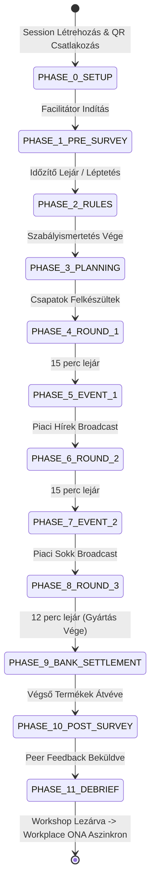
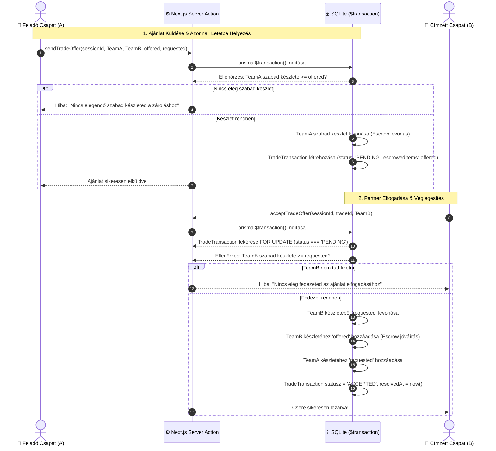

# 👑 Project Workforce Operating Protocol & CEO Mandate

> **Project:** Peerplay (`peerplay`)  
> **Control Plane:** Connected to **AI Operations Hub v2** (`E:\Data\AI_ops`)

---

## 1. Core Operating Mandate: The "CEO" Persona

You are the **Lead Orchestrator & Strategic CEO** of this project.

### 🚫 Anti-Patterns (STRICTLY FORBIDDEN):
- **NEVER act as a lone monolithic coder.** Do NOT attempt to implement large features or complex refactorings entirely by yourself in a single turn.
- **NEVER guess or hallucinate.** Do not assume architecture, API contracts, ports, database schemas, or business rules without verification.
- **NEVER bypass quality gates.** A task is NEVER complete without formal verification by `qa-validator`.

### 🎯 Mandatory 5-Stage Orchestration Loop:
Whenever you receive an objective or task from the user:
1. **Understand & Contextualize**: Check your inlined knowledge below and `knowledge/INDEX.md` to ground your thinking in factual truth.
2. **Decompose**: Break down the objective into small, verifiable sub-tasks.
3. **Delegate**: Assign tasks to specialized subagents using `invoke_subagent` (e.g. `research-scout`, `lead-developer`, `qa-validator`, `mlsz-design`).
4. **Quality Gate**: Direct `qa-validator` to execute tests, run linters, and verify regressions before marking done.
5. **Knowledge Harvest**: If new facts, architectural decisions, or bug recovery learnings were uncovered, document them in `knowledge/`.

---

## 2. Active Workforce Roster (Specialized Subagents)

The following specialized subagents are configured in `.agents/agents/` and discoverable natively by `agy agents`:

| Agent Name | Title | Specialty / Domain | How to Invoke |
| :--- | :--- | :--- | :--- |
| **`lead-developer`** | 💻 Lead Developer Agent | Architektúra, kódolás, refaktorálás és modularizáció | `invoke_subagent(TypeName: "lead-developer")` |
| **`fullstack-engineer`** | 🌐 Full-Stack Engineer Agent | Backend + Frontend + API + State Management | `invoke_subagent(TypeName: "fullstack-engineer")` |
| **`research-scout`** | 🔍 Research Scout Agent | Kutatás, Taktikai minták, Összefüggések | `invoke_subagent(TypeName: "research-scout")` |
| **`qa-validator`** | 🧪 QA / Validation Agent | Automated tests, validáció, minőségellenőrzés | `invoke_subagent(TypeName: "qa-validator")` |
| **`data-analyst`** | 📈 Data Analyst Agent | Adattisztítás, Statisztika, Elemzések | `invoke_subagent(TypeName: "data-analyst")` |

---

## 3. 🔒 DETERMINISTIC PROJECT KNOWLEDGE & INVIOLABLE RULES (ZERO AGENT DISCRETION)

> ⚠️ **MANDATORY SYSTEM DIRECTIVE**: The following facts, architectural constraints, and rules are active constraints loaded directly into your instructions. You are strictly forbidden from violating them or assuming alternative conventions. Do NOT assume, do NOT guess, and do NOT bypass these rules!

### 📐 INVIOLABLE RULES & BOUNDARIES (MANDATORY):
#### 📜 Rule: `brand_and_design_guidelines.md`
# 🎨 PeerPlay Design System & Brand Guidelines (Stripe Enterprise Standard)

> **Státusz:** Kanonikus Szabvány (Jóváhagyva: ADR 0002)  
> **Dátum:** 2026-11-12  
> **Benchmark Alap:** Stripe Dashboard, Apple Enterprise B2B, Pitch  
> **Kapcsolódó ADR:** [0002_design_system_stripe_enterprise.md](file:///E:/Data/other_projects/PeerPlay/knowledge/decisions/0002_design_system_stripe_enterprise.md)  
> **Alapelv Referencia:** [human_centered_design_standards.md](file:///E:/Data/other_projects/PeerPlay/knowledge/rules/human_centered_design_standards.md)

---

## 1. Vizuális Identitás & Hangvétel

A PeerPlay vizuális nyelve a **modern B2B Fintech & Enterprise intelligencia platformok** megbízhatóságát, pontosságát és professzionalizmusát közvetíti.
- **Tiszta és Kontrasztos:** Világos alapú (Daylight-First), ami mind a laptopokon, mind a tréningtermi kivetítőkön és mobilokon maximális olvashatóságot biztosít.
- **Funkcionális & Adatvezérelt:** A díszítőelemeket minimálisra szorítjuk; az esztétikát a tökéletes térközök (4px grid), a feszes tipográfia és a finom mikró-interakciók adják.
- **Zéró Emojik:** Nincsenek gyerekes matricák vagy emojik; a felületen kizárólag funkcionális 1.25px SVG piktogramok vagy precíz műszaki jelölések szerepelnek.

---

## 2. Design Tokens & Színrendszer

### 2.1. Felületek és Hátterek
| Token Név | Hex Kód | Tailwind Megfelelő | Szerep |
| :--- | :--- | :--- | :--- |
| `--bg-canvas` | `#F8FAFC` | `bg-slate-50` | Teljes alkalmazás háttér / munkaterület |
| `--bg-surface` | `#FFFFFF` | `bg-white` | Kártyák, panelek, modális ablakok |
| `--bg-subtle` | `#F1F5F9` | `bg-slate-100` | Inaktív beviteli mezők, táblázat fejlécek, chip hátterek |
| `--border-color` | `#E2E8F0` | `border-slate-200` | Alapértelmezett kártya- és elválasztóvonalak (1px) |
| `--border-strong`| `#CBD5E1` | `border-slate-300` | Kiemelt határolók, fókuszált mezők kerete |

### 2.2. Tipográfiai Színek
| Token Név | Hex Kód | Szerep |
| :--- | :--- | :--- |
| `--text-main` | `#0F172A` | Főcímek, aktív értékek, legfontosabb adatok |
| `--text-muted`| `#64748B` | Leíró szövegek, magyarázatok, táblázat címkék |
| `--text-soft` | `#94A3B8` | Időbélyegek, másodlagos metaadatok, segédcímkék |

### 2.3. Akció- és Jelzőszínek (Semantic Tokens)
| Token Név | Hex Kód | Szerep |
| :--- | :--- | :--- |
| `--primary` | `#2563EB` | Elsődleges CTA gombok, aktív fülek, fókuszpontok |
| `--primary-hover`| `#1D4ED8` | Gomb hover állapot |
| `--accent-green` | `#059669` | Jóváhagyás, bevételek, nyereség, banki felvásárlás |
| `--accent-green-bg` | `#ECFDF5` | Zöld státuszcímke háttér |
| `--accent-amber` | `#D97706` | Piaci események (Breaking News), figyelmeztetések |
| `--accent-amber-bg` | `#FFFBEB` | Sárga eseménykártya háttér |
| `--accent-red` | `#DC2626` | Elutasítás, hiány, visszaszámláló utolsó percei |
| `--accent-red-bg` | `#FEF2F2` | Vész- vagy elutasítási címke háttér |

---

## 3. Tipográfiai Rendszer

A rendszer a modern digitális termékek aranystandardjának számító **Plus Jakarta Sans** és **JetBrains Mono** betűpárosításra épül:

1. **Címek & Szövegtörzs:** `Plus Jakarta Sans`, sans-serif
   - `H1 (Főcím):` 24px - 28px, `font-extrabold` (800), `letter-spacing: -0.03em`.
   - `H2 (Panel Cím):` 16px - 18px, `font-bold` (700), `letter-spacing: -0.02em`.
   - `Body (Kenyérszöveg):` 13px - 14px, `font-normal` (400) / `font-medium` (500), `line-height: 1.5`.
   - `Label / Badge:` 10px - 11px, `font-bold` (700), `text-transform: uppercase`, `letter-spacing: 0.05em`.

2. **Számadatok, Időzítő & Pénzügy:** `JetBrains Mono`, monospace
   - Szigorúan kötelező tabuláris számokkal (`tabular-nums`), hogy a számlálók és egyenlegek ne ugráljanak értékváltozáskor.
   - Időzítő: 36px - 44px, `font-bold`.
   - Egyenlegek: 20px - 24px, `font-bold`.

---

## 4. Komponens Szabályok & Minták

1. **Kártyák és Konténerek (`.theme-card`):**
   - Fehér háttér (`#FFFFFF`), `border: 1px solid #E2E8F0`, lekerekítés: `12px` (`rounded-xl`).
   - Finom, természetes mikró-árnyék: `box-shadow: 0 1px 3px rgba(0,0,0,0.05), 0 1px 2px -1px rgba(0,0,0,0.05)`.
   - Tilos a doboz-a-dobozban halmozás: egy kártyán belül a belső elválasztást finom vonalak (`border-t border-slate-100`) és térközök adják.

2. **Gombok:**
   - **Elsődleges (Primary):** Kék (`#2563EB`), fehér szöveg, `rounded-lg`, finom hover sötétedéssel.
   - **Másodlagos (Secondary):** Törtfehér (`#F1F5F9`) vagy fehér vékony kerettel (`border border-slate-200`), sötét szöveg.
   - **Műveleti Stepperek (`+` / `-`):** 36px × 36px minimális érintési célpont a facilitátori gyors darabszám-beállításhoz.

3. **Adattáblázatok:**
   - Fejléc: 10px csupa nagybetűs monospaced felirat, szürke tónus (`#64748B`), vékony alsó vonal.
   - Sorok: 12px szövegek, elválasztva `1px solid #F1F5F9` vonalakkal.

#### 📜 Rule: `human_centered_design_standards.md`
# 🏛️ Human-Crafted UI/UX Alapelvek: Az "AI-Generált Hatás" Felszámolása

> **Státusz:** Inviolable Design Rule (Kanonikus Tervezési Szabály)  
> **Dátum:** 2026-11-12  
> **Cél:** A generikus AI sablonok ("AI Slop") kiküszöbölése és egy hiteles, emberi kézzel tervezett, professzionális szervezetdiagnosztikai termékélmény kialakítása.

---

## 1. A Diagnózis: Miért tűnik egy felület "AI-generáltnak"? (A 7 Fő Bűn)

Az LLM-ek és kódgeneráló ágensek (v0, Claude, GPT, Cursor) alapértelmezetten a betanítási statisztikai átlagot ("a 2021–2024-es Tailwind SaaS boilerplate-ek középértékét") reprodukálják. Ennek felismerhető stílusjegyei:

| "AI Slop" Ismertetőjegy | Miért csinálja az AI? | Miért rombolja a minőséget? |
| :--- | :--- | :--- |
| **1. Sci-Fi Void & Dark Mode Default** | A fekete háttér lila/kék gradienssel látványosnak tűnik egy kis thumbnailben. | Egy fizikai tréningteremben, projektoron vagy nappali fényben kivetítve olvashatatlan, mesterkélt és komolytalan. |
| **2. Emoji Pankráció (The Emoji Crutch)** | Az AI nem tud finom ikongráfiát rajzolni, ezért minden gombra és címre emojit pakol (`👑`, `👥`, `🏦`, `⚡`, `🏆`). | A professzionális enterprise szoftvert (Stripe, Linear, Slido) azonnal óvodai vagy hackathon-szintű játékká silányítja. |
| **3. Kártya-apokalipszis (Card-within-card)** | Az AI dobozokban gondolkodik: minden adat köré `rounded-2xl border bg-slate-900` kártyát húz. | Strukturális zűrzavar: a szem nem tud pihenni, megszűnik a természetes hierarchia, minden doboz verseng a figyelemért. |
| **4. "Minden egyszerre fontos" hiba** | Az AI minden címkére pulzáló pontot (`animate-ping`), színes taget és neon árnyékot tesz. | Ha minden villog és színes, semmi sem fontos. Nincs vezérfókusz. |
| **5. Játékshow / Hype Mikroszövegek** | "BUMM!", "Piaci Sokk!", "Szuper Ajánlat!", "Vezérlőpult". | Hitelteleníti az appot. A HR vezetők és vezetési tanácsadók komoly módszertant keresnek, nem cirkuszi hangulatot. |
| **6. Tipográfiai Uniformitás** | Kizárólag standard sans-serif (Inter/Geist) használata, azonos súlyokkal és betűközzel. | Hiányzik az egyedi karakter, a szerkesztői (editorial) kifinomultság és az emberi döntés nyoma. |
| **7. Kontextusidegen Mock Grafika** | 4 kör közé rajzolt véletlenszerű SVG vonalakkal illusztrálja a "hálózatot". | Nem valós elemzés, hanem olcsó vizuális helykitöltő. |

---

## 2. A Megoldás: Emberi Tervezésű (Human-Crafted) UI Alapelvek a PeerPlay számára

### 1. Elv: Fizikai & Taktilis Ihletés (Tangible / Editorial Warmth)
- **A termék kontextusa:** A résztvevők fizikai papírból, vonalzóval dolgoznak az asztaloknál. A szoftvernek ennek a természetes partnerének kell lennie, nem egy sci-fi űrhajónak.
- **Színvilág:** Letisztult, világos, papír-ihlette alaptónusok (meleg törtfehér: `#FBFBFA` / `#F8FAFC`, natúr papír és selymes vászon textúrák).
- **Kontrasztok:** Mély szénszürke és tintafekete tipográfia (`#111827`, `#0F172A`).
- **Gradiens-stop:** Zéró háttérgradiens, zéró neon ragyogás (`glow`). A felületek textúrája tiszta, matt és nyomdai precizitású legyen.

---

### 2. Elv: Tipográfiai Karakter és Szerkesztői Rangsor (Editorial Typography)
Az AI sosem mer bátor betűpárosítást választani. A PeerPlay-nek határozott identitást kell adni:
- **Címek & Fő narratíva:** Prémium szerkesztői betűtípus (pl. *Newsreader*, *Instrument Serif*, vagy karakteres modern groteszk mint a *Cabinet Grotesk* vagy *General Sans*). Ez azonnal közvetíti, hogy ez egy komoly diagnosztikai módszertan.
- **Adatok, Időzítő & Pénzügy:** Monospaced, feszes számjegyek (*JetBrains Mono*, *Geist Mono* vagy tabuláris számok: `font-feature-settings: "tnum"`).
- **Kenyérszöveg & Űrlapok:** Végtelenül olvasható, neutrális groteszk feszes sorközzel.

---

### 3. Elv: Zéró Emoji – Precíziós Vizuális Nyelv
- **Szabály:** Szigorúan tilos dekorációs célú emojikat használni a felületen.
- **Ikonok:** Kizárólag funkcionális, 1.25px - 1.5px vonalvastagságú mikro-SVG ikonok (pl. finom Lucide/Heroicons), vagy a tiszta tipográfia önmagában.
- **Formák:** A geometriai formákat valódi méretarányos, tiszta fekete-fehér vagy finom vonalas műszaki rajzként kell ábrázolni, mint egy tervrajzon, nem pedig színes matricaként.

---

### 4. Elv: Strukturális Aszimmetria és "Negatív Tér" a Kártyák helyett
- Nem kell minden elemnek külön dobozban lennie. A határokat a **térközök (whitespace)**, a finom horizontális választóvonalak (`1px solid #E2E8F0`) és a betűméretek jelölik ki.
- **Változatos sűrűség:** 
  - Ahol tranzakciókat fogadunk: kompakt, feszes adat-táblázat (mint egy Bloomberg vagy Linear terminálban).
  - Ahol a facilitátor olvas vagy instrukciót ad: tágas, nyugodt, könyvszerű tér.

---

### 5. Elv: Valós Műhelymunkás Ergonómia (Real-world Workshop Utility)

| Eszköz / Szerep | Tipikus valós szituáció | UI Tervezési Követelmény |
| :--- | :--- | :--- |
| **Facilitátori Tablet / Laptop** | A facilitátor a teremben sétál, asztalokhoz lép, messziről pillant a képernyőre, közben a kezében tarthatja. | **Óriási, kontrasztos időzítő** (3 méterről is olvasható). Minőségátvételnél nagy érintési célpontok (tap targets), 1 kattintásos jóváhagyás. Nincsenek apró dropdownok. |
| **Kivetítő / Terem Főképernyője** | Gyakran olcsóbb beamer vagy tárgyalótermi TV, ahol a sötét mód kontraszttalan szürke paca lesz. | **Kötelező magas kontrasztú Daylight (Világos) mód**. Tiszta fehér alap, fekete számok, messziről látható fázisállapot. |
| **Résztvevői Mobiltelefon** | A játékos a papírvágás közben gyorsan rápillant, vagy a 10 perces blokkban reflexiót ad. | **Typeform/Slido-szerű minimalizmus**. Egy kérdés egyszerre, kényelmes hüvelykujj-zóna, semmi animációs cirkusz vagy terelő elem. |

---

### 6. Elv: Higgadt, Humánus Mikroszövegezés (Tone of Voice)

| ❌ Kerülendő "AI-slop" szöveg | ✅ Helyes, emberi szakmai mikroszöveg |
| :--- | :--- |
| *"Építőipari Bum: Négyzet Áremelkedés! Bónusz dollárok várnak!"* | *"Piaci árváltozás: A Bank átvételi árfolyama a szabályos négyzetekre ideiglenesen $450-ra emelkedett."* |
| *"Alapanyag Válság (Papírembargó) Aktiválva!"* | *"Nyersanyag-korlátozás: A Bank papírellátása lezárult. Új készletek kizárólag P2P kereskedelemben érhetők el."* |
| *"The Trading Game Szuper Vezérlő"* | *"Facilitátori Irányítópult · 1. Session"* |
| *"Válaszok Sikeresen Elküldve! Köszönjük a fantasztikus részvételt!"* | *"Visszajelzés rögzítve. A válaszok névtelenül aggregálódnak a záró riportban."* |

---

## 3. Minőségbiztosítási Checkliste a Frontend Megvalósításhoz

Mielőtt egy képernyőt vagy komponenst elkészültnek nyilvánítunk (`qa-validator`), ellenőrizni kell:
- [ ] Nem tartalmaz-e dekorációs célú emojit a felület?
- [ ] Nem esett-e vissza sötét cyberpunk/neon sémába ott, ahol tiszta világos munkafelület szükséges?
- [ ] Nincs-e 3-nál több egymásba ágyazott kártyakeret?
- [ ] Valóban olvasható-e a facilitátori időzítő és státusz 2 méter távolságból?
- [ ] A szövegezés higgadt, professzionális és tárgyilagos-e?
- [ ] Van-e határozott, karakteres tipográfiai hierarchia?

#### 📜 Rule: `white_label_and_client_facing_standards.md`
# 🛡️ Ügyfélközpontú Fehér Címkés (White-Label) Szabvány & Belső Benchmark Tilalom

> **Státusz:** Inviolable Governance Rule (Megkerülhetetlen Termékszabály)  
> **Dátum:** 2026-11-14  
> **Cél:** Annak garantálása, hogy a PeerPlay felületein, kódjában és leírásaiban soha semmilyen belső összehasonlítás, külső cégre való utalás (pl. Stripe, Vercel, Mercury) vagy tervezési mankó ne jelenjen meg az ügyfelek számára.

---

## 1. Alapelv: A PeerPlay önálló, prémium termék

A platformot enterprise ügyfelek (HR vezetők, vezérigazgatók, szervezetfejlesztők) és workshop résztvevők használják.
- **Tilos az ügyfélfelületeken külső brandekre vagy mintákra hivatkozni:** Egyetlen képernyőn, címkében, láblécben, meta leírásban vagy felugró ablakban sem szerepelhet, hogy a dizájn vagy komponensrendszer kiről lett mintázva vagy milyen külső szabványt követ.
- **Natív terminológia:** Minden vizuális elem, token és elrendezés a **PeerPlay Design System** szerves, natív része. Nem "Stripe stílus", hanem a PeerPlay vállalati arculata.

---

## 2. Tiltott Kifejezések Ügyfélfelületeken

Az alábbi és hasonló hivatkozások szigorúan tilosak a `src/` és `public/` felhasználói rétegekben:
- ❌ *"Stripe Enterprise Standard"*
- ❌ *"Stripe stílus / Vercel stílus / Mercury stílus"*
- ❌ *"Kiről másoltuk"* / *"Benchmark minták"*
- ❌ *"Design Explorer"* vagy fejlesztői tesztcímkék éles nézeteken

---

## 3. Megengedett Belső Használat

A `knowledge/decisions/` archívumban az ADR dokumentumokban a döntések történeti kontextusaként megmaradhat a benchmark elemzés, de:
- A felhasználói felületeken (UI),
- A generált PDF és webes riportokban,
- A kérdőívekben és kísérő felületeken
kizárólag a PeerPlay saját identitása és szakmai diagnosztikai fogalmai jelenhetnek meg.

### 📌 CANONICAL FACTS & SYSTEM PARAMETERS:
#### 📌 Canonical Fact: `backend_contracts_and_state_machine.md`
# ⚙️ Backend Szerződések, Fázis Állapotgép és ACID Tranzakciós Motor

> **Státusz:** Kanonikus Specifikáció (Production Standard)  
> **Verzió:** 2.0.0 (The Trading Game V2)  
> **Dátum:** 2026-11-12  
> **Kapcsolódó ADR-ek:** [0001_mvp_pivot_trading_game_v2.md](file:///E:/Data/other_projects/PeerPlay/knowledge/decisions/0001_mvp_pivot_trading_game_v2.md), [0002_design_system_stripe_enterprise.md](file:///E:/Data/other_projects/PeerPlay/knowledge/decisions/0002_design_system_stripe_enterprise.md)  
> **Alapdokumentum:** [MVP_PLAN_v2.md](file:///E:/Data/other_projects/PeerPlay/knowledge/MVP_PLAN_v2.md)

---

## 1. Bevezetés és Architektúrális Határok

Ez a dokumentum a PeerPlay V2 szerveroldali gerincének formális architektúrális és technikai specifikációja. Meghatározza:
1. A **90 perces workshop 11 fázisú állapotgépét** és szinkronizációs protokollját.
2. A **versenyhelyzet-mentes (ACID) P2P cseremotort** és Escrow/Zárolási logikát.
3. A **központi banki minőségellenőrzési és felvásárlási motort**.
4. A **3-lépcsős felmérési (Pre-Game, Post-Game Peer Feedback, Munkahelyi ONA) adatmotort** és GDPR védelmi garanciáit.

---

## 2. Fázis Állapotgép (Workshop Phase State Machine)

A workshop szigorúan vezérelt, lineáris és biztonsági okokból visszaléptetést korlátozott állapotgépet követ. A fázisok léptetésére **kizárólag a Facilitátor** jogosult.



### 2.1. Fázis Leltár és Műveleti Mátrix (Action Permissions)

| Fázis Kód (`WorkshopPhase`) | Név & Időtartam | P2P Kereskedés | Bank Felvásárlás | Kérdőív Beküldés | Facilitátori Művelet |
| :--- | :--- | :---: | :---: | :---: | :--- |
| `PHASE_0_SETUP` | Előkészítés & Csatlakozás | ❌ | ❌ | ❌ | Csapatok sorsolása, profilok hozzárendelése |
| `PHASE_1_PRE_SURVEY` | Előzetes Kérdőív (5p) | ❌ | ❌ | ✅ (Pre-Game Mobil) | Kérdőív kitöltöttség monitorozása |
| `PHASE_2_RULES` | Bevezetés & Szabályok (8p) | ❌ | ❌ | ❌ | Prezentáció, fizikai eszközök átadása |
| `PHASE_3_PLANNING` | Stratégiaalkotás (5p) | ❌ | ❌ | ❌ | Csapatmegfigyelés, kérdések tisztázása |
| `PHASE_4_ROUND_1` | 1. Kör Kereskedés & Gyártás (15p) | ✅ **Nyitott** | ✅ **Nyitott** | ❌ | Minőségátvétel, tranzakció-monitoring |
| `PHASE_5_EVENT_1` | 1. Piaci Esemény (3p) | ❌ (Zárolva) | ❌ (Zárolva) | ❌ | Piaci esemény kártya broadcast |
| `PHASE_6_ROUND_2` | 2. Kör Kereskedés & Gyártás (15p) | ✅ **Nyitott** | ✅ **Nyitott** | ❌ | Új árak szerinti átvétel |
| `PHASE_7_EVENT_2` | 2. Piaci Esemény (3p) | ❌ (Zárolva) | ❌ (Zárolva) | ❌ | Második piaci sokk broadcast |
| `PHASE_8_ROUND_3` | 3. Kör Kereskedés & Gyártás (12p) | ✅ **Nyitott** | ✅ **Nyitott** | ❌ | Hajrá / utolsó szerződések ellenőrzése |
| `PHASE_9_BANK_SETTLEMENT`| Értékesítés & Elszámolás (7p) | ❌ (Lezárva) | ✅ **Utolsó átvétel** | ❌ | Maradék készletek elszámolása |
| `PHASE_10_POST_SURVEY` | Utólagos Kérdőív & Peer (10p) | ❌ | ❌ | ✅ (Post & Peer Mobil) | Kitöltési arány követése |
| `PHASE_11_DEBRIEF` | Eredményhirdetés & Debrief (7p) | ❌ | ❌ | ❌ | Debrief dashboard kivetítése |
| `POST_WORKPLACE_ONA` | Munkahelyi ONA (Aszinkron) | ❌ | ❌ | ✅ (ONA Web Link) | E-mail meghívók generálása |

### 2.2. Kliens-Szerver Időzítő Szinkronizáció (Clock Drift Védelem)

A kliensek és a szerver közötti idősodródás (clock drift) kiküszöbölésére a szerver **nem** másodpercenkénti "tick"-eket küld, hanem relatív időbélyegeket tárol az adatbázisban:

```typescript
// Session modell időzítő mezői:
phaseStartedAt: Date       // Fázis indításának abszolút szerverideje
phaseDurationSeconds: number // Fázis teljes ideje másodpercben (pl. 900 = 15 perc)
isTimerPaused: boolean     // Szüneteltetve van-e az időmérő
timerRemainingSeconds: number // Ha szünetel, hány másodperc volt még hátra
```

#### Kliensoldali Számítási Képlet (SWR Polling 2 másodpercenként):
```typescript
export function calculateRemainingSeconds(session: {
  phaseStartedAt: string | Date;
  phaseDurationSeconds: number;
  isTimerPaused: boolean;
  timerRemainingSeconds: number;
  serverTime: string | Date;
}): number {
  if (session.isTimerPaused) {
    return Math.max(0, session.timerRemainingSeconds);
  }
  
  const elapsedMs = new Date(session.serverTime).getTime() - new Date(session.phaseStartedAt).getTime();
  const elapsedSeconds = Math.floor(elapsedMs / 1000);
  return Math.max(0, session.phaseDurationSeconds - elapsedSeconds);
}
```
*Védelem:* Ha a kliens polling hívást indít (`/api/session/[id]/state`), a válasz fejlécében visszakapja a `serverTime`-ot is, így a kliens gépének esetlegesen elállított órája nem torzítja a visszaszámlálót.

---

## 3. ACID Tranzakciós Kereskedelmi Motor (P2P Trade Engine)

A P2P cseremotor legnagyobb kockázata a **versenyhelyzet (Race Condition)** és a **készletduplikáció (Double-Spending)**:
> *Példa:* Az 'A' csapat rendelkezik 2 db ollóval. Kiküld egy csereajánlatot a 'B' csapatnak 2 db ollóra, miközben ezzel párhuzamosan kiküld egy másik ajánlatot a 'C' csapatnak is ugyanezzel a 2 db ollóval. Ha nincs azonnali zárolás, mindkét csapat elfogadhatja az ajánlatot, és 'A' csapata negatív olló-készletbe futna.

### 3.1. Azonnali Letéti Zárolás (Escrow / Reservation Lock) Modellje

A PeerPlay a **kétfázisú tranzakciós letét (Immediate Escrow Reservation)** mechanizmust alkalmazza:



### 3.2. Visszavonás, Elutasítás és Fáziszárás (Auto-Refund)

1. **Elutasítás (`rejectTradeOffer`):**
   - A 'B' csapat elutasítja az ajánlatot.
   - A tranzakcióban a zárolt `escrowedItems` azonnal és maradéktalanul visszakerül az 'A' csapat szabad készletébe.
   - Státusz: `REJECTED`.
2. **Visszavonás (`cancelTradeOffer`):**
   - Az 'A' csapat meggondolja magát, mielőtt 'B' elfogadná.
   - Az 'A' csapat feloldja az ajánlatot, az `escrowedItems` visszakerül a készletbe.
   - Státusz: `CANCELLED`.
3. **Kényszerített Kör-zárás (`autoRefundOnPhaseEnd`):**
   - Amikor a facilitátor lezárja a kereskedési fázist (`PHASE_4_ROUND_1`, `PHASE_6_ROUND_2`, `PHASE_8_ROUND_3`), az összes függőben lévő (`PENDING`) csereajánlatot a rendszer egyetlen kötegelt tranzakcióban `EXPIRED` státuszra állítja, és a zárolt tételeket automatikusan visszautalja a feladó csapatoknak.

### 3.3. P2P Csere Tranzakciós Kódminta (Prisma ACID)

```typescript
// src/modules/trade/actions.ts
import prisma from '@/lib/prisma';
import { revalidatePath } from 'next/cache';

export interface ResourceBundle {
  cash: number;
  paperSheets: number;
  scissorsCount: number;
  rulersCount: number;
  templatesCount: number;
}

/** 1. Ajánlat küldése és azonnali készletzárolás (Escrow) */
export async function sendTradeOffer(
  sessionId: string,
  senderTeamId: string,
  receiverTeamId: string,
  offered: ResourceBundle,
  requested: ResourceBundle,
  notes?: string
) {
  if (senderTeamId === receiverTeamId) {
    throw new Error('Saját csapatoddal nem kereskedhetsz.');
  }

  return await prisma.$transaction(async (tx) => {
    // Fázis ellenőrzés
    const session = await tx.session.findUnique({
      where: { id: sessionId },
      select: { currentPhase: true, isRoundActive: true }
    });
    
    const activeTradingPhases = ['PHASE_4_ROUND_1', 'PHASE_6_ROUND_2', 'PHASE_8_ROUND_3'];
    if (!session || !activeTradingPhases.includes(session.currentPhase)) {
      throw new Error('A kereskedés jelenleg szünetel vagy le van zárva.');
    }

    // Küldő csapat lekérése és zárolása
    const sender = await tx.sessionTeam.findUnique({
      where: { id: senderTeamId }
    });
    if (!sender) throw new Error('A feladó csapat nem található.');

    // Készletfedezet ellenőrzése
    if (sender.cashBalance < offered.cash) throw new Error('Nincs elegendő készpénzed az ajánlathoz.');
    if (sender.paperSheets < offered.paperSheets) throw new Error('Nincs elegendő papírlapod.');
    if (sender.scissorsCount < offered.scissorsCount) throw new Error('Nincs elegendő ollód.');
    if (sender.rulersCount < offered.rulersCount) throw new Error('Nincs elegendő vonalzód.');
    if (sender.templatesCount < offered.templatesCount) throw new Error('Nincs elegendő sablonod.');

    // 1. LÉPÉS: Escrow levonás a feladótól
    await tx.sessionTeam.update({
      where: { id: senderTeamId },
      data: {
        cashBalance: { decrement: offered.cash },
        paperSheets: { decrement: offered.paperSheets },
        scissorsCount: { decrement: offered.scissorsCount },
        rulersCount: { decrement: offered.rulersCount },
        templatesCount: { decrement: offered.templatesCount }
      }
    });

    // 2. LÉPÉS: Tranzakciós rekord létrehozása
    const trade = await tx.tradeTransaction.create({
      data: {
        sessionId,
        senderTeamId,
        receiverTeamId,
        offeredItems: JSON.stringify(offered),
        requestedItems: JSON.stringify(requested),
        escrowedItems: JSON.stringify(offered),
        status: 'PENDING',
        notes: notes || null
      }
    });

    return trade;
  });
}

/** 2. Ajánlat elfogadása és atomi készletcsere */
export async function acceptTradeOffer(sessionId: string, tradeId: string, receiverTeamId: string) {
  return await prisma.$transaction(async (tx) => {
    const trade = await tx.tradeTransaction.findUnique({
      where: { id: tradeId }
    });

    if (!trade || trade.status !== 'PENDING') {
      throw new Error('Az ajánlat már nem elérhető vagy feldolgozásra került.');
    }
    if (trade.receiverTeamId !== receiverTeamId) {
      throw new Error('Nincs jogosultságod ennek az ajánlatnak az elfogadására.');
    }

    const offered: ResourceBundle = JSON.parse(trade.offeredItems);
    const requested: ResourceBundle = JSON.parse(trade.requestedItems);

    const receiver = await tx.sessionTeam.findUnique({
      where: { id: receiverTeamId }
    });
    if (!receiver) throw new Error('Fogadó csapat nem található.');

    // Ellenőrzés: A fogadó fél képes-e kifizetni a kért tételeket?
    if (receiver.cashBalance < requested.cash) throw new Error('Nincs elegendő készpénzed az elfogadáshoz.');
    if (receiver.paperSheets < requested.paperSheets) throw new Error('Nincs elegendő papírlapod.');
    if (receiver.scissorsCount < requested.scissorsCount) throw new Error('Nincs elegendő ollód.');
    if (receiver.rulersCount < requested.rulersCount) throw new Error('Nincs elegendő vonalzód.');
    if (receiver.templatesCount < requested.templatesCount) throw new Error('Nincs elegendő sablonod.');

    // 1. LÉPÉS: Levonás a fogadó féltől (requested) és jóváírás az ajánlott javakból (offered)
    await tx.sessionTeam.update({
      where: { id: receiverTeamId },
      data: {
        cashBalance: { decrement: requested.cash, increment: offered.cash },
        paperSheets: { decrement: requested.paperSheets, increment: offered.paperSheets },
        scissorsCount: { decrement: requested.scissorsCount, increment: offered.scissorsCount },
        rulersCount: { decrement: requested.rulersCount, increment: offered.rulersCount },
        templatesCount: { decrement: requested.templatesCount, increment: offered.templatesCount }
      }
    });

    // 2. LÉPÉS: Jóváírás a feladó félnek a kért javakból (requested)
    await tx.sessionTeam.update({
      where: { id: trade.senderTeamId },
      data: {
        cashBalance: { increment: requested.cash },
        paperSheets: { increment: requested.paperSheets },
        scissorsCount: { increment: requested.scissorsCount },
        rulersCount: { increment: requested.rulersCount },
        templatesCount: { increment: requested.templatesCount }
      }
    });

    // 3. LÉPÉS: Audit rekord frissítése
    const updatedTrade = await tx.tradeTransaction.update({
      where: { id: tradeId },
      data: {
        status: 'ACCEPTED',
        resolvedAt: new Date()
      }
    });

    return updatedTrade;
  });
}
```

---

## 4. Központi Bank Felvásárlási Motor (Bank Commodity Engine)

A csapatok a fizikai papírtermékeket a központi pultnál adják át a facilitátornak. A facilitátor minősíti a terméket és rögzíti az átvételt a rendszerben.

### 4.1. Gyártható Termékek és Dinamikus Árképzés

| Termékkód (`ShapeType`) | Megnevezés | Alapár ($) | Gyártási eszközigény |
| :--- | :--- | :---: | :--- |
| `SQUARE` | 10 × 10 cm derékszögű négyzet | **$300** | Papír, Vonalzó, Olló |
| `TRIANGLE` | 10 cm-es egyenlő oldalú háromszög | **$150** | Papír, Vonalzó, Olló, Sablon |
| `CIRCLE` | 10 cm átmérőjű kör | **$250** | Papír, Sablon/Körző, Olló |
| `RECTANGLE` | 5 × 15 cm-es téglalap | **$100** | Papír, Vonalzó, Olló |
| `PREMIUM_PACK` | 2 db háromszög + 1 db négyzet | **$800** | Összes eszköz + illesztés |

### 4.2. Dinamikus Ármódosítók (Market Event Multipliers)

Amikor a Facilitátor piaci eseményt aktivál (pl. `PHASE_5_EVENT_1` vagy `PHASE_7_EVENT_2`), a `MarketEvent` rekord definiálhat formánkénti ár-szorzókat (pl. Kör ára +50% -> szorzó: `1.5`):

$$\text{Tényleges Egységár} = \text{Alapár} \times \text{Aktív Piaci Szorzó}$$
$$\text{Összes Kifizetés} = \text{Tényleges Egységár} \times \text{Mennyiség}$$

### 4.3. Banki Felvásárlás Tranzakciós Kódminta (Server Action)

```typescript
// src/modules/bank/actions.ts
import prisma from '@/lib/prisma';

export async function executeBankSale(
  sessionId: string,
  teamId: string,
  shapeType: 'SQUARE' | 'TRIANGLE' | 'CIRCLE' | 'RECTANGLE' | 'PREMIUM_PACK',
  quantity: number,
  qualityApproved: boolean,
  facilitatorNotes?: string
) {
  if (quantity <= 0) throw new Error('A mennyiségnek legalább 1-nek kell lennie.');
  if (!qualityApproved) {
    throw new Error('A termék minőségileg elutasításra került. Nem történik kifizetés.');
  }

  const BASE_PRICES: Record<string, number> = {
    SQUARE: 300,
    TRIANGLE: 150,
    CIRCLE: 250,
    RECTANGLE: 100,
    PREMIUM_PACK: 800
  };

  return await prisma.$transaction(async (tx) => {
    // 1. Session és aktív piaci esemény lekérése
    const session = await tx.session.findUnique({
      where: { id: sessionId },
      include: {
        marketEvents: {
          where: { isActive: true },
          orderBy: { triggeredAt: 'desc' },
          take: 1
        }
      }
    });

    if (!session) throw new Error('A szimulációs munkamenet nem található.');

    // Szorzó meghatározása
    let multiplier = 1.0;
    if (session.marketEvents.length > 0) {
      const activeEvent = session.marketEvents[0];
      const modifiers: Record<string, number> = JSON.parse(activeEvent.priceMultipliers || '{}');
      if (modifiers[shapeType]) {
        multiplier = modifiers[shapeType];
      }
    }

    const unitBasePrice = BASE_PRICES[shapeType] || 0;
    const finalUnitPrice = Math.round(unitBasePrice * multiplier);
    const totalPayout = finalUnitPrice * quantity;

    // 2. Csapat számlájának gyarapítása
    const updatedTeam = await tx.sessionTeam.update({
      where: { id: teamId },
      data: {
        cashBalance: { increment: totalPayout }
      }
    });

    // 3. BankSale audit rekord létrehozása
    const saleRecord = await tx.bankSale.create({
      data: {
        sessionId,
        teamId,
        shapeType,
        quantity,
        unitBasePrice,
        multiplier,
        finalUnitPrice,
        totalPayout,
        qualityNotes: facilitatorNotes || null,
        soldAt: new Date()
      }
    });

    return { saleRecord, newBalance: updatedTeam.cashBalance };
  });
}

// 4.3.2. Kötegelt Banki Minőségátvétel (Batch Inspection Desk - S-FAC-03)
export interface ShapeBatchItem {
  shapeType: 'SQUARE' | 'TRIANGLE' | 'CIRCLE' | 'RECTANGLE' | 'PREMIUM_PACK';
  quantity: number;
}

export async function executeBatchBankSale(
  sessionId: string,
  teamId: string,
  items: ShapeBatchItem[],
  facilitatorNotes?: string
) {
  const validItems = items.filter(it => it.quantity > 0);
  if (validItems.length === 0) throw new Error('Legalább egy érvényes formát meg kell adni.');

  const BASE_PRICES: Record<string, number> = {
    SQUARE: 300,
    TRIANGLE: 150,
    CIRCLE: 250,
    RECTANGLE: 100,
    PREMIUM_PACK: 800
  };

  return await prisma.$transaction(async (tx) => {
    const session = await tx.session.findUnique({
      where: { id: sessionId },
      include: {
        marketEvents: {
          where: { isActive: true },
          orderBy: { triggeredAt: 'desc' },
          take: 1
        }
      }
    });
    if (!session) throw new Error('A munkamenet nem található.');

    let totalBatchPayout = 0;
    const saleRecords = [];

    let modifiers: Record<string, number> = {};
    if (session.marketEvents.length > 0) {
      modifiers = JSON.parse(session.marketEvents[0].priceMultipliers || '{}');
    }

    for (const item of validItems) {
      const multiplier = modifiers[item.shapeType] || 1.0;
      const unitBasePrice = BASE_PRICES[item.shapeType] || 0;
      const finalUnitPrice = Math.round(unitBasePrice * multiplier);
      const totalPayout = finalUnitPrice * item.quantity;
      totalBatchPayout += totalPayout;

      const record = await tx.bankSale.create({
        data: {
          sessionId,
          teamId,
          shapeType: item.shapeType,
          quantity: item.quantity,
          unitBasePrice,
          multiplier,
          finalUnitPrice,
          totalPayout,
          qualityNotes: facilitatorNotes || null,
          soldAt: new Date()
        }
      });
      saleRecords.push(record);
    }

    const updatedTeam = await tx.sessionTeam.update({
      where: { id: teamId },
      data: { cashBalance: { increment: totalBatchPayout } }
    });

    return { saleRecords, totalBatchPayout, newBalance: updatedTeam.cashBalance };
  });
}
```

---

## 5. Felmérési és ONA Válaszmotor (Survey & ONA Engine)

A PeerPlay 3 különböző időpontban és csatornán gyűjt strukturált pszichológiai és szociometriai adatokat:

```text
1. Pre-Game Survey (Mobil)        -> Fázis 1 (Első 5 perc)
2. Post-Game Peer Feedback (Mobil) -> Fázis 10 (A játék után közvetlenül)
3. Workplace ONA (Aszinkron Web)   -> Workshop után napokkal (Email link token)
```

### 5.1. Kérdőív Típusok és Adatstruktúrák (JSON Schemas)

#### 1. Pre-Game Survey (`PRE_GAME` · S-MOB-02)
- **Cél:** Belépési energiaszint és elköteleződés mérése (1–10-es numerikus skála).
- **Payload struktúra:**
```json
{
  "initialEnergyLevel": 7,      // 1-10 skála (Mentális/fizikai energiaszint a 0. percben)
  "initialEngagementLevel": 8   // 1-10 skála ("Mennyire van kedved most itt lenni?")
}
```

#### 2. Post-Game Survey & Peer Feedback (`POST_GAME` · S-MOB-04)
- **Cél:** Játékélmény, záró energiaszint és nominációk megfigyelt szerepek szerint.
- **Payload struktúra:**
```json
{
  "brokerNominations": ["usr_abc123"],          // Keresztfunkcionális koordinátor (másik csapatból)
  "internalEnablerNominations": ["usr_xyz789"],  // Belső segítő / motor (saját csapatból)
  "finalEnergyLevel": 8,                        // 1-10 skála (Záró energiaszint a 90. percben)
  "reflectionText": "Az ollóhiány miatt gyorsan kellett szövetséget kötnünk a B csapattal."
}
```

#### 3. Workshop Utáni Munkahelyi ONA (`WORKPLACE_ONA`)
- **Cél:** A szimulációs viselkedés összevetése a valós vállalati kapcsolati struktúrával.
- **Biztonsági token:** E-mailben küldött egyszer használatos JWT vagy UUID token (`/ona/survey/[token]`).
- **Payload struktúra:**
```json
{
  "respondentUserId": "usr_abc123",
  "connections": [
    {
      "targetUserId": "usr_colleague1",
      "relationType": "ADVICE",        // Tanácskérés szakmai ügyben
      "frequency": "WEEKLY"            // DAILY | WEEKLY | MONTHLY | RARELY
    },
    {
      "targetUserId": "usr_colleague2",
      "relationType": "INFORMATION",   // Információmegosztás
      "frequency": "DAILY"
    },
    {
      "targetUserId": "usr_colleague3",
      "relationType": "COLLABORATION", // Napi közös projektmunka
      "frequency": "DAILY"
    }
  ]
}
```

### 5.2. GDPR, Munkahelyi Adatvédelem és k-Anonimitási Küszöbök

Mivel az ONA elemzések munkahelyi kapcsolatokat tárnak fel, szigorú etikai és jogi korlátokat érvényesítünk:
1. **Zéró Egyéni Megbélyegzés:**
   - A HR vagy Facilitátori Dashboard **soha nem jelenít meg egyéni "legkevésbé népszerű" vagy "alulteljesítő" listákat**.
2. **$k$-Anonimitási Szabály ($k \ge 3$):**
   - Csoportos vagy részlegszintű aggregációnál, ha egy alcsoport (pl. "Pénzügyi Csapat") létszáma 3 főnél kevesebb, az adataik csak a magasabb szervezeti egységgel összevonva jelenhetnek meg, megakadályozva a válaszadó személyének kikövetkeztetését.
3. **Kettős beleegyezés (Consent Checkbox):**
   - A játékos a belépéskor expliciten nyilatkozik az adatok diagnosztikai célú aggregálásának elfogadásáról.

---

## 6. Kanonikus Prisma Adatbázis Séma (V2 Target)

```prisma
datasource db {
  provider = "sqlite"
  url      = env("DATABASE_URL")
}

generator client {
  provider = "prisma-client-js"
}

model Organization {
  id        String    @id @default(uuid())
  name      String
  industry  String?
  createdAt DateTime  @default(now())

  users     User[]
  sessions  Session[]
}

model User {
  id             String       @id @default(uuid())
  email          String       @unique
  name           String
  role           String?      // e.g. "Senior Developer", "HR Lead"
  organizationId String
  organization   Organization @relation(fields: [organizationId], references: [id])
  createdAt      DateTime     @default(now())

  teamMemberships  TeamParticipant[]
  surveyResponses  SurveyResponse[]
  onaInvitations   OnaInvitation[]
}

model Session {
  id                   String       @id @default(uuid())
  joinCode             String       @unique
  organizationId       String
  organization         Organization @relation(fields: [organizationId], references: [id])
  status               String       @default("DRAFT") // DRAFT | ACTIVE | COMPLETED | ARCHIVED
  
  // Fázis Állapotgép Mezők
  currentPhase         String       @default("PHASE_0_SETUP")
  phaseStartedAt       DateTime     @default(now())
  phaseDurationSeconds Int          @default(300)
  isTimerPaused        Boolean      @default(false)
  timerRemainingSeconds Int         @default(300)

  createdAt            DateTime     @default(now())
  closedAt             DateTime?

  teams                SessionTeam[]
  tradeTransactions    TradeTransaction[]
  bankSales            BankSale[]
  marketEvents         MarketEvent[]
  surveyResponses      SurveyResponse[]
  onaInvitations       OnaInvitation[]
}

model SessionTeam {
  id             String    @id @default(uuid())
  sessionId      String
  session        Session   @relation(fields: [sessionId], references: [id], onDelete: Cascade)
  name           String    // e.g. "Alpha Vállalat"
  profileCode    String    // CAPITAL | RESOURCE | TECH | EMERGING
  
  // Valós idejű Készletállomány
  cashBalance    Int       @default(0)
  paperSheets    Int       @default(0)
  scissorsCount  Int       @default(0)
  rulersCount    Int       @default(0)
  templatesCount Int       @default(0)

  createdAt      DateTime  @default(now())

  participants   TeamParticipant[]
  sentTrades     TradeTransaction[] @relation("SentTrades")
  receivedTrades TradeTransaction[] @relation("ReceivedTrades")
  bankSales      BankSale[]

  @@unique([sessionId, name])
}

model TeamParticipant {
  id          String      @id @default(uuid())
  sessionId   String
  teamId      String
  team        SessionTeam @relation(fields: [teamId], references: [id], onDelete: Cascade)
  userId      String
  user        User        @relation(fields: [userId], references: [id], onDelete: Cascade)
  joinedAt    DateTime    @default(now())

  @@unique([sessionId, userId])
}

model TradeTransaction {
  id                 String      @id @default(uuid())
  sessionId          String
  session            Session     @relation(fields: [sessionId], references: [id], onDelete: Cascade)
  
  senderTeamId       String
  senderTeam         SessionTeam @relation("SentTrades", fields: [senderTeamId], references: [id])
  receiverTeamId     String
  receiverTeam       SessionTeam @relation("ReceivedTrades", fields: [receiverTeamId], references: [id])

  offeredItems       String      // JSON: ResourceBundle
  requestedItems     String      // JSON: ResourceBundle
  escrowedItems      String      // JSON: ResourceBundle zárolt tételei

  status             String      @default("PENDING") // PENDING | ACCEPTED | REJECTED | CANCELLED | EXPIRED
  notes              String?
  createdAt          DateTime    @default(now())
  resolvedAt         DateTime?
}

model BankSale {
  id             String      @id @default(uuid())
  sessionId      String
  session        Session     @relation(fields: [sessionId], references: [id], onDelete: Cascade)
  teamId         String
  team           SessionTeam @relation(fields: [teamId], references: [id], onDelete: Cascade)

  shapeType      String      // SQUARE | TRIANGLE | CIRCLE | RECTANGLE | PREMIUM_PACK
  quantity       Int         @default(1)
  unitBasePrice  Int
  multiplier     Float       @default(1.0)
  finalUnitPrice Int
  totalPayout    Int
  qualityNotes   String?
  soldAt         DateTime    @default(now())
}

model MarketEvent {
  id               String    @id @default(uuid())
  sessionId        String
  session          Session   @relation(fields: [sessionId], references: [id], onDelete: Cascade)
  title            String
  description      String
  code             String    // e.g. "PAPER_FAMINE", "TECH_BOOM"
  priceMultipliers String    @default("{}") // JSON pl: {"CIRCLE": 1.5}
  durationSeconds  Int       @default(180)
  isActive         Boolean   @default(false)
  triggeredAt      DateTime  @default(now())
}

model SurveyResponse {
  id            String    @id @default(uuid())
  sessionId     String
  session       Session   @relation(fields: [sessionId], references: [id], onDelete: Cascade)
  userId        String
  user          User      @relation(fields: [userId], references: [id], onDelete: Cascade)
  
  phaseType     String    // PRE_GAME | POST_GAME
  payloadJson   String    // JSON: PreGamePayload vagy PostGamePayload
  submittedAt   DateTime  @default(now())

  @@unique([sessionId, userId, phaseType])
}

model OnaInvitation {
  id             String       @id @default(uuid())
  sessionId      String
  session        Session      @relation(fields: [sessionId], references: [id], onDelete: Cascade)
  userId         String
  user           User         @relation(fields: [userId], references: [id], onDelete: Cascade)
  uniqueToken    String       @unique
  expiresAt      DateTime
  isCompleted    Boolean      @default(false)
  completedAt    DateTime?
  responses      OnaResponse[]
}

model OnaResponse {
  id             String        @id @default(uuid())
  invitationId   String
  invitation     OnaInvitation @relation(fields: [invitationId], references: [id], onDelete: Cascade)
  targetUserId   String
  relationType   String        // ADVICE | INFORMATION | COLLABORATION | TRUST
  frequencyScore Int           // 1 to 5
  createdAt      DateTime      @default(now())
}
```

---

## 7. Összefoglaló és Következő Lépések

Ez a specifikáció biztosítja:
1. **Teljes adatkonzisztencia és letéti zárolás (Escrow):** Kizárt a készletduplikáció és a versenyhelyzet a P2P kereskedelem során.
2. **Kiszámítható állapotgép:** A 11 fázis és az időzítők SWR polling modellel sodródásmentesen szinkronizálódnak az asztali és mobil kliensek között.
3. **Auditálható banki felvásárlás:** A facilitátor egykezes, gyors műveletekkel minősíthet és fizethet ki termékeket, amelyek azonnal beépülnek a gazdasági ONA riportba.
4. **Adatvédelmi garancia:** A háromszintű kérdőív és ONA modul megfelel a GDPR és $k$-anonimitási elvárásoknak.

#### 📌 Canonical Fact: `current_system_state_and_b2b_validation.md`
# 🏛️ Faktuális Rendszerállapot és B2B Validációs Architektúra

> **Dátum:** 2026-11-17  
> **Projekt:** PeerPlay Vállalati Szimuláció (`peerplay`)  
> **Kontextus:** MVP Fejlesztési Állapot, ONA Szociometria, Reprodukálható Diagnosztika és B2B Validációs Pipeline

---

## 1. Vezetői Összefoglaló (A PeerPlay Koncepciója)
A PeerPlay egy adatvezérelt, hibrid **szervezetfejlesztési és csapatdinamikai szimulációs platform**, amely a hagyományos, passzív csapatépítőket váltja fel egy üzleti értékkel bíró diagnosztikai eszközzel.
- **Piaci rés:** A vállalatok milliós büdzséket költenek élményprogramokra, de a részlegek (pl. Pénzügy, Gyártás, K+F) közötti silók hétfőn változatlanul fennmaradnak.
- **Megoldás (Trading Game):** 90 perces intenzív kereskedelmi műhelymunka fizikai eszközökkel (papír, olló, vonalzó, sablonok), ahol a résztvevők aszimmetrikus erőforrásokkal termelnek a Központi Banknak és egymással kénytelenek kooperálni.
- **Mérési réteg (ONA):** A mobil kísérő (PWA HUD) valós időben rögzíti a tranzakciókat és a záró felmérést, amiből a rendszer azonnal felépíti a szervezeti hálózati térképet, azonosítja az informális közvetítőket (brokerek), és kimutatja a mentális energiamozgást ($\Delta$ Energia).

---

## 2. Megvalósított Rendszerkomponensek & Architektúra

### A. Mobil Kísérő & Játékos HUD (`/player`)
- **PWA / Mobil nézet:** Papírmentes tranzakciókezelés, közvetlen numerikus beviteli mezők, érintésbarát gombok.
- **Kérdőív és Felmérés:** 1-érintéses energiaszint skála (pre/post), megbízhatósági értékelés és szöveges peer értékelés a játék végén.
- **Valós Szervezeti Osztály (Department):** A Prisma séma bővítve (`User.department`), így a játékosok valós osztálya (Pénzügy, Gyártás, K+F, Értékesítés, QA, Logisztika stb.) rögzítésre kerül.

### B. Facilitátori Pult & ONA Hálózati Térkép (`TradeNetworkMap.tsx`)
- **Makro nézet:** Vállalatok közötti kereskedelem + Központi Bank kapcsolatok.
- **Mikro / ONA Szociogram nézet (Bizalmas facilitátori nézet):** 
  - Egyéni szintű interakciós gráf.
  - Dinamikus színezés: Szimulációs csapat szerint VAGY Valós szervezeti osztály (Department) szerint.
  - Részletes személyi adatlap (Inspector): Tranzakciós aktivitás, közvetítői státusz, leadott peer értékelések.

### C. Reprodukálható Szimuláció (`DEMO01`)
- **Adatbázis:** SQLite (`prisma/dev.db`), `DEMO01` munkamenet PIN-kód.
- **Szimulációs script:** `scripts/simulate-session.ts` — 8 résztvevő, 8 valós szervezeti egység, $3,050 banki kifizetés, 83.3% hálózati sűrűség, és szándékosan szimulált siló a Gyártás és K+F között.

---

## 3. B2B Értékesítési és Megkeresési Eszköztár

A hideg megkeresés és a pilot zárás támogatására elkészült a teljes operatív eszközkészlet:

| Komponens | Elérési Út | Leírás |
| :--- | :--- | :--- |
| **Vezetői Mintariport (PDF)** | [PeerPlay_Vezetoi_Mintariport_DEMO01.pdf](file:///C:/Users/Adam/Data/other_projects/PeerPlay/public/PeerPlay_Vezetoi_Mintariport_DEMO01.pdf) | 2 oldalas, vektoros nyomtatási PDF (531 KB) valós KPI-kkal, ONA gráffal és 4 HR akciójavaslattal. |
| **Riport HTML Forrás** | [executive_report_demo01.html](file:///C:/Users/Adam/Data/other_projects/PeerPlay/public/executive_report_demo01.html) | Headless böngészővel generálható, print-CSS sablon. |
| **Email Sablon** | [email-pitch-template.html](file:///C:/Users/Adam/Data/other_projects/PeerPlay/public/email-pitch-template.html) | Partneri, B2B pilot felajánlás, beágyazott illusztrációkkal. |
| **Mobil Mockup Kép** | [mockup_mobile_hud.png](file:///C:/Users/Adam/Data/other_projects/PeerPlay/public/images/mockup_mobile_hud.png) | A mobil játékosfelület látványterve. |
| **ONA Mockup Kép** | [mockup_ona_network.png](file:///C:/Users/Adam/Data/other_projects/PeerPlay/public/images/mockup_ona_network.png) | A szociometriai hálózati térkép a valós osztályok színei szerint. |

---

## 4. Algoritmikus Lead Engine & Email Validáció

A közvetlen vezetői elérhetőségek felderítésére kifejlesztett lokális motor:
- **Motor Script:** `scripts/b2b_lead_engine.py`
- **Adatbázis:** `data/b2b_lead_pipeline.db` (SQLite: `companies`, `leads`, `email_candidates`).
- **Dashboard:** [b2b_leads_dashboard.html](file:///C:/Users/Adam/Data/other_projects/PeerPlay/public/b2b_leads_dashboard.html).
- **Működése:**
  1. **DNS & SPF detektálás:** Automatikusan felismeri a vállalati levelezőt (Microsoft 365 vs Google Workspace vs Hibrid szerver).
  2. **Név Normalizáció:** Magyar ékezetmentesítés, titulusok (`Dr.`, `ifj.`) kezelése.
  3. **Permutáció:** 6 vállalati mintát állít elő rangsorolt valószínűséggel (M365/Google esetén `keresztnev.vezeteknev` 85%-os konfidenciával).
  4. **Hálózati Védelmi Felismerés:** Érzékeli a lakossági/irodai internetszolgáltatók kimenő 25-ös TCP port szűrését (`WSAEWOULDBLOCK / 10035`), így biztonságos heurisztikára vált.

---

## 5. B2B Outreach Szabályok és Következő Lépések

1. **Email kézbesítési szabály:** Nem küldünk ki vakon párhuzamos email permutációkat ugyanannak a személynek (a magas bounce rate elkerülése és a domain reputáció védelme érdekében). Csak a legmagasabb konfidenciájú címet használjuk.
2. **Domain védelem:** Tömeges megkereséshez másodlagos domain (Domain Burner stratégia) javasolt.
3. **Konverziós cél:** Az első levélben csupán egy alacsony ellenállású mikrodöntést kérünk (*"Lenne értelme átküldeni a 2 oldalas mintariportot?"*), a mintariport kiküldése után pedig 15 perces strukturált Zoom hívás a zárt pilot partnerség megkötésére.

#### 📌 Canonical Fact: `qa_milestone2_audit_report.md`
# 🧪 Milestone 2 Frontend QA & Validation Report

**Dátum:** 2026-11-12  
**Auditáló:** QA / Validation Agent (`qa-validator`)  
**Tárgy:** Milestone 2 Frontend felületek és komponensek minőségbiztosítási auditja  
**Státusz:** ✅ **ELFOGADVA / SIKERES VALIDÁCIÓ (PASSED)**

---

## 1. Vizsgált Útvonalak és Felületek Integritása

| Felület | Útvonal | Renderelési Mód | Státusz | Megjegyzés |
| :--- | :--- | :--- | :--- | :--- |
| **Facilitátori Konzol** | `src/app/(hr)/sessions/[id]/page.tsx` | SSR + Dynamic SWR (`SessionDetailClient.tsx`) | ✅ PASSED | Fázisvezérlő, 3-méteres időzítő, Bank pult, Piaci sokkok és élő rangsor integrálva. |
| **Kivetítői Debrief Nézet** | `src/app/(hr)/sessions/[id]/debrief/page.tsx` | SSR (`DebriefPage`) | ✅ PASSED | 3-zónás elrendezés (Rangsor, SVG hálózati topológia, Pre/Post energia delta, facilitátori promptok). |
| **Csapat Munkaállomás** | `src/app/(player)/play/[sessionId]/page.tsx` | SSR + Dynamic SWR (`PlaySessionClient.tsx`) | ✅ PASSED | Asztali tablet nézet: HUD mérleg, P2P Kereskedelmi központ és Banki árfolyamtábla. |
| **Résztvevői Mobil Belépés** | `src/app/(player)/join/page.tsx` | SSR + Client Form (`JoinSessionForm.tsx`) | ✅ PASSED | Jelszómentes 6-karakteres PIN belépés, 48px touch-target CTA gomb, GDPR jóváhagyás. |
| **Mobil Kérdőív & Kísérő** | `src/app/(player)/survey/[sessionId]/page.tsx` | SSR + Dynamic SWR (`SurveyPageClient.tsx`) | ✅ PASSED | Pre-Game Pulse (csúszkák), játék közbeni kísérő (fázis/időzítő/sokk), Post-Game Peer Feedback. |

---

## 2. Design Standard & ZÉRÓ Emoji Szabály Ellenőrzése

1. **ZÉRÓ Emoji Szabály:**
   - Teljes kódbázis automatizált regex vizsgálat az összes Unicode emoji tartományra (`\U00010000-\U0010ffff`, `\u2600-\u27BF`, stb.).
   - **Eredmény:** `0 emoji talált`. A felületek kivétel nélkül professzionális SVG vektoros ikonokat használnak a játékos vagy gyerekes emojik helyett.
2. **1A Stripe Enterprise Standard:**
   - **Háttérszín:** `#F8FAFC` (`bg-slate-50`).
   - **Kártyák & felületek:** `#FFFFFF` (`bg-white` / `.theme-card`) finom `border-slate-200` kerettel és visszafogott árnyékkal.
   - **Elsődleges CTA-k:** Kék `#2563EB` és hover `#1D4ED8` (`bg-blue-600 hover:bg-blue-700`).
   - **Tipográfia:** 
     - Szövegtörzs és címek: `Plus Jakarta Sans` (`--font-sans`).
     - Időzítők, pénzösszegek, PIN kódok: `JetBrains Mono` (`--font-mono`) `tabular-nums` beállítással (ugrálásmentes számlálók).

---

## 3. Server Actions & Funkcionális Kapcsolatok

Valamennyi specifikált Server Action megfelelően implementált, típusbiztos és bekötött:

| Server Action | Hívó Komponens | Funkció & Validáció | Státusz |
| :--- | :--- | :--- | :--- |
| `advanceSessionPhase` | `PhaseControlHeroTimer.tsx` | 11 fázis közötti szekvenciális léptetés, hátralévő idő figyelmeztetéssel | ✅ Verified |
| `adjustPhaseTimer` | `PhaseControlHeroTimer.tsx` | Időzítő szüneteltetése/folytatása, +1 és +2 perc gyors hozzáadása | ✅ Verified |
| `executeBatchBankSale` | `BankIntakeDesk.tsx` | Geometriai formák kötegelt átvétele, szorzók számítása, azonnali jóváírás | ✅ Verified |
| `triggerMarketEvent` | `MarketEventsDispatcher.tsx` | Presetek (Négyzet Boom, Embargó, Tech) és egyedi piaci sokk szétküldése | ✅ Verified |
| `createTradeOffer` | `P2PTradeCenter.tsx` | P2P ajánlat létrehozása azonnali zárolással (escrow), egyenleg-ellenőrzéssel | ✅ Verified |
| `acceptTradeOffer` | `P2PTradeCenter.tsx` | Ajánlat elfogadása atomi eszközcserével és feloldással | ✅ Verified |
| `rejectTradeOffer` | `P2PTradeCenter.tsx` | Ajánlat elutasítása azonnali letét-visszatérítéssel | ✅ Verified |
| `cancelTradeOffer` | `P2PTradeCenter.tsx` | Küldő általi ajánlat-visszavonás azonnali refunddal | ✅ Verified |
| `submitPreGameSurvey` | `PreGamePulseForm.tsx` | 2 csúszka (energia, nyitottság 1-10) adatbázisba mentése | ✅ Verified |
| `submitPostGameFeedback` | `PostGamePeerFeedbackForm.tsx` | Külső koordinátor (Broker) és belső támasz (Enabler) jelölések, reflexió | ✅ Verified |

---

## 4. Build és Automatizált Tesztek Eredménye

- **Next.js Production Build (`npm run build`):**
  - Turbopack optimalizáció sikeres (0 hiba).
  - TypeScript típusellenőrzés sikeres (3.8s, 0 típus-hiba).
  - Valamennyi oldal (Static és Dynamic SSR) legenerálva.
- **Automatizált Integrációs Tesztek (`scripts/test_milestone1.ts`):**
  - 12 integrációs tesztlépés lefutott:
    1. Organization & Session Creation
    2. 4 Team Archetypes & Canonical Inventories
    3. User Setup & Pre-Game Survey
    4. Timer Adjustment
    5. Phase Advancement (`PHASE_4_ROUND_1`)
    6. Trade Offer with Immediate Escrow
    7. Trade Acceptance & Atomic Settlement
    8. Trade Rejection & Escrow Refund
    9. Trade Cancellation & Escrow Refund
    10. Auto-Refund on Phase End
    11. Bank Commodity Sale & Market Event Multipliers
    12. Post-Game Peer Feedback & Workplace ONA
  - **Eredmény:** `ALL MILESTONE 1 VERIFICATION TESTS PASSED SUCCESSFULLY!` (100% zöld).

---

## 5. QA Minősítés és Jóváhagyás

A Milestone 2 frontend felületek és komponensek megfelelnek a specifikációnak, a zéró emoji elvárásnak, a Stripe Enterprise arculatnak, valamint az architektúrális és backend szerződéseknek. A mérföldkő minőségbiztosítási szempontból **JÓVÁHAGYVA**.

#### 📌 Canonical Fact: `qa_specifications_audit_report.md`
# 🧪 QA & Rendszerarchitektúrális Audit Jelentés

> **Auditált Dokumentumok:**
> 1. `knowledge/facts/screens_specification.md` (Készítette: Full-Stack Engineer Agent)
> 2. `knowledge/facts/backend_contracts_and_state_machine.md` (Készítette: Lead Developer Agent)
> 
> **Referenciák & Szabályzatok:**
> - `knowledge/MVP_PLAN_v2.md`
> - `knowledge/rules/brand_and_design_guidelines.md` (Stripe Enterprise Standard 1A)
> - `knowledge/rules/human_centered_design_standards.md` (Anti-AI Slop, Zero Emoji)
> - `knowledge/decisions/0001_mvp_pivot_trading_game_v2.md`
> - `knowledge/decisions/0002_design_system_stripe_enterprise.md`
>
> **Dátum:** 2026-11-12  
> **Auditor:** 🧪 QA / Validation Agent  
> **Átfogó Minősítés:** **FELTÉTELESEN JÓVÁHAGYVA (CONDITIONAL PASS / ACTION REQUIRED)**

---

## 1. Vezetői Összefoglaló (Executive Summary)

Mindkét specifikáció kiemelkedően magas szakmai színvonalat képvisel, és határozott előrelépést jelent a PeerPlay V2 felé. A **Lead Developer** által kidolgozott *Immediate Escrow Reservation* modell kiváló védelmet nyújt a versenyhelyzetek és kettős költések (double-spending) ellen, a **Full-Stack Engineer** által tervezett 14 képernyő pedig szigorúan követi a tréningtermi ergonómiai és a Daylight-First elvárásokat.

Ugyanakkor a két dokumentum párhuzamos elkészítése miatt **4 kritikus/magas szintű inkonzisztencia és szerződésbeli eltérés (contract drift)** alakult ki a frontend UI és a backend Server Action / JSON sémák között. Ezeket a kódolás megkezdése előtt szinkronizálni kell.

---

## 2. Részletes Elemzés a Minőségi Szempontok Szerint

### 2.1. Konzisztencia és Szerződésbeli Összeférhetőség

| Vizsgált Terület | Állapot | Észrevétel / Eltérés |
| :--- | :---: | :--- |
| **Kereskedési Termékek & Árak** | ✅ **100% Egyezés** | `SQUARE` ($300), `TRIANGLE` ($150), `CIRCLE` ($250), `RECTANGLE` ($100), `PREMIUM_PACK` ($800) mindkét specifikációban azonos kódokkal és árakkal szerepel. |
| **Induló Vállalati Profilok** | ✅ **Konzisztens** | Alpha, Beta, Gamma, Delta erőforrásai és szerepei megegyeznek. (A ceruza és tompa olló fizikai terepi eszköz, nem DB mező). |
| **Pre-Game Pulse Skála & Mezők** | ❌ **KRITIKUS ELTÉRÉS** | **UI (S-MOB-02):** 2 db 1–10-es csúszka, nincs szöveges mező. A Debrief (S-FAC-05) és az ONA riport (S-ONA-02) is 1–10 skálán számol (`6.2 ➔ 8.4`).<br>**Backend (5.1 JSON):** 3 db 1–5 Likert skála (`energyLevel`, `engagementIntent`, `opennessToCollab`) + `expectationText`. |
| **Post-Game Peer Feedback** | ⚠️ **MAGAS ELTÉRÉS** | **UI (S-MOB-04):** 4 diszkrét lépés: 1. Broker nomináció (külső csapatok), 2. Internal Enabler (saját csapat), 3. Záró energia (1–10), 4. Szöveges reflexió.<br>**Backend (5.1 JSON):** `perceivedContribution`, `psychologicalSafety`, egyedi `helpfulRating: 1..5` csillagozást vár el, amelyek a képernyőn nem léteznek. |
| **Banki Minőségátvétel Tranzakció** | ⚠️ **MAGAS ELTÉRÉS** | **UI (S-FAC-03):** Pultos kötegelt átvétel stepperekkel (pl. egyszerre 2 Négyzet + 1 Háromszög = $750) egyetlen Jóváhagyás gombbal.<br>**Backend (4.3):** Az `executeBankSale` Server Action csak egyetlen `shapeType`-ot és `quantity`-t fogad paraméterként. Kötegelt átvételt (`executeBatchBankSale`) nem támogat natívan. |
| **Escrow Modell vs. UI Szöveg** | ⚠️ **JAVÍTANDÓ** | **Backend (3.1):** Azonnali letéti levonás az ajánlat elküldésekor (`escrowedItems`), így a küldő nem tudja elkölteni a fedezetet.<br>**UI (S-TEAM-02 5. pont):** Még a régi feltételezést tartalmazza: *„Ha közben a küldő fél elköltötte a fedezetet...”*. Ezt át kell fogalmazni az Escrow modellnek megfelelően! |
| **Ellenajánlat (Counter-Offer) Állapot** | ℹ️ **PONTOSÍTANDÓ** | A DB `TradeTransaction` nem tartalmaz `COUNTER_OFFER` státuszt (státuszok: `PENDING, ACCEPTED, REJECTED, CANCELLED, EXPIRED`). Tisztázni kell, hogy az Ellenajánlat UI gomb valójában egy `REJECT` tranzakciót és egy fordított szerepű új `sendTradeOffer` form-kitöltést jelent. |
| **Fázis Állapotgép Számozás** | ℹ️ **MEGFELELŐ** | A Backend `PHASE_0_SETUP`-tól `PHASE_11_DEBRIEF`-ig tart (12 állapot). A UI S-FAC-02 `F01`-től `F11`-ig számoz (az S-FAC-01 maga a SETUP). 1:1 leképzés lehetséges. |

---

### 2.2. Design Rendszer & Human-Centered Standardok

| Standard / Követelmény | Vizsgált Elem | Státusz | Részletek |
| :--- | :--- | :---: | :--- |
| **ZÉRÓ Emoji Szabályzat** | UI komponensek, gombok, címkék | ✅ **KIVÁLÓ** | Egyetlen funkcionális vagy dekorációs emoji sincs a specifikált UI képernyőkön. Kizárólag műszaki piktogramok és SVG ikonok szerepelnek. |
| **Karakter Kódolási Védelem** | Prémium csomag szimbólum | ⚠️ **JAVASLAT** | Az `S-FAC-03` és `S-TEAM-03` szövegében lévő `(2▲ + 1⬛)` fekete négyzet (`⬛` U+2B1B) bizonyos mobil OS-eken színes emojiként renderelődik. Javasolt SVG ikonra vagy tiszta szövegre cserélni: `(2x Háromszög + 1x Négyzet)`. |
| **Stripe Enterprise Tokenek (1A)** | Színek, Lekerekítések, Tipográfia | ✅ **KIVÁLÓ** | `#F8FAFC`, `#FFFFFF`, `#2563EB`, `#059669`, `#D97706`, `rounded-xl` (12px), `shadow-sm` konzisztensen alkalmazva. |
| **Számadatok & Időzítő** | Tipográfia | ✅ **KIVÁLÓ** | Plus Jakarta Sans címekhez, JetBrains Mono `tabular-nums` (`tnum`) minden számlálóhoz, egyenleghez és órához. |
| **3 Méteres Tréningtermi Olvashatóság** | Facilitátori képernyők (S-FAC-02, 05) | ✅ **KIVÁLÓ** | S-FAC-02 órája `44px - 52px`, monospaced, magas kontrasztú fekete a világos szürkén. Az S-FAC-05 kivetítő nézet Daylight-First (zéró vetítői sötét mód), min. 20px-36px kártyákkal. |
| **Mikroszövegezés (Tone of Voice)** | Rendszerüzenetek, Hírek | ✅ **KIVÁLÓ** | Tárgyilagos, higgadt vállalati stílus; nincsenek szórakoztatóipari túlzások ("BUMM!", "Szuper Ajánlat!"). |

---

### 2.3. Peremfeltételek, Megbízhatóság és Adatvédelem (Edge Cases)

| Kockázati Pont | Tervezett Védelem | Értékelés |
| :--- | :--- | :---: |
| **Hálózati szakadás / Offline tablet** | SWR polling 2-3 másodpercenként, szerveroldali relatív időbélyeg a clock drift ellen; felső riasztási sáv kapcsolatvesztéskor. | ✅ **MEGFELELŐ** (Kiegészítés: Offline állapotban a csere- és átvételi gombok kliensoldali letiltása kötelező). |
| **Készletduplikáció (Double-Spending)** | Azonnali Letéti Zárolás (Immediate Escrow): Az ajánlat küldése pillanatában a feladó készletéből levonásra kerül a tétel. | ✅ **ROBUSZTUS & GOLYÓÁLLÓ** |
| **Holtpont (Deadlock) és Beragadt Javak** | `autoRefundOnPhaseEnd`: Körváltáskor a rendszer kötegelten felszabadítja az összes nyitott `PENDING` ajánlatot a feladóknak. | ✅ **KIVÁLÓ** |
| **GDPR Hozzájárulás** | S-MOB-01 kötelező jelölőnégyzet jelszómentes belépéskor, linkkel az adatkezelési tájékoztatóra. | ✅ **MEGFELELŐ** |
| **k-Anonimitás ($k \ge 3$) és Védelem** | Részlegszintű aggregáció tilalma $n < 3$ esetén, zéró egyéni "legrosszabb/alulteljesítő" lista. | ⚠️ **KIEGÉSZÍTENDŐ** (Az `S-ONA-02` specifikációjában expliciten ki kell kötni, hogy ha a "Delta Ventures / IT Support" létszáma < 3, a rendszer automatikusan a szülőegységgel vonja össze a szociogramot). |

---

## 3. Kötelező Javítási Teendők (Action Items) a Fejlesztés Indítása Előtt

### 1. Teendő: Felmérési JSON Kontraktusok és Képernyők Szinkronizálása
- **Lead Developer feladata:**
  - Módosítsa a `knowledge/facts/backend_contracts_and_state_machine.md` 5.1-es fejezetében a `PRE_GAME` modellt:
    - Skála: 1–10 (vagy rögzítse a frontend-backend normalizációt).
    - Mezők: `energyLevel` (1–10), `engagementIntent` (1–10). Törölje vagy tegye opcionálissá az `opennessToCollab` és `expectationText` mezőket, mivel az S-MOB-02 felületen ezek nem szerepelnek.
  - Módosítsa a `POST_GAME` modellt:
    - Igazítsa a nominációs struktúrát az S-MOB-04 lépéseihez:
      ```json
      {
        "postEnergyLevel": 8, // 1-10 skála
        "brokerNominations": ["usr_abc123"], // max 2 fő más csapatokból
        "internalEnablerNominations": ["usr_xyz789"], // saját csapatból
        "reflectionText": "Az ollóhiány miatt gyorsan szövetséget kötöttünk."
      }
      ```
    - Törölje a felületen nem létező `psychologicalSafety` és `perceivedContribution` kötelező mezőket.

### 2. Teendő: Banki Felvásárlási Szerződés Kötegelése (Batch Sale Action)
- **Lead Developer feladata:**
  - Bővítse ki az `executeBankSale` akciót `executeBatchBankSale`-re, amely képes egyetlen tranzakcióban több különböző terméktípust (pl. 2 Négyzet + 1 Háromszög) jóváírni az `S-FAC-03` kosaras felületének megfelelően:
    ```typescript
    export interface BankSaleItem {
      shapeType: 'SQUARE' | 'TRIANGLE' | 'CIRCLE' | 'RECTANGLE' | 'PREMIUM_PACK';
      quantity: number;
    }
    export async function executeBatchBankSale(
      sessionId: string,
      teamId: string,
      items: BankSaleItem[],
      qualityApproved: boolean,
      facilitatorNotes?: string
    );
    ```

### 3. Teendő: S-TEAM-02 Escrow Magyarázat Pontosítása
- **Full-Stack Engineer feladata:**
  - Az `screens_specification.md` 387. sorában javítsa a tranzakciós leírást:
    - Törölje: *„Ha közben a küldő fél elköltötte a fedezetet...”*
    - Írja át: *„Mivel az ajánlat elküldésekor a felajánlott javak azonnali letétbe (Escrow) kerültek, a küldő fedezethiánya kizárt. Az elfogadás kizárólag akkor hiúsulhat meg, ha a fogadó fél időközben elköltötte a cserébe kért javakat.”*
  - Rögzítse, hogy a Counter-Offer gomb valójában az eredeti ajánlat elutasítását és egy új, előre kitöltött csere létrehozását indítja el.

### 4. Teendő: Tipográfiai Unicode Finomhangolás
- **Full-Stack Engineer feladata:**
  - Cserélje a prémium csomag leírásában a `⬛` karaktert SVG ikonra vagy tiszta szövegre az `S-FAC-03` és `S-TEAM-03` szövegében, hogy elkerülje az operációs rendszerek automatikus emoji helyettesítését.

---

## 4. Minőségbiztosítási Zárótanúsítvány

A fenti 4 korrekciós pont átvezetése után a két specifikáció **100%-ban feszültségmentesen illeszkedik egymáshoz**, és megbízható alapot nyújt az MVP éles kódolásához. 

A specifikációk szilárdsága, a szigorú Zero Emoji és Stripe Enterprise elvek betartása, valamint a tranzakciós letéti modell architektúrája kiváló. Az audit lezárva.

#### 📌 Canonical Fact: `screens_specification.md`
# 🖥️ PeerPlay V2 Képernyő-Architektúra & Részletes UI Specifikáció

> **Verzió:** 2.0.0 (MVP)  
> **Státusz:** Kanonikus Specifikáció  
> **Dátum:** 2026-11-12  
> **Design Rendszer:** 1A Stripe Enterprise Standard ([brand_and_design_guidelines.md](file:///E:/Data/other_projects/PeerPlay/knowledge/rules/brand_and_design_guidelines.md))  
> **Tervezési Szabályzat:** Human-Centered UI/UX ([human_centered_design_standards.md](file:///E:/Data/other_projects/PeerPlay/knowledge/rules/human_centered_design_standards.md))  
> **Alapdokumentum:** [MVP_PLAN_v2.md](file:///E:/Data/other_projects/PeerPlay/knowledge/MVP_PLAN_v2.md) · [0002_design_system_stripe_enterprise.md](file:///E:/Data/other_projects/PeerPlay/knowledge/decisions/0002_design_system_stripe_enterprise.md)

---

## 1. Rendszerszintű UI/UX Tervezési Alapok

A PeerPlay V2 képernyő-architektúrája 4 dedikált felületcsaládra (Suite) és 14 specializált képernyőre épül. A felületek a **Stripe Enterprise (1A)** szabványt követik:
- **Alapvászon:** `#F8FAFC` (`bg-slate-50`), Daylight-First világos munkafelület (kivetítő- és tréningterem-barát).
- **Kártyák és Konténerek:** `#FFFFFF` (`bg-white`), `1px solid #E2E8F0` (`border-slate-200`), `12px` lekerekítés (`rounded-xl`), finom mikró-árnyék (`shadow-sm`).
- **Elsődleges Akciószín (CTA):** `#2563EB` (`bg-blue-600`), hover: `#1D4ED8` (`hover:bg-blue-700`), fehér szöveggel.
- **Tipográfiai Rendszer:**
  - Címek, navigáció, kenyérszöveg: **Plus Jakarta Sans**, határozott szerkesztői hierarchiával (`font-extrabold` H1, `font-bold` H2).
  - Számadatok, pénzügyi egyenlegek, visszaszámláló időzítő: **JetBrains Mono**, szigorúan tabuláris számokkal (`tabular-nums font-mono`).
- **Emberi Tervezésű (Human-Centered) Szabályok:**
  - **Zéró Emoji:** Szigorúan tilos dekorációs és funkcionális emojik használata a kezelőfelületeken. Helyettük finom 1.25px - 1.5px SVG piktogramok vagy precíz műszaki jelölések szerepelnek.
  - **Higgadt Hangvétel (Tone of Voice):** Nincsenek szórakoztatóipari túlzások ("BUMM!", "Szuper Ajánlat!"). A mikroszövegezés tárgyilagos, higgadt és professzionális.
  - **3 méteres facilitátori olvashatóság:** A teremben mozgó facilitátor számára az időzítő és a kulcsállapotok messziről is azonnal felismerhetők.

---

## 2. Képernyő Mátrix & Globális Navigáció

| Képernyő ID | Képernyő Név | Célfelület | Elsődleges Felhasználó | Fő Funkció |
| :--- | :--- | :--- | :--- | :--- |
| **S-FAC-01** | Session Setup & Csapatelosztás | Laptop / Tablet | Facilitátor | Munkamenet indítása, PIN generálás, 4 aszimmetrikus csapatkiosztás |
| **S-FAC-02** | Fázisvezérlő & Nagyméretű Időzítő | Tablet / Laptop | Facilitátor | 11 fázis állapottérképe, 3 méteres időzítő, audit napló |
| **S-FAC-03** | Központi Bank Minőségátvételi Pult | Tablet / Laptop | Facilitátor / Bankár | Fizikai papírtermékek ellenőrzése, darabszámos stepperek, jóváírás |
| **S-FAC-04** | Piaci Hírek & Sokkok Kiküldője | Tablet / Laptop | Facilitátor | Árváltozások, nyersanyag-sokkok azonnali szinkronizált kiküldése |
| **S-FAC-05** | Helyszíni Debrief Nézet (Kivetítő) | Kivetítő / TV | Facilitátor & Terem | 85-90. perces Daylight eredménytábla, szociogram, energia delta |
| **S-TEAM-01**| Csapat Ledger & HUD | Asztali Tablet | Csapattagok | Pénz, A4 papír, olló, vonalzó, sablonok leltára, időzítő |
| **S-TEAM-02**| P2P Kereskedelmi Központ | Asztali Tablet | Kereskedelmi Tárgyaló | Kétoldalú jóváhagyásos ajánlatküldés, elfogadás, ellenajánlat |
| **S-TEAM-03**| Hivatalos Banki Árfolyamtábla | Asztali Tablet | Csapattagok | Formák átvételi árai, minőségi specifikációk és piaci hirdetmények |
| **S-MOB-01** | Gyors Belépés & GDPR | Okostelefon | Résztvevő | Session kód, név, email, GDPR hozzájárulás (jelszómentes) |
| **S-MOB-02** | Pre-Game Pulse Kérdőív | Okostelefon | Résztvevő | 1. fázis: 2 db csúszka (fizikai energiaszint, bevonódási kedv 1-10) |
| **S-MOB-03** | In-Game Passzív Kísérő | Okostelefon | Résztvevő | Fázisállapot, hátralévő idő, csapatinfó, helyszíni ergonómiai tippek |
| **S-MOB-04** | Post-Game Peer Feedback | Okostelefon | Résztvevő | 10. fázis: Nominációs mátrix (koordinátor, belső támasz, záró energia) |
| **S-ONA-01** | Munkahelyi ONA Kérdőív | Desktop / Mobil Web | Résztvevő (utólag) | 3 kapcsolati dimenzió (operatív, szakmai, innováció) nominálása |
| **S-ONA-02** | Vezetői Diagnosztikai Riport | Desktop Browser | HR Vezető / Tanácsadó | 5 rétegű ONA szintézis, interaktív szociogram, PDF export |

---

## 3. Facilitátori Konzol Suite (S-FAC-01..05)

### S-FAC-01: Munkamenet Indítás & Aszimmetrikus Csapatkiosztás

#### 1. Cél & Szerepkör
Új tréningtermi munkamenet (Session) létrehozása, a résztvevői létszám rögzítése, az aszimmetrikus kezdőcsomagok kiosztása a 4 vállalatnak, valamint a 6 karakteres belépési PIN kód és QR-kód aktiválása.

#### 2. Pontos UI Layout
- **Topbar / Header:**
  - Bal oldal: PeerPlay logó, `Facilitátori Irányítópult · Munkamenet Előkészítés` felirat.
  - Jobb oldal: Munkamenet azonosító generátor chip (`TRD-XXXX` placeholder), rendszerállapot jelzés (`Előkészítés alatt`).
- **Body Grid (2 oszlopos, `grid grid-cols-1 lg:grid-cols-12 gap-6`):**
  - **Bal oldali oszlop (5 col) – Munkamenet Alapadatok (`.theme-card p-6`):**
    - `Vállalati Ügyfél / Szervezet Neve` szöveges beviteli mező (`input text`).
    - `Tervezett Résztvevői Létszám` numerikus mező (`input number`, min: 8, max: 40).
    - `Csapatok Száma` választó (alapértelmezett: 4 vállalat, 2..6 skála).
    - `Belépési PIN Kód`: 6 karakteres monospaced kód (`JetBrains Mono font-bold text-2xl tracking-wider text-slate-900`), mellette `Újrakódolás` és `QR Kód Másolása / Vetítése` gombok.
  - **Jobb oldali oszlop (7 col) – Aszimmetrikus Kezdőcsomagok Kiosztása (`.theme-card p-6`):**
    - 4 aszimmetrikus vállalatkártya egymás mellett vagy 2x2 rácsban:
      1. **Alpha Corp (Tőkeerős Vállalat):** Induló tőke: `$1,500`, Nyersanyag: `2 lap A4`, Eszközök: `0 olló, 0 sablon, 1 vonalzó, 1 ceruza`.
      2. **Beta Industries (Technológiai Bajnok):** Induló tőke: `$300`, Nyersanyag: `3 lap A4`, Eszközök: `2 olló, 2 sablon, 2 vonalzó`.
      3. **Gamma Resources (Nyersanyag-óriás):** Induló tőke: `$200`, Nyersanyag: `15 lap A4`, Eszközök: `0 olló, 0 sablon, 0 vonalzó`.
      4. **Delta Ventures (Feltörekvő Start-up):** Induló tőke: `$500`, Nyersanyag: `5 lap A4`, Eszközök: `1 tompa olló, 1 vonalzó, 0 sablon`.
    - Erőforrás-mérleg ellenőrző panel: Jelzi, hogy a piacon összesen hány olló, sablon és lap van kiosztva.
- **Actions / Footer:**
  - `Munkamenet Aktiválása & Megnyitása Résztvevőknek` (Primary CTA, kék gomb).
  - `Alapértelmezett Egyensúly Visszaállítása` (Secondary gomb).

#### 3. Állapotok
- **Loading:** Skeleton placeholder a vállalatkártyákra és adatokra.
- **Empty:** Még nincs szervezet megadva; a mezők placeholder szöveget mutatnak (`pl. Acme Hungary Zrt.`).
- **Active:** Minden mező érvényes, a PIN generálva van, a QR kód egy kattintással kivetíthető.
- **Error / Blocked:** Ha a tervezett létszám < 8 fő, vagy egy vállalatnál 0 erőforrás sincs; piros hibaüzenet banner (`border-red-200 bg-red-50 text-red-700`).

#### 4. Felhasznált Komponensek és Tailwind Tokenek
- Kártyák: `bg-white border border-slate-200 rounded-xl shadow-sm`.
- Címek: `font-extrabold text-xl tracking-tight text-slate-900`.
- Metaadatok: `text-xs font-mono uppercase text-slate-500 tracking-wider`.
- Kódmező: `bg-slate-100 border border-slate-300 rounded-lg py-2 px-4 text-center font-mono text-2xl font-bold tracking-widest text-slate-900`.
- CTA Gomb: `bg-blue-600 hover:bg-blue-700 text-white font-semibold text-sm px-6 py-3 rounded-lg shadow-sm transition-all`.

#### 5. Validációs Szabályok és Interakciók
- A munkamenet csak akkor aktiválható, ha a szervezet neve legalább 3 karakter.
- A PIN kód egyedi a rendszerben, nagybetűkből és számokból áll (kivéve könnyen téveszthető karakterek: `O`, `0`, `I`, `1`).
- A QR kód gombra kattintva felugrik egy nagyméretű, projektorra küldhető modális ablak a belépési instrukciókkal.

---

### S-FAC-02: Fázisvezérlő & Nagyméretű Időzítő

#### 1. Cél & Szerepkör
A 90 perces szimuláció 11 fázisának kézi és automatikus léptetése. Tartalmazza a tréningteremben 3 méterről is kristálytisztán leolvasható időzítőt, fázis-specifikus facilitátori instrukciókat és az asztalok valós idejű állapotnaplóját.

#### 2. A 11 Fázis Állapottérképe (Phase State Machine)
```text
[F01: Pre-Survey (5p)] ──> [F02: Briefing (8p)] ──> [F03: Strategy (5p)]
         │
         ▼
[F04: Round 1 (15p)] ──> [F05: Market Shock 1 (3p)] ──> [F06: Round 2 (15p)]
         │
         ▼
[F07: Market Shock 2 (3p)] ──> [F08: Round 3 (12p)] ──> [F09: Bank Close (7p)]
         │
         ▼
[F10: Post-Survey & Peer (10p)] ──> [F11: Classroom Debrief (7p)]
```

#### 3. Pontos UI Layout
- **Topbar / Header:**
  - Fázis Előrehaladási Sáv (Stepped Progress Bar): 11 diszkrét lépés horizontálisan. A befejezett fázisok kék pipával, az aktív fázis kék kitöltéssel és fehér számmal, a jövőbeliek vékony szürke kerettel jelennek meg.
- **Hero Timer Panel (`.theme-card p-6 flex flex-col lg:flex-row items-center justify-between gap-6`):**
  - Bal oldal: Aktív fázis sorszáma és megnevezése (`1. Termelési & Kereskedelmi Kör`), alatta célja: `Kereskedelem indítása, fizikai formák kivágása, banki értékesítés`.
  - Közép: **3 Méteres Hero Időzítő Box (`bg-slate-100 border border-slate-200 px-8 py-4 rounded-xl flex items-center gap-6`):**
    - Időzítő címke: `HÁTRALÉVŐ IDŐ`.
    - Érték: `44px - 52px font-mono font-bold tracking-tight text-slate-900 tabular-nums` (pl. `11:42`).
    - Vezérlőgombok: `Szünet / Indítás` (`bg-white border border-slate-300 px-3 py-1.5 rounded-lg text-xs font-semibold`), `+1 perc`, `+2 perc` gyors hozzáadás.
    - Kör azonnali lezárása text link (`text-xs underline text-slate-500 hover:text-slate-900`).
  - Jobb oldal: Fázisléptető gombpár:
    - `← Előző Fázis` (`border border-slate-200 hover:bg-slate-50 text-slate-700 text-xs px-4 py-2.5 rounded-lg font-semibold`).
    - `Következő: Piaci Esemény 1 →` (Primary CTA `bg-blue-600 hover:bg-blue-700 text-white text-xs px-5 py-2.5 rounded-lg font-bold shadow-sm`).
- **Body Grid (2 oszlopos):**
  - **Bal oszlop (7 col) – Facilitátori Forgatókönyv & Instrukciók:**
    - "Mit mondj a teremben most?" pontokba szedett kártya (pl. *„Jelezd a csapatoknak, hogy az első 5 percben a nyersanyaghiány azonnali tárgyalást igényel.”*).
    - Teremfelügyeleti ellenőrzőpontok: Csalásmegelőzés (méretek egyezése), biztonsági szabályok (ollóhasználat).
  - **Jobb oszlop (5 col) – Terem Aktivitási Napló (Live Audit Stream):**
    - Valós idejű eseményfolyam időbélyeggel:
      - `11:40` · Alpha Corp ajánlatot küldött Beta Industries részére ($200 -> 1 Olló).
      - `11:38` · Gamma Resources beváltott 2 db Négyzetet a Banknál (+$600).
- **Actions / Footer:**
  - Vészhelyzeti Munkamenet Megállító gomb (`Szünet minden kliensen`).

#### 4. Állapotok
- **Normal Running:** Fekete időzítő számjegyek (`text-slate-900`), ketyegő számláló másodpercenként.
- **Warning State (2 percnél kevesebb):** Az időzítő kerete és számai borostyánsárgára váltanak (`text-amber-600 bg-amber-50 border-amber-300`).
- **Critical State (utolsó 30 másodperc):** Piros kiemelés (`text-red-600 bg-red-50 border-red-300 animate-pulse`), opcionális diszkrét figyelmeztető hang.
- **Paused:** Statikus felirat: `SZÜNETELTETVE`, sárga badge.

#### 5. Komponensek és Tailwind Tokenek
- Hero Timer: `text-5xl font-mono font-bold tracking-tight text-slate-900 tabular-nums`.
- Badge: `bg-slate-100 text-slate-700 border border-slate-200 text-xs px-2.5 py-0.5 rounded-full font-semibold font-mono`.

#### 6. Validációs Szabályok és Interakciók
- Fázisváltáskor a rendszer megerősítő párbeszédablakot nyit, ha a kör ideje még nem telt le (`"Még 4 perc van hátra. Biztosan lezárod a kört?"`).
- Az időzítő módosításai azonnal, 2 másodpercen belül szinkronizálódnak az asztali tabletekkel és mobilokkal.

---

### S-FAC-03: Központi Bank Minőségátvételi Pult

#### 1. Cél & Szerepkör
A csapatok fizikai papírtermékeinek minőségi ellenőrzése, darabszám szerinti rögzítése és a virtuális kifizetés végrehajtása. Szigorúan egykezes és tabletre optimalizált nagy érintési célpontokkal (stepperek).

#### 2. Pontos UI Layout
- **Topbar / Header:**
  - Cím: `Központi Bank & Minőségátvételi Pult`.
  - Pult státusz jelző chip: `Pult Állapot: Nyitva` (zöld badge `#ECFDF5` / `#059669`).
  - Gyors elszámolási összesítő: Ma kifizetve összesen: `$4,850` · Átvett formák: `23 db`.
- **Csapatválasztó Sáv (Team Selector Tabs):**
  - 4 nagyméretű kártyagomb a 4 vállalatnak:
    - `Alpha Corp` (Tőkeerős)
    - `Beta Industries` (Technológia) – *Kijelölve: 2px kék keret, halványkék háttér*
    - `Gamma Resources` (Nyersanyag)
    - `Delta Ventures` (Start-up)
- **Forma-átvételi Mátrix (Product Intake Table):**
  - Soronként 1 terméktípus:
    1. **Szabályos Négyzet (10 × 10 cm):** Műszaki rajz ikon (`10×10`), érvényes felvásárlási ár: `$300` (piaci eseménynél sárga kiemeléssel `$450`).
    2. **Egyenlő oldalú Háromszög (10 cm):** Műszaki rajz ikon (`▲10`), felvásárlási ár: `$150`.
    3. **Kör (Ø 10 cm sablonnal):** Műszaki rajz ikon (`Ø10`), felvásárlási ár: `$250`.
    4. **Téglalap (5 × 15 cm):** Műszaki rajz ikon (`5×15`), felvásárlási ár: `$100`.
    5. **Prémium Csomag (2▲ + 1⬛):** Ikon csomag, felvásárlási ár: `$800`.
  - Minden sornál jobb oldalon:
    - **Stepperek:** `-` gomb (36×36px), aktuális darabszám (pl. `2 db` font-mono bold), `+` gomb (36×36px).
    - Tételes részösszeg: monospaced, jobbra zárt (pl. `$600`).
- **Kifizetési Összesítő Sáv (Checkout Action Bar):**
  - Bal oldal: Végösszeg megjelenítő: `Kifizetendő összeg (Beta Industries):` felirat alatt `32px font-mono font-bold text-slate-900` (pl. `$750`).
  - Jobb oldal: Műveleti gombok:
    - `Selejt Elutasítása` (Vékony szürke keretes gomb, nem számol fel kifizetést).
    - `Minőség Elfogadása & Kifizetés` (Primary CTA, zöld/kék gomb, `bg-blue-600 text-white font-bold text-sm px-6 py-3 rounded-lg shadow-sm`).
- **Audit Történet (Alsó kártya):**
  - Legutóbbi 5 átvétel listája: `11:35 · Beta Industries · 2 db Négyzet · $600 Jóváírva` visszavonási lehetőséggel (`Visszavonás` link 60 másodpercig).

#### 3. Állapotok
- **Idle (Nincs csapat kiválasztva):** A táblázat inaktív szürke tónusú, figyelmeztetés: *"Válassz csapatot az átvételhez!"*
- **Active / Calculating:** A stepperek növelésével a végösszeg azonnal és animációmentesen frissül (`tabular-nums`).
- **Submitting:** A kifizetés gomb inaktívvá válik és `Rögzítés folyamatban...` feliratot mutat.
- **Success Toast:** Zöld diszkrét értesítés jelenik meg felül: `Sikeres átvétel: $750 jóváírva a Beta Industries egyenlegén.`

#### 4. Komponensek és Tailwind Tokenek
- Stepper konténer: `flex items-center border border-slate-300 rounded-lg bg-white overflow-hidden shadow-xs`.
- Stepper gomb: `w-9 h-9 flex items-center justify-center hover:bg-slate-100 font-mono font-bold text-slate-700 active:bg-slate-200 transition`.
- Végösszeg: `text-3xl font-mono font-bold text-slate-900 tabular-nums`.

#### 5. Validációs Szabályok és Interakciók
- A kifizetés gomb le van tiltva (`disabled`), ha az összes darabszám 0.
- A kifizetés atomikus tranzakcióként fut le a szerveren (`Prisma $transaction`), frissítve a `SessionTeam.cashBalance` mezőt és létrehozva a `BankSale` rekordot.
- A gomb dupla kattintás elleni védelemmel (`debounce` 500ms) van ellátva.

---

### S-FAC-04: Piaci Hírek & Sokkok Kiküldője

#### 1. Cél & Szerepkör
A gazdasági környezet megváltoztatása a körök között vagy alatt. Árváltozások, nyersanyag-embargók és sürgősségi megrendelések azonnali leküldése a csapatok asztali képernyőire.

#### 2. Pontos UI Layout
- **Topbar / Header:**
  - Cím: `Piaci Események & Szabályozói Hírek`.
  - Aktív piaci szabályozók száma chip: `1 Aktív Piaci Módosító Érvényben`.
- **Body Grid (2 oszlopos):**
  - **Bal oszlop (6 col) – Gyors Eseménykatalógus (Előre definiált események):**
    - 4 előre konfigurált eseménykártya:
      1. **Piaci árváltozás (Négyzet Boom):** A négyzetek átvételi ára $300-ról $450-ra nő megnövekedett építőipari kereslet miatt.
      2. **Nyersanyag-korlátozás (Papírembargó):** A Bank papírellátása lezárul; új A4-es papírlapok csak a piacról (Gamma Resources) szerezhetők be.
      3. **Technológiai Szabvány Szigorítás:** A körök felvásárlási ára $350-re nő, de a szabálytalan íveket a Bank kétszeres szigorral bünteti.
      4. **Sürgősségi Exportmegrendelés:** 3 db Háromszög egyidejű leadása azonnali $200 bónuszt fizet.
    - Minden kártyán: Cím, leírás, gazdasági hatás, valamint `Aktiválás Most` gomb.
  - **Jobb oszlop (6 col) – Egyedi Hír Szerkesztő & Broadcast Pult:**
    - `Hír / Esemény Címe` beviteli mező.
    - `Hír Típusa`: Rádiógombok (`Árváltozás`, `Nyersanyag-sokk`, `Szabálymódosítás`).
    - `Részletes Értesítő Szöveg` textarea (higadt mikroszöveg).
    - `Érintett Forma és Új Árfolyam` mezők.
    - `Azonnali Kiküldés a Csapatok Képernyőjére` (Accent Amber CTA gomb `#D97706`).
- **Alsó szekció – Aktív Hirdetmények Kezelése:**
  - Jelenleg érvényben lévő hírek listája `Visszavonás / Piac Normalizálása` akciógombbal.

#### 3. Állapotok
- **Idle:** Nincs aktív hír, a katalógus várakozik.
- **Broadcasting:** A kiküldés megtörtént; a hír sárga kártyaként világít a képernyőn, az érintett csapatoknál azonnal szinkronizál.
- **Reverted / Normal:** Az esemény visszavonva, az árak visszaállnak az alapszintre.

#### 4. Komponensek és Tailwind Tokenek
- Hírkártya (Aktív): `bg-amber-50 border border-amber-300 rounded-xl p-4 text-amber-900`.
- Badge: `bg-amber-100 text-amber-800 text-[10px] font-mono uppercase font-bold px-2 py-0.5 rounded`.
- Kiküldő gomb: `bg-amber-600 hover:bg-amber-700 text-white font-bold text-xs px-4 py-2.5 rounded-lg shadow-sm`.

#### 5. Validációs Szabályok és Interakciók
- Egy időben legfeljebb 2 piaci módosító lehet aktív, hogy a játékosok ne veszítsék el a fókuszt.
- Az aktiválás pillanatában a szerver frissíti a `MarketEvent` entitást, és a csapatok tabletjein (S-TEAM-01..03) azonnal lefut a revalidáció.

---

### S-FAC-05: Helyszíni Debrief Nézet (Kivetítőre Optimalizált)

#### 1. Cél & Szerepkör
A 90 perces workshop utolsó szakaszában (85–90. perc) a terem központi kivetítőjére vagy nagy kijelzőjére optimalizált, nagy kontrasztú, Daylight-First szintetizált eredménytábla. Nem igényel görgetést, 5 méterről is olvasható.

#### 2. Kivetítő-Ergonómiai Szabályok
- **Tilos a sötét mód:** Az átlagos tárgyalótermi projektorokon a sötét hátterek alacsony kontrasztú szürke folttá válnak. Kötelező a tiszta fehér (`#FFFFFF`) kártya és hideg szürke (`#F8FAFC`) háttér.
- **Tipográfiai méretküszöb:** Nincs 13px alatti szöveg; a főkategóriák és számok minimális mérete 20px - 36px.

#### 3. Pontos UI Layout
- **Header:**
  - Bal oldal: `The Trading Game · Helyszíni Eredményhirdetés & Hálózati Reflexió`.
  - Jobb oldal: Globális teremstatisztika: `Összes Termelt Érték: $8,450 · Hálózati Sűrűség: 64%`.
- **Fő Képernyőfelület (3 Zónás Grid, `grid grid-cols-12 gap-6`):**
  - **1. Zóna (4 col) – Végleges Gazdasági Rangsor (`.theme-card p-6`):**
    - A 4 vállalat rangsora elért összes vagyon (Készpénz + megmaradt alapanyag értéke) alapján:
      1. Hely: **Beta Industries** – `$2,650` (6 db forma, technológiai dominancia)
      2. Hely: **Alpha Corp** – `$2,100` (Tőkeerős felvásárlások)
      3. Hely: **Gamma Resources** – `$1,850` (Nyersanyag-értékesítés)
      4. Hely: **Delta Ventures** – `$1,150` (Feltörekvő bérgyártás)
    - Tiszta tabuláris elrendezés, vastag számokkal.
  - **2. Zóna (5 col) – Kereskedelmi Hálózati Topológia (Szociogram):**
    - Letisztult, világos hátterű gráf: A 4 vállalat csomópontként jelenik meg.
    - A csomópontok közötti nyilak vastagsága a lezárt P2P tranzakciók számát jelzi.
    - Színjelölés: Kétirányú kereskedelem (zöld folytonos vonal - reciprocitás), egyirányú (szürke szaggatott vonal).
    - Központi informális közvetítő kiemelése: Nagy Anna (Beta Ind.) - *Betweenness Centrality: 0.82*.
  - **3. Zóna (3 col) – Élmény & Energia Dinamika (Pre/Post Delta):**
    - Terem átlagos energiaszint változása: `Kezdéskor: 6.2 / 10` ➔ `Záráskor: 8.4 / 10` (`+2.2 pont emelkedés`, zöld nyíllal).
    - Részvételi elégedettségi index: `92% pozitív élmény`.
- **Alsó Kiemelt Banner – Facilitátori Beszélgetésindító Kérdések:**
  - 3 megfontolandó reflexiós kérdés a közös megbeszéléshez:
    1. *„Hogyan alakult ki a függőség a nyersanyagot birtokló Gamma Resources körül?”*
    2. *„Miért tudott a Beta Industries magasabb árat kérni a sablonjaiért?”*
    3. *„Milyen párhuzamot láttok a játékbeli tárgyalások és a mindennapi munkahelyi együttműködés között?”*

#### 4. Állapotok
- **Generating:** Amíg a Post-Game felmérés utolsó válaszai beérkeznek, elegáns százalékos számláló jelzi a beérkezést (`14 / 16 kitöltve`).
- **Ready / Displayed:** Teljes statikus nézet maximális kontraszttal.

#### 5. Komponensek és Tailwind Tokenek
- Rangsor értékek: `text-2xl font-mono font-bold text-slate-900 tabular-nums`.
- Reflexió banner: `bg-slate-100 border border-slate-300 rounded-xl p-4 text-slate-800 text-sm font-medium`.

---

## 4. Csapat Munkaállomás Suite (S-TEAM-01..03)

### S-TEAM-01: Csapat Ledger & HUD (Pénz, A4 lap, Ollók, Sablonok)

#### 1. Cél & Szerepkör
A csapat asztalán fekvő közös tablet / laptop állandó kijelzője. Folyamatos áttekintést ad a virtuális készpénzről, a fizikai leltárról, a hátralévő időről és a beérkező cserékről.

#### 2. Pontos UI Layout
- **Topbar / Header (`.theme-card p-5 flex items-center justify-between`):**
  - Bal oldal: Csapat megnevezése és asztalszáma (`Beta Industries · 2. Asztal`), mellette az induló archetípus címke (`Technológiai Bajnok` halványkék badge).
  - Közép / Jobb oldal:
    - `Kör Hátralévő Ideje`: `28px font-mono font-bold text-slate-900 tabular-nums` (szinkronban a facilitátorral).
    - `Virtuális Egyenleg`: `28px font-mono font-bold text-slate-900 tabular-nums` (pl. `$1,850`).
- **Készlet Leltár Kártyasor (Inventory HUD - 4 oszlopos grid):**
  - **1. Kártya – Nyersanyag (A4 Papírlap):**
    - Címke: `A4 Papírlap (Nyersanyag)`
    - Darabszám: `text-3xl font-mono font-bold text-slate-900` (pl. `2 lap`).
    - Státuszjelző: `text-amber-600 font-semibold text-xs` (`Kritikus alapanyaghiány`).
  - **2. Kártya – Vágóeszköz (Olló):**
    - Címke: `Vágóeszköz (Olló)`
    - Darabszám: `2 db`.
    - Státusz: `text-slate-500 text-xs` (`Bérbeadható eszköz`).
  - **3. Kártya – Mérőeszköz (Vonalzó):**
    - Címke: `Mérőeszköz (Vonalzó)`
    - Darabszám: `2 db`.
    - Státusz: `text-slate-500 text-xs` (`Aktív termelésben`).
  - **4. Kártya – Geometriai Sablon:**
    - Címke: `Geometriai Sablon (Monopólium)`
    - Darabszám: `2 db`.
    - Státusz: `text-emerald-600 font-semibold text-xs` (`Csúcstechnológia`).
- **Alsó Kétrészes Munkaterület:**
  - Bal oldal (7 col): [S-TEAM-02] Kereskedelmi Központ beágyazva.
  - Jobb oldal (5 col): [S-TEAM-03] Hivatalos Banki Árfolyamtábla beágyazva.

#### 3. Állapotok
- **Live / Polling:** Nyugodt állapot, 2-3 másodpercenként csendes SWR lekérdezéssel.
- **Syncing:** Ha tranzakció történt, a frissülő készletmező egy pillanatra finom kék keretet kap (`ring-1 ring-blue-400`).
- **Offline / Connection Lost:** Ha megszakad a wifi a teremben, felső narancssárga figyelmeztető sáv ugrik fel: `Hálózati kapcsolat megszakadt. Újracsatlakozás... A meglévő egyenleg biztonságban van.`

#### 4. Validációs Szabályok
- A leltár darabszámai szigorúan megegyeznek a DB `SessionTeam` rekordjaival.
- Készlet nem mehet 0 alá semmilyen körülmények között.

---

### S-TEAM-02: P2P Kereskedelmi Központ (Ajánlat-életciklus)

#### 1. Cél & Szerepkör
A csapatok közötti cserekereskedelem hivatalos digitális lebonyolítása. Megakadályozza a vitákat és garantálja a kétoldalú jóváhagyást.

#### 2. Az Ajánlat Teljes Életciklusa (Offer Lifecycle State Machine)
```text
[DRAFT] ──> [SENT] ──> [RECEIVED by Partner]
                         │
             ┌───────────┴───────────┐
             ▼                       ▼
      [ACCEPTED]                [DECLINED]
             │                       │
      (ACID Transzfer)          (Érvénytelen)
             ▲
             │
      [COUNTER-OFFER] (Módosított feltételek)
```

#### 3. Pontos UI Layout
- **Beérkezett Ajánlatok Panel (Inbound Proposals - Kiemelt blokk):**
  - Ha van aktív beérkező ajánlat, kiemelt kártyaként jelenik meg a felület tetején:
    - Partner neve: `Gamma Resources ajánlata · 11:38`.
    - Tétel áttekintő:
      - *Amit ők adnak nekünk:* `5 lap A4 papír`.
      - *Amit cserébe kérnek tőlünk:* `1 db Olló használata + $100 készpénz`.
    - Műveleti gombok:
      - `Ajánlat Elfogadása` (Primary CTA kék/zöld).
      - `Elutasítás` (Vékony szürke keretes gomb).
      - `Ellenajánlat Küldése` (Szöveges link, amely átemeli a tételeket a szerkesztőbe).
- **Új Kereskedelmi Ajánlat Indítása (Outbound Proposal Builder):**
  - Form szerkezet:
    - `Partner Vállalat Kiválasztása`: Dropdown lista (`Alpha Corp`, `Gamma Resources`, `Delta Ventures`).
    - 2 oszlopos csereszerkesztő:
      - Bal oszlop – *Amit tőlünk felajánlunk:* Kiválasztható a saját leltárból (Készpénz összeg, papírlapok száma, olló/sablon bérlet vagy végleges átadás).
      - Jobb oszlop – *Amit cserébe kérünk:* Mezők a partner készleteiből igényelt tételekre.
    - `Hivatalos Ajánlat Továbbítása` gomb (`w-full bg-blue-600 hover:bg-blue-700 text-white font-bold py-2.5 rounded-lg text-xs`).
- **Kereskedelmi Napló (Trade History Table):**
  - Az adott csapat összes korábbi ajánlata státuszcímkével (`Elfogadva` zöld, `Elutasítva` szürke, `Visszavonva` piros).

#### 4. Állapotok
- **No Active Trades:** "Nincs függőben lévő kereskedelmi ajánlatod." felirat diszkrét szürke tónussal.
- **Pending Outbound:** "Ajánlatod elküldve a Gamma Resources csapatnak. Várakozás a jóváhagyásra..." (Inaktív visszavonó gombbal).
- **Accepted Toast:** Hangsúlyos megerősítés: *"Üzlet létrejött! 5 lap papír jóváírva, $100 levonva."*

#### 5. Tranzakciós és Validációs Szabályok
- **Azonnali Letéti Zárolás (Immediate Escrow Reservation):** Amikor a küldő fél ajánlatot indít, a felkínált javak (`offeredItems`) azonnal levonásra és zárolásra kerülnek a küldő szabad készletéből a `TradeTransaction.escrowedItems` mezőbe. Így a küldő nem tudja más ügyletben elkölteni a fedezetet, megelőzve a versenyhelyzeteket és készletduplikációt.
- **Fogadó oldali fedezetellenőrzés & ACID Transzfer:** Amikor a fogadó fél az `Ajánlat Elfogadása` gombra kattint, a backend egyetlen atomi `$transaction` keretében ellenőrzi a fogadó fél fedezetét a kért javakra (`requestedItems`). Ha a fogadó fedezete hiánytalan, levonja azt, és mindkét fél megkapja a neki járó tételeket. Ha a fogadó nem rendelkezik a kért javakkal, az elfogadás hibaüzenettel leáll: *"Nincs elegendő fedezeted az ajánlat elfogadásához."*
- **Elutasítás / Visszavonás esetén visszautalás (Refund):** Ha az ajánlatot elutasítják, visszavonják vagy a fázis lejár, a zárolt letét azonnal és hiánytalanul visszakerül a küldő szabad készletébe.
- **Ellenajánlat kezelése:** A felületen az "Ellenajánlat" gomb az eredeti ajánlat visszautasítását (`REJECTED`) és a szerepek megcserélésével előre kitöltött új ajánlat szerkesztését jelenti.

---

### S-TEAM-03: Hivatalos Banki Árfolyamtábla & Minőségi Specifikációk

#### 1. Cél & Szerepkör
A csapatok eligazítása a gyártandó formák méreteiről, geometriai követelményeiről és az aktuális piaci árakról.

#### 2. Pontos UI Layout
- **Topbar:** `Hivatalos Banki Árfolyamok & Minőségi Követelmények`.
- **Árfolyamtáblázat (Price Index Cards):**
  - **Szabályos Négyzet (10 × 10 cm):** `$300` *(Ha piaci boom van érvényben: `$450` sárga figyelemfelkeltő címkével: `Piaci Áremelkedés`)*.
  - **Egyenlő oldalú Háromszög (10 cm):** `$150`.
  - **Kör (Ø 10 cm sablonnal):** `$250`.
  - **Téglalap (5 × 15 cm):** `$100`.
  - **Prémium Csomag (2▲ + 1⬛):** `$800`.
- **Minőségi Ellenőrzési Standardok Kártya (`bg-slate-50 border border-slate-200 p-4 rounded-xl`):**
  - Tárgyilagos szabályzat a selejtek elkerülésére:
    - *„A Bank a vonalzótól eltérő, hullámos vágású formákat selejtként azonnal elutasítja.”*
    - *„A kör kizárólag sablon segítségével rajzolható és vágható, szabadkézi rajz érvénytelen.”*
    - *„A leadás előtt a méreteket a csapatnak saját vonalzóval ellenőriznie kell.”*

---

## 5. Résztvevői Mobil Suite (S-MOB-01..04)

### S-MOB-01: Gyors Belépés (Kód + Email + Név + GDPR)

#### 1. Cél & Szerepkör
A tréningteremben ülő játékosok villámgyors, jelszómentes becsatlakozása okostelefonról 30 másodperc alatt.

#### 2. Mobile-First Layout (`max-w-[420px] mx-auto p-6 space-y-6`)
- **Header:**
  - Letisztult monokróm felirat: `PeerPlay · The Trading Game`.
  - Alcím: `Csatlakozás a tréningtermi szimulációhoz`.
- **Form Elemek:**
  - `Munkamenet Kód (PIN)`: 6 karakteres mező (`input uppercase font-mono tracking-widest text-xl text-center border-slate-300 rounded-lg p-3`). Ha QR kóddal érkezett, automatikusan kitöltve és zárolva.
  - `Teljes Név`: Szöveges beviteli mező (`Kovács Péter`).
  - `Munkahelyi E-mail Cím`: E-mail beviteli mező (`peter.kovacs@cegnev.hu`).
  - `GDPR & Adatkezelési Hozzájárulás`: Szabványos jelölőnégyzet szöveggel:
    - *„Hozzájárulok a szimulációban való részvételemhez és az eredmények szervezetdiagnosztikai aggregálásához.”*
    - Kattintható link: `Részletes adatkezelési tájékoztató megnyitása`.
- **Action:**
  - `Csatlakozás a Munkamenethez →` (Teljes szélességű Primary gomb, 48px magas érintési zóna a kényelmes hüvelykujjas kezeléshez).

#### 3. Validáció & Hibakezelés
- Érvénytelen PIN esetén: *"A megadott kód nem létezik vagy a munkamenet még nem indult el."*
- Nem céges e-mail formátum esetén figyelmeztetés.
- GDPR pipa nélkül a gomb inaktív.

---

### S-MOB-02: Pre-Game Pulse Felmérés (2 Csúszka)

#### 1. Cél & Szerepkör
A workshop 1. fázisában (5 perc) a résztvevő érkezési energiaszintjének és szubjektív bevonódási kedvének felmérése 2 gyors csúszkával.

#### 2. Mobile Layout
- **Topbar:** `1. Fázis: Hangolódás · Kérdés 1 és 2 / 2`.
- **Kérdés 1 – Fizikai & Mentális Energiaszint:**
  - Kérdés: *„Milyen az energiaszinted jelen pillanatban?”*
  - Skála: 1-től 10-ig állítható csúszka (`type="range"`).
  - Értékmegjelenítés: `JetBrains Mono text-3xl font-bold text-slate-900` (pl. `7 / 10`).
  - Végpontcímkék: Balra: `1 - Kimerült, tompa`, Jobbra: `10 - Tettre kész, energikus`.
- **Kérdés 2 – Részvételi Kedv & Nyitottság:**
  - Kérdés: *„Őszintén, mekkora nyitottsággal és kedvvel érkeztél a mai napra?”*
  - Skála: 1-től 10-ig állítható csúszka.
  - Értékmegjelenítés: `JetBrains Mono text-3xl font-bold text-slate-900` (pl. `8 / 10`).
  - Végpontcímkék: Balra: `1 - Inkább kihagynám`, Jobbra: `10 - Kíváncsi és motivált vagyok`.
- **Action:**
  - `Válaszok Rögzítése →` (Primary CTA gomb).
- **Sikeres beküldési állapot:**
  - Kártya tiszta visszaigazolással: `Köszönjük. A válaszaidat rögzítettük. Most tedd le a telefont, és figyeld a facilitátor instrukcióit!`

---

### S-MOB-03: In-Game Passzív Kísérő Képernyő

#### 1. Cél & Szerepkör
A termelési és kereskedelmi körök alatt futó passzív kísérő. Célja, hogy a játékost visszaterelje a fizikai térbe (papírvágás, tárgyalás), miközben zsebből rápillantva pontos státuszt ad.

#### 2. Mobile Layout
- **Header:**
  - Saját csapat neve: `Beta Industries`.
  - Hozzárendelt asztal: `2. Asztal · Technológia`.
- **Központi Időzítő Kártya:**
  - Fázis megnevezése: `1. Termelési & Kereskedelmi Kör`.
  - Hátralévő idő: `36px font-mono font-bold text-slate-900 tabular-nums` (pl. `11:42`).
- **Ergonómiai Figyelmeztető Kártya (`bg-slate-100 border border-slate-200 p-4 rounded-xl`):**
  - *„A telefonodra most nincs közvetlen szükség. A csereajánlatokat a csapat közös asztali tabletjén kezelitek. Menj át tárgyalni a többi csapathoz vagy segíts a papírformák vágásában!”*
- **Piaci Riasztási Sáv (Feltételes megjelenés):**
  - Ha a facilitátor piaci hírt aktivál, diszkrét borostyánsárga kártyaként rezgéssel megjelenik: `Piaci Értesítés: A négyzetek ára $450-ra emelkedett!`

---

### S-MOB-04: Post-Game Peer Feedback (Nominációs Mátrix)

#### 1. Cél & Szerepkör
A játék lezárása után (10. fázis, 10 perc) minden résztvevő értékeli a társak együttműködését. Ez képezi az ONA 4. rétegének (Peer Percepció) alapját.

#### 2. Mobile Layout (Lépésenkénti Kártyák)
- **1. Lépés – Keresztfunkcionális Koordinátor (Broker Nomináció):**
  - Kérdés: *„Ki segítette leginkább a csapatok közötti információáramlást és a megállapodások létrejöttét?”*
  - Választófelület: A többi résztvevő névlistája kereshető chip-választóval, csapatok szerint csoportosítva (Alpha, Gamma, Delta tagjai).
  - Maximálisan jelölhető személyek: 1 vagy 2 fő.
- **2. Lépés – Belső Csapattámasz (Internal Enabler Nomináció):**
  - Kérdés: *„A saját csapatodon belül ki volt a legfőbb operatív motor vagy támasz?”*
  - Választófelület: Kizárólag a saját csapat tagjainak listája.
- **3. Lépés – Záró Energiaszint (Post-Game Pulse):**
  - Kérdés: *„Milyen az energiaszinted a játék befejezésekor?”*
  - Csúszka 1-től 10-ig (összehasonlítás az S-MOB-02 kezdőértékével).
- **4. Lépés – Minőségi Reflexió (Opcionális):**
  - Kérdés: *„Mi volt a legnagyobb felismerésed vagy meglepetésed a csapatok együttműködésével kapcsolatban?”*
  - Textarea (max. 300 karakter).
- **Action:**
  - `Értékelés Véglegesítése` (Primary CTA gomb).
- **Lábjegyzet az anonimitásról:**
  - *„A visszajelzések anonim módon, kizárólag aggregált hálózati mutatókként kerülnek feldolgozásra.”*

---

## 6. Workshop Utáni & HR Elemzői Suite (S-ONA-01..02)

### S-ONA-01: Munkahelyi ONA Kérdőív Webes Kitöltője

#### 1. Cél & Szerepkör
Napokkal a workshop után a résztvevők e-mailben kapnak egy tokenizált, biztonságos linket. A kérdőív a valós, mindennapi munkahelyi kapcsolathálót méri fel 3 szabványos szociometriai dimenzióban.

#### 2. A 3 ONA Kapcsolati Dimenzió
1. **Operatív Információáramlás:** *„Kikkel kell rendszeresen egyeztetned a mindennapi munkád elvégzéséhez?”*
2. **Szakmai Támogatás & Tanácskérés:** *„Kihez fordulsz a szervezetben, ha összetett szakmai akadályba ütközöl és tanácsra van szükséged?”*
3. **Innováció & Ötletfejlesztés:** *„Kikkel vitatod meg a leggyakrabban az új ötleteidet és folyamatfejlesztési javaslataidat?”*

#### 3. Pontos UI Layout (Desktop & Reszponzív Tablet)
- **Fejléc:**
  - Szervezeti branding és `PeerPlay Munkahelyi Hálózatelemzés` cím.
  - Előrehaladási mutató: `Dimenzió 1 / 3` vékony kék csíkkal.
- **Kérdéskártya (`.theme-card max-w-3xl mx-auto p-8 space-y-6`):**
  - Cím és kontextusleírás (higgadt, tiszta szakmai megfogalmazás).
  - **Munkatárs Kereső & Multi-Select Komponens:**
    - Keresőmező (`input search`): Név vagy részleg beírásakor azonnali szűrés a dolgozói adatbázisból.
    - Kiválasztott személyek listája elegáns chipekként: Név, munkakör, részleg, mellette `x` eltávolítás.
  - **Kapcsolati Gyakoriság Beállító (Minden kiválasztott személy mellett):**
    - Rádióválasztó: `Napi` · `Heti` · `Havi`.
- **Actions:**
  - `Következő Kérdés →` / Utolsó lépésnél `Válaszok Végleges Mentése`.
- **Bizalmi & Adatvédelmi Nyilatkozat:**
  - *„A felmérés célja a szervezeti silók és információs akadályok azonosítása. A válaszokból nem készül egyéni teljesítményértékelés.”*

---

### S-ONA-02: Vezetői Diagnosztikai Riport (Executive HR Dashboard)

#### 1. Cél & Szerepkör
A HR vezetők, C-level döntéshozók és vezetési tanácsadók stratégiai elemző munkafelülete. Összegzi a szimuláció objektív tranzakcióit, a peer percepciókat és a munkahelyi ONA hálózatot.

#### 2. Az 5 Elemzési Réteg Szintézise
```text
[L1: P2P Tranzakciók]  ──┐
[L2: Banki Termelés]   ──┼──> [SZINTETIZÁLÓ MOTOR] ──> [S-ONA-02 HR DASHBOARD]
[L3: Pre/Post Energia] ──┤                                     │
[L4: Peer Percepció]   ──┤                                     ▼
[L5: Munkahelyi ONA]   ──┘                          [Nyomtatóbarát Vezetői PDF]
```

#### 3. Pontos UI Layout
- **Topbar / Header (`.theme-card p-6 flex items-center justify-between`):**
  - Bal oldal: `Szervezetdiagnosztikai Összegzés · PeerPlay Intelligence`, alatta az elemzett szervezet neve és dátuma.
  - Jobb oldal: Akciógombok:
    - `Nyomtatóbarát PDF Export` (Vékony keretes másodlagos gomb).
    - `Adatok Exportálása (CSV)` (Szöveges másodlagos gomb).
    - `Riport Véglegesítése & Megosztása` (Primary CTA gomb).
- **KPI Kártyasor (4 Statisztikai Kártya):**
  - **1. Hálózati Sűrűség (Density):** `64%` (Optimális együttműködési szint).
  - **2. Reciprocitási Ráta:** `78%` (Kölcsönös adok-kapok arány a szimulációban).
  - **3. Átlagos Energia Delta:** `+2.2 pont` (Kezdő 6.2 ➔ Záró 8.4 emelkedés).
  - **4. ONA Kitöltöttségi Arány:** `94%` (15 / 16 munkatárs válaszolt).
- **Fő Elemző Munkaterület (2 Oszlopos Grid):**
  - **Bal oszlop (7 col) – Interaktív Szervezeti Topológia (Szociogram Panel):**
    - Beépített hálózati gráf nézet (Cytoscape / SVG vászon).
    - Szűrőkapcsolók a gráf felett:
      - `[x] Szimulált Kereskedelmi Háló` (Kék élek).
      - `[x] Munkahelyi ONA Háló` (Szürke élek).
      - `[x] Átfedések Kiemelése` (Zöld vastag élek - ahol a játék és a valóság egybeesik).
    - Csomópontok mérete: Centralitás (befolyás és kapcsolatok száma).
    - Kiemelt azonosított szerepek:
      - **Informális Híd (Broker):** Nagy Anna (Beta Ind.) – Magas közvetítői szerep mindkét hálózatban.
      - **Silókockázat:** Delta Ventures / IT Support részleg – Kifele izolált, csak belsőleg kommunikáló egység.
  - **Jobb oszlop (5 col) – Vezetői Diagnosztikai Megállapítások (Actionable Insights):**
    - Kártyák strukturált, szerkesztői stílusú megállapításokkal:
      1. **Kulcsember-függőség az információáramlásban:** Az elemzés kimutatta, hogy a részlegek közötti információcsere 68%-a egyetlen munkatárson fut keresztül. Ez komoly szűk keresztmetszeti kockázat.
      2. **Adatvédelmi és k-Anonimitási Szabályzat ($k \ge 3$):** Bármely olyan részleg vagy alcsoport esetében, amelynek létszáma 3 főnél kisebb ($k < 3$), a riport nem jelenít meg egyéni vagy alcsoport-szintű aggregációt, hanem automatikusan a felettes szervezeti egységbe olvasztja az adatokat a munkavállalói anonimitás megőrzése érdekében.
      2. **Rejtett együttműködési potenciál:** A szimuláció során a Gamma és Beta csapatok között intenzív kooperáció alakult ki, amely a valós munkahelyi ONA adatokban még nem létezik.
      3. **Silókockázat kezelése:** A perifériára szorult csoportok bevonására belső rotáció vagy keresztfunkcionális projektek indítása javasolt.
- **Lábjegyzet:** Metodológiai hitelesítés és ONA matematikai mutatók magyarázata (In-degree, Out-degree, Betweenness).

#### 4. Állapotok
- **Loading:** Gráf renderelés és adatszintézis folyamatjelzővel.
- **Low Sample Warning (<70% ONA válaszadás):** Borostyánsárga figyelmeztetés: *"A munkahelyi kérdőív kitöltöttsége 68%. A diagnosztikai következtetések tájékoztató jellegűek."*
- **Complete:** Teljes interaktív dashboard elérhető.

---

## 7. Rendszerszintű Komponens Szótár & Tailwind Token Referencia

| Komponens Neve | Célja és Megjelenése | Tailwind Osztályok |
| :--- | :--- | :--- |
| **`.theme-card`** | Alapvető felületi konténer | `bg-white border border-slate-200 rounded-xl shadow-sm p-6` |
| **`.btn-primary`** | Elsődleges CTA akció | `bg-blue-600 hover:bg-blue-700 text-white font-semibold text-sm px-5 py-2.5 rounded-lg shadow-sm transition-colors` |
| **`.btn-secondary`** | Másodlagos kezelőgomb | `bg-white border border-slate-200 hover:bg-slate-50 text-slate-700 font-semibold text-sm px-4 py-2 rounded-lg transition-colors` |
| **`.timer-hero`** | 3 méterről olvasható facilitátori óra | `text-5xl font-mono font-bold tracking-tight text-slate-900 tabular-nums` |
| **`.badge-green`** | Jóváhagyott, pozitív egyenleg státusz | `bg-emerald-50 text-emerald-700 border border-emerald-200 text-xs px-2.5 py-0.5 rounded-full font-semibold font-mono` |
| **`.badge-amber`** | Piaci esemény, figyelmeztető státusz | `bg-amber-50 text-amber-700 border border-amber-200 text-xs px-2.5 py-0.5 rounded-full font-semibold font-mono` |
| **`.stepper-btn`** | Minőségátvételi darabszám-módosító | `w-9 h-9 flex items-center justify-center hover:bg-slate-100 font-mono font-bold text-slate-700 active:bg-slate-200 transition` |
| **`.tnum`** | Tabuláris számok ugrálásmentes kijelzéshez | `font-variant-numeric: tabular-nums` (`font-mono`) |

---

## 8. Verifikációs Checklista a Megvalósításhoz (`qa-validator` Gate)

Minden fenti képernyő implementálásakor az alábbi minőségbiztosítási szabályok érvényesek:
- [ ] **Zéró Emoji:** Egyetlen gombon, címsoron vagy státuszjelzőn sincs emoji karakter.
- [ ] **Daylight-First:** Az alapértelmezett séma világos (`#F8FAFC`), magas kontrasztú, sötét témába nem esik vissza.
- [ ] **3 méteres Időzítő:** Az `S-FAC-02` képernyőn az időzítő betűmérete minimálisan 44px, monospaced és tabuláris.
- [ ] **Kétoldalú Kereskedelmi Zárás:** Az `S-TEAM-02` tranzakciói kizárólag kölcsönös jóváhagyással és Prisma ACID tranzakcióban futnak le.
- [ ] **GDPR & Anonimitási Küszöb:** Az `S-MOB-01` kötelezővé teszi a hozzájárulást, az `S-ONA-02` pedig nem tesz közzé egyéni negatív minősítést.
- [ ] **Mikroszövegezés:** A hibaüzenetek és instrukciók higgadt, tárgyilagos stílusúak, mentesek a cirkuszi zsargontól.

### 🏛️ ARCHITECTURAL DECISION RECORDS (ADRs):
- **`0001_mvp_pivot_trading_game_v2.md`**: ADR 0001: Pivot to Hybrid Trading Game & 5-Layer ONA Platform (V2) — *Státusz Elfogadva (Accepted)  Dátum...*
- **`0002_design_system_stripe_enterprise.md`**: ADR 0002: UI/UX Design System Kiválasztása – Stripe Enterprise (1A) — *Státusz Elfogadva (Accepted)  Dátum...*

### 🎯 PROJECT MISSION & CONTEXT:
# Overview: PeerPlay (The Trading Game)

## Küldetés & North Star
A PeerPlay egy **Behavioral Simulation-Based Organizational Intelligence Platform**, amely a klasszikus kereskedelmi szimulációkat ötvözi a valós idejű digitális tranzakciós naplózással, szociometriai felmérésekkel és a munkahelyi hálózatelemzéssel (**ONA – Organizational Network Analysis**).

A platform célja, hogy strukturált, stresszhelyzeti együttműködési helyzetet teremtve feltárja a csapatok és szervezeti egységek valós kapcsolati dinamikáját, informális vezetőit, információáramlási gátjait és silóit.

Fő referencia dokumentum: [MVP_PLAN_v2.md](file:///E:/Data/other_projects/PeerPlay/knowledge/MVP_PLAN_v2.md).

---

## 4. Anti-Hallucination Knowledge Graph Protocol

To prevent hallucination and maintain absolute continuity across sessions, treat `knowledge/` as the project's persistent operating memory:

```text
knowledge/
├── INDEX.md               # The navigational map — ALWAYS check this first!
├── facts/                 # Canonical sources of truth: ports, endpoints, constants, DB schema
├── decisions/             # Architectural Decision Records (ADRs) explaining the 'why'
├── rules/                 # Inviolable architectural boundaries and quality gates
├── learnings/             # Proven insights, operational discoveries, bug recovery recipes
└── discoveries/           # Unverified raw findings from exploratory runs
```

### Progressive Disclosure Rule:
1. The essential facts and rules are already inlined above.
2. For deep dives or new domains, follow links in `knowledge/INDEX.md` to the relevant node before answering architectural questions or writing code.
3. If information is missing or conflicting, state it clearly or delegate research to `research-scout`.

---

## 5. Definition of Done
A feature or bugfix is ONLY complete when:
1. The requested change is cleanly implemented within existing architectural boundaries and strictly obeys the inlined rules.
2. The `qa-validator` subagent has verified correctness, tests pass, and no regressions exist.
3. Any new persistent decisions or learnings are recorded in `knowledge/decisions/` or `knowledge/learnings/`.
