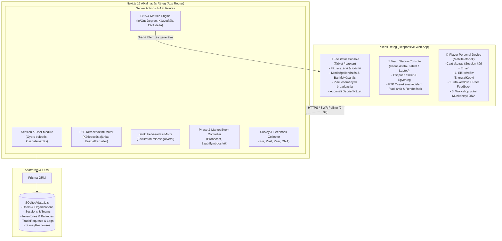
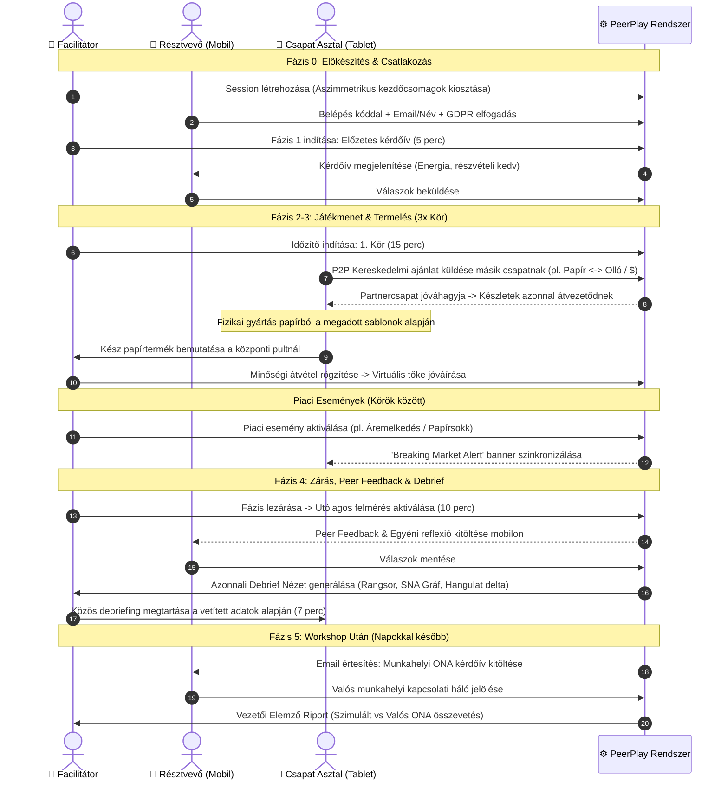
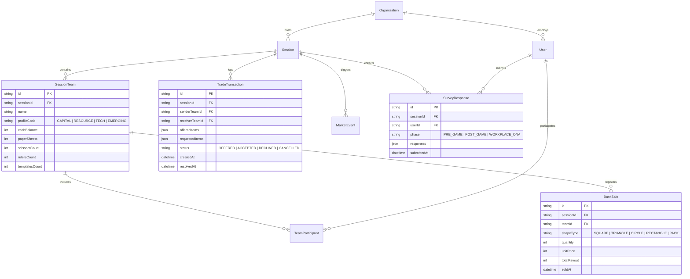
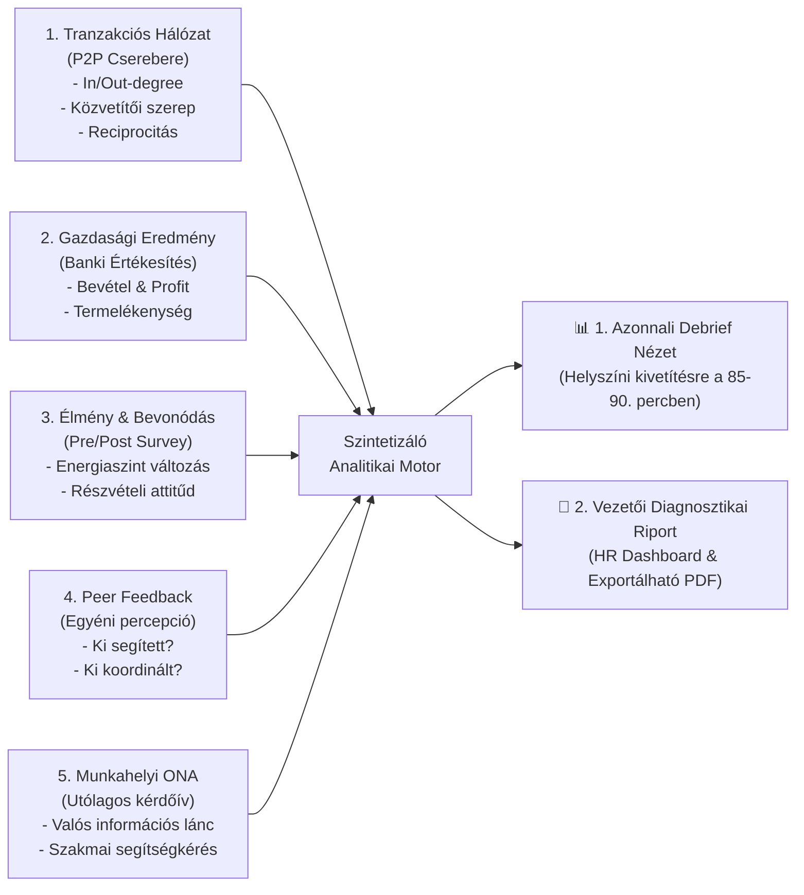

# 🚀 PeerPlay MVP Terv – The Trading Game (V2)

> **Verzió:** 2.0.0 (MVP)  
> **Státusz:** Jóváhagyva (Grill-Me Validáció alapján)  
> **Dátum:** 2026-11-12  
> **Alapdokumentum:** [APP_PLAN_v2.md](file:///E:/Data/other_projects/PeerPlay/APP_PLAN_v2.md)  
> **Kapcsolódó ADR:** [0001_mvp_pivot_trading_game_v2.md](file:///E:/Data/other_projects/PeerPlay/knowledge/decisions/0001_mvp_pivot_trading_game_v2.md)

---

## 1. Vezetői Összefoglaló & Termékvízió

A **PeerPlay: The Trading Game** egy hibrid (fizikai + digitális) szervezeti szimulációs platform, amely a klasszikus kereskedelmi szimulációkat ötvözi a valós idejű tranzakciós naplózással, szociometriai felmérésekkel és a munkahelyi hálózatelemzéssel (**ONA – Organizational Network Analysis**).

Nem egyszerű szórakoztató játék, hanem **Behavioral Simulation-Based Organizational Intelligence Platform**, amely stresszhelyzeti együttműködést szimulálva objektív és szubjektív adatokból mutatja ki a szervezeti dinamikát.

### A Hibrid Működési Modell:
1. **Fizikai sík:** A csapatok fizikai asztaloknál A4-es papírlapokból, vonalzókkal, sablonokkal és ollókkal geometriai formákat (négyzet, kör, háromszög, téglalap, komplex termékek) gyártanak.
2. **Digitális sík:** Minden hivatalos cserekereskedelem (P2P eszköz- és pénzcsere), a banki felvásárlás, a piaci események hirdetményei, valamint a felmérési kérdőívek a **PeerPlay webes felületén** zajlanak valós időben.

---

## 2. Rendszerarchitektúra (System Architecture)

A rendszer 3 fő kliensfelületből, egy központi Next.js App Router háttérből, egy tranzakciós SQLite adatbázisból és egy hálózatelemző analitikai motorból áll.

---

## 3. End-to-End Felhasználói Folyamatok (User Flows)

### 3.1. A 90 perces Workshop & Játék Folyamat

---

## 4. Játékmechanika és Gazdasági Szabályrendszer

### 4.1. Gyártható Geometriai Formák és Árstruktúra

| Termék (Forma) | Méret / Specifikáció | Szükséges eszközök | Alap felvásárlási ár (Bank) | Piaci szerep |
| :--- | :--- | :--- | :--- | :--- |
| **Négyzet** | 10 × 10 cm, derékszögű | Papír, Vonalzó, Olló | **$300** | Alapvető tömegtermék |
| **Egyenlő oldalú háromszög** | 10 cm-es oldalak | Papír, Vonalzó, Olló, Sablon | **$150** | Nagyobb precizitást igényel |
| **Kör** | 10 cm átmérő | Papír, Körző/Sablon, Olló | **$250** | Technológiai monopólium eszköz |
| **Téglalap** | 5 × 15 cm | Papír, Vonalzó, Olló | **$100** | Gyors, de alacsony margójú termék |
| **Prémium Csomag** | 2 db háromszög + 1 db négyzet | Összes eszköz + minőségi vágás | **$800** | Magas koordinációs prémium |

### 4.2. Aszimmetrikus Kezdőcsomagok (Csapatprofilok)

A gazdasági és kapcsolati függőségek mesterséges előidézésére a csapatok egyenlőtlen induló csomagokat kapnak:

1. **A Tőkeerős Vállalat (Capital Rich):**
   - Készpénz: **$1,500**
   - Nyersanyag: 2 lap A4 papír
   - Eszközök: Nincs olló, nincs sablon, 1 ceruza
   - *Kényszer:* Eszközöket vagy alapanyagot kell vásárolnia / bérelnie a termeléshez.

2. **A Nyersanyag-óriás (Resource Rich):**
   - Készpénz: **$200**
   - Nyersanyag: 15 lap A4 papír
   - Eszközök: Nincs olló, nincs vonalzó
   - *Kényszer:* Nyersanyagot kell eladnia vagy megmunkáló partnert találnia.

3. **A Technológiai Bajnok (Tech Leader):**
   - Készpénz: **$300**
   - Nyersanyag: 3 lap A4 papír
   - Eszközök: 2 db olló, 2 db professzionális sablon, 2 db vonalzó
   - *Kényszer:* Nincs elég papírja, de kiváló bérgyártó vagy eszközbérbeadó lehet.

4. **A Feltörekvő Start-up (Emerging Team):**
   - Készpénz: **$500**
   - Nyersanyag: 5 lap A4 papír
   - Eszközök: 1 db vonalzó, 1 db tompa olló
   - *Kényszer:* Gyors szövetségkötésre kényszerül a túléléshez.

---

## 5. Adatmodell & Adatbázis Evolúció (Prisma)

A V1-es virtuális mezőgazdasági modellt leváltjuk a V2-es fizikai/hibrid sémára:

---

## 6. Az 5 Elemzési Réteg és Riport Struktúra

### Riport Kiemelt Funkciói:
1. **Szimulált vs. Valós ONA Hálózati Összevetés:**
   - Kik azok az informális vezetők/közvetítők, akik a szimulációban hidat képeztek, és betöltik-e ugyanezt a valós munkahelyi struktúrában?
   - Mely csapatok vagy részlegek hajlamosak a silósodásra (izoláció a kereskedelemben és az ONA-ban is)?
2. **Önpercepció vs. Peer Percepció Eltérés:**
   - Hogyan látja saját koordinációs/segítő szerepét a játékos a társak visszajelzéséhez képest?
3. **Akcióorientált Fejlesztési Hipotézisek:**
   - Kifejezetten vezetett, nem megbélyegző fejlesztési javaslatok a belső kommunikáció és kooperáció erősítésére.

---

## 7. RACI Mátrix – Ágensek Feladatmegosztása a Launchig

A projekt végrehajtását a specializált AI munkaerő végzi a vezetésemmel (Lead Orchestrator / CEO Persona):

| Munkacsomag / Feladatkör | Lead Orchestrator (CEO) | lead-developer | fullstack-engineer | qa-validator | research-scout | data-analyst |
| :--- | :---: | :---: | :---: | :---: | :---: | :---: |
| **1. Architektúra & Adatmodell Refaktor** (Prisma séma, migrálás) | **A** | **R** | C | I | I | C |
| **2. Facilitátori Vezérlőpult** (Phase Controller, Időzítő, Bank felvásárlás) | **A** | C | **R** | I | I | I |
| **3. Csapat Állomás & P2P Kereskedelem** (Kétlépcsős cseremotor, készletkezelés) | **A** | **R** | **R** | C | I | I |
| **4. Mobil Játékos Portál** (Gyors belépés, Pre/Post kérdőívek, Peer Feedback) | **A** | I | **R** | C | I | I |
| **5. Workshop utáni ONA Modul** (Munkahelyi kérdőív, külső kitöltő link) | **A** | I | **R** | C | I | C |
| **6. SNA Gráf & Hálózatelemző Motor** (Cytoscape metrikák, in/out-degree) | **A** | C | C | I | C | **R** |
| **7. Riportkészítő & Debrief Nézet** (Vezetői PDF & Interaktív HR Dashboard) | **A** | I | **R** | I | I | **R** |
| **8. Gazdasági Szabályok & Kiegyensúlyozás** (Árak, induló csomagok tesztje) | **A** | I | I | C | **R** | C |
| **9. Minőségbiztosítás & Stressztesztek** (Concurrency, 20+ párhuzamos kliens) | **A** | C | C | **R** | I | I |
| **10. GDPR & Adatvédelmi megfelelőség** (Anonimizálás, hozzáférésvédelem) | **A** | C | C | **R** | **R** | I |

*Jelmagyarázat:*
- **R (Responsible):** A megvalósításért felelős végrehajtó
- **A (Accountable):** A végső jóváhagyó és felelős (Lead Orchestrator)
- **C (Consulted):** Szakmai konzultáns, bemenetet nyújtó ágens
- **I (Informed):** Tájékoztatott fél

---

## 8. Magas Minőségi Követelmények és Megbízhatóság (Non-functional Requirements)

1. **Valós idejű szinkronizáció és Hálózati rugalmasság:**
   - 2-3 másodperces intelligens polling (SWR) automatikus hiba-újrapróbálkozással és offline detektálással.
   - Ha egy csapat tabletje ideiglenesen megszakad, a helyi állapot nem sérül, újracsatlakozáskor automatikusan szinkronizál a szerverállapottal.
2. **Tranzakciós Integritás (ACID):**
   - Minden P2P kereskedelmi elfogadás és banki felvásárlás szigorú Prisma tranzakcióban (`$transaction`) fut. Nem fordulhat elő készletduplikáció vagy eltűnő tőke.
3. **GDPR és Munkahelyi Adatvédelem:**
   - Személyes azonosítók (nevek, e-mailek) biztonságos tárolása, hozzáférés korlátozása (csak a szervezethez dedikált HR jogosultsággal tekinthető meg).
   - ONA és Peer Feedback adatoknál küszöbérték-alapú aggregáció (k-anonimitás elve), hogy egyéni szintű megbélyegzés ne alakulhasson ki.
4. **Reszponzivitás és Eszközfüggetlenség:**
   - Játékos felületek szigorúan Mobile-First élményt nyújtanak.
   - Facilitátori felület optimalizálva tablet/laptop felbontásokra, egykezes gyors műveletekkel a minőségellenőrzés során.
