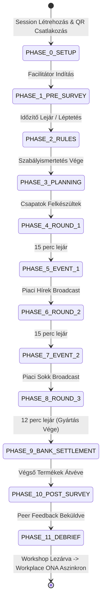
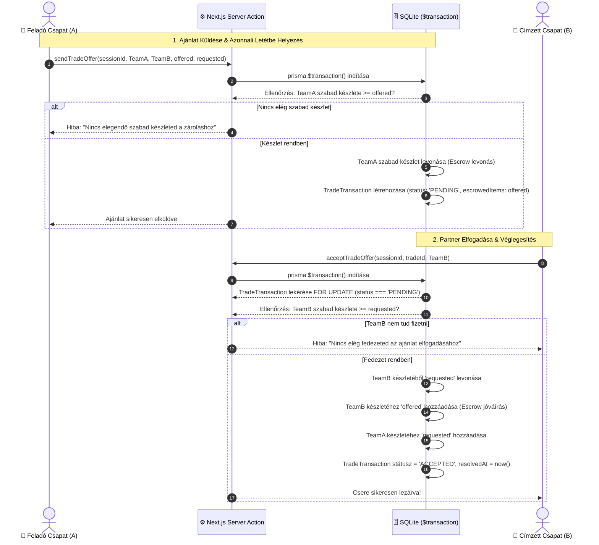

# ⚙️ Backend Szerződések, Fázis Állapotgép és ACID Tranzakciós Motor

> **Státusz:** Kanonikus Specifikáció (Production Standard)  
> **Verzió:** 2.0.0 (The Trading Game V2)  
> **Dátum:** 2026-11-12  
> **Kapcsolódó ADR-ek:** [0001_mvp_pivot_trading_game_v2.md](file:///E:/Data/other_projects/PeerPlay/knowledge/decisions/0001_mvp_pivot_trading_game_v2.md), [0002_design_system_stripe_enterprise.md](file:///E:/Data/other_projects/PeerPlay/knowledge/decisions/0002_design_system_stripe_enterprise.md)  
> **Alapdokumentum:** [MVP_PLAN_v2.md](file:///E:/Data/other_projects/PeerPlay/knowledge/MVP_PLAN_v2.md)

---

## 1. Bevezetés és Architektúrális Határok

Ez a dokumentum a PeerPlay V2 szerveroldali gerincének formális architektúrális és technikai specifikációja. Meghatározza:
1. A **90 perces workshop 11 fázisú állapotgépét** és szinkronizációs protokollját.
2. A **versenyhelyzet-mentes (ACID) P2P cseremotort** és Escrow/Zárolási logikát.
3. A **központi banki minőségellenőrzési és felvásárlási motort**.
4. A **3-lépcsős felmérési (Pre-Game, Post-Game Peer Feedback, Munkahelyi ONA) adatmotort** és GDPR védelmi garanciáit.

---

## 2. Fázis Állapotgép (Workshop Phase State Machine)

A workshop szigorúan vezérelt, lineáris és biztonsági okokból visszaléptetést korlátozott állapotgépet követ. A fázisok léptetésére **kizárólag a Facilitátor** jogosult.



### 2.1. Fázis Leltár és Műveleti Mátrix (Action Permissions)

| Fázis Kód (`WorkshopPhase`) | Név & Időtartam | P2P Kereskedés | Bank Felvásárlás | Kérdőív Beküldés | Facilitátori Művelet |
| :--- | :--- | :---: | :---: | :---: | :--- |
| `PHASE_0_SETUP` | Előkészítés & Csatlakozás | ❌ | ❌ | ❌ | Csapatok sorsolása, profilok hozzárendelése |
| `PHASE_1_PRE_SURVEY` | Előzetes Kérdőív (5p) | ❌ | ❌ | ✅ (Pre-Game Mobil) | Kérdőív kitöltöttség monitorozása |
| `PHASE_2_RULES` | Bevezetés & Szabályok (8p) | ❌ | ❌ | ❌ | Prezentáció, fizikai eszközök átadása |
| `PHASE_3_PLANNING` | Stratégiaalkotás (5p) | ❌ | ❌ | ❌ | Csapatmegfigyelés, kérdések tisztázása |
| `PHASE_4_ROUND_1` | 1. Kör Kereskedés & Gyártás (15p) | ✅ **Nyitott** | ✅ **Nyitott** | ❌ | Minőségátvétel, tranzakció-monitoring |
| `PHASE_5_EVENT_1` | 1. Piaci Esemény (3p) | ❌ (Zárolva) | ❌ (Zárolva) | ❌ | Piaci esemény kártya broadcast |
| `PHASE_6_ROUND_2` | 2. Kör Kereskedés & Gyártás (15p) | ✅ **Nyitott** | ✅ **Nyitott** | ❌ | Új árak szerinti átvétel |
| `PHASE_7_EVENT_2` | 2. Piaci Esemény (3p) | ❌ (Zárolva) | ❌ (Zárolva) | ❌ | Második piaci sokk broadcast |
| `PHASE_8_ROUND_3` | 3. Kör Kereskedés & Gyártás (12p) | ✅ **Nyitott** | ✅ **Nyitott** | ❌ | Hajrá / utolsó szerződések ellenőrzése |
| `PHASE_9_BANK_SETTLEMENT`| Értékesítés & Elszámolás (7p) | ❌ (Lezárva) | ✅ **Utolsó átvétel** | ❌ | Maradék készletek elszámolása |
| `PHASE_10_POST_SURVEY` | Utólagos Kérdőív & Peer (10p) | ❌ | ❌ | ✅ (Post & Peer Mobil) | Kitöltési arány követése |
| `PHASE_11_DEBRIEF` | Eredményhirdetés & Debrief (7p) | ❌ | ❌ | ❌ | Debrief dashboard kivetítése |
| `POST_WORKPLACE_ONA` | Munkahelyi ONA (Aszinkron) | ❌ | ❌ | ✅ (ONA Web Link) | E-mail meghívók generálása |

### 2.2. Kliens-Szerver Időzítő Szinkronizáció (Clock Drift Védelem)

A kliensek és a szerver közötti idősodródás (clock drift) kiküszöbölésére a szerver **nem** másodpercenkénti "tick"-eket küld, hanem relatív időbélyegeket tárol az adatbázisban:

```typescript
// Session modell időzítő mezői:
phaseStartedAt: Date       // Fázis indításának abszolút szerverideje
phaseDurationSeconds: number // Fázis teljes ideje másodpercben (pl. 900 = 15 perc)
isTimerPaused: boolean     // Szüneteltetve van-e az időmérő
timerRemainingSeconds: number // Ha szünetel, hány másodperc volt még hátra
```

#### Kliensoldali Számítási Képlet (SWR Polling 2 másodpercenként):
```typescript
export function calculateRemainingSeconds(session: {
  phaseStartedAt: string | Date;
  phaseDurationSeconds: number;
  isTimerPaused: boolean;
  timerRemainingSeconds: number;
  serverTime: string | Date;
}): number {
  if (session.isTimerPaused) {
    return Math.max(0, session.timerRemainingSeconds);
  }
  
  const elapsedMs = new Date(session.serverTime).getTime() - new Date(session.phaseStartedAt).getTime();
  const elapsedSeconds = Math.floor(elapsedMs / 1000);
  return Math.max(0, session.phaseDurationSeconds - elapsedSeconds);
}
```
*Védelem:* Ha a kliens polling hívást indít (`/api/session/[id]/state`), a válasz fejlécében visszakapja a `serverTime`-ot is, így a kliens gépének esetlegesen elállított órája nem torzítja a visszaszámlálót.

---

## 3. ACID Tranzakciós Kereskedelmi Motor (P2P Trade Engine)

A P2P cseremotor legnagyobb kockázata a **versenyhelyzet (Race Condition)** és a **készletduplikáció (Double-Spending)**:
> *Példa:* Az 'A' csapat rendelkezik 2 db ollóval. Kiküld egy csereajánlatot a 'B' csapatnak 2 db ollóra, miközben ezzel párhuzamosan kiküld egy másik ajánlatot a 'C' csapatnak is ugyanezzel a 2 db ollóval. Ha nincs azonnali zárolás, mindkét csapat elfogadhatja az ajánlatot, és 'A' csapata negatív olló-készletbe futna.

### 3.1. Azonnali Letéti Zárolás (Escrow / Reservation Lock) Modellje

A PeerPlay a **kétfázisú tranzakciós letét (Immediate Escrow Reservation)** mechanizmust alkalmazza:



### 3.2. Visszavonás, Elutasítás és Fáziszárás (Auto-Refund)

1. **Elutasítás (`rejectTradeOffer`):**
   - A 'B' csapat elutasítja az ajánlatot.
   - A tranzakcióban a zárolt `escrowedItems` azonnal és maradéktalanul visszakerül az 'A' csapat szabad készletébe.
   - Státusz: `REJECTED`.
2. **Visszavonás (`cancelTradeOffer`):**
   - Az 'A' csapat meggondolja magát, mielőtt 'B' elfogadná.
   - Az 'A' csapat feloldja az ajánlatot, az `escrowedItems` visszakerül a készletbe.
   - Státusz: `CANCELLED`.
3. **Kényszerített Kör-zárás (`autoRefundOnPhaseEnd`):**
   - Amikor a facilitátor lezárja a kereskedési fázist (`PHASE_4_ROUND_1`, `PHASE_6_ROUND_2`, `PHASE_8_ROUND_3`), az összes függőben lévő (`PENDING`) csereajánlatot a rendszer egyetlen kötegelt tranzakcióban `EXPIRED` státuszra állítja, és a zárolt tételeket automatikusan visszautalja a feladó csapatoknak.

### 3.3. P2P Csere Tranzakciós Kódminta (Prisma ACID)

```typescript
// src/modules/trade/actions.ts
import prisma from '@/lib/prisma';
import { revalidatePath } from 'next/cache';

export interface ResourceBundle {
  cash: number;
  paperSheets: number;
  scissorsCount: number;
  rulersCount: number;
  templatesCount: number;
}

/** 1. Ajánlat küldése és azonnali készletzárolás (Escrow) */
export async function sendTradeOffer(
  sessionId: string,
  senderTeamId: string,
  receiverTeamId: string,
  offered: ResourceBundle,
  requested: ResourceBundle,
  notes?: string
) {
  if (senderTeamId === receiverTeamId) {
    throw new Error('Saját csapatoddal nem kereskedhetsz.');
  }

  return await prisma.$transaction(async (tx) => {
    // Fázis ellenőrzés
    const session = await tx.session.findUnique({
      where: { id: sessionId },
      select: { currentPhase: true, isRoundActive: true }
    });
    
    const activeTradingPhases = ['PHASE_4_ROUND_1', 'PHASE_6_ROUND_2', 'PHASE_8_ROUND_3'];
    if (!session || !activeTradingPhases.includes(session.currentPhase)) {
      throw new Error('A kereskedés jelenleg szünetel vagy le van zárva.');
    }

    // Küldő csapat lekérése és zárolása
    const sender = await tx.sessionTeam.findUnique({
      where: { id: senderTeamId }
    });
    if (!sender) throw new Error('A feladó csapat nem található.');

    // Készletfedezet ellenőrzése
    if (sender.cashBalance < offered.cash) throw new Error('Nincs elegendő készpénzed az ajánlathoz.');
    if (sender.paperSheets < offered.paperSheets) throw new Error('Nincs elegendő papírlapod.');
    if (sender.scissorsCount < offered.scissorsCount) throw new Error('Nincs elegendő ollód.');
    if (sender.rulersCount < offered.rulersCount) throw new Error('Nincs elegendő vonalzód.');
    if (sender.templatesCount < offered.templatesCount) throw new Error('Nincs elegendő sablonod.');

    // 1. LÉPÉS: Escrow levonás a feladótól
    await tx.sessionTeam.update({
      where: { id: senderTeamId },
      data: {
        cashBalance: { decrement: offered.cash },
        paperSheets: { decrement: offered.paperSheets },
        scissorsCount: { decrement: offered.scissorsCount },
        rulersCount: { decrement: offered.rulersCount },
        templatesCount: { decrement: offered.templatesCount }
      }
    });

    // 2. LÉPÉS: Tranzakciós rekord létrehozása
    const trade = await tx.tradeTransaction.create({
      data: {
        sessionId,
        senderTeamId,
        receiverTeamId,
        offeredItems: JSON.stringify(offered),
        requestedItems: JSON.stringify(requested),
        escrowedItems: JSON.stringify(offered),
        status: 'PENDING',
        notes: notes || null
      }
    });

    return trade;
  });
}

/** 2. Ajánlat elfogadása és atomi készletcsere */
export async function acceptTradeOffer(sessionId: string, tradeId: string, receiverTeamId: string) {
  return await prisma.$transaction(async (tx) => {
    const trade = await tx.tradeTransaction.findUnique({
      where: { id: tradeId }
    });

    if (!trade || trade.status !== 'PENDING') {
      throw new Error('Az ajánlat már nem elérhető vagy feldolgozásra került.');
    }
    if (trade.receiverTeamId !== receiverTeamId) {
      throw new Error('Nincs jogosultságod ennek az ajánlatnak az elfogadására.');
    }

    const offered: ResourceBundle = JSON.parse(trade.offeredItems);
    const requested: ResourceBundle = JSON.parse(trade.requestedItems);

    const receiver = await tx.sessionTeam.findUnique({
      where: { id: receiverTeamId }
    });
    if (!receiver) throw new Error('Fogadó csapat nem található.');

    // Ellenőrzés: A fogadó fél képes-e kifizetni a kért tételeket?
    if (receiver.cashBalance < requested.cash) throw new Error('Nincs elegendő készpénzed az elfogadáshoz.');
    if (receiver.paperSheets < requested.paperSheets) throw new Error('Nincs elegendő papírlapod.');
    if (receiver.scissorsCount < requested.scissorsCount) throw new Error('Nincs elegendő ollód.');
    if (receiver.rulersCount < requested.rulersCount) throw new Error('Nincs elegendő vonalzód.');
    if (receiver.templatesCount < requested.templatesCount) throw new Error('Nincs elegendő sablonod.');

    // 1. LÉPÉS: Levonás a fogadó féltől (requested) és jóváírás az ajánlott javakból (offered)
    await tx.sessionTeam.update({
      where: { id: receiverTeamId },
      data: {
        cashBalance: { decrement: requested.cash, increment: offered.cash },
        paperSheets: { decrement: requested.paperSheets, increment: offered.paperSheets },
        scissorsCount: { decrement: requested.scissorsCount, increment: offered.scissorsCount },
        rulersCount: { decrement: requested.rulersCount, increment: offered.rulersCount },
        templatesCount: { decrement: requested.templatesCount, increment: offered.templatesCount }
      }
    });

    // 2. LÉPÉS: Jóváírás a feladó félnek a kért javakból (requested)
    await tx.sessionTeam.update({
      where: { id: trade.senderTeamId },
      data: {
        cashBalance: { increment: requested.cash },
        paperSheets: { increment: requested.paperSheets },
        scissorsCount: { increment: requested.scissorsCount },
        rulersCount: { increment: requested.rulersCount },
        templatesCount: { increment: requested.templatesCount }
      }
    });

    // 3. LÉPÉS: Audit rekord frissítése
    const updatedTrade = await tx.tradeTransaction.update({
      where: { id: tradeId },
      data: {
        status: 'ACCEPTED',
        resolvedAt: new Date()
      }
    });

    return updatedTrade;
  });
}
```

---

## 4. Központi Bank Felvásárlási Motor (Bank Commodity Engine)

A csapatok a fizikai papírtermékeket a központi pultnál adják át a facilitátornak. A facilitátor minősíti a terméket és rögzíti az átvételt a rendszerben.

### 4.1. Gyártható Termékek és Dinamikus Árképzés

| Termékkód (`ShapeType`) | Megnevezés | Alapár ($) | Gyártási eszközigény |
| :--- | :--- | :---: | :--- |
| `SQUARE` | 10 × 10 cm derékszögű négyzet | **$300** | Papír, Vonalzó, Olló |
| `TRIANGLE` | 10 cm-es egyenlő oldalú háromszög | **$150** | Papír, Vonalzó, Olló, Sablon |
| `CIRCLE` | 10 cm átmérőjű kör | **$250** | Papír, Sablon/Körző, Olló |
| `RECTANGLE` | 5 × 15 cm-es téglalap | **$100** | Papír, Vonalzó, Olló |
| `PREMIUM_PACK` | 2 db háromszög + 1 db négyzet | **$800** | Összes eszköz + illesztés |

### 4.2. Dinamikus Ármódosítók (Market Event Multipliers)

Amikor a Facilitátor piaci eseményt aktivál (pl. `PHASE_5_EVENT_1` vagy `PHASE_7_EVENT_2`), a `MarketEvent` rekord definiálhat formánkénti ár-szorzókat (pl. Kör ára +50% -> szorzó: `1.5`):

$$\text{Tényleges Egységár} = \text{Alapár} \times \text{Aktív Piaci Szorzó}$$
$$\text{Összes Kifizetés} = \text{Tényleges Egységár} \times \text{Mennyiség}$$

### 4.3. Banki Felvásárlás Tranzakciós Kódminta (Server Action)

```typescript
// src/modules/bank/actions.ts
import prisma from '@/lib/prisma';

export async function executeBankSale(
  sessionId: string,
  teamId: string,
  shapeType: 'SQUARE' | 'TRIANGLE' | 'CIRCLE' | 'RECTANGLE' | 'PREMIUM_PACK',
  quantity: number,
  qualityApproved: boolean,
  facilitatorNotes?: string
) {
  if (quantity <= 0) throw new Error('A mennyiségnek legalább 1-nek kell lennie.');
  if (!qualityApproved) {
    throw new Error('A termék minőségileg elutasításra került. Nem történik kifizetés.');
  }

  const BASE_PRICES: Record<string, number> = {
    SQUARE: 300,
    TRIANGLE: 150,
    CIRCLE: 250,
    RECTANGLE: 100,
    PREMIUM_PACK: 800
  };

  return await prisma.$transaction(async (tx) => {
    // 1. Session és aktív piaci esemény lekérése
    const session = await tx.session.findUnique({
      where: { id: sessionId },
      include: {
        marketEvents: {
          where: { isActive: true },
          orderBy: { triggeredAt: 'desc' },
          take: 1
        }
      }
    });

    if (!session) throw new Error('A szimulációs munkamenet nem található.');

    // Szorzó meghatározása
    let multiplier = 1.0;
    if (session.marketEvents.length > 0) {
      const activeEvent = session.marketEvents[0];
      const modifiers: Record<string, number> = JSON.parse(activeEvent.priceMultipliers || '{}');
      if (modifiers[shapeType]) {
        multiplier = modifiers[shapeType];
      }
    }

    const unitBasePrice = BASE_PRICES[shapeType] || 0;
    const finalUnitPrice = Math.round(unitBasePrice * multiplier);
    const totalPayout = finalUnitPrice * quantity;

    // 2. Csapat számlájának gyarapítása
    const updatedTeam = await tx.sessionTeam.update({
      where: { id: teamId },
      data: {
        cashBalance: { increment: totalPayout }
      }
    });

    // 3. BankSale audit rekord létrehozása
    const saleRecord = await tx.bankSale.create({
      data: {
        sessionId,
        teamId,
        shapeType,
        quantity,
        unitBasePrice,
        multiplier,
        finalUnitPrice,
        totalPayout,
        qualityNotes: facilitatorNotes || null,
        soldAt: new Date()
      }
    });

    return { saleRecord, newBalance: updatedTeam.cashBalance };
  });
}

// 4.3.2. Kötegelt Banki Minőségátvétel (Batch Inspection Desk - S-FAC-03)
export interface ShapeBatchItem {
  shapeType: 'SQUARE' | 'TRIANGLE' | 'CIRCLE' | 'RECTANGLE' | 'PREMIUM_PACK';
  quantity: number;
}

export async function executeBatchBankSale(
  sessionId: string,
  teamId: string,
  items: ShapeBatchItem[],
  facilitatorNotes?: string
) {
  const validItems = items.filter(it => it.quantity > 0);
  if (validItems.length === 0) throw new Error('Legalább egy érvényes formát meg kell adni.');

  const BASE_PRICES: Record<string, number> = {
    SQUARE: 300,
    TRIANGLE: 150,
    CIRCLE: 250,
    RECTANGLE: 100,
    PREMIUM_PACK: 800
  };

  return await prisma.$transaction(async (tx) => {
    const session = await tx.session.findUnique({
      where: { id: sessionId },
      include: {
        marketEvents: {
          where: { isActive: true },
          orderBy: { triggeredAt: 'desc' },
          take: 1
        }
      }
    });
    if (!session) throw new Error('A munkamenet nem található.');

    let totalBatchPayout = 0;
    const saleRecords = [];

    let modifiers: Record<string, number> = {};
    if (session.marketEvents.length > 0) {
      modifiers = JSON.parse(session.marketEvents[0].priceMultipliers || '{}');
    }

    for (const item of validItems) {
      const multiplier = modifiers[item.shapeType] || 1.0;
      const unitBasePrice = BASE_PRICES[item.shapeType] || 0;
      const finalUnitPrice = Math.round(unitBasePrice * multiplier);
      const totalPayout = finalUnitPrice * item.quantity;
      totalBatchPayout += totalPayout;

      const record = await tx.bankSale.create({
        data: {
          sessionId,
          teamId,
          shapeType: item.shapeType,
          quantity: item.quantity,
          unitBasePrice,
          multiplier,
          finalUnitPrice,
          totalPayout,
          qualityNotes: facilitatorNotes || null,
          soldAt: new Date()
        }
      });
      saleRecords.push(record);
    }

    const updatedTeam = await tx.sessionTeam.update({
      where: { id: teamId },
      data: { cashBalance: { increment: totalBatchPayout } }
    });

    return { saleRecords, totalBatchPayout, newBalance: updatedTeam.cashBalance };
  });
}
```

---

## 5. Felmérési és ONA Válaszmotor (Survey & ONA Engine)

A PeerPlay 3 különböző időpontban és csatornán gyűjt strukturált pszichológiai és szociometriai adatokat:

```text
1. Pre-Game Survey (Mobil)        -> Fázis 1 (Első 5 perc)
2. Post-Game Peer Feedback (Mobil) -> Fázis 10 (A játék után közvetlenül)
3. Workplace ONA (Aszinkron Web)   -> Workshop után napokkal (Email link token)
```

### 5.1. Kérdőív Típusok és Adatstruktúrák (JSON Schemas)

#### 1. Pre-Game Survey (`PRE_GAME` · S-MOB-02)
- **Cél:** Belépési energiaszint és elköteleződés mérése (1–10-es numerikus skála).
- **Payload struktúra:**
```json
{
  "initialEnergyLevel": 7,      // 1-10 skála (Mentális/fizikai energiaszint a 0. percben)
  "initialEngagementLevel": 8   // 1-10 skála ("Mennyire van kedved most itt lenni?")
}
```

#### 2. Post-Game Survey & Peer Feedback (`POST_GAME` · S-MOB-04)
- **Cél:** Játékélmény, záró energiaszint és nominációk megfigyelt szerepek szerint.
- **Payload struktúra:**
```json
{
  "brokerNominations": ["usr_abc123"],          // Keresztfunkcionális koordinátor (másik csapatból)
  "internalEnablerNominations": ["usr_xyz789"],  // Belső segítő / motor (saját csapatból)
  "finalEnergyLevel": 8,                        // 1-10 skála (Záró energiaszint a 90. percben)
  "reflectionText": "Az ollóhiány miatt gyorsan kellett szövetséget kötnünk a B csapattal."
}
```

#### 3. Workshop Utáni Munkahelyi ONA (`WORKPLACE_ONA`)
- **Cél:** A szimulációs viselkedés összevetése a valós vállalati kapcsolati struktúrával.
- **Biztonsági token:** E-mailben küldött egyszer használatos JWT vagy UUID token (`/ona/survey/[token]`).
- **Payload struktúra:**
```json
{
  "respondentUserId": "usr_abc123",
  "connections": [
    {
      "targetUserId": "usr_colleague1",
      "relationType": "ADVICE",        // Tanácskérés szakmai ügyben
      "frequency": "WEEKLY"            // DAILY | WEEKLY | MONTHLY | RARELY
    },
    {
      "targetUserId": "usr_colleague2",
      "relationType": "INFORMATION",   // Információmegosztás
      "frequency": "DAILY"
    },
    {
      "targetUserId": "usr_colleague3",
      "relationType": "COLLABORATION", // Napi közös projektmunka
      "frequency": "DAILY"
    }
  ]
}
```

### 5.2. GDPR, Munkahelyi Adatvédelem és k-Anonimitási Küszöbök

Mivel az ONA elemzések munkahelyi kapcsolatokat tárnak fel, szigorú etikai és jogi korlátokat érvényesítünk:
1. **Zéró Egyéni Megbélyegzés:**
   - A HR vagy Facilitátori Dashboard **soha nem jelenít meg egyéni "legkevésbé népszerű" vagy "alulteljesítő" listákat**.
2. **$k$-Anonimitási Szabály ($k \ge 3$):**
   - Csoportos vagy részlegszintű aggregációnál, ha egy alcsoport (pl. "Pénzügyi Csapat") létszáma 3 főnél kevesebb, az adataik csak a magasabb szervezeti egységgel összevonva jelenhetnek meg, megakadályozva a válaszadó személyének kikövetkeztetését.
3. **Kettős beleegyezés (Consent Checkbox):**
   - A játékos a belépéskor expliciten nyilatkozik az adatok diagnosztikai célú aggregálásának elfogadásáról.

---

## 6. Kanonikus Prisma Adatbázis Séma (V2 Target)

```prisma
datasource db {
  provider = "sqlite"
  url      = env("DATABASE_URL")
}

generator client {
  provider = "prisma-client-js"
}

model Organization {
  id        String    @id @default(uuid())
  name      String
  industry  String?
  createdAt DateTime  @default(now())

  users     User[]
  sessions  Session[]
}

model User {
  id             String       @id @default(uuid())
  email          String       @unique
  name           String
  role           String?      // e.g. "Senior Developer", "HR Lead"
  organizationId String
  organization   Organization @relation(fields: [organizationId], references: [id])
  createdAt      DateTime     @default(now())

  teamMemberships  TeamParticipant[]
  surveyResponses  SurveyResponse[]
  onaInvitations   OnaInvitation[]
}

model Session {
  id                   String       @id @default(uuid())
  joinCode             String       @unique
  organizationId       String
  organization         Organization @relation(fields: [organizationId], references: [id])
  status               String       @default("DRAFT") // DRAFT | ACTIVE | COMPLETED | ARCHIVED
  
  // Fázis Állapotgép Mezők
  currentPhase         String       @default("PHASE_0_SETUP")
  phaseStartedAt       DateTime     @default(now())
  phaseDurationSeconds Int          @default(300)
  isTimerPaused        Boolean      @default(false)
  timerRemainingSeconds Int         @default(300)

  createdAt            DateTime     @default(now())
  closedAt             DateTime?

  teams                SessionTeam[]
  tradeTransactions    TradeTransaction[]
  bankSales            BankSale[]
  marketEvents         MarketEvent[]
  surveyResponses      SurveyResponse[]
  onaInvitations       OnaInvitation[]
}

model SessionTeam {
  id             String    @id @default(uuid())
  sessionId      String
  session        Session   @relation(fields: [sessionId], references: [id], onDelete: Cascade)
  name           String    // e.g. "Alpha Vállalat"
  profileCode    String    // CAPITAL | RESOURCE | TECH | EMERGING
  
  // Valós idejű Készletállomány
  cashBalance    Int       @default(0)
  paperSheets    Int       @default(0)
  scissorsCount  Int       @default(0)
  rulersCount    Int       @default(0)
  templatesCount Int       @default(0)

  createdAt      DateTime  @default(now())

  participants   TeamParticipant[]
  sentTrades     TradeTransaction[] @relation("SentTrades")
  receivedTrades TradeTransaction[] @relation("ReceivedTrades")
  bankSales      BankSale[]

  @@unique([sessionId, name])
}

model TeamParticipant {
  id          String      @id @default(uuid())
  sessionId   String
  teamId      String
  team        SessionTeam @relation(fields: [teamId], references: [id], onDelete: Cascade)
  userId      String
  user        User        @relation(fields: [userId], references: [id], onDelete: Cascade)
  joinedAt    DateTime    @default(now())

  @@unique([sessionId, userId])
}

model TradeTransaction {
  id                 String      @id @default(uuid())
  sessionId          String
  session            Session     @relation(fields: [sessionId], references: [id], onDelete: Cascade)
  
  senderTeamId       String
  senderTeam         SessionTeam @relation("SentTrades", fields: [senderTeamId], references: [id])
  receiverTeamId     String
  receiverTeam       SessionTeam @relation("ReceivedTrades", fields: [receiverTeamId], references: [id])

  offeredItems       String      // JSON: ResourceBundle
  requestedItems     String      // JSON: ResourceBundle
  escrowedItems      String      // JSON: ResourceBundle zárolt tételei

  status             String      @default("PENDING") // PENDING | ACCEPTED | REJECTED | CANCELLED | EXPIRED
  notes              String?
  createdAt          DateTime    @default(now())
  resolvedAt         DateTime?
}

model BankSale {
  id             String      @id @default(uuid())
  sessionId      String
  session        Session     @relation(fields: [sessionId], references: [id], onDelete: Cascade)
  teamId         String
  team           SessionTeam @relation(fields: [teamId], references: [id], onDelete: Cascade)

  shapeType      String      // SQUARE | TRIANGLE | CIRCLE | RECTANGLE | PREMIUM_PACK
  quantity       Int         @default(1)
  unitBasePrice  Int
  multiplier     Float       @default(1.0)
  finalUnitPrice Int
  totalPayout    Int
  qualityNotes   String?
  soldAt         DateTime    @default(now())
}

model MarketEvent {
  id               String    @id @default(uuid())
  sessionId        String
  session          Session   @relation(fields: [sessionId], references: [id], onDelete: Cascade)
  title            String
  description      String
  code             String    // e.g. "PAPER_FAMINE", "TECH_BOOM"
  priceMultipliers String    @default("{}") // JSON pl: {"CIRCLE": 1.5}
  durationSeconds  Int       @default(180)
  isActive         Boolean   @default(false)
  triggeredAt      DateTime  @default(now())
}

model SurveyResponse {
  id            String    @id @default(uuid())
  sessionId     String
  session       Session   @relation(fields: [sessionId], references: [id], onDelete: Cascade)
  userId        String
  user          User      @relation(fields: [userId], references: [id], onDelete: Cascade)
  
  phaseType     String    // PRE_GAME | POST_GAME
  payloadJson   String    // JSON: PreGamePayload vagy PostGamePayload
  submittedAt   DateTime  @default(now())

  @@unique([sessionId, userId, phaseType])
}

model OnaInvitation {
  id             String       @id @default(uuid())
  sessionId      String
  session        Session      @relation(fields: [sessionId], references: [id], onDelete: Cascade)
  userId         String
  user           User         @relation(fields: [userId], references: [id], onDelete: Cascade)
  uniqueToken    String       @unique
  expiresAt      DateTime
  isCompleted    Boolean      @default(false)
  completedAt    DateTime?
  responses      OnaResponse[]
}

model OnaResponse {
  id             String        @id @default(uuid())
  invitationId   String
  invitation     OnaInvitation @relation(fields: [invitationId], references: [id], onDelete: Cascade)
  targetUserId   String
  relationType   String        // ADVICE | INFORMATION | COLLABORATION | TRUST
  frequencyScore Int           // 1 to 5
  createdAt      DateTime      @default(now())
}
```

---

## 7. Összefoglaló és Következő Lépések

Ez a specifikáció biztosítja:
1. **Teljes adatkonzisztencia és letéti zárolás (Escrow):** Kizárt a készletduplikáció és a versenyhelyzet a P2P kereskedelem során.
2. **Kiszámítható állapotgép:** A 11 fázis és az időzítők SWR polling modellel sodródásmentesen szinkronizálódnak az asztali és mobil kliensek között.
3. **Auditálható banki felvásárlás:** A facilitátor egykezes, gyors műveletekkel minősíthet és fizethet ki termékeket, amelyek azonnal beépülnek a gazdasági ONA riportba.
4. **Adatvédelmi garancia:** A háromszintű kérdőív és ONA modul megfelel a GDPR és $k$-anonimitási elvárásoknak.
