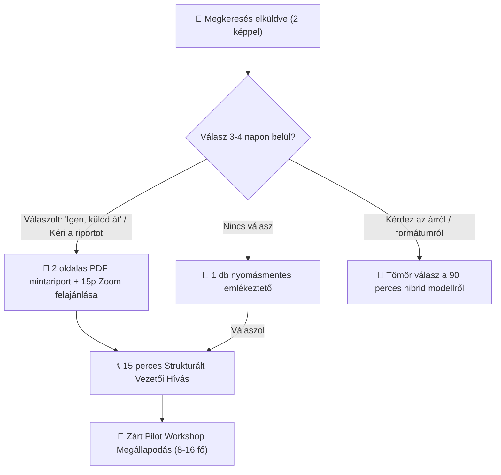

# 🚀 B2B Validációs Playbook: Vezetői Megkeresés & Pilot Konverziós Útmutató

**Projekt:** PeerPlay Vállalati Szimuláció (`peerplay`)  
**Cél:** Piaci igény felmérése és zárt pilotok lezárása fejlesztési időpazarlás nélkül.  
**Dátum:** 2026-11-15 (Frissítve a felnőtt, vezetői hangnem alapján)

---

## 1. Vezetői Pszichológia: Mitől működik és mitől bukik el egy hideg megkeresés?

### 🚫 A 3 Tipikus Hiba, amit azonnal kiszúr a C-Level / HR Igazgató:
1. **„Nem szeretnék eladni semmit...”**  
   *Miért káros:* Álszentnek és gyávának tűnik. A vezető pontosan tudja, hogy üzleti szándékkal keresed meg. Ha azt állítod, nem akarsz eladni, azonnal manipulációt vagy időrabló amatőrizmust gyanít.
2. **„Kíváncsi vagyok a tapasztalatodra / tölts ki egy kérdőívet...”**  
   *Miért káros:* A döntéshozó nem ingyenes piackutató tanácsadó. Az ilyen levelek azonnal a kukába kerülnek.
3. **Agresszív naptárfoglalási link (Calendly) az első levélben:**  
   *Miért káros:* Egy ismeretlennek senki sem ad 30 percet a naptárából látatlanban.

### ✅ A Nyertes Vezetői Pozicionálás:
- **Tiszteletteljes, de egyenes:** Elismeri, hogy a vezető ideje drága, és azonnal a megtérülésre és a szervezeti fájdalomra (silók, felesleges csapatépítő büdzsé) mutat rá.
- **Kemény, rövid tárgymező (<45 karakter):** Nem vágja le a mobil kliens (pl. *„Pénzkidobás a csapatépítő? / [Cégnév]”* vagy *„Haszon a csapatépítőből / [Cégnév]”*).
- **Nem dobozos terméket ad el, hanem Pilot Partnert keres:** 2 kiválasztott céget von be esettanulmány-alapon.
- **Határozott mikrodöntés a végén (zéró megalázkodás):** Nem kér bocsánatot a létezéséért (*„Lenne értelme...?”* = tilos!), hanem egyenrangú kijelentést tesz és zöld utat kér: *„Átküldöm a 2 oldalas vezetői mintariportot, hogy lásd a gyakorlatban. Mehet?”* Erre 1 szóval válaszolhat mobilon (*„Mehet”* / *„Küldd”*).

---

## 2. Az Email Sablon és Vizuális Anyagok

- **HTML Sablon Fájl:** [email-pitch-template.html](file:///C:/Users/Adam/Data/other_projects/PeerPlay/public/email-pitch-template.html)
- **Böngészős előnézet (ha fut a szerver):** `http://localhost:3001/email-pitch-template.html`

### A 2 db Kötelező Vizuális Anyag:
1. **1. Kép – Mobil Kísérő (Munkavállalói Élmény):**  
   Képernyőfotó a telefonos felületről. Üzenete: Modern, mobil-natív, papírmentes.
2. **2. Kép – ONA Hálózati Térkép (Vezetői Diagnosztika):**  
   Képernyőfotó a Facilitátori Pultról, a **„Valós Szervezeti Osztály szerint”** színezéssel. Üzenete: Objektív röntgenkép a részlegek (Pénzügy, Gyártás, K+F, Értékesítés) valós együttműködéséről.

---

## 3. Döntési Fa és Következő Lépések

---

## 4. Konkrét Válaszsablonok

### A) Ha visszaírja: „Igen, jöhet” vagy kéri a mintajelentést:
> **Tárgy:** Re: Alternatíva a hagyományos csapatépítőkre / Mintariport
> 
> Kedves [Keresztnév]!
> 
> Köszönöm a gyors visszajelzést! Csatoltan küldöm a szimulált adatokból generált vezetői mintariportot [vagy link].
> 
> Kifejezetten érdemes ránézni a **hálózati térképre (2. oldal)**:
> - Tisztán kirajzolódik a Pénzügy és a Gyártás közötti funkcionális siló, és látszik az a 2 kulcsember, aki egyedül képes volt hidat képezni a döntésekben.
> - A pszichometriai panel számszerűsíti a csapatok energiamozgását (+1.75 pont emelkedés a 90 perc alatt).
> 
> Mivel most választjuk ki a 2 pilot partnert a következő időszakra:
> **Ráérsz a héten csütörtökön 10:00-kor vagy pénteken 14:00-kor egy 15 perces online egyeztetésre?**  
> Megmutatom, hogyan nézne ki ez a gyakorlatban a [Cégnév] egyik 8–16 fős csapatánál.
> 
> Üdvözlettel,  
> [Neved]

### B) Ha 4 napig nem válaszol (Follow-up):
> Kedves [Keresztnév]!
> 
> Tudom, hogy rendkívül sűrűek a napjaid, ezért csak egyetlen mondatban jelentkezem.
> 
> A héten zárjuk a zárt pilot programunk partnerségi körét. Ha releváns lehet a [Cégnév]-nél a belső silók objektív felmérése és egy mérhető csapatprogram, szívesen átküldöm a 2 oldalas mintariportot.
> 
> Ha most nem időszerű a téma, természetesen megértem és köszönöm az idődet!
> 
> Üdvözlettel,  
> [Neved]

---

## 5. A Zárt Pilot Ajánlat (A híváson elhangzó ajánlat)

> *„A célunk most nem az, hogy szoftverlicencet adjunk el nektek.  
> Azt ajánljuk fel, hogy levezetünk egy 90 perces hibrid szimulációt egy általatok kijelölt 8–16 fős csapatnak (vagy keresztfunkcionális vezetői körnek), és utána átadunk a menedzsmentnek egy teljes ONA diagnosztikai elemzést az együttműködési hálózatukról.*
> 
> *A workshop piaci listaára később 450.000 – 600.000 Ft lesz, ebben a pilot körben viszont **önköltségi áron (vagy esettanulmányért cserébe)** megtartjuk nektek.*
> 
> *Érdemes lenne beütemeznünk egy próbát a következő negyedévre?”*

---

## 6. Algoritmikus Lead Engine & Perzisztens Adatbázis

A vezetők közvetlen email címének generálására és ellenőrzésére rendelkezésre áll a [b2b_lead_engine.py](file:///C:/Users/Adam/Data/other_projects/PeerPlay/scripts/b2b_lead_engine.py) motor:
- **SQLite Adatbázis:** [data/b2b_lead_pipeline.db](file:///C:/Users/Adam/Data/other_projects/PeerPlay/data/b2b_lead_pipeline.db) (`companies`, `leads`, `email_candidates` táblák).
- **Vizuális Dashboard:** [b2b_leads_dashboard.html](file:///C:/Users/Adam/Data/other_projects/PeerPlay/public/b2b_leads_dashboard.html) (`http://localhost:3001/b2b_leads_dashboard.html`).
- **Infrastruktúra-detektálás:** A natív DNS MX és SPF rekordok alapján automatikusan megállapítja a céges felhőt (Microsoft 365: ~85% `first.last@domain`, Google Workspace, On-premise Exchange), és ez alapján súlyozza a valószínűségi konfidenciát.
- **Hálózati szabály:** A lakossági/irodai ISP-k által blokkolt TCP port 25 (`WSAEWOULDBLOCK / 10035`) helyett DNS MX + SPF mintaheurisztikát alkalmaz lokálisan, míg felhős VPS szerveren a közvetlen SMTP 250 kézfogás is futtatható.
