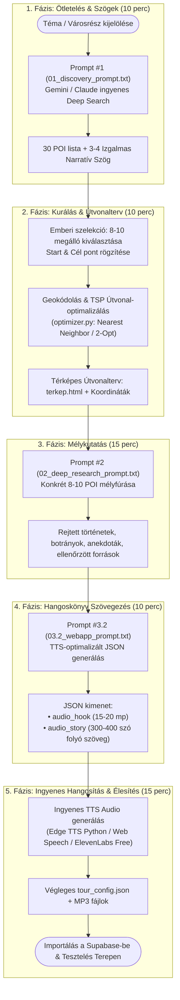

# 🎙️ VitaSteps Kitérő: Ingyenes Sétagyártási Master Workflow

Ez az útmutató bemutatja, hogyan lehet **100%-ban ingyenes vagy minimális költségű AI eszközökkel** (Deep Research, Prompt láncok, geokódolás, TSP optimalizálás, böngészős/ingyenes TTS hanggenerálás) profi, magával ragadó városi élménysétákat készíteni a VitaSteps Kitérőhöz.

---

## 🗺️ 1. A Sétagyártás 5 Lépéses AI-Ember Folyamata

---

## 🛠️ 2. Hogyan oldjuk meg 0 Ft-ból a gyártást?

1. **Kutatás & Szöveg:**
   * **Gemini 2.5 Pro / Flash** (Google AI Studio vagy ingyenes webes felület) $\rightarrow$ korlátlan mélykeresés és forráskutatás magyar nyelven.
   * A `01_discovery_prompt.txt` és `02_deep_research_prompt.txt` promptok azonnal beilleszthetők.
2. **Útvonaltervezés & Sorrendezés:**
   * Ingyenes Nominatim / OpenStreetMap geokódolás és Python TSP optimalizálás (`optimizer.py`), ami garantálja a legkevesebb felesleges gyaloglást.
3. **Hangalámondás (TTS) 0 Ft költséggel:**
   * **Microsoft Edge TTS (`edge-tts` python csomag):** Teljesen ingyenes, nincs token-korlát. A Microsoft természetes neurális magyar hangjai (`hu-HU-TamasNeural`, `hu-HU-NoemiNeural`) kimagaslóan jó minőségűek, felveszik a versenyt a fizetős rendszerekkel.
   * Alternatíva: ElevenLabs ingyenes tier (havi 10 000 karakter = kb. 1 komplett pilot séta hanganyaga).

---

## 📁 3. Elérhető Promptok a Projektben

A prompt sablonok közvetlenül elérhetők a projektben:
* [landing_predikalo1/prompts/kitero_workflow/01_discovery_prompt.txt](file:///E:/Data/other_projects/VitaSteps/landing_predikalo1/prompts/kitero_workflow/01_discovery_prompt.txt) — 30 POI ötletelés és tematika
* [landing_predikalo1/prompts/kitero_workflow/02_deep_research_prompt.txt](file:///E:/Data/other_projects/VitaSteps/landing_predikalo1/prompts/kitero_workflow/02_deep_research_prompt.txt) — Tényfeltáró mélykutatás és anekdoták
* [landing_predikalo1/prompts/kitero_workflow/03.2_webapp_prompt.txt](file:///E:/Data/other_projects/VitaSteps/landing_predikalo1/prompts/kitero_workflow/03.2_webapp_prompt.txt) — Felolvasásra optimalizált Hook és Story JSON generálás
* [landing_predikalo1/prompts/kitero_workflow/03_setakonyv_prompt.txt](file:///E:/Data/other_projects/VitaSteps/landing_predikalo1/prompts/kitero_workflow/03_setakonyv_prompt.txt) — Részletes sétakönyv/kalandfüzet generáló prompt
