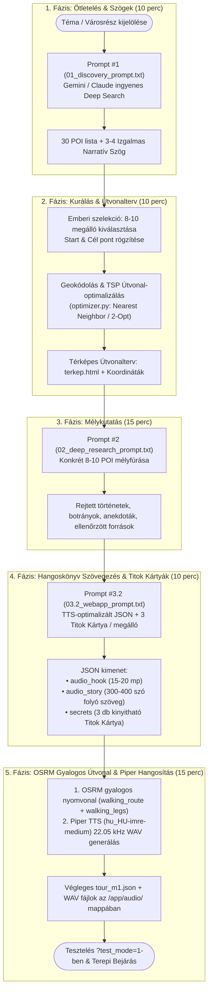

# 🎙️ VitaSteps Kitérő: Ingyenes Sétagyártási Master Workflow

Ez az útmutató bemutatja, hogyan lehet **100%-ban ingyenes vagy minimális költségű AI eszközökkel** (Deep Research, Prompt láncok, geokódolás, TSP optimalizálás, böngészős/ingyenes TTS hanggenerálás) profi, magával ragadó városi élménysétákat készíteni a VitaSteps Kitérőhöz.

---

## 🗺️ 1. A Sétagyártás 5 Lépéses AI-Ember Folyamata

---

## 🛠️ 2. Hogyan oldjuk meg 0 Ft-ból a gyártást?

1. **Kutatás & Szöveg (és 3-as Titok Kártya bontás):**
   * **Gemini 2.5 Pro / Flash** (Google AI Studio vagy ingyenes webes felület) $\rightarrow$ korlátlan mélykeresés és forráskutatás magyar nyelven.
   * A `01_discovery_prompt.txt` és `02_deep_research_prompt.txt` promptok azonnal beilleszthetők.
   * Minden megálló története a folyó `audio_story` mellett **3 darab önálló Titok Kártyára (`secrets` tömb: `icon`, `title`, `badge`, `content`)** van bontva az exkluzív accordion megjelenítéshez.
2. **Útvonaltervezés, Sorrendezés & Valódi Gyalogos Nyomvonal (OSRM):**
   * Ingyenes Nominatim / OpenStreetMap geokódolás és Python TSP optimalizálás (`optimizer.py`), ami garantálja a legkevesebb felesleges gyaloglást.
   * Az `https://routing.openstreetmap.de/routed-foot/route/v1/foot/...` végpontról lekérjük a valódi gyalogos koordinátákat (`walking_route` a teljes túrára, `walking_legs` a megállók közötti szakaszokra), így a térkép soha nem légvonalat, hanem a valódi járdákat és sétányokat rajzolja ki zölden.
3. **Hangalámondás (TTS) 0 Ft költséggel:**
   * **Helyi Piper Neurális TTS (`hu_HU-imre-medium.onnx`):** 100%-ban offline, ingyenes, korlátlan karakterrel futtatható helyi neurális magyar férfihang (`poi_{id}_hook.wav` és `poi_{id}_story.wav`, 22.05 kHz 16-bit PCM).
   * **Alternatívák:** Microsoft Edge TTS (`edge-tts` python csomag: `hu-HU-TamasNeural`, `hu-HU-NoemiNeural`) vagy ElevenLabs Free tier.

---

## 📁 3. Elérhető Promptok a Projektben

A prompt sablonok közvetlenül elérhetők a projektben:
* [landing_predikalo1/prompts/kitero_workflow/01_discovery_prompt.txt](file:///E:/Data/other_projects/VitaSteps/landing_predikalo1/prompts/kitero_workflow/01_discovery_prompt.txt) — 30 POI ötletelés és tematika
* [landing_predikalo1/prompts/kitero_workflow/02_deep_research_prompt.txt](file:///E:/Data/other_projects/VitaSteps/landing_predikalo1/prompts/kitero_workflow/02_deep_research_prompt.txt) — Tényfeltáró mélykutatás és anekdoták
* [landing_predikalo1/prompts/kitero_workflow/03.2_webapp_prompt.txt](file:///E:/Data/other_projects/VitaSteps/landing_predikalo1/prompts/kitero_workflow/03.2_webapp_prompt.txt) — Felolvasásra optimalizált Hook és Story JSON generálás
* [landing_predikalo1/prompts/kitero_workflow/03_setakonyv_prompt.txt](file:///E:/Data/other_projects/VitaSteps/landing_predikalo1/prompts/kitero_workflow/03_setakonyv_prompt.txt) — Részletes sétakönyv/kalandfüzet generáló prompt
