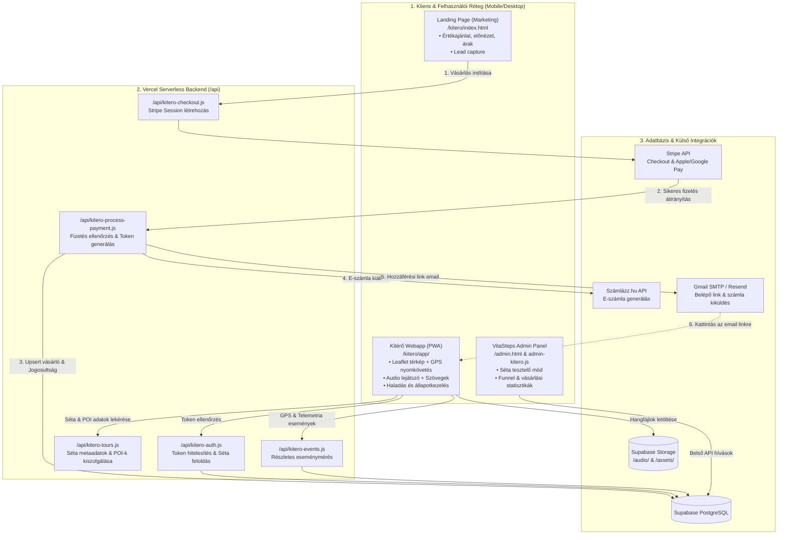
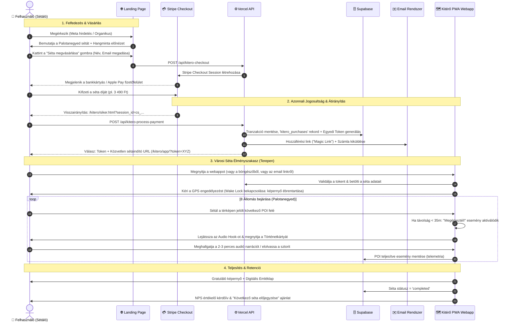
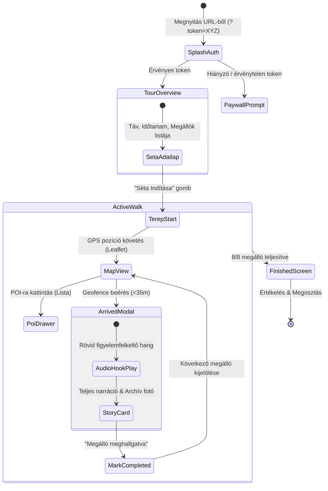
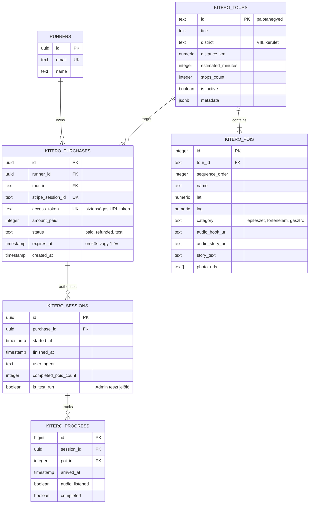
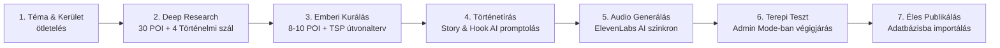

# 🧭 VitaSteps Kitérő: Master Rendszerterv & Architektúra

Ez a dokumentum a **VitaSteps Kitérő** önvezetett, digitális városi élményséták end-to-end specifikációja. Integrálja a korábbi kutatási és kísérleti alapokat (az `E:\Data\hosszulepes` AI prompt és PWA tapasztalatait, valamint a `kitero_launch_handover.md` stratégiai döntéseit) a meglévő VitaSteps infrastruktúrába (`vitastepsss.vercel.app` / Supabase / Stripe / Számlázz.hu).

---

## 1. Vezetői Összefoglaló és Célkitűzés

A **VitaSteps Kitérő** a márka magas árrésű, zéró fizikai készletezési költségű digitális terméke.
* **Első éles pilot séta:** *A Kisföldalatti Nyomában* (Budapest VI. és XIV. kerület, Mexikói úti járműteleptől a Vörösmarty térig, 9 megálló, ~3.4 km, 1.5–2 óra).
* **Fő technológiai modell:** Mobil-optimalizált **PWA (Progressive Web App)**, amely asztali és mobil böngészőből azonnal elérhető telepítés nélkül, de "Kezdőképernyőhöz adható", Service Workerrel gyorsítótárazza a térképet és az audió anyagokat.
* **UI/UX & Design Rendszer:** **Tactical Carto** elrendezés egységes **Outfit** tipográfiával (nem-AI, tiszta architektúra):
  * **Nappali (Light) mód:** *Editorial Forest Light* (Meleg krém `#F8F7F2`, fehér kártyák, mély erdőzöld `#365A45` akcentus – közvetlen összhangban a meglévő marketing landinggel).
  * **Éjszakai (Dark) mód:** *Dark Olive Forest* (Mély olíva-fekete háttér `#141815`, erdőzöld kártyák `#1D231F`, smaragdzöld navigációs akcentus `#529B72`).
* **Tartalmi struktúra az állomásokon:** Strukturált 4 részes **Adatmátrix (Data Matrix)** (Építés éve, Stílus, Funkcióváltás, Történelmi súly) + lényegretörő háttértörténet + **Podcast stílusú TTS audiolejátszó**. Felesleges sallangok és AI-slop (pl. headline takeaway és emoji-túltengés) nélkül.
* **Üzleti modell:** Egyedi séta vásárlás (3 490 Ft – 3 990 Ft) Stripe fizetéssel, automata számlázással és azonnali hozzáféréssel (Magic Link / Access Token).
* **Vercel Free Limit Védelem:** Nem hozunk létre új serverless function-öket, a meglévő `api/kitero.js` végponton keresztül fut a checkout, process, auth és event routing.

---

## 2. Rendszerarchitektúra (Architecture Overview)

A meglévő VitaSteps architektúrába illeszkedve a Kitérő nem igényel új tárhelyet vagy teljesen különálló infrastruktúrát. A Vercel szerveroldali monorepo és a közös Supabase adatbázis szolgálja ki.

---

## 3. End-to-End User Flow (Felhasználói Útvonal)

A felhasználó a hirdetéstől a városi séta fizikai befejezéséig terjedő teljes útja:

---

## 4. UI/UX és Webapp Funkcionális Specifikáció

A korábbi `E:\Data\hosszulepes\webapp` prototípus és a Stitch dizájn tanulságai alapján a PWA az alábbi képernyőkből és modulokból épül fel:

### Kulcsfontosságú UX megoldások:
1. **Screen Wake Lock API:** Megakadályozza, hogy séta közben a telefon képernyője lezárjon.
2. **Kétlépcsős Hangélmény:**
   * **Audio Hook:** 15–20 másodperces, azonnal induló felcsigázó felütés a helyszínhez éréskor.
   * **Full Story:** 2–3 perces mély, emberközpontú történet zenei aláfestéssel.
3. **Manuális felülbírálás (Fail-safe):** Ha a városi házak árnyékolása miatt a GPS pontatlan, a sétáló egyetlen gombnyomással manuálisan is bejelentkezhet az adott állomásra ("Itt vagyok" gomb).
4. **Offline ellenállóképesség:** A Service Worker előre cache-eli a hangfájlokat és a térképcsempéket induláskor, így a térerő-ingadozás sem akasztja meg az élményt.

---

## 5. Adatbázis Modell (Supabase Adatbázis Kiterjesztés)

Nem szükséges külön Supabase projektet indítani. A meglévő VitaSteps adatbázisban a Kitérő entitások dedikált táblákba kerülnek, közvetlenül összekapcsolva a meglévő `runners` és `analytics_sessions` rekordokkal.

---

## 6. Sétagyártási & Tartalom Workflow (AI-Ember Kollaboráció)

A séták előállítása az `E:\Data\hosszulepes` mappában kidolgozott, bevált 5-fázisú receptúrára épül:

1. **Ötlet & Narratíva:** Claude / Gemini kutatás (érdekességek, legendák, botrányok).
2. **TSP Útvonal-optimalizálás:** Python szkript (`optimizer.py`) rendezi a megállókat a legkevesebb felesleges gyaloglást eredményező sorrendbe.
3. **Szövegezés:** A `03.2_webapp_prompt.txt` alapján készült formázás-mentes, folyó szövegek (Hook + 300–400 szavas Story).
4. **Hanganyag (AI Voice):** ElevenLabs / Google Cloud TTS élethű, atmoszférikus felolvasással, MP3 tömörítéssel a Supabase Storage-ba töltve.
5. **Terepi Teszt:** Az admin felületen dedikált tesztüzemmódban történő végigjárás.

---

## 7. Események Időbelisége és Felelősségi Mátrix (RACI)

| Időablak / Fázis | Feladat / Esemény | Felelős (R) | Támogató (A/C) | Output / Eredmény |
| :--- | :--- | :--- | :--- | :--- |
| **T0: Alapozás (1-2. nap)** | Supabase séma migráció (`kitero_*` táblák) | Lead Developer | CEO | Létrejött adatbázistáblák, RLS szabályok |
| **T0: Alapozás (2-3. nap)** | Backend API végpontok (`checkout`, `process`, `auth`) | Fullstack Eng. | Lead Developer | Működő Stripe fizetési & jogosultsági flow |
| **T1: Webapp & PWA (3-5. nap)** | `/kitero/app/` PWA felépítése a korábbi kódokból | Fullstack Eng. | Lead Developer | Leaflet GPS térkép, audio lejátszó, offline SW |
| **T1: Tartalom (3-4. nap)** | Palotanegyed POI adatok, szövegek & audió generálás | Research Scout | CEO | 8 megálló végleges hanganyaga és képei |
| **T2: Terepteszt (5-6. nap)** | **Élő budapesti séta végigjárása mobiltelefonnal** | **CEO (Adam)** | QA-Validator | GPS pontosság, hangerő és felhasználói élmény teszt |
| **T2: Landing frissítés (6. nap)** | Landing page átkötése a fizetési pipeline-ra | Fullstack Eng. | Lead Developer | Éles checkout CTA gombok, A/B tesztelt árak |
| **T3: Piacra lépés (7. nap)** | Meta kampány indítás & Email bejelentés | CEO | Data Analyst | Első éles vásárlók, analitikai figyelés |

---

## 8. Adminisztráció, Tesztelési Mód & Mérés (Analytics)

1. **Admin / Tesztelői Mód (`is_test=true`):**
   * Az admin felületről vagy egy speciális URL-lel (`/kitero/app/?test_mode=1`) a rendszer fizetés nélkül is megnyitható.
   * GPS szimulátor és megálló-léptető gombok segítik az asztali tesztelést.
   * A tesztelés során generált adatok nem torzítják az üzleti statisztikákat.
2. **Analitikai Mérőrendszer:**
   * A meglévő `analytics.js` bővítése Kitérő specifikus eseményekkel:
     * `kitero_landing_view` $\rightarrow$ `kitero_preview_play` $\rightarrow$ `kitero_checkout_init` $\rightarrow$ `kitero_purchase_success`
     * `kitero_walk_start` $\rightarrow$ `kitero_poi_reach` $\rightarrow$ `kitero_audio_finish` $\rightarrow$ `kitero_walk_complete`
   * Napi Pushbullet vezetői jelentés a Kitérő látogatókról, vásárlásokról és teljesítésekről.
