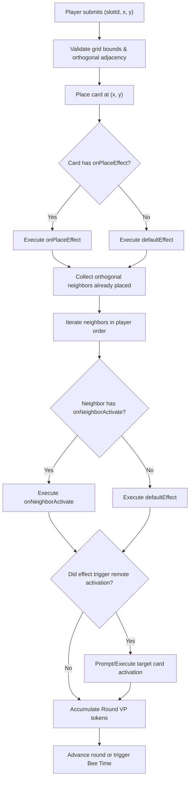

# Bear Necessities — Card Abilities & Mechanics Specification

**Document Version:** 1.0  
**Source Baseline:** Mojito Studios Rulebook, Card Spritesheet (100 slots: 94 cards + 4 card backs + 2 blank), and Extracted Game Data.

---

## 1. Overview & Core Card Anatomy

In *Bear Necessities*, cards are drafted and placed into a personal **4-column by 3-row grid** (12 cards total) over 12 rounds. Each card is defined by fixed physical attributes, activation triggers, and declarative scoring or action effects.

### 1.1 Card Attributes
1. **Id / Slot Index:** Integer `0` to `93` (94 unique playing cards). Slots `94` to `97` are color card backs; slots `98` and `99` are blanks.
2. **Name:** Descriptive identifier (e.g., `Lighthouse`, `Fisherbear`, `Dandelion`, `Binoculars`, `Queen Bee`).
3. **Color (Environment):** Exactly one of 4 colors:
   - `Red` (City)
   - `Blue` (Water)
   - `Green` (Mountain)
   - `Yellow` (Desert)
4. **Types:** 0, 1, or 2 of the 5 standard types:
   - `Bearfolk`
   - `Building`
   - `Item`
   - `Plant`
   - `Animal`
5. **Bee Hive Symbols (`beeHives`):** Count of bee hive multiplier icons (`0`, `1`, or `2`). Used at game end: `totalBeeTokens * totalBeeHiveSymbols`.
6. **Goal Marker (`isGoal`):** Boolean. If `true`, the card features a split condition (`Unmet` base score vs `Met` goal score).
7. **Special Visual Features:**
   - `hasGlasses`: Boolean (Bearfolk with glasses, relevant to cards like the *Optician*).
   - `nameStartsS`: Boolean (Snake effect: cards whose name starts with "S" or "Snake mark" icon).

---

## 2. Trigger & Activation Lifecycle

### 2.1 Placement Activation Sequence
When player plays card $C$ at grid coordinate $(x, y)$:
1. **Self-Activation:** Card $C$ is placed face up and immediately activates its own effect.
   - If $C$ has separate `onPlace` vs `onActivate` rules (e.g. *Dandelion*, *Secret Honey Stash*), apply `onPlace`. Otherwise apply default activation.
2. **Neighbor Activation:** All orthogonally adjacent cards already in the tableau ($N \in \text{OrthogonalNeighbors}(C)$) activate in the order chosen by the player.
   - For each neighbor $N$, apply $N$'s `onActivate` (or default activation) effect.
3. **Chain Activations:** If any activated card triggers a target activation (e.g., *Binoculars* activating any Building in tableau, or *Guide* activating any Bearfolk), resolve that target activation before proceeding.

### 2.2 Activation Modes
- `Default`: Same scoring formula whether triggered on placement or by a neighbor.
- `TriggerDifferentiated`:
  - `onPlace`: Effect when this card is placed into the tableau (e.g., *Dandelion* scores 7 VP; *Secret Honey Stash* gives 2 bee tokens).
  - `onNeighborActivate`: Effect when an adjacent card is placed next to this card (e.g., *Dandelion* scores 1 VP; *Secret Honey Stash* gives 1 bee token).
- `EndGame`: Bee hive multiplier scoring computed at conclusion of round 12.

---

## 3. Taxonomy of Card Mechanics & Effects

All card effects in Bear Necessities fall into **10 distinct mechanical categories**:

### Category 1: Orthogonal Adjacency Checks
Evaluates cards immediately above, below, left, or right of the active card.
- **`AdjacentToColor`**: Scores fixed VP or multiplier per adjacent card matching color(s).
  - *Fisherbear*: 4 VP if adjacent to $\ge 1$ Water (Blue).
  - *Reed*: 5 VP if adjacent to exactly 1 Water (Blue).
  - *Water Lily*: 3 VP per adjacent Water (Blue).
- **`AdjacentToType`**: Scores fixed VP or multiplier per adjacent card matching type(s).
  - *Dog*: 3 VP per adjacent Bearfolk.
  - *Wild Carrot*: 5 VP if adjacent to $\ge 1$ Animal.
  - *Bearbecue*: 4 VP per adjacent Animal (or Fish).
- **`AdjacentToSymbol`**: Scores per adjacent symbol.
  - *Queen Bee*: 4 VP per adjacent Bee Hive symbol.
- **`AdjacentDiversity`**: Scores based on the number of distinct colors or types among neighbors.
  - *Small Trading Post*: 8 VP if adjacent to exactly 2 different colors.
  - *Medium Trading Post*: 12 VP if adjacent to exactly 3 different colors.
  - *Trading Post*: 16 VP if adjacent to 4 different colors.
  - *Explorer*: 3 VP per different type adjacent.
- **`AdjacentSpecificCard`**: Checks for specific named cards.
  - *Baby Beaver*: 3 VP if adjacent to *Beaver Dad* or *Beaver Mom*.
- **`NegativeAdjacency`**: Scores if adjacent requirements are absent.
  - *Cactus*: 4 VP if not adjacent to Water.
  - *Factory*: 4 VP if not adjacent to Plant / Animal.

### Category 2: Row & Column Geometry
Evaluates cards along the active card's row, column, or relative direction.
- **`RowColCount`**: Counts matching cards in the active card's row and column.
  - *Lighthouse*: 2 VP per Water card in this row and in this column (self counted only once).
  - *Town Hall*: 2 VP per Building/City in this row and in this column (self counted only once).
- **`RowCount`**: Counts matching cards in the active card's row.
  - *Berries*: 4 VP per Plant in this row.
  - *Sergeant*: 3 VP per Bearfolk in this row.
- **`DirectionalRows`**: Checks rows strictly relative to the card's row index.
  - *Pigeon*: 4 VP per Bird/Animal in all rows below this card ($y' > y$).
  - *Cellar*: 4 VP per Item/Building in all rows above this card ($y' < y$).
- **`DirectionalAdjacency`**: Relative positional check.
  - *Photographer*: Goal met if there is a target card immediately to its right ($x' = x + 1, y' = y$).
- **`CompletedLines`**: Scores for completed rows or columns.
  - *Station*: 3 VP per complete row (all 4 cards present).
  - *Suburban Apartments*: 2 VP per complete column (all 3 cards present).

### Category 3: Tableau-Wide Aggregation
Counts cards across the player's entire 12-card grid (including self unless specified).
- **`TableauTypeCount`**: 
  - *Eagle*: 2 VP per Animal in your tableau (including Eagle).
  - *Yucca*: 2 VP per Plant in your tableau.
  - *Architect*: 4 VP per Building in your tableau.
- **`TableauColorCount`**:
  - *Hiker*: 2 VP per Mountain card in your tableau.
- **`TableauCardCount`**:
  - *Tourist Office*: 1 VP per card in your tableau.
- **`TableauFilterCount`**:
  - *Optician*: 4 VP per Bearfolk in tableau *without glasses*.
  - *Snake*: 2 VP per card in tableau whose name starts with "S" (marked with the snake symbol).
- **`NonAdjacentTableauCount`**:
  - *Lookout Tower*: 1 VP per card in tableau *not* adjacent to this card.
- **`UniversalSet`**:
  - *Visitor Center*: High VP bonus if all 4 colors or all 5 types are present in tableau.

### Category 4: Connected Clusters (Adjacency Groups)
Finds connected components (orthogonally connected subgraphs) matching a property.
- **`LargestAdjacentGroup`**:
  - *Fish*: 2 VP per Fish in your largest group of orthogonally adjacent Fish cards.

### Category 5: Reserve Card Interaction
Evaluates the card currently held in the player's secret reserve slot for the round.
- **`ReserveColorMatch`**:
  - *Weather Forecast (Red/City)*: 7 VP if the card in your reserve is Red.
  - *Weather Forecast (Blue/Water)*: 7 VP if the card in your reserve is Blue.
  - *Weather Forecast (Green/Mountain)*: 7 VP if the card in your reserve is Green.
  - *Weather Forecast (Yellow/Desert)*: 7 VP if the card in your reserve is Yellow.

### Category 6: Token Interactions & Bee Multipliers
Directly grants or scores based on Victory Point and Bee tokens.
- **`BeeTokenCount`**:
  - *Snack Bag*: 2 VP per Bee token currently in reserve.
- **`DirectTokenGrant`**:
  - *Secret Honey Stash*: Gain 2 bee tokens on placement; gain 1 bee token on neighbor activation.
- **`EndGameBeeMultiplication`**:
  - $\text{EndScoreBonus} = (\sum \text{BeeTokens}) \times (\sum \text{BeeHiveSymbols})$.
  - *Rubber Duck*: Provides 2 bee hive symbols and 2 base VP.

### Category 7: Goal Cards (`Split Scoring`)
Goal cards feature a horizontal divider line with a base reward above and a higher reward below.
- Every activation evaluates the condition:
  - If condition is **False**: award `unmetVP` (typically 2–3 VP).
  - If condition is **True**: award `metVP` (typically 8–20 VP), completely replacing `unmetVP`.
- Goal examples:
  - *Bearlet*: 2 VP unmet; 10 VP if player has $\ge 6$ bee tokens.
  - *Small Trading Post*: 2 VP unmet; 8 VP if adjacent to exactly 2 different colors.
  - *Medium Trading Post*: 3 VP unmet; 12 VP if adjacent to exactly 3 different colors.
  - *Trading Post*: 4 VP unmet; 16 VP if adjacent to 4 different colors.
  - *Collector*: 2 VP unmet; 20 VP if tableau contains $\ge 5$ of the same color or type.
  - *Harbor*: 2 VP unmet; 8 VP if adjacent to $\ge 2$ Water cards.
  - *Streetlight*: 2 VP unmet; 10 VP if adjacent to $\ge 2$ City cards.

### Category 8: Meta-Goal & Synergy Scoring
Scores based on other cards' attributes or completion states.
- **`GoalCount`**:
  - *Banker* / *Treasure Hunter*: Scores VP per card in your tableau showing a Goal symbol that *can be completed* (even if not activated).
- **`SpecificSynergy`**:
  - *CIA Headquarters*: 5 VP per *Spy* in your tableau.

### Category 9: Opponent Tableau & Token Checks
Evaluates opponents' state (interaction without destructive take-that).
- **`OpponentTableauCount`**:
  - *Spy (Water)*: 2 VP per Water in any one opponent's tableau.
  - *Spy (Dual Color)*: 1 VP per Red and 1 VP per Yellow in any one opponent's tableau.
- **`OpponentTokenCount`**:
  - *Spy (Bee Tokens)*: 2 VP per Bee token held by any single opponent.

### Category 10: Chain Reaction & Remote Activations
Triggers secondary activations inside the player's tableau.
- **`RemoteCardActivation`**:
  - *Binoculars*: "Activate a Building in your tableau." Player selects any Building card already placed; that card immediately triggers its activation effect.
  - *Guide*: "Activate a Bearfolk in your tableau."

---

## 4. Declarative Effect Schema (TypeScript)

To ensure game logic is pure data rather than arbitrary hardcoded code, all card definitions adhere to the following declarative schema.

```typescript
export type CardColor = 'red' | 'blue' | 'green' | 'yellow';
export type CardType = 'bearfolk' | 'building' | 'item' | 'plant' | 'animal';

export interface CardFilter {
  colors?: CardColor[];
  types?: CardType[];
  cardIds?: number[];
  hasGlasses?: boolean;
  nameStartsWith?: string;
  hasBeeHive?: boolean;
  isGoal?: boolean;
}

export type Scope = 
  | 'adjacent'                  // 4 orthogonal neighbors
  | 'row'                       // Current row
  | 'column'                    // Current column
  | 'row_and_column'            // Union of row and column (self deduplicated)
  | 'rows_above'                // All rows y' < y
  | 'rows_below'                // All rows y' > y
  | 'relative_right'            // Exactly (x + 1, y)
  | 'tableau'                   // Entire personal 4x3 grid
  | 'tableau_non_adjacent'      // Tableau cards excluding orthogonal neighbors
  | 'reserve'                   // Card in reserve slot
  | 'opponent_max_tableau'      // Max count across any single opponent
  | 'opponent_max_bee_tokens';  // Max bee tokens held by any single opponent

export type Condition =
  | { kind: 'min_count'; count: number; filter?: CardFilter; scope: Scope }
  | { kind: 'exact_count'; count: number; filter?: CardFilter; scope: Scope }
  | { kind: 'none'; filter?: CardFilter; scope: Scope }
  | { kind: 'distinct_colors_count'; count: number; scope: Scope }
  | { kind: 'distinct_types_count'; count: number; scope: Scope }
  | { kind: 'min_bee_tokens'; count: number }
  | { kind: 'has_reserve_color'; color: CardColor };

export type EffectAction =
  | {
      kind: 'fixed_vp';
      points: number;
    }
  | {
      kind: 'vp_per_match';
      pointsPerMatch: number;
      filter?: CardFilter;
      scope: Scope;
      includeSelf?: boolean;
    }
  | {
      kind: 'vp_per_bee_token';
      pointsPerToken: number;
      scope: 'self' | 'opponent_max';
    }
  | {
      kind: 'vp_per_distinct';
      pointsPerDistinct: number;
      dimension: 'color' | 'type';
      scope: Scope;
    }
  | {
      kind: 'largest_adjacent_group_vp';
      pointsPerCard: number;
      filter: CardFilter;
    }
  | {
      kind: 'grant_bee_tokens';
      amount: number;
    }
  | {
      kind: 'activate_remote_card';
      targetFilter: CardFilter;
    }
  | {
      kind: 'conditional_goal';
      condition: Condition;
      metScore: number;
      unmetScore: number;
    };

export interface CardActivationProfile {
  defaultEffect?: EffectAction;
  onPlaceEffect?: EffectAction;
  onNeighborActivateEffect?: EffectAction;
}

export interface CardDefinition {
  id: number;                   // Slot index 0..93
  name: string;
  color: CardColor;
  types: CardType[];
  beeHives: number;             // Multiplier count (0, 1, or 2)
  isGoal: boolean;
  hasGlasses?: boolean;
  nameStartsS?: boolean;
  profile: CardActivationProfile;
}
```

---

## 5. Catalog of Key Cards & Concrete Parameter Mappings

| Slot | Name | Color | Type(s) | Hives | Goal | Mechanic / Formula |
|:---|:---|:---|:---|:---:|:---:|:---|
| **00** | Baby Beaver | Blue | Animal | 0 | No | 3 VP if adjacent to any parent (Beaver Dad or Beaver Mom). |
| **01** | Beaver Dad | Blue | Animal | 0 | No | Base animal synergy card for Baby Beaver. |
| **02** | Beaver Mom | Blue | Animal | 0 | No | Base animal synergy card for Baby Beaver. |
| **03-10**| Fish | Blue | Animal | 0-1 | No | 2 VP per Fish in your largest group of orthogonally adjacent Fish. |
| **11** | Cabin | Blue | Building | 0 | No | 4 VP if adjacent to exactly 1 Mountain/Water. |
| **12** | Harbor | Blue | Building | 0 | Yes | Goal: 8 VP if adjacent to $\ge 2$ Water; else 2 VP. |
| **13** | Lighthouse | Blue | Building | 0 | No | 2 VP per Water in this row and column (counted once). |
| **14** | Binoculars | Red/Yellow | Item | 0 | No | Remote activation: Activate a Building in your tableau. |
| **15** | Collector (Base) | Yellow | Bearfolk | 0 | No | 3 VP per Item in your tableau. |
| **16** | Collector (Goal) | Yellow | Bearfolk | 0 | Yes | Goal: 20 VP if you have $\ge 5$ of the same color or type; else 2 VP. |
| **18** | Fisherbear | Blue | Bearfolk | 0 | No | 4 VP if adjacent to at least 1 Water. |
| **19** | Spy (Water) | Blue | Bearfolk | 0 | No | 2 VP per Water in any one opponent's tableau. |
| **20-21**| Reed | Blue | Plant | 0 | No | 5 VP if adjacent to exactly 1 Water. |
| **22** | Water Lily | Blue | Plant | 0 | No | 3 VP per adjacent Water. |
| **24** | Coyote | Yellow | Animal | 0 | No | Multiplier per adjacent Desert/Animal. |
| **25** | Queen Bee | Yellow | Animal | 1 | No | 4 VP per adjacent Bee Hive symbol. |
| **26** | Trading Post | Yellow | Building | 0 | Yes | Goal: 16 VP if adjacent to 4 different colors; else 4 VP. |
| **27** | CIA Headquarters | Red | Building | 0 | No | 5 VP per Spy in your tableau. |
| **29** | Small Trading Post| Yellow| Building | 0 | Yes | Goal: 8 VP if adjacent to exactly 2 different colors; else 2 VP. |
| **30** | Med Trading Post | Yellow | Building | 0 | Yes | Goal: 12 VP if adjacent to exactly 3 different colors; else 3 VP. |
| **31** | Bearbecue | Red | Item | 0 | No | 4 VP per adjacent Fish. |
| **34** | Secret Honey Stash| Green | Item | 0 | No | On place: +2 bee tokens. On neighbor activation: +1 bee token. |
| **36** | Water Canteen | Blue | Item | 0 | No | 4 VP per adjacent Water. |
| **37** | Explorer | Green | Bearfolk | 0 | No | 3 VP per different type adjacent. |
| **38** | Photographer | Red | Bearfolk | 0 | Yes | Goal: Met if matching card is adjacent to its right ($x+1$). |
| **41** | Treasure Hunter | Green | Bearfolk | 0 | Yes | Scores VP for each Goal card that can be completed. |
| **42** | Cactus | Yellow | Plant | 0 | No | 4 VP if not adjacent to Water. |
| **44** | Yucca | Yellow | Plant | 0 | No | 2 VP per Plant in your tableau. |
| **48** | Pigeon | Red | Animal | 0 | No | 4 VP per Animal in all rows below this card. |
| **49** | Cellar | Red | Building | 0 | No | 4 VP per Item/Building in all rows above this card. |
| **50** | Factory | Red | Building | 0 | No | 4 VP if not adjacent to Plant / Animal. |
| **51** | Suburban Apts | Red | Building | 0 | No | 2 VP per complete column in tableau. |
| **52** | Station | Red | Building | 0 | No | 3 VP per complete row in tableau. |
| **53** | Tourist Office | Red | Building | 0 | No | 1 VP per card in your tableau. |
| **54** | Town Hall | Red | Building | 0 | No | 2 VP per City/Building in this row & column. |
| **55** | Rubber Duck | Blue | Item | 2 | No | Flat 2 VP (provides 2 Bee Hive multipliers). |
| **57** | Streetlight | Red | Item | 0 | Yes | Goal: 10 VP if adjacent to $\ge 2$ City; else 2 VP. |
| **60** | Architect | Red | Bearfolk | 0 | No | 4 VP per Building in your tableau. |
| **61** | Banker | Red | Bearfolk | 0 | No | 5 VP per Goal card in tableau. |
| **63** | Bearlet | Green | Bearfolk | 0 | Yes | Goal: 10 VP if you have $\ge 6$ bee tokens; else 2 VP. |
| **64** | Optician | Red | Bearfolk | 0 | No | 4 VP per Bearfolk without glasses in tableau. |
| **65** | Sergeant | Red | Bearfolk | 0 | No | 3 VP per Bearfolk in this row. |
| **71** | Eagle | Green | Animal | 0 | No | 2 VP per Animal in tableau (includes itself). |
| **73** | Snake | Green | Animal | 0 | No | 2 VP per card in tableau whose name starts with "S". |
| **74** | Lookout Tower | Green | Building | 0 | No | 1 VP per card in tableau NOT adjacent to this card. |
| **75** | Research Lab | Green | Building | 0 | Yes | Goal: Met if adjacent to $\ge 1$ Building and $\ge 1$ Item. |
| **77** | Backpack | Green | Item | 0 | No | 3 VP if $\ge 3$ Items in your tableau (counts itself). |
| **80** | Snack Bag | Green | Item | 0 | No | 2 VP per bee token you have. |
| **81** | Weather: City | Red | Item | 0 | No | 7 VP if you have a Red card in your reserve. |
| **82** | Weather: Water | Blue | Item | 0 | No | 7 VP if you have a Blue card in your reserve. |
| **83** | Weather: Mtn | Green | Item | 0 | No | 7 VP if you have a Green card in your reserve. |
| **84** | Weather: Desert| Yellow| Item | 0 | No | 7 VP if you have a Yellow card in your reserve. |
| **86** | Guide | Green | Bearfolk | 0 | No | Remote activation: Activate a Bearfolk in your tableau. |
| **90** | Spy (Bee Tokens)| Green| Bearfolk | 0 | No | 2 VP per bee token any one opponent has. |
| **92** | Berries | Green | Plant | 0 | No | 4 VP per Plant in this row. |
| **93** | Dandelion | Green | Plant | 0 | No | 7 VP when placed; 1 VP when activated by another card. |
| **95** | Sequoia | Green | Plant | 0 | No | Flat 3 VP. |
| **96** | Wild Carrot | Green | Plant | 0 | No | 5 VP if adjacent to $\ge 1$ Animal. |

---

## 6. Engine Execution & Evaluation Pipeline

When the server processes a move `PLACE_CARD { slotId, x, y }`:



### 6.1 Deterministic Scoring Properties
- All conditions are pure functions of `(gameState, activePlayerId, targetCoordinate)`.
- Re-evaluating a card on neighbor activation calculates the game state *after* the new card has already been placed in the grid.
- Goal evaluations check the current state at the instant of activation: if completed, the higher reward is banked immediately into the round score.

---

## 7. Verification & Edge Cases

1. **Self-Inclusion:** Cards like *Eagle*, *Backpack*, and *Collector* explicitly count themselves when evaluating their tableau condition.
2. **Double-Count Prevention:** Cards checking both row and column (*Lighthouse*, *Town Hall*) count the active card only once.
3. **Reserve Card Privacy:** During rounds 1 to 12, the card kept in reserve is known only to its owner. In multiplayer, server validates *Weather Forecast* against the player's private state without leaking the card identity to opponents until revealed.
4. **Spy Cards in 2-Player Games:** In a 2-player game, "any one opponent" simply targets the single opponent. In 3-4 player games, the engine automatically selects $\max_{p \in \text{Opponents}}(\text{count}(p))$ to award the highest possible score.
5. **Chain Activations:** Cards like *Binoculars* cannot trigger infinite loops; an activated card does not re-trigger its neighbors (the rulebook specifies: *"A card activates its adjacent neighbors ONLY when it is placed in your tableau"*).
