# Kaptár nélküli kártyák listája (Bear Necessities)

Ez a dokumentum azokat a játékkártyákat listázza, amelyek **NEM tartalmaznak kaptárt** (`beeHives: 0`), azaz a kijátszásukkor nem adnak kaptár ikont a kör végi Bee Time döntéshez.

A katalógus 94 lapjából a pontosított adatok alapján **58 darab kártya** nem tartalmaz kaptárt.

> [!NOTE]
> **Számozási magyarázat (Képfájl vs Katalógus ID):**
> A játék eredeti spritesheet táblájában minden színcsoport után egy kártyahátlap volt elhelyezve (slot 23: Víz hátlap, slot 45: Sivatag hátlap, slot 70: Város hátlap).
> A `public/assets/cards` mappában csak a játszható kártyák lettek folytonosan számozva (`card_01.webp` – `card_94.webp`). Ezért:
> - A **Víz** kártyáknál (slot 0..22) a képfájl sorszáma `ID + 1` (pl. ID 0 = `card_01.webp`).
> - A **Sivatag** kártyáknál (slot 24..44) az 1 hátlap kivonása miatt az ID és a képfájl száma pontosan megegyezik (pl. ID 26 = `card_26.webp`, ID 42 = `card_42.webp`).
> - A **Város (Piros)** kártyáknál (slot 46..69) már 2 hátlap esett ki előtte, így a képfájl száma `ID - 1` (pl. ID 46 Macska = `card_45.webp`, ID 59 Színész = `card_58.webp`, ID 63 Kismedve = `card_62.webp`).
> - A **Hegy (Zöld)** kártyáknál (slot 71..96) 3 hátlap esett ki, így a képfájl száma `ID - 2` (pl. ID 71 Sas = `card_69.webp`).

> [!TIP]
> A táblázatban minden kártya képe közvetlenül megjelenik előnézetként, rákattintva pedig megnyílik az eredeti WebP képfájl.

---

## Összesítés színek / élőhelyek szerint

| Élőhely / Szín | Kártyák száma | Összes lap a pakliban | Arány |
| :--- | :---: | :---: | :---: |
| **Víz (Water - Kék)** | 15 db | 23 db | 65.2% |
| **Sivatag (Desert - Sárga)** | 14 db | 21 db | 66.7% |
| **Város (City - Piros)** | 14 db | 24 db | 58.3% |
| **Hegy (Mountain - Zöld)** | 15 db | 26 db | 57.7% |
| **Összesen** | **58 db** | **94 db** | **61.7%** |

---

## Víz (Water - Kék) (15 db)

| Kép | Katalógus ID | Kártya neve | Típus | Cél? | Képesség / Pontozás leírása |
| :---: | :---: | :--- | :--- | :---: | :--- |
|  | `0` | **Baby Beaver** | `animal` | Igen | 2 points. Goal: 8 points if adjacent to Beaver Dad or Beaver Mom. |
|  | `7` | **Fish** | `animal` | Nem | 2 points per BLUE card in your largest group of adjacent BLUE cards. |
|  | `8` | **Fish** | `animal` | Nem | 2 points per BLUE card in your largest group of adjacent BLUE cards. |
|  | `9` | **Fish** | `animal` | Nem | 2 points per BLUE card in your largest group of adjacent BLUE cards. |
|  | `10` | **Fish** | `animal` | Nem | 2 points per BLUE card in your largest group of adjacent BLUE cards. |
| <a href="file:///C:/Users/Adam/Data/other_projects/bear_nec/public/assets/cards/card_12.webp">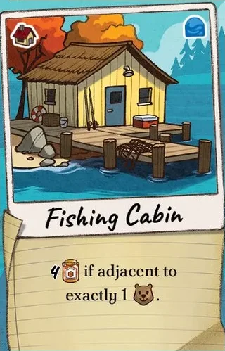</a> | `11` | **Cabin** | `building` | Nem | 4 points if adjacent to exactly 1 Bearfolk. |
|  | `12` | **Harbor** | `building` | Igen | 2 points. Goal: 7 points if adjacent to at least 2 BLUE cards. |
|  | `13` | **Lighthouse** | `building` | Nem | 2 points per BLUE card in this row and this column (counting itself once). |
|  | `14` | **Binoculars** | `item` | Nem | Activate a BLUE card in your tableau. |
| <a href="file:///C:/Users/Adam/Data/other_projects/bear_nec/public/assets/cards/card_16.webp">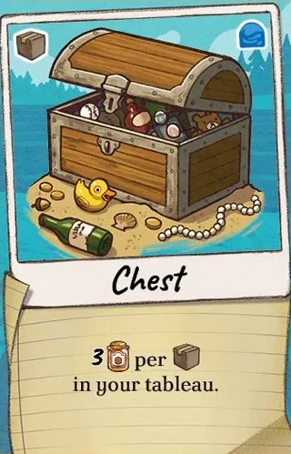</a> | `15` | **Collector** | `bearfolk` | Nem | 3 points per Item in your tableau. |
|  | `16` | **Collector** | `bearfolk` | Igen | 2 points. Goal: 12 points if you have at least 5 cards of the same color. |
|  | `17` | **Telescope** | `item` | Nem | Activate an Item in your tableau. |
|  | `18` | **Fisherbear** | `bearfolk` | Nem | 4 points if adjacent to at least 1 BLUE card. |
| <a href="file:///C:/Users/Adam/Data/other_projects/bear_nec/public/assets/cards/card_20.webp">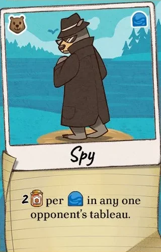</a> | `19` | **Spy** | `bearfolk` | Nem | 2 points per BLUE card in any one opponent's tableau. |
|  | `22` | **Water Lily** | `plant` | Nem | 3 points per adjacent BLUE card. |

---

## Sivatag (Desert - Sárga) (14 db)

| Kép | Katalógus ID | Kártya neve | Típus | Cél? | Képesség / Pontozás leírása |
| :---: | :---: | :--- | :--- | :---: | :--- |
|  | `24` | **Coyote** | `animal` | Nem | 4 points per adjacent GREEN card. |
| <a href="file:///C:/Users/Adam/Data/other_projects/bear_nec/public/assets/cards/card_25.webp">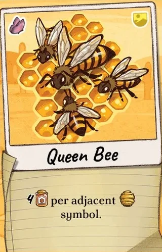</a> | `25` | **Queen Bee** | `animal` | Nem | 4 points per adjacent Hive symbol. |
| <a href="file:///C:/Users/Adam/Data/other_projects/bear_nec/public/assets/cards/card_29.webp">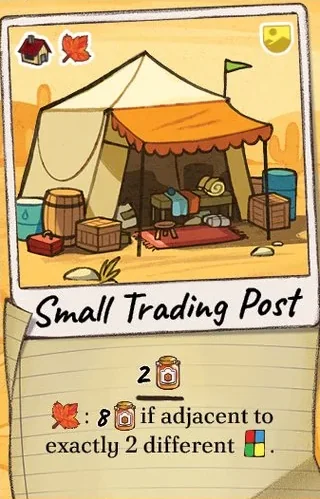</a> | `29` | **Small Trading Post** | `building` | Igen | 2 points. Goal: 8 points if adjacent to exactly 2 different colors. |
|  | `30` | **Medium Trading Post** | `building` | Igen | 2 points. Goal: 12 points if adjacent to exactly 3 different colors. |
|  | `31` | **Bearbecue** | `item` | Nem | 6 points per adjacent Fish. |
|  | `32` | **Binoculars** | `item` | Nem | Activate a YELLOW card in your tableau. |
|  | `35` | **Signpost** | `item` | Nem | 4 points per adjacent RED card. |
| <a href="file:///C:/Users/Adam/Data/other_projects/bear_nec/public/assets/cards/card_36.webp">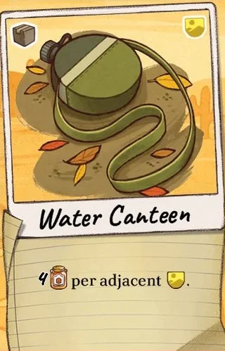</a> | `36` | **Water Canteen** | `item` | Nem | 4 points per adjacent YELLOW card. |
| <a href="file:///C:/Users/Adam/Data/other_projects/bear_nec/public/assets/cards/card_37.webp">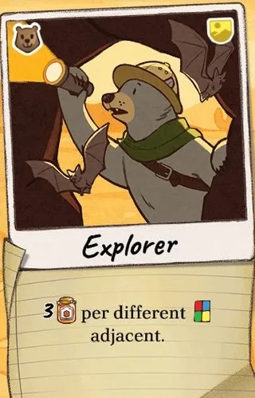</a> | `37` | **Explorer** | `bearfolk` | Nem | 3 points per different color adjacent. |
| <a href="file:///C:/Users/Adam/Data/other_projects/bear_nec/public/assets/cards/card_38.webp">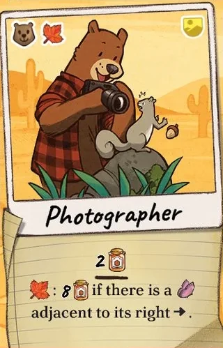</a> | `38` | **Photographer** | `bearfolk` | Igen | 2 points. Goal: 8 points if an Animal is adjacent to its right. |
|  | `39` | **Spy** | `bearfolk` | Nem | 1 point per RED and 1 point per GREEN card in any one opponent's tableau. |
| <a href="file:///C:/Users/Adam/Data/other_projects/bear_nec/public/assets/cards/card_40.webp">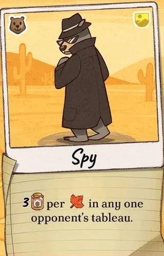</a> | `40` | **Spy** | `bearfolk` | Nem | 3 points per Goal symbol in any one opponent's tableau. |
| <a href="file:///C:/Users/Adam/Data/other_projects/bear_nec/public/assets/cards/card_41.webp">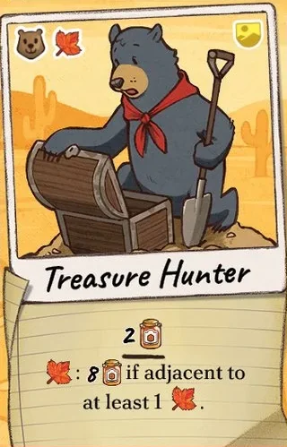</a> | `41` | **Treasure Hunter** | `bearfolk` | Igen | 2 points. Goal: 8 points if adjacent to at least 1 Goal symbol. |
| <a href="file:///C:/Users/Adam/Data/other_projects/bear_nec/public/assets/cards/card_44.webp">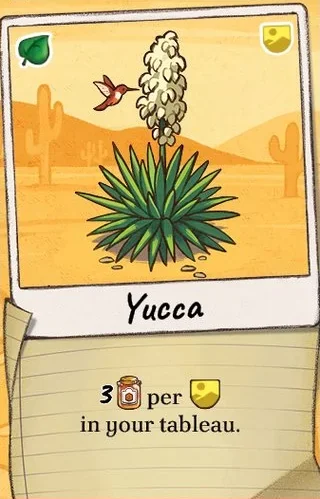</a> | `44` | **Yucca** | `plant` | Nem | 3 points per YELLOW card in your tableau. |

---

## Város (City - Piros) (14 db)

| Kép | Katalógus ID | Kártya neve | Típus | Cél? | Képesség / Pontozás leírása |
| :---: | :---: | :--- | :--- | :---: | :--- |
| <a href="file:///C:/Users/Adam/Data/other_projects/bear_nec/public/assets/cards/card_46.webp">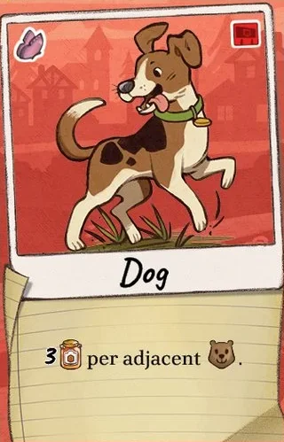</a> | `47` | **Dog** | `animal` | Nem | 3 points per adjacent Bearfolk. |
| <a href="file:///C:/Users/Adam/Data/other_projects/bear_nec/public/assets/cards/card_47.webp">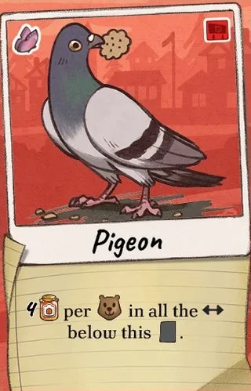</a> | `48` | **Pigeon** | `animal` | Nem | 4 points per Bearfolk in all rows below this card. |
|  | `51` | **Suburban Apartments** | `building` | Nem | 2 points per complete column (3 cards). |
|  | `52` | **Station** | `building` | Nem | 3 points per complete row (4 cards). |
| <a href="file:///C:/Users/Adam/Data/other_projects/bear_nec/public/assets/cards/card_53.webp">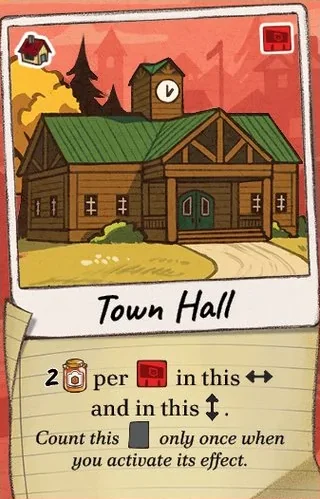</a> | `54` | **Town Hall** | `building` | Nem | 2 points per RED card in this row and this column (counting itself once). |
| <a href="file:///C:/Users/Adam/Data/other_projects/bear_nec/public/assets/cards/card_55.webp">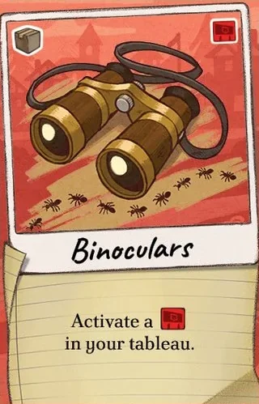</a> | `56` | **Binoculars** | `item` | Nem | Activate a RED card in your tableau. |
| <a href="file:///C:/Users/Adam/Data/other_projects/bear_nec/public/assets/cards/card_56.webp">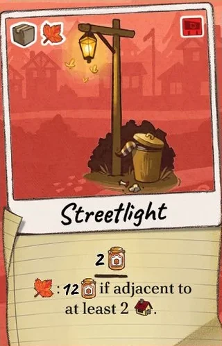</a> | `57` | **Streetlight** | `item` | Igen | 2 points. Goal: 12 points if adjacent to at least 2 Buildings. |
|  | `58` | **Statue** | `item` | Nem | 2 points per column with at least 1 RED card. |
| <a href="file:///C:/Users/Adam/Data/other_projects/bear_nec/public/assets/cards/card_61.webp">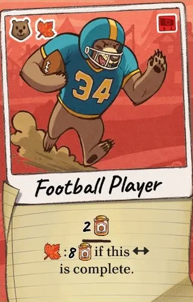</a> | `62` | **Football Player** | `bearfolk` | Igen | 2 points. Goal: 8 points if this row is complete. |
|  | `65` | **Sergeant** | `bearfolk` | Nem | 3 points per Bearfolk in this row. |
|  | `66` | **Spy** | `bearfolk` | Nem | 2 points per YELLOW card in any one opponent's tableau. |
| <a href="file:///C:/Users/Adam/Data/other_projects/bear_nec/public/assets/cards/card_66.webp">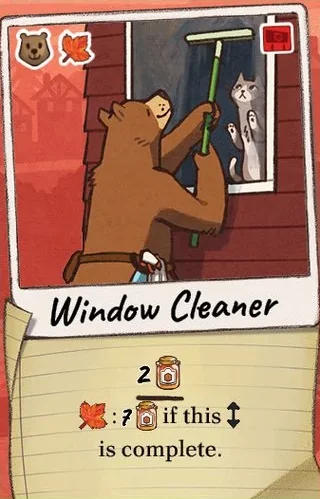</a> | `67` | **Window Cleaner** | `bearfolk` | Igen | 2 points. Goal: 7 points if this column is complete. |
|  | `68` | **Planter Box** | `plant` | Nem | 2 points per row with at least 1 RED card. |
|  | `69` | **Rose** | `plant` | Igen | 2 points. Goal: 10 points if adjacent to exactly 2 Bearfolk. |

---

## Hegy (Mountain - Zöld) (15 db)

| Kép | Katalógus ID | Kártya neve | Típus | Cél? | Képesség / Pontozás leírása |
| :---: | :---: | :--- | :--- | :---: | :--- |
| <a href="file:///C:/Users/Adam/Data/other_projects/bear_nec/public/assets/cards/card_72.webp">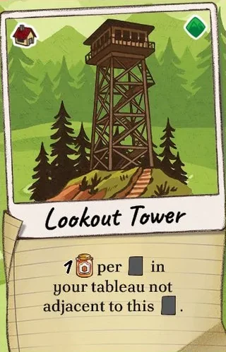</a> | `74` | **Lookout Tower** | `building` | Nem | 1 point per card in your tableau not adjacent to this card. |
|  | `76` | **Visitor Center** | `building` | Igen | 2 points. Goal: 7 points if all 4 colors are in your tableau. |
| <a href="file:///C:/Users/Adam/Data/other_projects/bear_nec/public/assets/cards/card_75.webp">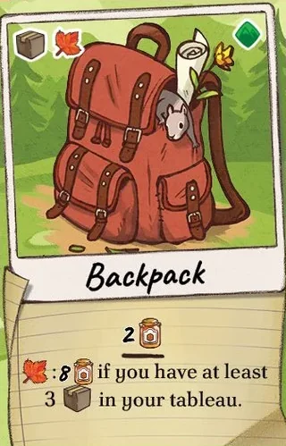</a> | `77` | **Backpack** | `item` | Igen | 2 points. Goal: 8 points if you have at least 3 Items in your tableau. |
| <a href="file:///C:/Users/Adam/Data/other_projects/bear_nec/public/assets/cards/card_76.webp">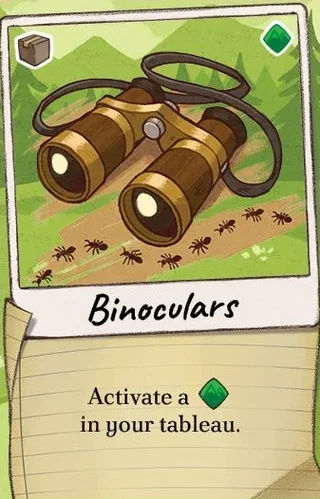</a> | `78` | **Binoculars** | `item` | Nem | Activate a GREEN card in your tableau. |
|  | `79` | **Water Trough** | `item` | Nem | 4 points per adjacent Animal. |
|  | `81` | **Weather Forecast: City** | `item` | Nem | 7 points if the card in your reserve is RED. |
|  | `82` | **Weather Forecast: Water** | `item` | Nem | 7 points if the card in your reserve is BLUE. |
| <a href="file:///C:/Users/Adam/Data/other_projects/bear_nec/public/assets/cards/card_82.webp">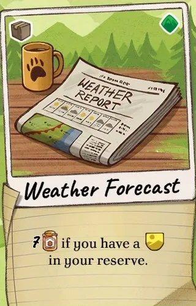</a> | `84` | **Weather Forecast: Desert** | `item` | Nem | 7 points if the card in your reserve is YELLOW. |
|  | `86` | **Guide** | `bearfolk` | Nem | Activate a Bearfolk in your tableau. |
|  | `88` | **Spy** | `bearfolk` | Nem | 1 point per YELLOW and 1 point per GREEN card in any one opponent's tableau. |
|  | `89` | **Spy** | `bearfolk` | Nem | 1 point per RED and 1 point per BLUE card in any one opponent's tableau. |
|  | `90` | **Spy** | `bearfolk` | Nem | 2 points per Bee token owned by any one opponent. |
| <a href="file:///C:/Users/Adam/Data/other_projects/bear_nec/public/assets/cards/card_89.webp">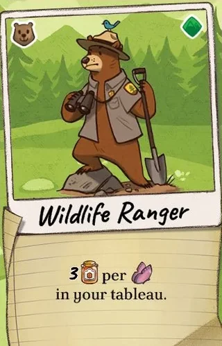</a> | `91` | **Wildlife Ranger** | `bearfolk` | Nem | 3 points per Animal in your tableau. |
| <a href="file:///C:/Users/Adam/Data/other_projects/bear_nec/public/assets/cards/card_90.webp">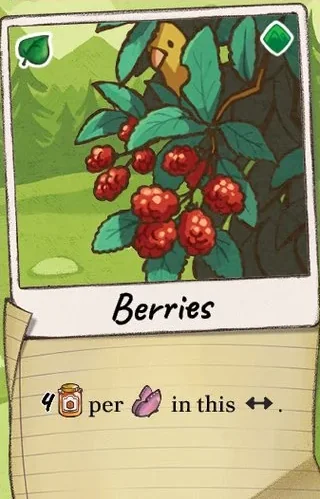</a> | `92` | **Berries** | `plant` | Nem | 4 points per Animal in this row. |
|  | `93` | **Dandelion** | `plant` | Nem | 7 points when placed. 1 point when activated by another card. |

---

