# Kaptár nélküli kártyák listája (Bear Necessities)

Ez a dokumentum azokat a játékkártyákat listázza, amelyek **NEM tartalmaznak kaptárt** (`beeHives: 0`), azaz a kijátszásukkor / draftolásukkor nem járulnak hozzá a kör végi Bee Time versenyhez (kaptár-összehasonlítás).

A katalógusban található **93 kártyából összesen 66 kártya** nem tartalmaz kaptárt (a fennmaradó 27 kártya tartalmaz 1 kaptárt).

> [!TIP]
> A táblázatban a kártyák bélyegképei közvetlenül megjelennek a markdown előnézetben, a képre vagy a fájlnévre kattintva pedig megnyitható az eredeti, nagy felbontású képfájl.

---

## Összesítés színek / élőhelyek szerint

| Élőhely / Szín | Kaptár nélküli kártyák száma | Összes kártya a pakliban | Kaptár nélküli arány |
| :--- | :---: | :---: | :---: |
| **Víz (Water - Kék)** | 15 db | 23 db | 65.2% |
| **Sivatag (Desert - Sárga)** | 18 db | 23 db | 78.3% |
| **Város (City - Piros)** | 18 db | 24 db | 75.0% |
| **Hegy (Mountain - Zöld)** | 15 db | 23 db | 65.2% |
| **Összesen** | **66 db** | **93 db** | **71.0%** |

---

## Víz (Kék) (15 db)

| Kép | ID | Kártya neve | Típus | Cél? | Képesség / Pontozás leírása |
| :---: | :---: | :--- | :--- | :---: | :--- |
| <a href="file:///C:/Users/Adam/Data/other_projects/bear_nec/public/assets/cards/card_01.webp">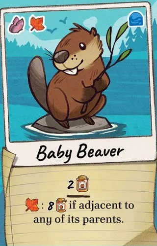</a> [card_01.webp](file:///C:/Users/Adam/Data/other_projects/bear_nec/public/assets/cards/card_01.webp) | 0 | **Baby Beaver** | `animal` | Igen | 2 points. Goal: 8 points if adjacent to Beaver Dad or Beaver Mom. |
| <a href="file:///C:/Users/Adam/Data/other_projects/bear_nec/public/assets/cards/card_08.webp">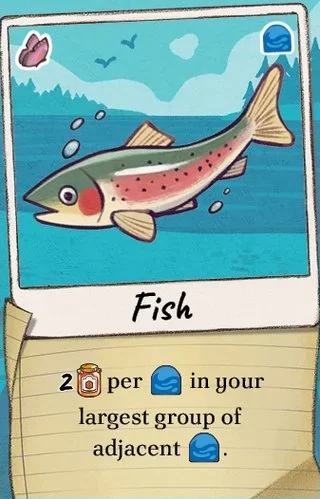</a> [card_08.webp](file:///C:/Users/Adam/Data/other_projects/bear_nec/public/assets/cards/card_08.webp) | 7 | **Fish** | `animal` | Nem | 2 points per BLUE card in your largest group of adjacent BLUE cards. |
|  [card_09.webp](file:///C:/Users/Adam/Data/other_projects/bear_nec/public/assets/cards/card_09.webp) | 8 | **Fish** | `animal` | Nem | 2 points per BLUE card in your largest group of adjacent BLUE cards. |
|  [card_10.webp](file:///C:/Users/Adam/Data/other_projects/bear_nec/public/assets/cards/card_10.webp) | 9 | **Fish** | `animal` | Nem | 2 points per BLUE card in your largest group of adjacent BLUE cards. |
|  [card_11.webp](file:///C:/Users/Adam/Data/other_projects/bear_nec/public/assets/cards/card_11.webp) | 10 | **Fish** | `animal` | Nem | 2 points per BLUE card in your largest group of adjacent BLUE cards. |
|  [card_12.webp](file:///C:/Users/Adam/Data/other_projects/bear_nec/public/assets/cards/card_12.webp) | 11 | **Cabin** | `building` | Nem | 4 points if adjacent to exactly 1 Bearfolk. |
| <a href="file:///C:/Users/Adam/Data/other_projects/bear_nec/public/assets/cards/card_13.webp">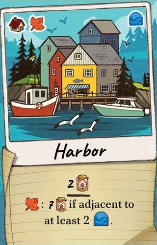</a> [card_13.webp](file:///C:/Users/Adam/Data/other_projects/bear_nec/public/assets/cards/card_13.webp) | 12 | **Harbor** | `building` | Igen | 2 points. Goal: 7 points if adjacent to at least 2 BLUE cards. |
| <a href="file:///C:/Users/Adam/Data/other_projects/bear_nec/public/assets/cards/card_14.webp">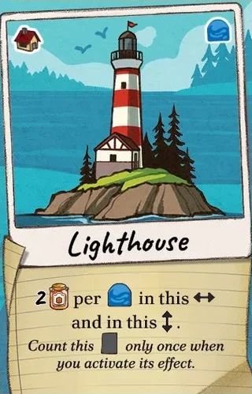</a> [card_14.webp](file:///C:/Users/Adam/Data/other_projects/bear_nec/public/assets/cards/card_14.webp) | 13 | **Lighthouse** | `building` | Nem | 2 points per BLUE card in this row and this column (counting itself once). |
| <a href="file:///C:/Users/Adam/Data/other_projects/bear_nec/public/assets/cards/card_15.webp">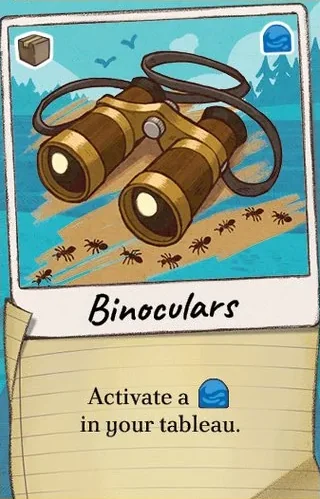</a> [card_15.webp](file:///C:/Users/Adam/Data/other_projects/bear_nec/public/assets/cards/card_15.webp) | 14 | **Binoculars** | `item` | Nem | Activate a BLUE card in your tableau. |
|  [card_16.webp](file:///C:/Users/Adam/Data/other_projects/bear_nec/public/assets/cards/card_16.webp) | 15 | **Collector** | `bearfolk` | Nem | 3 points per Item in your tableau. |
| <a href="file:///C:/Users/Adam/Data/other_projects/bear_nec/public/assets/cards/card_17.webp">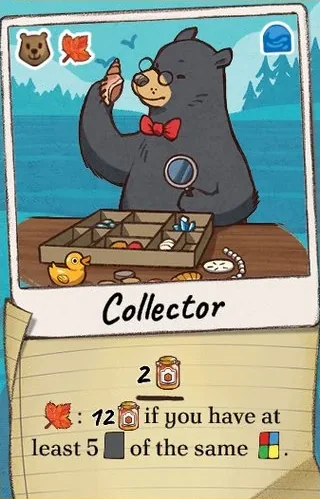</a> [card_17.webp](file:///C:/Users/Adam/Data/other_projects/bear_nec/public/assets/cards/card_17.webp) | 16 | **Collector** | `bearfolk` | Igen | 2 points. Goal: 12 points if you have at least 5 cards of the same color. |
| <a href="file:///C:/Users/Adam/Data/other_projects/bear_nec/public/assets/cards/card_18.webp">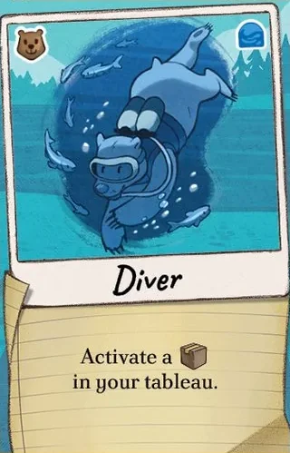</a> [card_18.webp](file:///C:/Users/Adam/Data/other_projects/bear_nec/public/assets/cards/card_18.webp) | 17 | **Telescope** | `item` | Nem | Activate an Item in your tableau. |
| <a href="file:///C:/Users/Adam/Data/other_projects/bear_nec/public/assets/cards/card_19.webp">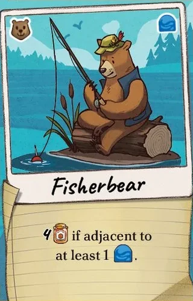</a> [card_19.webp](file:///C:/Users/Adam/Data/other_projects/bear_nec/public/assets/cards/card_19.webp) | 18 | **Fisherbear** | `bearfolk` | Nem | 4 points if adjacent to at least 1 BLUE card. |
|  [card_20.webp](file:///C:/Users/Adam/Data/other_projects/bear_nec/public/assets/cards/card_20.webp) | 19 | **Spy** | `bearfolk` | Nem | 2 points per BLUE card in any one opponent's tableau. |
| <a href="file:///C:/Users/Adam/Data/other_projects/bear_nec/public/assets/cards/card_23.webp">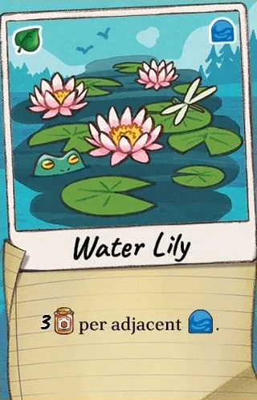</a> [card_23.webp](file:///C:/Users/Adam/Data/other_projects/bear_nec/public/assets/cards/card_23.webp) | 22 | **Water Lily** | `plant` | Nem | 3 points per adjacent BLUE card. |

---

## Sivatag (Sárga) (18 db)

| Kép | ID | Kártya neve | Típus | Cél? | Képesség / Pontozás leírása |
| :---: | :---: | :--- | :--- | :---: | :--- |
| <a href="file:///C:/Users/Adam/Data/other_projects/bear_nec/public/assets/cards/card_24.webp">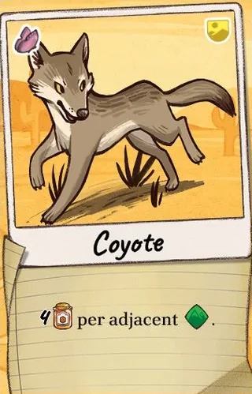</a> [card_24.webp](file:///C:/Users/Adam/Data/other_projects/bear_nec/public/assets/cards/card_24.webp) | 24 | **Coyote** | `animal` | Nem | 4 points per adjacent GREEN card. |
| <a href="file:///C:/Users/Adam/Data/other_projects/bear_nec/public/assets/cards/card_26.webp">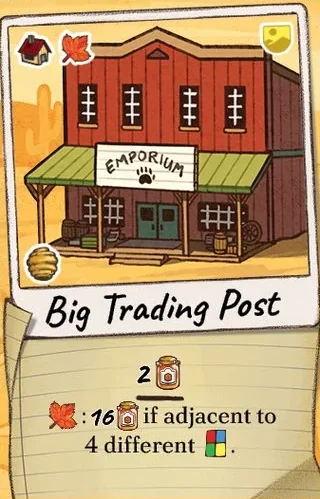</a> [card_26.webp](file:///C:/Users/Adam/Data/other_projects/bear_nec/public/assets/cards/card_26.webp) | 26 | **Trading Post** | `building` | Igen | 2 points. Goal: 16 points if adjacent to 4 different colors. |
| <a href="file:///C:/Users/Adam/Data/other_projects/bear_nec/public/assets/cards/card_28.webp">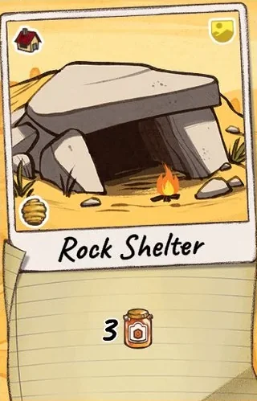</a> [card_28.webp](file:///C:/Users/Adam/Data/other_projects/bear_nec/public/assets/cards/card_28.webp) | 28 | **Rock Shelter** | `building` | Nem | 3 points. |
|  [card_29.webp](file:///C:/Users/Adam/Data/other_projects/bear_nec/public/assets/cards/card_29.webp) | 29 | **Small Trading Post** | `building` | Igen | 2 points. Goal: 8 points if adjacent to exactly 2 different colors. |
|  [card_30.webp](file:///C:/Users/Adam/Data/other_projects/bear_nec/public/assets/cards/card_30.webp) | 30 | **Medium Trading Post** | `building` | Igen | 2 points. Goal: 12 points if adjacent to exactly 3 different colors. |
| <a href="file:///C:/Users/Adam/Data/other_projects/bear_nec/public/assets/cards/card_31.webp">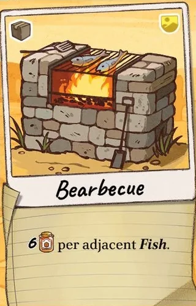</a> [card_31.webp](file:///C:/Users/Adam/Data/other_projects/bear_nec/public/assets/cards/card_31.webp) | 31 | **Bearbecue** | `item` | Nem | 6 points per adjacent Fish. |
| <a href="file:///C:/Users/Adam/Data/other_projects/bear_nec/public/assets/cards/card_32.webp">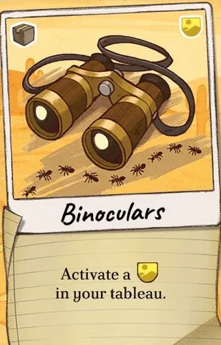</a> [card_32.webp](file:///C:/Users/Adam/Data/other_projects/bear_nec/public/assets/cards/card_32.webp) | 32 | **Binoculars** | `item` | Nem | Activate a YELLOW card in your tableau. |
| <a href="file:///C:/Users/Adam/Data/other_projects/bear_nec/public/assets/cards/card_34.webp">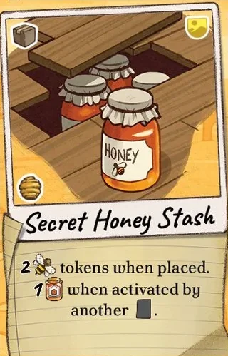</a> [card_34.webp](file:///C:/Users/Adam/Data/other_projects/bear_nec/public/assets/cards/card_34.webp) | 34 | **Secret Honey Stash** | `item` | Nem | Take 2 Bee tokens when placed. 1 point when activated by another card. |
|  [card_35.webp](file:///C:/Users/Adam/Data/other_projects/bear_nec/public/assets/cards/card_35.webp) | 35 | **Signpost** | `item` | Nem | 4 points per adjacent RED card. |
|  [card_36.webp](file:///C:/Users/Adam/Data/other_projects/bear_nec/public/assets/cards/card_36.webp) | 36 | **Water Canteen** | `item` | Nem | 4 points per adjacent YELLOW card. |
|  [card_37.webp](file:///C:/Users/Adam/Data/other_projects/bear_nec/public/assets/cards/card_37.webp) | 37 | **Explorer** | `bearfolk` | Nem | 3 points per different color adjacent. |
|  [card_38.webp](file:///C:/Users/Adam/Data/other_projects/bear_nec/public/assets/cards/card_38.webp) | 38 | **Photographer** | `bearfolk` | Igen | 2 points. Goal: 8 points if an Animal is adjacent to its right. |
| <a href="file:///C:/Users/Adam/Data/other_projects/bear_nec/public/assets/cards/card_39.webp">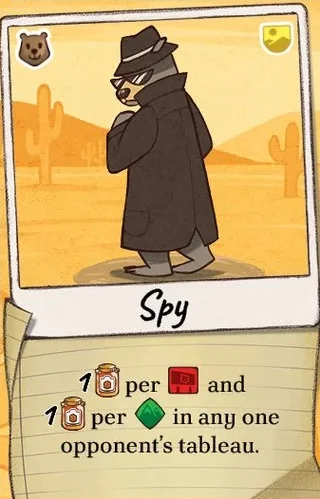</a> [card_39.webp](file:///C:/Users/Adam/Data/other_projects/bear_nec/public/assets/cards/card_39.webp) | 39 | **Spy** | `bearfolk` | Nem | 1 point per RED and 1 point per GREEN card in any one opponent's tableau. |
|  [card_40.webp](file:///C:/Users/Adam/Data/other_projects/bear_nec/public/assets/cards/card_40.webp) | 40 | **Spy** | `bearfolk` | Nem | 3 points per Goal symbol in any one opponent's tableau. |
|  [card_41.webp](file:///C:/Users/Adam/Data/other_projects/bear_nec/public/assets/cards/card_41.webp) | 41 | **Treasure Hunter** | `bearfolk` | Igen | 2 points. Goal: 8 points if adjacent to at least 1 Goal symbol. |
| <a href="file:///C:/Users/Adam/Data/other_projects/bear_nec/public/assets/cards/card_42.webp">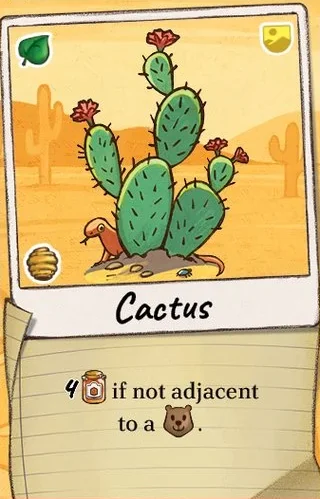</a> [card_42.webp](file:///C:/Users/Adam/Data/other_projects/bear_nec/public/assets/cards/card_42.webp) | 42 | **Cactus** | `plant` | Nem | 4 points if not adjacent to a Bearfolk. |
| <a href="file:///C:/Users/Adam/Data/other_projects/bear_nec/public/assets/cards/card_43.webp">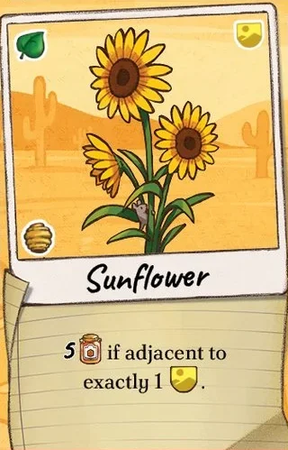</a> [card_43.webp](file:///C:/Users/Adam/Data/other_projects/bear_nec/public/assets/cards/card_43.webp) | 43 | **Sunflower** | `plant` | Nem | 5 points if adjacent to exactly 1 YELLOW card. |
|  [card_44.webp](file:///C:/Users/Adam/Data/other_projects/bear_nec/public/assets/cards/card_44.webp) | 44 | **Yucca** | `plant` | Nem | 3 points per YELLOW card in your tableau. |

---

## Város (Piros/Szürke) (18 db)

| Kép | ID | Kártya neve | Típus | Cél? | Képesség / Pontozás leírása |
| :---: | :---: | :--- | :--- | :---: | :--- |
| <a href="file:///C:/Users/Adam/Data/other_projects/bear_nec/public/assets/cards/card_45.webp">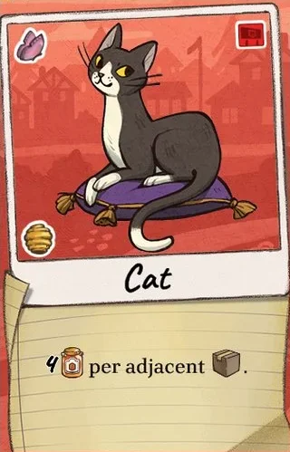</a> [card_45.webp](file:///C:/Users/Adam/Data/other_projects/bear_nec/public/assets/cards/card_45.webp) | 46 | **Cat** | `animal` | Nem | 4 points per adjacent Item. |
|  [card_46.webp](file:///C:/Users/Adam/Data/other_projects/bear_nec/public/assets/cards/card_46.webp) | 47 | **Dog** | `animal` | Nem | 3 points per adjacent Bearfolk. |
|  [card_47.webp](file:///C:/Users/Adam/Data/other_projects/bear_nec/public/assets/cards/card_47.webp) | 48 | **Pigeon** | `animal` | Nem | 4 points per Bearfolk in all rows below this card. |
| <a href="file:///C:/Users/Adam/Data/other_projects/bear_nec/public/assets/cards/card_50.webp">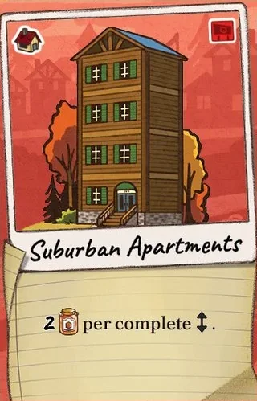</a> [card_50.webp](file:///C:/Users/Adam/Data/other_projects/bear_nec/public/assets/cards/card_50.webp) | 51 | **Suburban Apartments** | `building` | Nem | 2 points per complete column (3 cards). |
| <a href="file:///C:/Users/Adam/Data/other_projects/bear_nec/public/assets/cards/card_51.webp">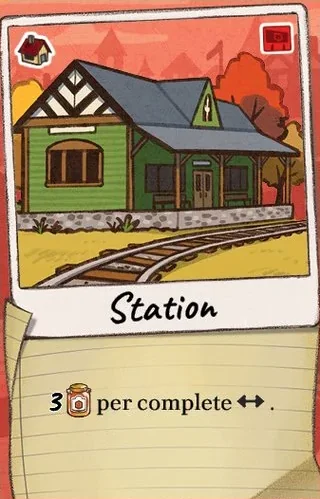</a> [card_51.webp](file:///C:/Users/Adam/Data/other_projects/bear_nec/public/assets/cards/card_51.webp) | 52 | **Station** | `building` | Nem | 3 points per complete row (4 cards). |
|  [card_53.webp](file:///C:/Users/Adam/Data/other_projects/bear_nec/public/assets/cards/card_53.webp) | 54 | **Town Hall** | `building` | Nem | 2 points per RED card in this row and this column (counting itself once). |
|  [card_55.webp](file:///C:/Users/Adam/Data/other_projects/bear_nec/public/assets/cards/card_55.webp) | 56 | **Binoculars** | `item` | Nem | Activate a RED card in your tableau. |
|  [card_56.webp](file:///C:/Users/Adam/Data/other_projects/bear_nec/public/assets/cards/card_56.webp) | 57 | **Streetlight** | `item` | Igen | 2 points. Goal: 12 points if adjacent to at least 2 Buildings. |
| <a href="file:///C:/Users/Adam/Data/other_projects/bear_nec/public/assets/cards/card_57.webp">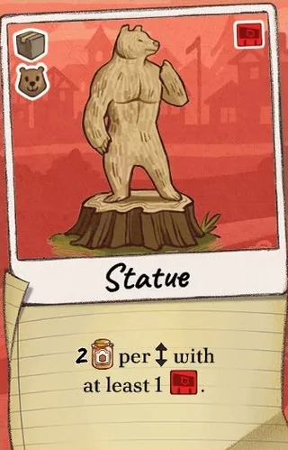</a> [card_57.webp](file:///C:/Users/Adam/Data/other_projects/bear_nec/public/assets/cards/card_57.webp) | 58 | **Statue** | `item` | Nem | 2 points per column with at least 1 RED card. |
| <a href="file:///C:/Users/Adam/Data/other_projects/bear_nec/public/assets/cards/card_58.webp">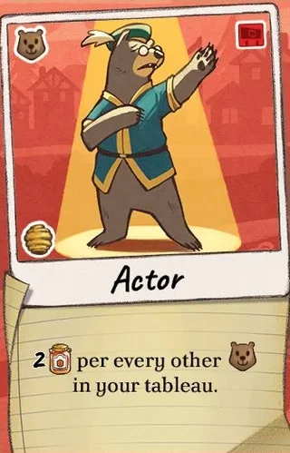</a> [card_58.webp](file:///C:/Users/Adam/Data/other_projects/bear_nec/public/assets/cards/card_58.webp) | 59 | **Actor** | `bearfolk` | Nem | 2 points per other Bearfolk in your tableau. |
| <a href="file:///C:/Users/Adam/Data/other_projects/bear_nec/public/assets/cards/card_59.webp">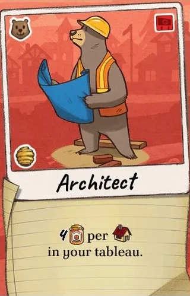</a> [card_59.webp](file:///C:/Users/Adam/Data/other_projects/bear_nec/public/assets/cards/card_59.webp) | 60 | **Architect** | `bearfolk` | Nem | 4 points per Building in your tableau. |
|  [card_61.webp](file:///C:/Users/Adam/Data/other_projects/bear_nec/public/assets/cards/card_61.webp) | 62 | **Football Player** | `bearfolk` | Igen | 2 points. Goal: 8 points if this row is complete. |
| <a href="file:///C:/Users/Adam/Data/other_projects/bear_nec/public/assets/cards/card_62.webp">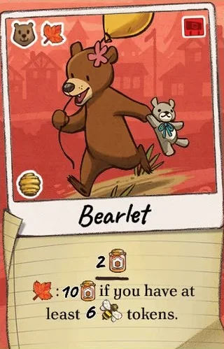</a> [card_62.webp](file:///C:/Users/Adam/Data/other_projects/bear_nec/public/assets/cards/card_62.webp) | 63 | **Bearlet** | `bearfolk` | Igen | 2 points. Goal: 10 points if you have at least 6 Bee tokens. |
| <a href="file:///C:/Users/Adam/Data/other_projects/bear_nec/public/assets/cards/card_64.webp">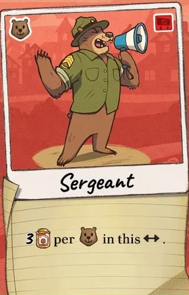</a> [card_64.webp](file:///C:/Users/Adam/Data/other_projects/bear_nec/public/assets/cards/card_64.webp) | 65 | **Sergeant** | `bearfolk` | Nem | 3 points per Bearfolk in this row. |
| <a href="file:///C:/Users/Adam/Data/other_projects/bear_nec/public/assets/cards/card_65.webp">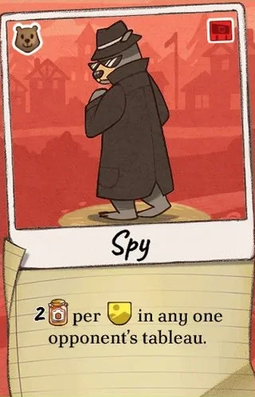</a> [card_65.webp](file:///C:/Users/Adam/Data/other_projects/bear_nec/public/assets/cards/card_65.webp) | 66 | **Spy** | `bearfolk` | Nem | 2 points per YELLOW card in any one opponent's tableau. |
|  [card_66.webp](file:///C:/Users/Adam/Data/other_projects/bear_nec/public/assets/cards/card_66.webp) | 67 | **Window Cleaner** | `bearfolk` | Igen | 2 points. Goal: 7 points if this column is complete. |
| <a href="file:///C:/Users/Adam/Data/other_projects/bear_nec/public/assets/cards/card_67.webp">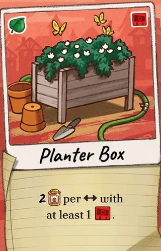</a> [card_67.webp](file:///C:/Users/Adam/Data/other_projects/bear_nec/public/assets/cards/card_67.webp) | 68 | **Planter Box** | `plant` | Nem | 2 points per row with at least 1 RED card. |
| <a href="file:///C:/Users/Adam/Data/other_projects/bear_nec/public/assets/cards/card_68.webp">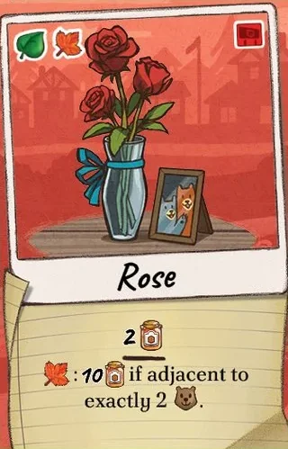</a> [card_68.webp](file:///C:/Users/Adam/Data/other_projects/bear_nec/public/assets/cards/card_68.webp) | 69 | **Rose** | `plant` | Igen | 2 points. Goal: 10 points if adjacent to exactly 2 Bearfolk. |

---

## Hegy (Zöld) (15 db)

| Kép | ID | Kártya neve | Típus | Cél? | Képesség / Pontozás leírása |
| :---: | :---: | :--- | :--- | :---: | :--- |
|  [card_72.webp](file:///C:/Users/Adam/Data/other_projects/bear_nec/public/assets/cards/card_72.webp) | 74 | **Lookout Tower** | `building` | Nem | 1 point per card in your tableau not adjacent to this card. |
| <a href="file:///C:/Users/Adam/Data/other_projects/bear_nec/public/assets/cards/card_74.webp">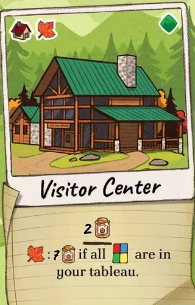</a> [card_74.webp](file:///C:/Users/Adam/Data/other_projects/bear_nec/public/assets/cards/card_74.webp) | 76 | **Visitor Center** | `building` | Igen | 2 points. Goal: 7 points if all 4 colors are in your tableau. |
|  [card_75.webp](file:///C:/Users/Adam/Data/other_projects/bear_nec/public/assets/cards/card_75.webp) | 77 | **Backpack** | `item` | Igen | 2 points. Goal: 8 points if you have at least 3 Items in your tableau. |
|  [card_76.webp](file:///C:/Users/Adam/Data/other_projects/bear_nec/public/assets/cards/card_76.webp) | 78 | **Binoculars** | `item` | Nem | Activate a GREEN card in your tableau. |
| <a href="file:///C:/Users/Adam/Data/other_projects/bear_nec/public/assets/cards/card_77.webp">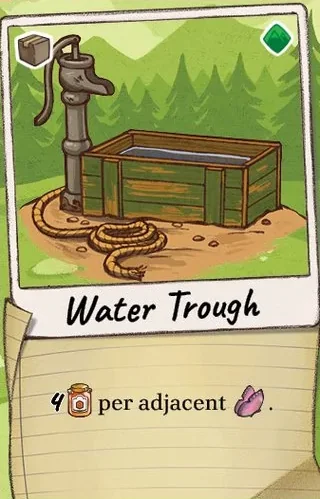</a> [card_77.webp](file:///C:/Users/Adam/Data/other_projects/bear_nec/public/assets/cards/card_77.webp) | 79 | **Water Trough** | `item` | Nem | 4 points per adjacent Animal. |
| <a href="file:///C:/Users/Adam/Data/other_projects/bear_nec/public/assets/cards/card_79.webp">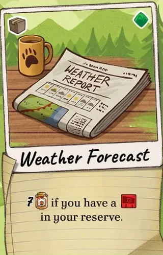</a> [card_79.webp](file:///C:/Users/Adam/Data/other_projects/bear_nec/public/assets/cards/card_79.webp) | 81 | **Weather Forecast: City** | `item` | Nem | 7 points if the card in your reserve is RED. |
| <a href="file:///C:/Users/Adam/Data/other_projects/bear_nec/public/assets/cards/card_80.webp">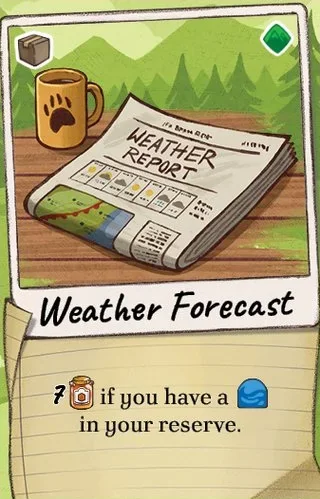</a> [card_80.webp](file:///C:/Users/Adam/Data/other_projects/bear_nec/public/assets/cards/card_80.webp) | 82 | **Weather Forecast: Water** | `item` | Nem | 7 points if the card in your reserve is BLUE. |
|  [card_82.webp](file:///C:/Users/Adam/Data/other_projects/bear_nec/public/assets/cards/card_82.webp) | 84 | **Weather Forecast: Desert** | `item` | Nem | 7 points if the card in your reserve is YELLOW. |
| <a href="file:///C:/Users/Adam/Data/other_projects/bear_nec/public/assets/cards/card_84.webp">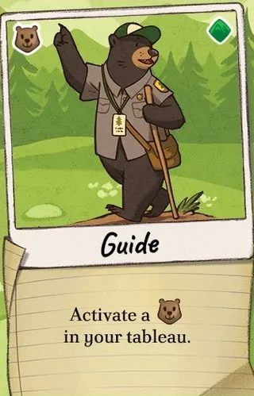</a> [card_84.webp](file:///C:/Users/Adam/Data/other_projects/bear_nec/public/assets/cards/card_84.webp) | 86 | **Guide** | `bearfolk` | Nem | Activate a Bearfolk in your tableau. |
| <a href="file:///C:/Users/Adam/Data/other_projects/bear_nec/public/assets/cards/card_86.webp">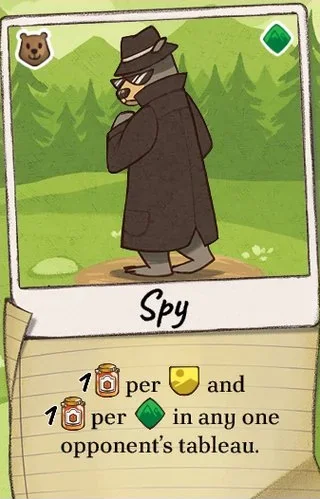</a> [card_86.webp](file:///C:/Users/Adam/Data/other_projects/bear_nec/public/assets/cards/card_86.webp) | 88 | **Spy** | `bearfolk` | Nem | 1 point per YELLOW and 1 point per GREEN card in any one opponent's tableau. |
| <a href="file:///C:/Users/Adam/Data/other_projects/bear_nec/public/assets/cards/card_87.webp">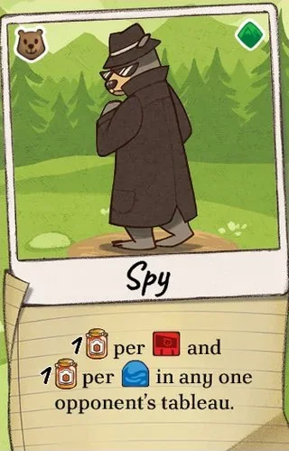</a> [card_87.webp](file:///C:/Users/Adam/Data/other_projects/bear_nec/public/assets/cards/card_87.webp) | 89 | **Spy** | `bearfolk` | Nem | 1 point per RED and 1 point per BLUE card in any one opponent's tableau. |
| <a href="file:///C:/Users/Adam/Data/other_projects/bear_nec/public/assets/cards/card_88.webp">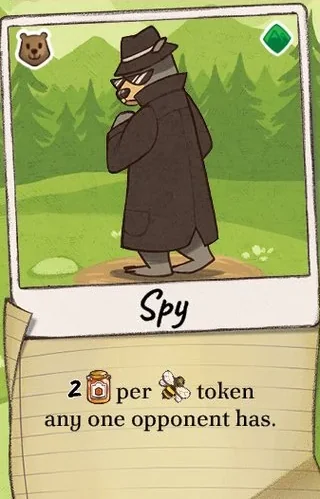</a> [card_88.webp](file:///C:/Users/Adam/Data/other_projects/bear_nec/public/assets/cards/card_88.webp) | 90 | **Spy** | `bearfolk` | Nem | 2 points per Bee token owned by any one opponent. |
|  [card_89.webp](file:///C:/Users/Adam/Data/other_projects/bear_nec/public/assets/cards/card_89.webp) | 91 | **Wildlife Ranger** | `bearfolk` | Nem | 3 points per Animal in your tableau. |
|  [card_90.webp](file:///C:/Users/Adam/Data/other_projects/bear_nec/public/assets/cards/card_90.webp) | 92 | **Berries** | `plant` | Nem | 4 points per Animal in this row. |
| <a href="file:///C:/Users/Adam/Data/other_projects/bear_nec/public/assets/cards/card_91.webp">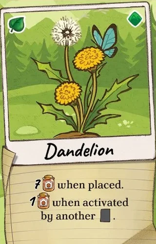</a> [card_91.webp](file:///C:/Users/Adam/Data/other_projects/bear_nec/public/assets/cards/card_91.webp) | 93 | **Dandelion** | `plant` | Nem | 7 points when placed. 1 point when activated by another card. |

---

