# Kaptárt tartalmazó kártyák listája (Bear Necessities)

Ez a dokumentum azokat a játékkártyákat listázza, amelyek **TARTALMAZNAK kaptárt** (`beeHives >= 1`), így kijátszásukkor / a tablóban növelik a játékos kaptárszámát, és hozzájárulnak a kör végi Bee Time megnyeréséhez.

A katalógus 94 lapjából összesen **36 darab kártya** tartalmaz legalább 1 kaptárt (közülük a Gumikacsa 2 kaptárt tartalmaz).

> [!NOTE]
> **Számozási magyarázat (Képfájl vs Katalógus ID):**
> A játék eredeti spritesheet táblájában minden színcsoport után egy kártyahátlap volt elhelyezve (slot 23: Víz hátlap, slot 45: Sivatag hátlap, slot 70: Város hátlap).
> A `public/assets/cards` mappában csak a játszható kártyák lettek folytonosan számozva (`card_01.webp` – `card_94.webp`). Ezért:
> - A **Víz** kártyáknál (slot 0..22) a képfájl sorszáma `ID + 1` (pl. ID 0 = `card_01.webp`).
> - A **Sivatag** kártyáknál (slot 24..44) az 1 hátlap kivonása miatt az ID és a képfájl száma pontosan megegyezik (pl. ID 26 = `card_26.webp`, ID 42 = `card_42.webp`).
> - A **Város (Piros)** kártyáknál (slot 46..69) már 2 hátlap esett ki előtte, így a képfájl száma `ID - 1` (pl. ID 46 Macska = `card_45.webp`, ID 59 Színész = `card_58.webp`, ID 63 Kismedve = `card_62.webp`).
> - A **Hegy (Zöld)** kártyáknál (slot 71..96) 3 hátlap esett ki, így a képfájl száma `ID - 2` (pl. ID 71 Sas = `card_69.webp`).

> [!TIP]
> A táblázatban minden kártya képe közvetlenül megjelenik előnézetként, rákattintva pedig megnyílik az eredeti WebP képfájl.

---

## Összesítés színek / élőhelyek szerint

| Élőhely / Szín | Kártyák száma | Összes lap a pakliban | Arány |
| :--- | :---: | :---: | :---: |
| **Víz (Water - Kék)** | 8 db | 23 db | 34.8% |
| **Sivatag (Desert - Sárga)** | 7 db | 21 db | 33.3% |
| **Város (City - Piros)** | 10 db | 24 db | 41.7% |
| **Hegy (Mountain - Zöld)** | 11 db | 26 db | 42.3% |
| **Összesen** | **36 db** | **94 db** | **38.3%** |

---

## Víz (Water - Kék) (8 db)

| Kép | Katalógus ID | Kártya neve | Kaptárak | Típus | Cél? | Képesség / Pontozás leírása |
| :---: | :---: | :--- | :---: | :--- | :---: | :--- |
| <a href="file:///C:/Users/Adam/Data/other_projects/bear_nec/public/assets/cards/card_02.webp">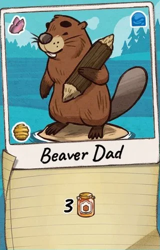</a> | `1` | **Beaver Dad** | 🍯 (1) | `animal` | Nem | 3 points. |
| <a href="file:///C:/Users/Adam/Data/other_projects/bear_nec/public/assets/cards/card_03.webp">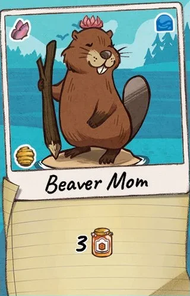</a> | `2` | **Beaver Mom** | 🍯 (1) | `animal` | Nem | 3 points. |
| <a href="file:///C:/Users/Adam/Data/other_projects/bear_nec/public/assets/cards/card_04.webp">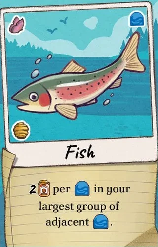</a> | `3` | **Fish** | 🍯 (1) | `animal` | Nem | 2 points per BLUE card in your largest group of adjacent BLUE cards. |
|  | `4` | **Fish** | 🍯 (1) | `animal` | Nem | 2 points per BLUE card in your largest group of adjacent BLUE cards. |
|  | `5` | **Fish** | 🍯 (1) | `animal` | Nem | 2 points per BLUE card in your largest group of adjacent BLUE cards. |
|  | `6` | **Fish** | 🍯 (1) | `animal` | Nem | 2 points per BLUE card in your largest group of adjacent BLUE cards. |
| <a href="file:///C:/Users/Adam/Data/other_projects/bear_nec/public/assets/cards/card_21.webp">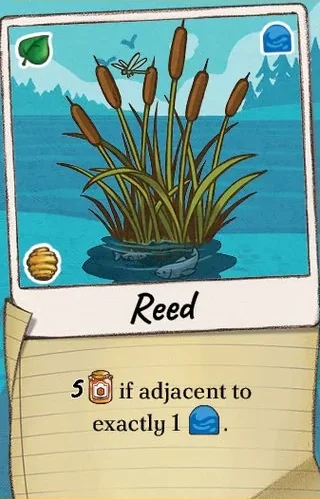</a> | `20` | **Reed** | 🍯 (1) | `plant` | Nem | 5 points if adjacent to exactly 1 BLUE card. |
| <a href="file:///C:/Users/Adam/Data/other_projects/bear_nec/public/assets/cards/card_22.webp">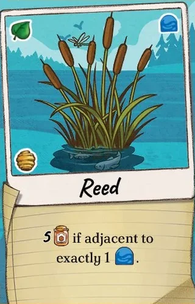</a> | `21` | **Reed** | 🍯 (1) | `plant` | Nem | 5 points if adjacent to exactly 1 BLUE card. |

---

## Sivatag (Desert - Sárga) (7 db)

| Kép | Katalógus ID | Kártya neve | Kaptárak | Típus | Cél? | Képesség / Pontozás leírása |
| :---: | :---: | :--- | :---: | :--- | :---: | :--- |
| <a href="file:///C:/Users/Adam/Data/other_projects/bear_nec/public/assets/cards/card_26.webp">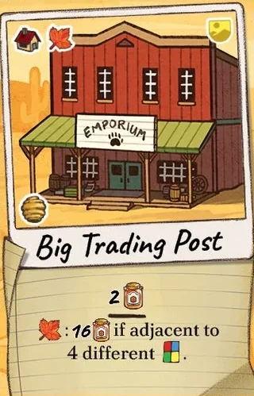</a> | `26` | **Trading Post** | 🍯 (1) | `building` | Igen | 2 points. Goal: 16 points if adjacent to 4 different colors. |
|  | `27` | **CIA Headquarters** | 🍯 (1) | `building` | Nem | 5 points per Spy in your tableau. |
| <a href="file:///C:/Users/Adam/Data/other_projects/bear_nec/public/assets/cards/card_28.webp">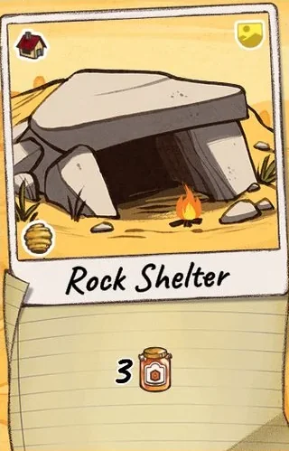</a> | `28` | **Rock Shelter** | 🍯 (1) | `building` | Nem | 3 points. |
| <a href="file:///C:/Users/Adam/Data/other_projects/bear_nec/public/assets/cards/card_33.webp">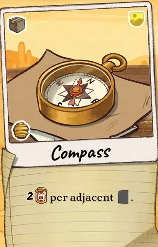</a> | `33` | **Compass** | 🍯 (1) | `item` | Nem | 2 points per adjacent card. |
| <a href="file:///C:/Users/Adam/Data/other_projects/bear_nec/public/assets/cards/card_34.webp">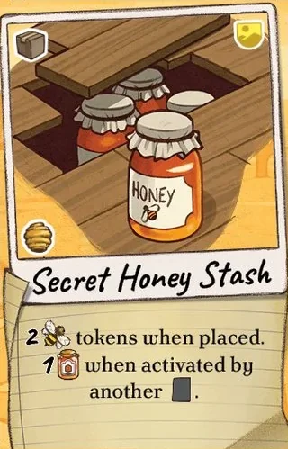</a> | `34` | **Secret Honey Stash** | 🍯 (1) | `item` | Nem | Take 2 Bee tokens when placed. 1 point when activated by another card. |
| <a href="file:///C:/Users/Adam/Data/other_projects/bear_nec/public/assets/cards/card_42.webp">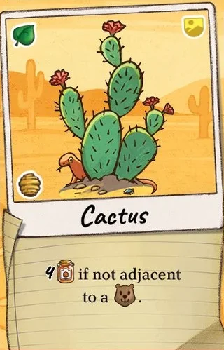</a> | `42` | **Cactus** | 🍯 (1) | `plant` | Nem | 4 points if not adjacent to a Bearfolk. |
| <a href="file:///C:/Users/Adam/Data/other_projects/bear_nec/public/assets/cards/card_43.webp">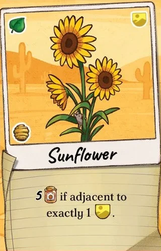</a> | `43` | **Sunflower** | 🍯 (1) | `plant` | Nem | 5 points if adjacent to exactly 1 YELLOW card. |

---

## Város (City - Piros) (10 db)

| Kép | Katalógus ID | Kártya neve | Kaptárak | Típus | Cél? | Képesség / Pontozás leírása |
| :---: | :---: | :--- | :---: | :--- | :---: | :--- |
| <a href="file:///C:/Users/Adam/Data/other_projects/bear_nec/public/assets/cards/card_45.webp">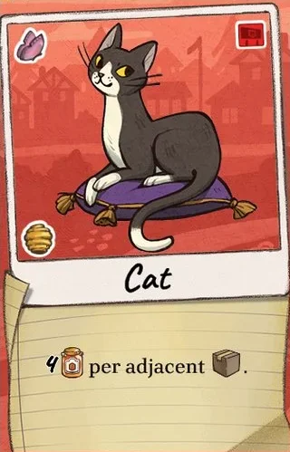</a> | `46` | **Cat** | 🍯 (1) | `animal` | Nem | 4 points per adjacent Item. |
| <a href="file:///C:/Users/Adam/Data/other_projects/bear_nec/public/assets/cards/card_48.webp">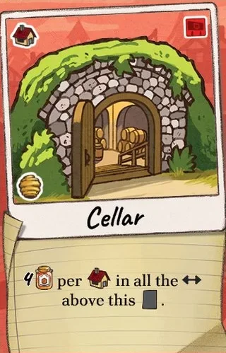</a> | `49` | **Cellar** | 🍯 (1) | `building` | Nem | 4 points per Building in all rows above this card. |
| <a href="file:///C:/Users/Adam/Data/other_projects/bear_nec/public/assets/cards/card_49.webp">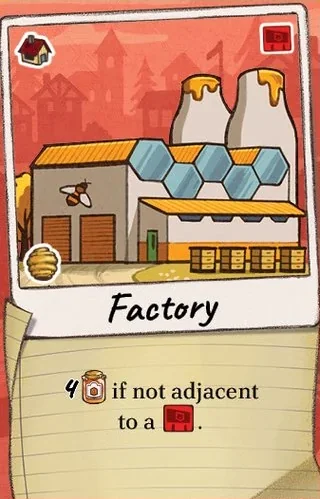</a> | `50` | **Factory** | 🍯 (1) | `building` | Nem | 4 points if not adjacent to a RED card. |
| <a href="file:///C:/Users/Adam/Data/other_projects/bear_nec/public/assets/cards/card_52.webp">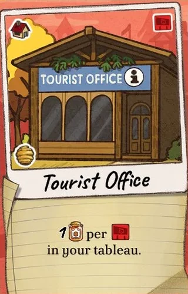</a> | `53` | **Tourist Office** | 🍯 (1) | `building` | Nem | 1 point per RED card in your tableau. |
| <a href="file:///C:/Users/Adam/Data/other_projects/bear_nec/public/assets/cards/card_54.webp">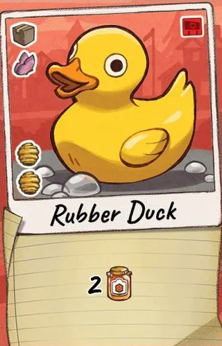</a> | `55` | **Rubber Duck** | 🍯🍯 (2) | `item` | Nem | 2 points. |
| <a href="file:///C:/Users/Adam/Data/other_projects/bear_nec/public/assets/cards/card_58.webp">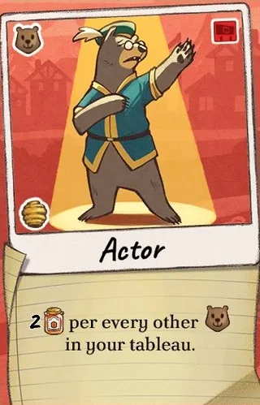</a> | `59` | **Actor** | 🍯 (1) | `bearfolk` | Nem | 2 points per other Bearfolk in your tableau. |
| <a href="file:///C:/Users/Adam/Data/other_projects/bear_nec/public/assets/cards/card_59.webp">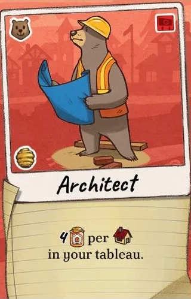</a> | `60` | **Architect** | 🍯 (1) | `bearfolk` | Nem | 4 points per Building in your tableau. |
| <a href="file:///C:/Users/Adam/Data/other_projects/bear_nec/public/assets/cards/card_60.webp">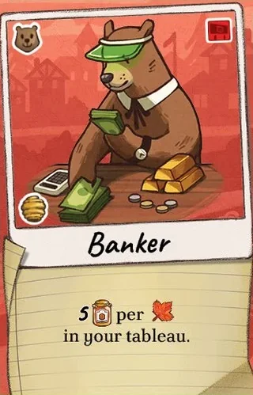</a> | `61` | **Banker** | 🍯 (1) | `bearfolk` | Nem | 5 points per Goal symbol in your tableau. |
| <a href="file:///C:/Users/Adam/Data/other_projects/bear_nec/public/assets/cards/card_62.webp">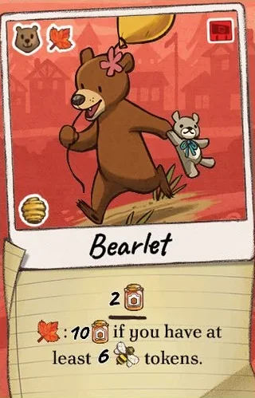</a> | `63` | **Bearlet** | 🍯 (1) | `bearfolk` | Igen | 2 points. Goal: 10 points if you have at least 6 Bee tokens. |
| <a href="file:///C:/Users/Adam/Data/other_projects/bear_nec/public/assets/cards/card_63.webp">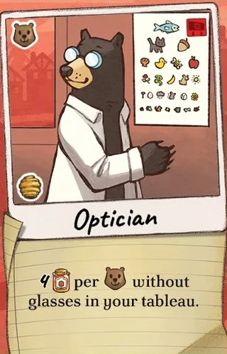</a> | `64` | **Optician** | 🍯 (1) | `bearfolk` | Nem | 4 points per Bearfolk without glasses in your tableau. |

---

## Hegy (Mountain - Zöld) (11 db)

| Kép | Katalógus ID | Kártya neve | Kaptárak | Típus | Cél? | Képesség / Pontozás leírása |
| :---: | :---: | :--- | :---: | :--- | :---: | :--- |
| <a href="file:///C:/Users/Adam/Data/other_projects/bear_nec/public/assets/cards/card_69.webp">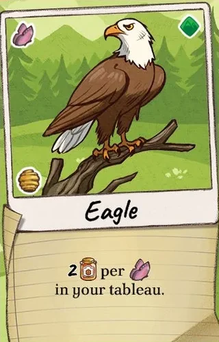</a> | `71` | **Eagle** | 🍯 (1) | `animal` | Nem | 2 points per Animal in your tableau. |
| <a href="file:///C:/Users/Adam/Data/other_projects/bear_nec/public/assets/cards/card_70.webp">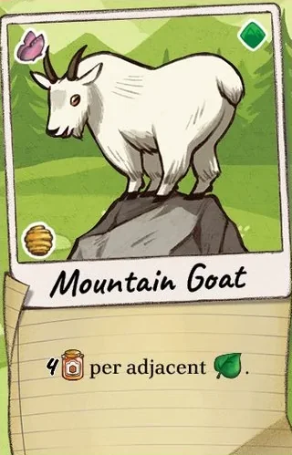</a> | `72` | **Mountain Goat** | 🍯 (1) | `animal` | Nem | 4 points per adjacent Plant. |
| <a href="file:///C:/Users/Adam/Data/other_projects/bear_nec/public/assets/cards/card_71.webp">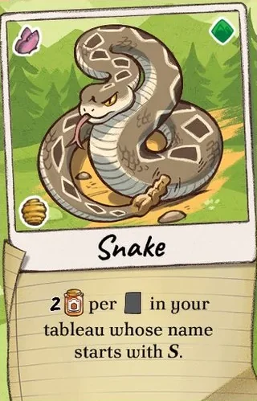</a> | `73` | **Snake** | 🍯 (1) | `animal` | Nem | 2 points per card in your tableau whose name starts with S. |
| <a href="file:///C:/Users/Adam/Data/other_projects/bear_nec/public/assets/cards/card_73.webp">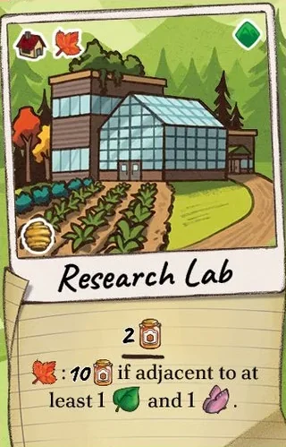</a> | `75` | **Research Lab** | 🍯 (1) | `building` | Igen | 2 points. Goal: 10 points if adjacent to at least 1 Plant and 1 Animal. |
| <a href="file:///C:/Users/Adam/Data/other_projects/bear_nec/public/assets/cards/card_78.webp">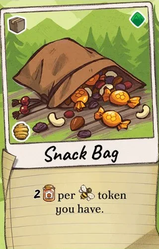</a> | `80` | **Snack Bag** | 🍯 (1) | `item` | Nem | 2 points per Bee token you own. |
| <a href="file:///C:/Users/Adam/Data/other_projects/bear_nec/public/assets/cards/card_81.webp">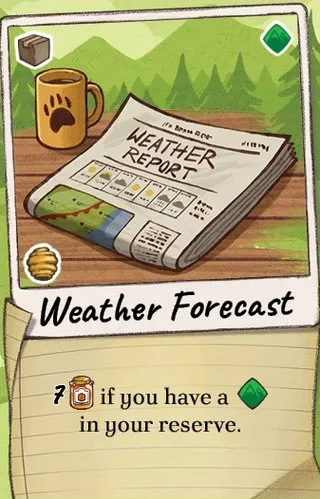</a> | `83` | **Weather Forecast: Mountain** | 🍯 (1) | `item` | Nem | 7 points if the card in your reserve is GREEN. |
| <a href="file:///C:/Users/Adam/Data/other_projects/bear_nec/public/assets/cards/card_83.webp">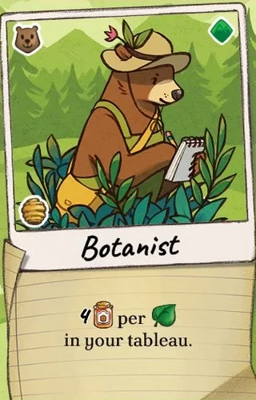</a> | `85` | **Botanist** | 🍯 (1) | `bearfolk` | Nem | 4 points per Plant in your tableau. |
| <a href="file:///C:/Users/Adam/Data/other_projects/bear_nec/public/assets/cards/card_85.webp">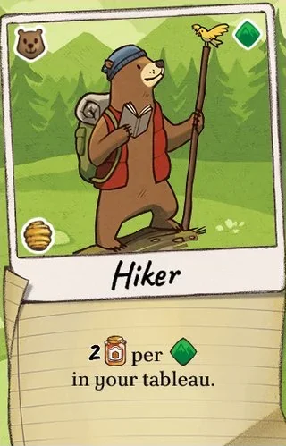</a> | `87` | **Hiker** | 🍯 (1) | `bearfolk` | Nem | 2 points per GREEN card in your tableau. |
| <a href="file:///C:/Users/Adam/Data/other_projects/bear_nec/public/assets/cards/card_92.webp">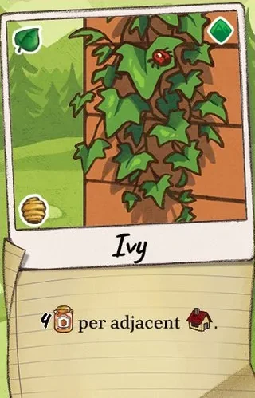</a> | `94` | **Fern** | 🍯 (1) | `plant` | Nem | 4 points per adjacent Building. |
| <a href="file:///C:/Users/Adam/Data/other_projects/bear_nec/public/assets/cards/card_93.webp">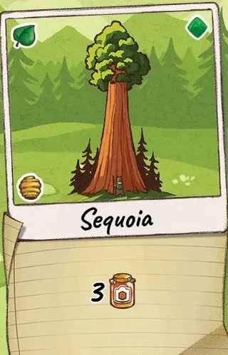</a> | `95` | **Sequoia** | 🍯 (1) | `plant` | Nem | 3 points. |
| <a href="file:///C:/Users/Adam/Data/other_projects/bear_nec/public/assets/cards/card_94.webp">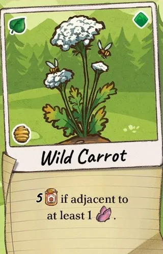</a> | `96` | **Wild Carrot** | 🍯 (1) | `plant` | Nem | 5 points if adjacent to at least 1 Animal. |

---

