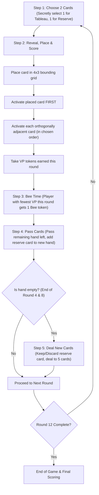

# Bear Necessities — Complete Rules Summary & Game System Analysis

> **Source Documents:** Official Rulebook (`assets/sources/rules.pdf`, `docs/rules_extracted.txt`), Mojito Studios (Designers: Gricha German & Johan Benvenuto; Illustrator: Kerri Aitken).

---

## 1. Game Overview & Objective

**Bear Necessities** is a spatial tableau-building and card-drafting game played over exactly **12 rounds**. 

Each player builds a personal photographic journey represented by a **4-column by 3-row grid** (12 cards total). On each turn, players simultaneously select two cards from hand—one to place into their tableau and one to store in their reserve for the following round. 

When a card is placed into the tableau, it triggers **cascading activations**: the newly placed card activates first, and then it activates every orthogonally adjacent neighbor in the player's choice of order. Activating cards scores Victory Points (VP) and triggers special card abilities.

At the end of each round, the player (or players) who gained the fewest VP that round receives a **Bee token**. At game's end, Bee tokens multiply the total number of **Bee Hive multiplier symbols** in a player's tableau, providing significant catch-up and scoring potential. 

The player with the highest total Victory Points at the end of round 12 wins.

---

## 2. Components

| Component | Quantity | Details / Constraints |
| :--- | :---: | :--- |
| **Cards** | **94** | Illustrated photograph cards featuring Bearfolk, nature, items, and sights across 4 biomes/colors. |
| **Victory Point (VP) Tokens** | **100** | Various denominations (e.g., 1, 5, 10, 20). Supply is considered infinite (substitutes allowed if exhausted). |
| **Bee Tokens** | **20** | Wooden / cardboard bee tokens. Supply is considered infinite (substitutes allowed; real bees not recommended!). |
| **Rulebook** | 1 | Official 4-page rules sheet. |

---

## 3. Card Classifications & Anatomy

Every card has specific attributes that interact with scoring conditions, adjacency checks, and tableau requirements.

### 3.1 The 4 Colors (Biomes)
Card colors appear on both the front and back of each card, with distinct accessibility icons for colorblind players:
1. **City (Red)**
2. **Desert (Yellow)**
3. **Mountain (Green)**
4. **Water (Blue)**

### 3.2 The 5 Card Types
Cards feature one or two types located beneath the title / icon area:
1. **Bearfolk** (Bears living in cities, exploring, fishing, etc.)
2. **Building** (Structures, stores, lighthouses, trading posts)
3. **Item** (Photographic equipment, binoculars, collectibles, rubber ducks)
4. **Plant** (Berries, sequoias, wild carrots, dandelions)
5. **Animal** (Dogs, eagles, bees, wildlife)

> **Note:** A single card can possess **dual types** (e.g., both *Plant* and *Food*, or *Animal* and *Bearfolk*). Dual-type cards satisfy conditions for both types simultaneously.

### 3.3 Card Anatomy & Symbols
* **Card Name:** Displayed at the top of the card.
* **Color / Biome Symbol:** Displays the card's color/biome icon in the corner.
* **Card Type(s):** Icons indicating 1 or 2 of the 5 card types.
* **Goal Symbol (`[Goal]`):** Indicates a conditional split-scoring card.
* **Bee Hive Symbol(s) (`[Hive]`):** End-game multiplier symbol (some cards have 1, some have 2).
* **Card Effect / Scoring Box:** The rule or VP awarded whenever this card is activated.

#### Symbol Glossary
* **`[Card]` (Card):** Represents any card in tableau, row, or column.
* **`[VP]` (Victory Point):** Represents points awarded immediately as VP tokens.
* **`[Hive]` (Bee Hive Multiplier):** Multiplies total Bee tokens at end-game scoring.
* **`[Goal]` (Goal Card):** Indicates an unmet vs. met conditional effect.
* **`[Row]` (Row):** The horizontal line of up to 4 cards containing this card.
* **`[Column]` (Column):** The vertical line of up to 3 cards containing this card.
* **`[Right]` (Right Direction):** Spatial placement relative to cards on the right.
* **`[Color]` (Color / Biome):** References matching or distinct card colors.
* **`[Bee]` (Bee Token):** References collected Bee tokens in the player's reserve.

---

## 4. Setup

1. **Shared Token Supply:** Place all VP tokens and Bee tokens within easy reach of all players in a central common supply. (Supply is infinite; use replacements if depleted).
2. **Card Deck:** Shuffle all 94 cards thoroughly to create a single face-down draw deck.
3. **Dealer & Initial Deal:**
   - Choose a random player to be the dealer.
   - The dealer cuts the deck and deals **5 cards** to each player in clockwise order, starting with the player to their left.
   - These 5 cards form each player's starting hand.
4. **Player Reserve Area:**
   - Each player establishes a personal play area directly in front of them with enough space for:
     - Their personal **4x3 tableau** (4 cards wide by 3 cards high).
     - A **Reserve** area to hold collected VP tokens, collected Bee tokens, and 1 face-down reserve card during turns.

---

## 5. Detailed Turn & Round Structure (12 Rounds Total)

The game spans **12 rounds**, divided into three 4-round drafting cycles (Rounds 1–4, Rounds 5–8, Rounds 9–12). Every round proceeds through the following sequential steps performed simultaneously:

### Step 1: Choose 2 Cards (Simultaneous & Secret)
Each player secretly examines their current hand and selects exactly **2 cards**:
- **1 Card for the Tableau** (to be placed and scored this round).
- **1 Card for the Reserve** (to be placed face-down in reserve and added to the hand received next round).
Both cards are kept face-down until all players have chosen.

### Step 2: Reveal, Place & Score (Simultaneous)
All players simultaneously reveal their tableau card and place it into their personal grid:
1. **Grid Placement Constraints:**
   - The first card of the game may be placed anywhere in the player's play area.
   - Every subsequent card (cards 2 through 12) **must be placed orthogonally adjacent** (up, down, left, right) to at least one already placed card.
   - **Bounding Box Rule:** The completed tableau must strictly form a **4-column by 3-row grid** (width = 4, height = 3). A player may never exceed 4 columns or 3 rows at any point. Once 4 columns or 3 rows have been bounded, all subsequent placements must fit within that boundary.
2. **Cascading Activations:**
   - **The placed card activates FIRST**, evaluating its scoring or action effect.
   - **Orthogonally adjacent cards activate NEXT:** Each card directly adjacent (orthogonally: North, East, South, West) to the newly placed card activates.
   - **Order of Activation:** The active player chooses the exact order in which adjacent cards activate.
   - **NO Infinite Cascade:** Activating an adjacent card **does NOT** trigger that neighbor's neighbors. Only the newly placed card triggers its immediate orthogonal neighbors.
3. **Collect VP Tokens:**
   - Sum all VP scored across all activations in this step.
   - Take the corresponding VP tokens from the central supply and place them into your reserve.

### Step 3: Bee Time (Catch-up Mechanism)
- Compare the VP scored by each player **in the current round only** (do not compare cumulative VP totals).
- The player who scored the **fewest VP** this round takes **1 Bee token** from the supply and adds it to their reserve.
- **Ties:** If two or more players tie for scoring the lowest VP, **each tied player takes 1 Bee token**.
- *Example:* If Player A scores 4 VP and Player B scores 2 VP, Player B takes 1 Bee. If both score 3 VP, both take 1 Bee.

### Step 4: Pass the Cards
- Each player takes their remaining unselected cards in hand and passes them to the player on their left.
- Each player takes the card they placed face-down in their **reserve** during Step 1 and adds it into the hand they just received from the player on their right.

#### Hand Progression per 4-Round Cycle:
| Round in Cycle | Starting Hand Size | Cards Picked | Hand Passed Left | Received from Right | Reserve Added | New Hand for Next Round |
| :---: | :---: | :---: | :---: | :---: | :---: | :---: |
| **Round 1 (or 5, 9)** | 5 | 2 (1 tab, 1 res) | 3 | 3 | +1 | 4 |
| **Round 2 (or 6, 10)** | 4 | 2 (1 tab, 1 res) | 2 | 2 | +1 | 3 |
| **Round 3 (or 7, 11)** | 3 | 2 (1 tab, 1 res) | 1 | 1 | +1 | 2 |
| **Round 4 (or 8, 12)** | 2 | 2 (1 tab, 1 res) | 0 | 0 | 0 | 0 (Hand Empty) |

### Step 5: Deal New Cards When Needed (After Rounds 4 and 8)
At the end of Round 4 and Round 8, players have placed 4 cards each and have **0 cards remaining in their hand**. However, each player still holds **1 card in their reserve** (the card reserved in Step 1 of that round):
1. **Keep or Discard Decision:** Each player secretly or openly decides whether to:
   - **Keep** their reserve card into their new hand, OR
   - **Discard** their reserve card to the game discard pile.
2. **Dealer Refill:**
   - Once all players have decided, the dealer cuts the deck.
   - The dealer deals cards until **every player has exactly 5 cards in hand**:
     * If a player kept their reserve card: they are dealt **4 new cards** (4 + 1 = 5).
     * If a player discarded their reserve card: they are dealt **5 new cards** (0 + 5 = 5).
3. The next cycle begins with Round 5 (or Round 9).

---

## 6. End of Game & Final Scoring

The game concludes immediately after **Round 12**, when all players have placed their 12th card, completed all round 12 activations, and resolved the final Bee Time.

### Final Scoring Steps:
1. **Tableau Verification:** Every player's tableau must form a complete 4-column by 3-row grid (12 cards).
2. **Bee Hive Conversion:**
   - Count the total number of **Bee Hive multiplier symbols (`[Hive]`)** across all 12 cards in your tableau.
   - Multiply this count by the total number of **Bee tokens** in your reserve:
     $$\text{Bee Bonus VP} = (\text{Total Bee Hive Symbols in Tableau}) \times (\text{Total Bee Tokens in Reserve})$$
   - Take that many VP tokens from the supply.
   - *Example from Rulebook:* A player has 4 Bee Hive symbols on their cards and 6 Bee tokens in reserve. They score $4 \times 6 = 24\text{ bonus VP}$.
3. **Final Total:**
   - Add all VP tokens gained during rounds 1–12 to the Bee Bonus VP.
   $$\text{Final VP} = \text{In-game VP Tokens} + \text{Bee Bonus VP}$$
4. **Victory & Tiebreakers:**
   - The player with the highest final VP total wins.
   - **Tie Condition:** If there is a tie, tied players **share the victory**. (No secondary tiebreaker).

---

## 7. Special Mechanics & Card Effect Clarifications

### 7.1 Goal Cards (`[Goal]`)
Cards featuring the Goal symbol have a horizontal dividing line separating two scoring outcomes:
- **Upper Section:** The default base VP awarded when the goal requirement is **not met**.
- **Lower Section:** The upgraded VP awarded when the goal requirement is **met** (ignoring the upper value entirely).
- **Activation-Only Trigger:** A Goal card **only checks and scores when activated**. Completing a goal's requirement through placing a card elsewhere does not score points unless that Goal card is activated that turn (either by direct orthogonal placement or an activation effect like *Binoculars*).
- *Example (Bearlet):*
  - Top: `2 VP`
  - Bottom: `10 VP if you have at least 6 Bee tokens`
  - When activated: if you have 6+ bees, score 10 VP; if you have 0–5 bees, score 2 VP.

### 7.2 Activation Scopes & Self-Counting
* **Self-Counting Cards:** Cards that count cards of a specific type or condition within your tableau (e.g., *Eagle*: "2 VP per Animal in your tableau") **count themselves** if they match that type/condition. (Eagle is an Animal, so it counts itself as at least 1 Animal).
* **Adjacent-Counting Cards:** Cards that score based on adjacent cards (e.g., *Dog*: "3 VP per adjacent Bearfolk", or *Queen Bee*: "4 VP per adjacent Bee Hive symbol") **only count cards orthogonally adjacent** to them; they do **not** count themselves.
* **Row / Column Scope:** Cards like *Lighthouse* ("2 VP per Card in this Row and in this Column"): count the total number of cards in that row plus column. When counting, count the *Lighthouse* itself **only once**.
* **Placement vs. Neighbor Activations:** Some cards have split triggers depending on how they activate (e.g., *Dandelion*: "7 VP when placed. 1 VP when activated by another card").

### 7.3 Goal-Referencing Cards
Cards like the *Banker* or *Treasure Hunter* reward VP for cards in your tableau showing a Goal symbol. These cards award points for any card bearing a `[Goal]` icon, **regardless of whether that goal's condition is met or unmet**.

### 7.4 Weather Forecast Cards
Cards with Weather Forecast abilities specifically inspect or interact with the card currently stored face-down in your **Reserve** (selected during Step 1 for the upcoming round).

### 7.5 Action Cards (e.g., Binoculars)
Cards that state *"Activate a [Card] in your tableau"* allow the player to choose any card already in their tableau and trigger its activation effect immediately, applying its rules as if an adjacent card had activated it.

---

## 8. Two-Player Mode Considerations & Edge Cases

When playing as a 2-player game (the primary target for this online multiplayer implementation), several unique mechanical dynamics emerge:

1. **Closed-Loop Drafting (The "Boomerang" Effect):**
   - With 2 players (A and B):
     * Round 1: Player A passes 3 cards to Player B; Player B passes 3 cards to Player A.
     * Round 2: Player A receives Player B's 3 cards plus Player B's Round 1 reserve card. Player A picks 2 and passes the remaining 2 back to Player B.
     * Round 3: Player A receives 2 cards back that they previously saw in Round 1 (plus Player B's Round 2 reserve card).
   - This creates deep strategic card counting, memory tracking, and intentional hate-drafting.
2. **Bee Time in 2-Player:**
   - In a 2-player game, exactly one player will take a Bee token each round, **unless both players score the exact same VP in that round**, in which case **both players receive 1 Bee token**.
   - If both players score 0 VP on round 1, both gain a Bee token.
3. **Tableau Bounding Box Constraints:**
   - The grid is strictly 4 columns wide and 3 rows tall. It cannot be rotated into a 3-column by 4-row grid.
   - If Player A places card 1, then card 2 immediately to its left, card 3 to its left, and card 4 to its left, that row now spans 4 columns. Neither Player A nor the game engine can permit any placement further left or right of those 4 columns.
4. **Simultaneous Secret Selection:**
   - Both players must submit both their tableau choice and reserve choice before either card is revealed.
   - Neither player may alter their placement or reserve card after seeing the opponent's choice.
5. **Simultaneous Independent Activation:**
   - Activations only affect a player's personal tableau and token pool; no card allows stealing or direct disruption of an opponent's tableau. Therefore, activation order between Player A and Player B is completely independent and simultaneous.
