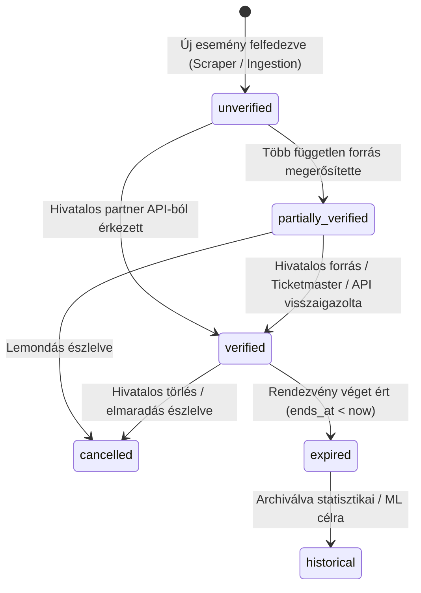

# 🏛️ Entity: Canonical Event Entity

A **Canonical Event Entity** az Optivoya esemény-intelligencia motorjának alapegysége. A statikus látványosságokkal (`[[experience-entity]]`) ellentétben ez az entitás **diszkrét időablakhoz kötött, múlandó valós eseményt** reprezentál (pl. szilveszteri koncert, elektronikus zenei party, gasztronómiai vásár, színházi előadás vagy sportmérkőzés).

Minden esemény egyértelmű forrásmegjelöléssel, dátumellenőrzéssel és megbízhatósági szinttel rendelkezik a `[[ADR-004-honest-scraping-mode]]` és `[[ADR-011-event-intelligence-engine]]` szerint.

---

## 📋 Séma & Attribútumok (`public.events`)

| Mező | Típus | Leírás | Példa |
| :--- | :--- | :--- | :--- |
| `id` | `UUID (PK)` | Belső adatbázis rekordazonosító | `a3c1e289-4b68-4a9f-9c02-e1d5a76e9f12` |
| `event_id` | `TEXT (UNIQUE)` | Determinisztikus üzleti azonosító (`evt_{dest}_{slug}_{date}`) | `evt_es_bcn_sonar_club_20261231` |
| `destination_id` | `TEXT` | Célállomás kódja (kapcsolat a `destinations` táblával) | `ES_BCN` |
| `title` | `TEXT` | Az esemény hivatalos megnevezése | `Razzmatazz NYE 2026 Electronic Gala` |
| `description` | `TEXT` | Részletes leírás, fellépők és programpontok | `5 rooms of techno, house and indie dance...` |
| `category` | `TEXT` | Főkategória | `nightlife_party`, `live_music_concert`, `festival`, `food_culinary`, `culture_arts`, `seasonal_holiday` |
| `subcategory` | `TEXT` | Részletes altípus | `techno_club`, `rock_gig`, `christmas_market`, `food_truck_fest`, `opera` |
| `venue_name` | `TEXT` | A helyszín neve | `Razzmatazz` |
| `latitude`, `longitude` | `FLOAT` | Pontos WGS-84 koordináták | `41.3977`, `2.1911` |
| `starts_at` | `TIMESTAMPTZ` | Hivatalos kezdési időpont helyi időzónában | `2026-12-31T23:00:00+01:00` |
| `ends_at` | `TIMESTAMPTZ` | Tervezett befejezés (éjszakai logisztikához kritikus) | `2027-01-01T06:00:00+01:00` |
| `price_min` | `FLOAT` | Belépőjegy alsó határa (vagy `null` ha ismeretlen) | `35.0` |
| `price_max` | `FLOAT` | Belépőjegy felső határa (VIP / helyszíni ár) | `75.0` |
| `currency` | `TEXT` | Pénznem ISO kódja | `EUR` |
| `is_free` | `BOOLEAN` | Ingyenesen látogatható rendezvény-e | `false` |
| `booking_url` | `TEXT` | Közvetlen hivatalos jegyvásárlási URL | `https://salarazzmatazz.com/tickets/...` |
| `source_url` | `TEXT` | Az adatot szolgáltató elsődleges forrásoldal | `https://ra.co/events/1982736` |
| `source_name` | `TEXT` | Adatforrás neve | `resident_advisor`, `songkick`, `bandsintown`, `eventbrite`, `city_portal` |
| `source_event_id` | `TEXT` | A forrás saját egyedi eseményazonosítója | `ra_1982736` |
| `confidence_score` | `FLOAT` | Adatmegbízhatósági és hitelességi szint (0.00 – 1.00) | `0.92` |
| `status` | `TEXT` | Esemény aktuális életciklus státusza | `verified`, `partially_verified`, `unverified`, `cancelled`, `expired`, `historical` |
| `last_verified_at` | `TIMESTAMPTZ` | Forrás utolsó sikeres lekérdezésének időpontja | `2026-11-20T14:30:00Z` |
| `retrieved_at` | `TIMESTAMPTZ` | Eredeti rögzítés időpontja | `2026-11-15T08:00:00Z` |
| `raw_payload` | `JSONB` | A forrásból kapott eredeti nyers válasz (Zero-Loss) | `{"id": "...", "lineup": [...], ...}` |
| `created_at` | `TIMESTAMPTZ` | Rekord létrehozási ideje | `2026-11-15T08:00:00Z` |
| `updated_at` | `TIMESTAMPTZ` | Utolsó frissítés ideje | `2026-11-20T14:30:00Z` |

---

## 🏷️ Életciklus Státuszok (Event Status Lifecycle)

1. **`verified`**: Elsődleges, hivatalos forrás vagy megerősített partner API által igazolt esemény, biztos dátummal és elérhető jegyértékesítéssel.
2. **`partially_verified`**: Több független naptárban szereplő esemény, amely még nem rendelkezik közvetlen jegyirodai visszaigazolással.
3. **`unverified`**: Egyetlen nem hivatalos forrásból (pl. fórumból, közösségi posztból) származó program; az ajánlóban figyelmeztető jelzéssel látható.
4. **`cancelled`**: Hivatalosan elmaradó vagy lemondott esemény. Azonnal kizárásra kerül az ajánlásokból, vagy figyelmeztető státuszt kap a mentett tervekben.
5. **`expired`**: Lezárult program (`ends_at < current_timestamp`).
6. **`historical`**: Korábbi évek eseményarchívuma, amely kizárólag szezonális előrejelzésre és mintafelismerésre szolgál, **ajánlatként sosem jelenhet meg közvetlenül**.
