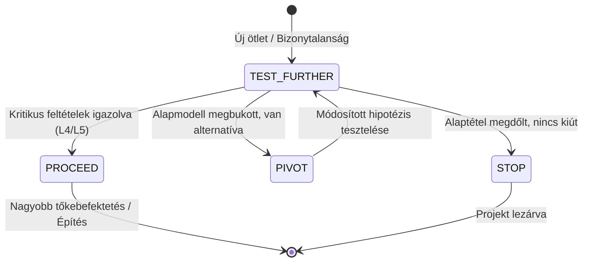
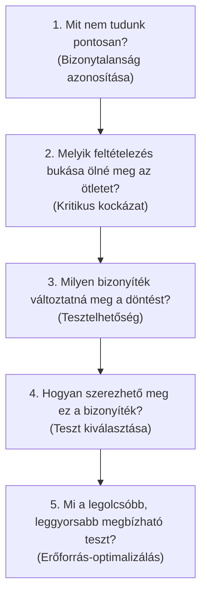

# Döntési Szabályrendszer (Decision Rules & Gates) — VIS 2.0

> **Verzió:** 2.0 (Evidence-Driven Venture Validation frissítés)  
> **Dátum:** 2026-11-18  
> **Vezérelv:** *„Maximize Decision Confidence per Unit of Time and Money Invested.”*

---

## 1. A 4 Központi Döntési Kimenet

A rendszer szándékosan **nem használ univerzális 80/100-as pontszámokat**. A döntés mindig a **kritikus túlélési feltételekre megszerzett bizonyítékok minőségéhez** kötődik:

| Döntési Állapot | Jelentése és Szabálya | Megengedett Következő Lépés |
| :---: | :--- | :--- |
| **`PROCEED`** | A kritikus feltételezések elegendően alátámasztottak **saját elsődleges (L4) vagy gazdasági (L5) bizonyítékokkal**. | Indokolt a következő, nagyobb idő- és pénzbefektetéssel járó fázis (pl. kódolt MVP, sales csapat, skálázás). |
| **`TEST FURTHER`** | Az ötlet ígéretes, de maradt tisztázatlan kritikus bizonytalanság. | **Tilos fejleszteni!** Az Adaptive Validation Plan alapján újabb, alacsony költségű célzott kísérletet kell futtatni. |
| **`PIVOT`** | Az eredeti modell egy eleme (árazás, célcsoport, facilitáció, csatorna) megbukott, de az adatok egy működőképes alternatívát mutatnak. | A feltételezés- és kérdésgráf módosítása, majd célzott teszt. |
| **`STOP`** | Egy kritikus feltételezés megbukott, és nincs gazdaságos alternatíva. | A projekt azonnali lezárása (bukás korai, olcsó szakaszban = tőkemegtakarítás). |

---

## 2. A Döntéshozatal 5 Vizsgálati Kérdése

Minden döntési kapunál az alábbi 5 kérdésre kell választ adni:

---

## 3. Kapuátlépési Feltételek (Gate Passage Criteria)

1. **A „Szekunder Nem Elég” Korlát:**  
   Pusztán másodlagos adatokkal (L1–L3) a projekt soha nem kaphat `PROCEED` minősítést nagybefektetéshez (kódolás, fizetett hirdetések, irodabérlet). Legfeljebb `TEST FURTHER` vagy pilot engedélyezés lehetséges.
2. **A Fizetési Hajlandóság Kapuja (Skin-in-the-game Gate):**  
   Nem fogadható el validáltnak a kereslet szóbeli dicséretek alapján. Kötelező az idő (pl. 60 perces interjú), az adat (pl. belső folyamatok átadása) vagy a pénz (előleg, LoI, pilot megrendelés) bevonása.
3. **A Megvalósíthatósági Kapu:**  
   Ha a termék működéséhez harmadik fél (pl. belső HR facilitátor) közreműködése kell, a modellt tilos validáltnak tekinteni mindaddig, amíg legalább egy ilyen partner sikeresen és önállóan le nem vezényelte a folyamatot.
