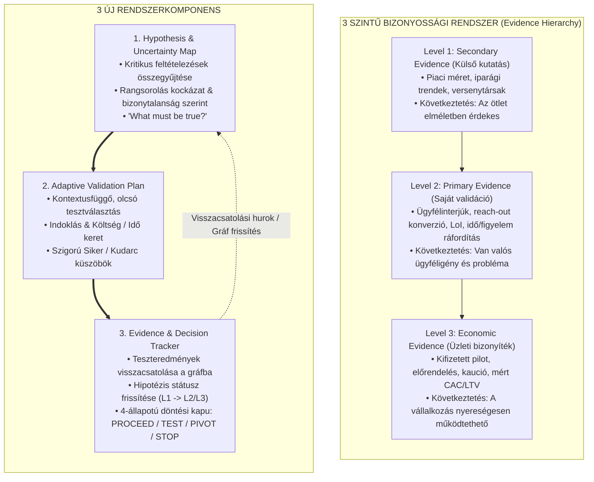
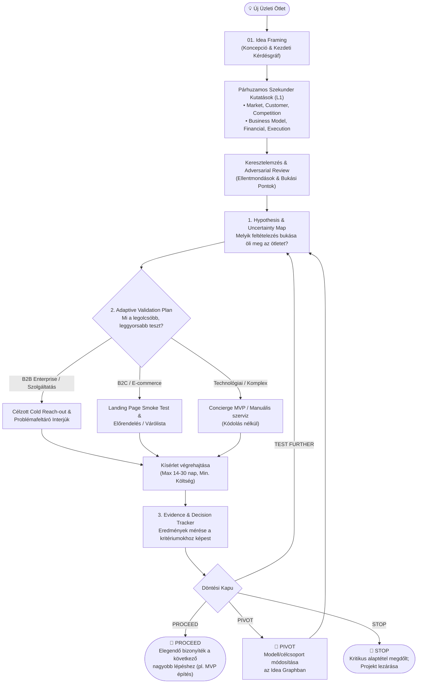
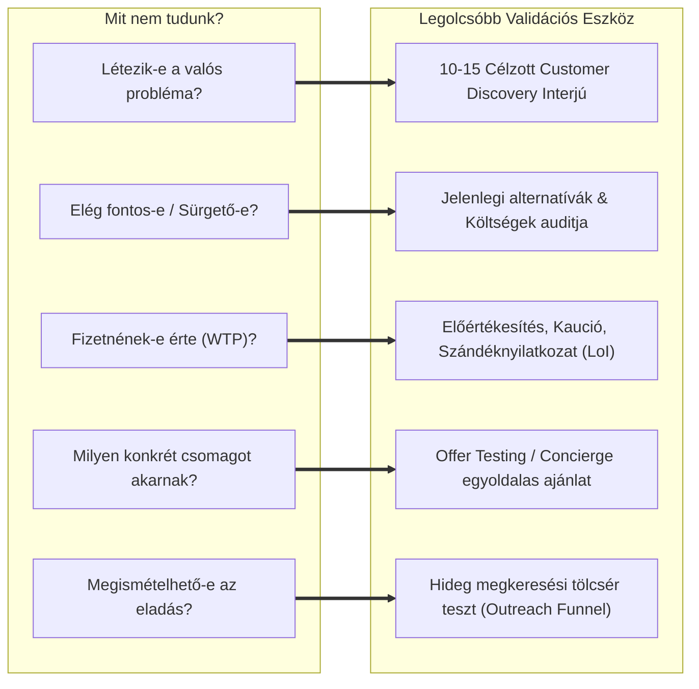
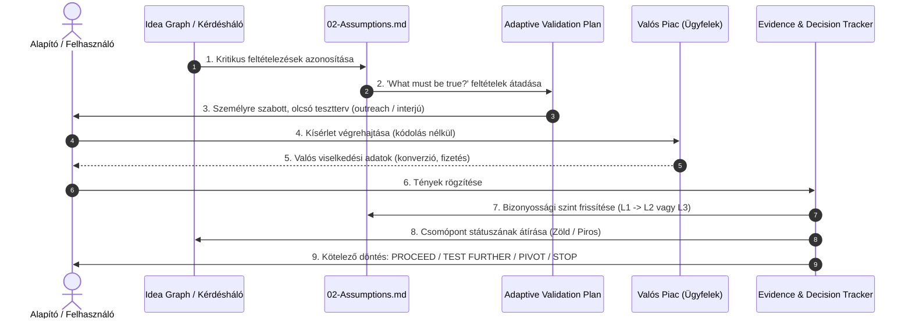

# Evidence-Driven Venture Validation Workflow (VIS 2.0)
## Az Idea Graph adaptív, bizonyítékvezérelt működési modellje

> **A rendszer alapfilozófiája:**  
> **„Maximize Decision Confidence per Unit of Time and Money Invested.”**  
> *(A döntési bizonyosság maximalizálása a befektetett idő és pénz egységére vetítve.)*  
> 
> Az Idea Graph nem egyszerűen azt vizsgálja, hogy egy üzleti ötlet elméletben jónak tűnik-e, hanem azt határozza meg, hogy **hogyan tudjuk a lehető legkisebb ráfordítással (kódolás, hirdetések és felesleges munkaórák nélkül) kideríteni, hogy valóban működőképes és nyereséges vállalkozás építhető-e belőle.**

---

## 1. A Megújult Rendszerarchitektúra és Szintek

A rendszer 3 bizonyossági szintet (Evidence Hierarchy) és 3 új, egymással szorosan összekapcsolódó komponenst vezet be:

---

## 2. A Teljes End-to-End Munkafolyamat (Workflow Flowchart)

A folyamat két fő ciklusra oszlik: az **Elméleti Elemzésre (Desk Research)** és a közvetlenül ráépülő **Adaptív Validációs Ciklusra (Actionable Validation Loop)**.

---

## 3. A Kontextusfüggő Tesztválasztási Mátrix

Az Idea Graph nem sablonos ellenőrzőlistát ad, hanem a felismert üzleti modell és a bizonytalanság jellege alapján választja ki a legolcsóbb tesztet:

### Konkrét Teszt Tervezési Sablon (Minden ajánláshoz kötelező)
Minden generált kísérletnek az alábbi 9 pontot kell kötelezően tartalmaznia:
1. **Hypothesis:** *Mit tesztelünk pontosan?*
2. **Why this test:** *Miért ez a legolcsóbb és legmegbízhatóbb módszer az adott kontextusban?*
3. **Uncertainty reduced:** *Milyen kockázatot zár ki a teszt?*
4. **Execution:** *Lépésről lépésre mit kell csinálni a következő 14 napban?*
5. **Cost & Time:** *Pontosan hány forintba és munkaórába kerül? (Tilos kódolást és drága hirdetést előírni)*
6. **Success criteria (Zöld lámpa):** *Mi az a számszerűsíthető eredmény, ami bizonyítja a feltevést?*
7. **Failure criteria (Piros lámpa):** *Mi az az eredmény, ami cáfolja (hamisítja) a feltevést?*
8. **Limitations:** *Mit NEM tudunk meg ebből a tesztből?*
9. **Next decision:** *Hogyan lépünk tovább az eredmény fényében?*

---

## 4. Visszacsatolási Hurok a Kérdésgráfba (Feedback Loop)

A rendszer legfontosabb technikai újítása, hogy a teszteredmények nem elszigetelt jegyzetek maradnak, hanem **visszacsatolódnak a kérdésgráf csomópontjaira**:

---

## 5. Az Arany Szabály (The Golden Rule)

> [!CAUTION]
> ### Rendszerszintű Védelmi Szabály
> **Az AI soha nem nyilváníthat egy hipotézist validálttá pusztán azért, mert több másodlagos kutatási forrás vagy elemzés alátámasztja!**
> 
> * Külső kutatási források (L1) = **Lehetőség (Opportunity Hypothesis)**
> * Saját ügyfél-viselkedés (L2) = **Igény-bizonyíték (Demand Evidence)**
> * Saját bevétel és megtartás (L3) = **Üzleti bizonyíték (Economic Viability)**
> 
> A rendszer nem engedi meg a `PROCEED` döntést nagytőkéjű fázisba (pl. teljes szoftverfejlesztés), amíg a kritikus túlélési feltételekre nincs legalább L2 vagy L3 szintű saját bizonyíték.
