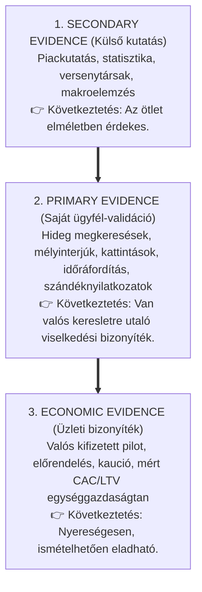

# Evidence Protocol (Bizonyítási Szabályzat) — VIS 2.0

> **Verzió:** 2.0 (Evidence-Driven Venture Validation frissítés)  
> **Dátum:** 2026-11-18  
> **Vezérelv:** *„Maximize Decision Confidence per Unit of Time and Money Invested.”*  
> **Cél:** A másodlagos adatok, a hallucinációk és a saját, valós ügyfélbizonyítékok szigorú elválasztása.

---

## 1. A Három Bizonyossági Kategória (Evidence Hierarchy)

A rendszerben minden állítás és feltételezés három fő kategória valamelyikébe tartozik:

---

## 2. A Megbízhatósági Szintek (L1 – L5)

Minden kutatási dokumentumban és kérdésgráf-csomóponton kötelező a besorolás:

| Szint | Megnevezés | Kategória | Definíció | Döntési Használhatóság |
| :---: | :--- | :---: | :--- | :--- |
| **L1** | **Verified Fact** (Tény) | Secondary | Hivatalos statisztikai adat (KSH, Eurostat), hatályos jogszabály, auditált jelentés. | Piacméret korlátok, jogi keretek meghatározása |
| **L2** | **Supported Claim** (Alátámasztott) | Secondary | Elemzői benchmark (Gartner, McKinsey, PwC), publikált esettanulmány. | Trendek, elméleti piaci igény kijelölése |
| **L3** | **Estimate / Analytical** (Modellezett) | Secondary | Racionális számítás, Pareto-eloszlás, top-down / bottom-up levezetés. | Tervezési irányok, kezdeti árképzés |
| **L4** | **Primary Behavioral** (Elsődleges adat) | **Primary** | **Közvetlen saját mérés:** Megkeresési válaszarányszám, interjúkivonatok, tesztoldali konverzió. | **Validációs kapuátlépés feltétele!** |
| **L5** | **Economic Transaction** (Tranzakció) | **Economic** | **Banki jóváírás:** Kifizetett előleg, szerződéses megrendelés, pilot díj. | **Tőkebefektetés és skálázás feltétele!** |

---

## 3. A Rendszer Aranyszabálya (The Golden Rule)

> [!CAUTION]
> ### Vaskalapos Validációs Szabály
> **Az AI soha nem emelhet egy hipotézist validálttá pusztán azért, mert több másodlagos kutatási forrás (L1–L3) alátámasztja!**  
> A piaci adatok és a saját ügyfélbizonyítékok (L4–L5) szigorúan külön kategóriában maradnak. 
> 
> * 100 lektorált iparági cikk sem helyettesíthet 10 valós B2B interjút.
> * 10 lelkes szóbeli dicséret sem helyettesíthet 2 ténylegesen kifizetett pilot előleget.

---

## 4. Validációs Módszertani Követelmény (Test Spec)

Minden javasolt kísérletnek kötelezően tartalmaznia kell:
1. **Hypothesis:** Mit tesztelünk pontosan?
2. **Why this test:** Miért ez a legolcsóbb, leggyorsabb módszer?
3. **Uncertainty reduced:** Milyen bizonytalanságot csökkent?
4. **Execution:** Lépésről lépésre a teendők (max. 14–30 nap, nulla felesleges kódolás/hirdetés).
5. **Cost & Time:** Konkrét költségvetési és időkeret.
6. **Success criteria:** Mi számít sikernek (számszerűen)?
7. **Failure criteria:** Mi számít kudarcnak (hamisítási küszöb)?
8. **Limitations:** Mit nem tudunk meg ebből a tesztből?
9. **Next decision:** Mi a következő lépés az eredmény függvényében?
