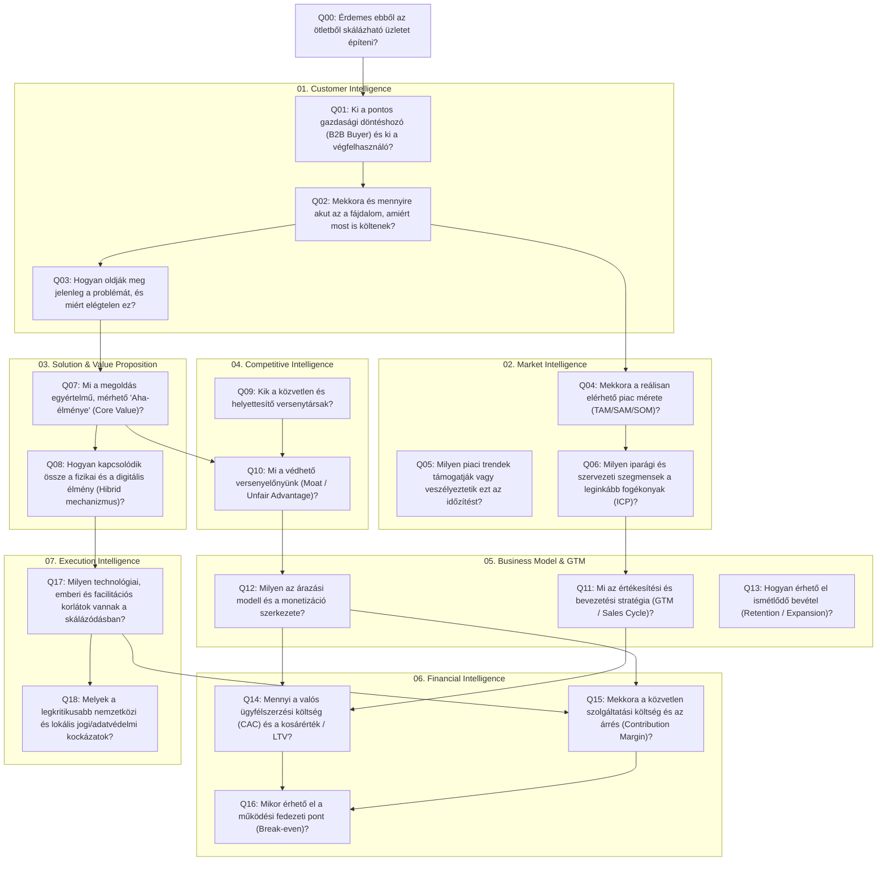

# Core Framework: Univerzális Kérdésgráf (Question Graph)

> **Verzió:** 1.0 (Alapverzió: 18 Törzskérdés)  
> **Dátum:** 2026-11-17  
> **Státusz:** Fázis 2 — Core Framework  

---

## 1. A Kérdésgráf alapelvei

A rendszer célja, hogy bármilyen üzleti lehetőséget (beleértve a hibrid B2B szolgáltatásokat, mint a PeerPlay) strukturáltan boncoljon fel.

### Kapcsolattípusok
- **Függőség (`depends_on`):** Nem vizsgálható érdemben a kérdés, amíg az előzmény nincs tisztázva.
- **Befolyásolás (`influences`):** Az egyik tényező változása módosítja a másik kimenetét.
- **Ellentmondás (`contradicts`):** Ha a válaszok ütköznek, döntési kapu lép életbe.
- **Döntési kapu (`gate`):** STOP / PIVOT vagy VALIDATE feltétel.

---

## 2. A 18 Törzskérdés Rendszere

---

## 3. Részletes Kérdéskatalógus & Kapcsolati Szabályok

### Q01: Ki a pontos gazdasági döntéshozó és ki a végfelhasználó?
* **Dimenzió:** Customer
* **Miért kritikus:** B2B termékeknél gyakori buktató, hogy a felhasználó imádja az élményt (pl. munkatársak), de a döntéshozó (pl. CFO / HR Igazgató / Ügyvezető) nem látja benne az üzleti ROI-t.
* **Függőségek:** Belépési pont (nincs előfeltétele).
* **Bizonyítékszint elvárás:** Verified Fact (Interjúk során azonosított konkrét döntési lánc és büdzséfelelős).

### Q02: Mekkora és mennyire akut az a fájdalom, amiért most is költenek?
* **Dimenzió:** Customer
* **Miért kritikus:** Ha a probléma csak "vitamin" (jó, ha van), nem pedig "fájdalomcsillapító", a gazdasági válságban azonnal megvágják.
* **Függőség:** `depends_on: Q01`
* **Döntési kapu (Gate 1):** Ha a probléma nem égető, vagy nincs rá elkülönített büdzsé -> **STOP / PIVOT**.

### Q03: Hogyan oldják meg jelenleg a problémát, és miért elégtelen ez?
* **Dimenzió:** Customer
* **Miért kritikus:** Megmutatja az elégedetlenségi rést és a rejtett költségeket (pl. értelmetlen ivászatok költsége, belső súrlódások miatti határidőcsúszások).
* **Függőség:** `depends_on: Q02`

### Q04: Mekkora a reálisan elérhető piac mérete (TAM/SAM/SOM)?
* **Dimenzió:** Market
* **Miért kritikus:** Kiderül, hogy érdemes-e skálázható vállalkozást építeni, vagy egy kis tanácsadó butik marad.
* **Függőség:** `depends_on: Q02, Q06`

### Q05: Milyen piaci trendek támogatják vagy veszélyeztetik az időzítést?
* **Dimenzió:** Market (Why now?)
* **Miért kritikus:** Hibrid munka, fluktuáció, burnout, adatalapú HR elemzések (People Analytics) térnyerése.

### Q06: Milyen iparági és szervezeti szegmensek a leginkább fogékonyak (ICP)?
* **Dimenzió:** Market
* **Miért kritikus:** Nem minden cégnek fáj ugyanúgy a silósodás (pl. 50 fős mérnöki cégek vs. 1000 fős multik).
* **Függőség:** `influences: Q11 (GTM)`

### Q07: Mi a megoldás egyértelmű, mérhető "Aha-élménye"?
* **Dimenzió:** Solution
* **Miért kritikus:** Az a pillanat, amikor a vezető rájön, hogy a diagnosztikai riport olyat mutatott meg a cégéről, amit eddig soha nem látott.
* **Függőség:** `depends_on: Q03`

### Q08: Hogyan kapcsolódik össze a fizikai és digitális mechanizmus?
* **Dimenzió:** Solution / Execution
* **Miért kritikus:** A fizikai játék (papír, olló) adja a flow-élményt és az érzelmi bevonódást, a mobil webapp adja a skálázható adatrögzítést.
* **Függőség:** `influences: Q17 (Skálázódási korlátok)`

### Q09: Kik a közvetlen és helyettesítő versenytársak?
* **Dimenzió:** Competition
* **Miért kritikus:** Nemcsak más trénerekkel, hanem a hagyományos rendezvényszervezőkkel és a digitális ONA szoftverekkel (pl. Polinode, Worklytics) is versenyez.

### Q10: Mi a védhető versenyelőnyünk (Moat)?
* **Dimenzió:** Competition
* **Miért kritikus:** Ha egy tréner látja a játékot, le tudja-e másolni 2 hét múlva papíron és Excelben? Mi a szoftveres/módszertani védőbástya?
* **Függőség:** `depends_on: Q07, Q09`

### Q11: Mi az értékesítési és bevezetési stratégia (GTM)?
* **Dimenzió:** GTM / Business Model
* **Miért kritikus:** Ki értékesíti a workshopot? Közvetlen B2B sales, HR-konferenciák, vagy független szervezetfejlesztő trénereken keresztüli viszonteladói hálózat?
* **Függőség:** `depends_on: Q06`

### Q12: Milyen az árazási modell és a monetizáció?
* **Dimenzió:** Business Model
* **Miért kritikus:** Egyszeri workshop-díj (400-600k Ft), vagy előfizetéses benchmarking és utánkövetés?

### Q13: Hogyan érhető el ismétlődő bevétel (Retention / LTV)?
* **Dimenzió:** Business Model
* **Miért kritikus:** Egy cég hányszor játszhatja le ezt egy évben? Hogyan nem hal el a projekt egyetlen workshop után?
* **Döntési kapu (Gate 2):** Ha nincs visszatérő igény vagy magas LTV -> Alacsony vállalati értékelés / Csapdába esett tanácsadói modell.

### Q14: Mennyi a CAC és az egy ügyfélre jutó bevétel?
* **Dimenzió:** Financial
* **Miért kritikus:** Ha a B2B sales ciklus 6 hónapig tart 1 darab 500.000 Ft-os workshopért, a modell csődbe megy.
* **Függőség:** `depends_on: Q11, Q12`

### Q15: Mekkora a közvetlen költség és az árrés (Contribution Margin)?
* **Dimenzió:** Financial
* **Miért kritikus:** Facilitátor díja, utazás, eszközök, app fenntartás vs. bevétel.

### Q16: Mikor érhető el a működési fedezeti pont (Break-even)?
* **Dimenzió:** Financial
* **Miért kritikus:** Hány workshop / hó szükséges a szoftverfejlesztés és a fix költségek fedezésére?

### Q17: Milyen korlátok vannak a skálázódásban (Facilitáció vs. Szoftver)?
* **Dimenzió:** Execution
* **Miért kritikus:** Személyes jelenlétet igényel-e az alapítótól, vagy bárki betanítható facilitátornak "dobozos" formában?

### Q18: Melyek a legkritikusabb jogi és adatvédelmi kockázatok (GDPR / ONA)?
* **Dimenzió:** Execution / Legal
* **Miért kritikus:** Munkavállalói hálózatelemzés, egyéni teljesítmény- és energiamérés név szerint. Munkajogi és GDPR akadályok a multiknál!
