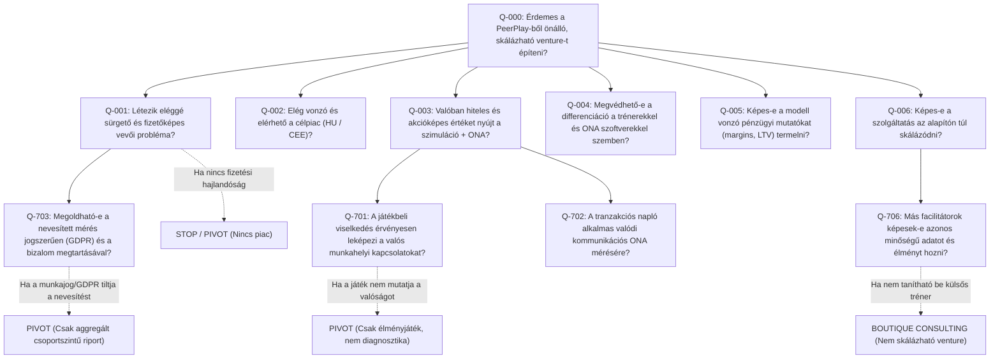

# PeerPlay — Alkalmazott Hierarchikus Kérdésgráf (Q-001 – Q-706)

Ez a kérdésgráf a Prompt 01 mélyelemzéséből született, részletes kutatási specifikációval.

---

## 1. Vizuális Struktúra (Mermaid)

---

## 2. A 6 Kutatási Terület Mappája & Kérdéskódjai

* 🧑‍💼 **Customer & Problem (`Research/Customer.md`):** [[02-Ventures/PeerPlay/Research/Customer]]  
  *Kérdések:* `Q-101` – `Q-106` (Ki a büdzséfelelős? Milyen gyakori a probléma? Miért nem jó az ivászat?)
* 📈 **Market Intelligence (`Research/Market.md`):** [[02-Ventures/PeerPlay/Research/Market]]  
  *Kérdések:* `Q-201` – `Q-205` (TAM/SAM/SOM Magyarországon és CEE-ben a 150-500 fős szegmensben, tréning büdzsék)
* 🔬 **Solution & Validity (`Research/Execution.md`):** [[02-Ventures/PeerPlay/Research/Execution]]  
  *Kérdések:* `Q-301` – `Q-307` és `Q-701`, `Q-702`, `Q-705` (Módszertani és ONA validitás, Δ Energia mérés)
* ⚔️ **Competition & Moat (`Research/Competition.md`):** [[02-Ventures/PeerPlay/Research/Competition]]  
  *Kérdések:* `Q-401` – `Q-405` (Csapatépítők vs. Polinode/Worklytics szoftverek vs. OD tanácsadók)
* 💰 **Business Model & Unit Economics (`Research/Business-Model.md` & `Financial.md`):** [[02-Ventures/PeerPlay/Research/Business-Model]] & [[02-Ventures/PeerPlay/Research/Financial]]  
  *Kérdések:* `Q-501` – `Q-507` (400-600k Ft árrése, workshop költség, ismétlődő diagnosztika / Retention)
* ⚖️ **Execution, Scalability & GDPR (`Research/Execution.md`):** [[02-Ventures/PeerPlay/Research/Execution]]  
  *Kérdések:* `Q-601` – `Q-606`, `Q-703`, `Q-706` (Facilitátor hálózat betanítása, GDPR/DPIA adatvédelem)
