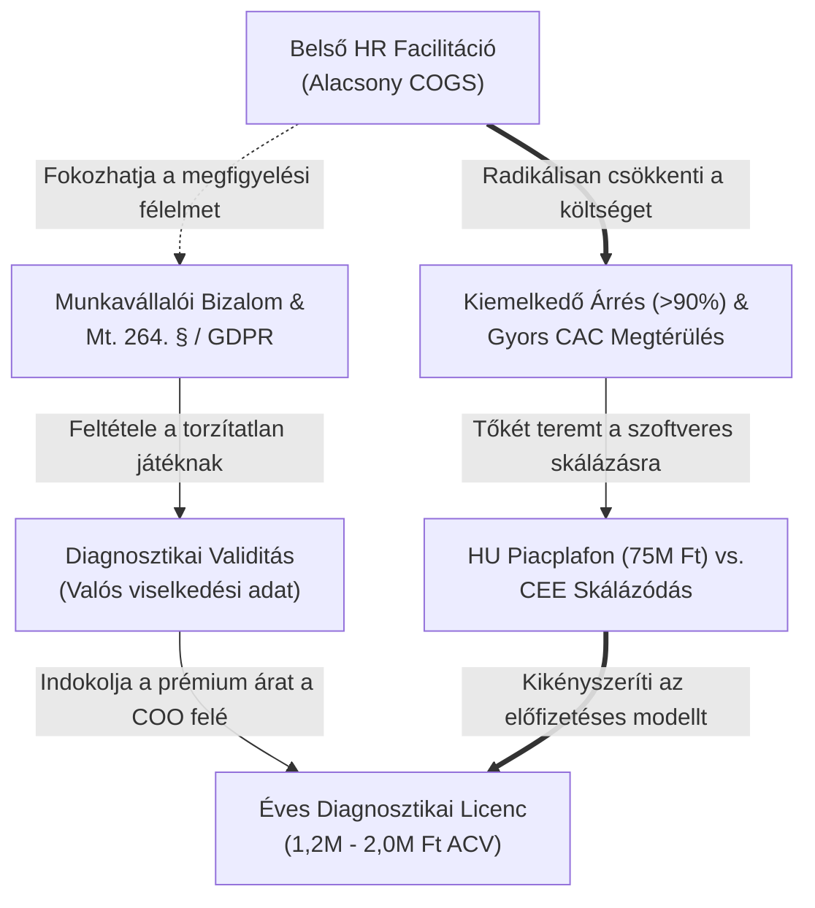

# PeerPlay — Keresztelemzés és Rendszerszintű Szintézis (Cross-Analysis)

> **Dokumentum célja:** A hat különálló kutatási jelentés (Piac, Ügyfél, Verseny, Üzleti modell, Pénzügy, Megvalósítás) integrált szintézise. Nem a fejezetek mechanikus ismétlése, hanem az ellentmondások, a rejtett összefüggések, a kritikus feltételezések és a stratégiai kompromisszumok feltárása.
> **Kulcsfontosságú bemeneti finomítás:** Az alapterv szerint a workshopok közvetlen levezetését a vállalati **belső HR-es / L&D-s kollégák** végzik (a PeerPlay pedig a digitális platformot, a facilitációs forgatókönyvet és az automatizált ONA riportot szállítja), ami drasztikusan módosítja a változó költségszerkezetet és a skálázódási potenciált.

---

## 1. Integrált Fő Következtetések (Executive Synthesis)

A hat kutatási dimenzió együttes vizsgálata alapján a PeerPlay előtt kirajzolódó üzleti lehetőség a következő sarkalatos pontokra épül:

1. **A „termékesített tanácsadás” helyett „szoftveresen támogatott belső facilitáció” a nyerő modell:**
   * A pénzügyi és működési kutatás korábban kimutatta, hogy ha külső trénereket kell fizetni (135–170e Ft/alkalom), az egységfedezet 60% körül marad, a közvetlen értékesítési CAC pedig nehezen térül meg egyetlen alkalom alatt.
   * Azáltal, hogy **a megbízó vállalat saját belső HR/L&D szakembere facilitálja a játékot**, a PeerPlay mentesül a legnehezebb operatív tehertől (utazás, helyszíni jelenlét, tréneri napidíjak). 
   * A változó költség (COGS) alkalmanként gyakorlatilag a felhő/szoftver futtatására és a fizikai játékkellékek egyszeri/időszakos biztosítására szűkül (~15–25e Ft), így a 400 000 – 600 000 Ft-os díjból **a bruttó árrés eléri a 90–95%-ot**.

2. **A belső HR facilitáció mint kétélű fegyver:**
   * **Előny:** Óriási költségmegtakarítás, nulla utazási teher, a HR azonnali belső tulajdonosa és bajnoka lesz az eszköznek.
   * **Kockázat (Ökológiai és etikai torzítás):** Ha a cég saját HR-ese vezeti a játékot, a munkavállalókban felerősödhet a gyanú: *„A HR megfigyel és tesztel minket!”* Ez sértheti a pszichológiai biztonságot, és cinikus, védekező játékviselkedést válthat ki, ami tönkreteszi a hálózati adatok hitelességét.
   * **Szükséges védelem:** A Facilitátori Playbooknak és a WebAppnak szigorúan **semleges szerepbe kell helyeznie a belső HR-est** (játékmester/moderátor, nem bíró), a nyers adatokat pedig a rendszernek kell titkosítania és aggregálnia, hogy a HR se láthasson személyes pontszámokat.

3. **A piacméret kettőssége:**
   * A magyarországi 150+ fős vállalatok száma (1 759 cég) szűk plafont jelent: az elérhető som 75M Ft (150 alkalom) körül tetőzik a 3. évben.
   * A venture-értékteremtéshez elengedhetetlen a **visszatérő mérés (éves/féléves diagnosztikai előfizetés)**, valamint a **CEE régiós nyitás (elsőként Ausztria és Csehország)**, ahol a képzési hajlandóság és a hibrid munkavégzés aránya lényegesen magasabb, mint Romániában vagy Lengyelországban.

---

## 2. Dimenziók Közötti Keresztkapcsolatok és Ellentmondások (Cross-Domain Dynamics)

### 1. Ellentmondás: Alacsony költség vs. Megfigyelési paranoia
* **Feszültség:** A külső facilitátor semleges félként könnyebben teremt pszichológiai biztonságot, de drága. A belső HR-es ingyen van (vállalati bérköltség), viszont a munkavállalók szemében ő a munkáltató megtestesítője.
* **Feloldás:** A szoftvernek garantálnia kell a **technikai anonimitást és szerepkódos védelmet**. A riportban a HR-es sem láthatja az egyének neveit, csak a funkciók közötti kapcsolatokat.

### 2. Kereszthatás: Piacméret korlát $\Longrightarrow$ Licencelési modell
* **Feszültség:** Ha a belső HR-es facilitál, a cég miért fizetne alkalmanként 500 000 Ft-ot, ha a munkát ő maga végzi el?
* **Feloldás:** A pozicionálást át kell tolni a **„Vállalati Diagnosztikai Szoftverlicenc & Módszertan”** irányába: a cég nem az emberi munkaórát fizeti meg, hanem a szabadalmaztatott játékmódszertant, a felhőalapú WebApp futtatását, az azonnali matematikai ONA elemzést és a benchmark riportot. Ez megnyitja az utat az **éves előfizetés (1,2–2,0M Ft/év korlátlan vagy 2–4 mérésre)** felé.

### 3. Kereszthatás: Szabályozás (EU AI Act & Mt. 264. §) $\Longrightarrow$ Eladási sebesség
* Az EU AI Act 2025. februári munkahelyi érzelemfelismerési tilalma és az Mt. 264. § miatti 15 napos kötelező Üzemi Tanács egyeztetés lelassíthatja az eladásokat, ha a HR nem kap előre kész dokumentációt.
* Ha a belső HR-es a facilitátor, ő maga készíti elő az Üzemi Tanács anyagot, így a belső megfelelési ellenállás minimálisra csökkenthető egy előre gyártott DPO-csomaggal.

---

## 3. Közös Feltételezések és Sebezhetőségek (Assumption Analysis)

Az összes kutatási dimenzió sikere három közös, még nem validált alappilléren nyugszik:

| Feltételezés kódja | Feltételezés megfogalmazása | Érintett dimenziók | Kockázati szint | Valós piaci teszt igénye |
| :--- | :--- | :--- | :--- | :--- |
| **A-SHARED-01** | **Belső HR kompetencia:** A vállalati HR-es kolléga egy Playbook alapján képes önállóan, magas minőségben levezetni a 90 perces pörgős szimulációt és értelmezni a riportot. | *Execution, Financial, Customer* | **Kritikus (Végzetes)** | Élő pilot teszt, ahol a HR-es vezeti a játékot az alapító jelenlétében (árnyékolás). |
| **A-SHARED-02** | **Fizetési hajlandóság szoftverért/módszertanért:** A vállalat hajlandó kifizetni 400–600e Ft-ot (vagy éves 1,5M Ft-ot), miközben a helyszíni munkát a saját embere végzi. | *Customer, Financial, Business Model* | **Magas** | Árajánlat-teszt a BSC szektorban: platformdíj + játékkészlet csomagban. |
| **A-SHARED-03** | **Ökológiai érvényesség (Ecological Validity):** A 90 perces játékban mért interakciók valóban a hétfő reggeli munkahelyi kommunikációs blokkokat mutatják. | *Solution, Customer, Competition* | **Magas** | Poszt-workshop interjúk a vezetőkkel: egybeesnek-e a riport silói a valós tapasztalatokkal? |

---

## 4. Végzetes Hibák és Kockázati Hierarchia (Fatal Flaw Analysis)

### 🔴 Végzetes Hibák (Fatal Flaws — A venture azonnali leállását okozhatják)
1. **A HR-es facilitáció kudarca:** Ha a belső HR-esek túlterheltek, bátortalanok vagy alkalmatlanok a szimuláció dinamikus levezetésére, a termék visszahullik az alapítói boutique-tanácsadás szintjére, ami megöli a skálázódást.
2. **A szimuláció elutasítása mint „gyerekes játék”:** Ha a COO vagy az üzletágvezetők komolytalannak tartják a papírból és ollóval épített alakzatok kereskedelmét, és nem fogadják el az ONA diagnózis alapjául.

### 🟡 Súlyos, de Kezelhető Kockázatok (Manageable Risks)
1. **Adatvédelmi és megfigyelési félelem:** A munkatársak szabotálhatják az adatbevitelt. *Megoldás:* Szigorú szerepköralapú pszeudonimizálás és nyílt felhatalmazás.
2. **Hosszú B2B fizetési ciklusok (45–60 nap):** Átmeneti likviditási hiányt okozhat. *Megoldás:* Pénzforgalmi ÁFA és belső HR facilitáció esetén minimális tőkepuffer (~2M Ft) elegendő.
3. **Piacméret korlát Magyarországon:** *Megoldás:* 2. évtől kötelező CEE nyitás a nemzetközi BSC hálózatokon (ABSL) keresztül.

---

## 5. Dimenziónkénti Értékelés és Vonzóerő (Opportunity Scorecard)

| Dimenzió | Értékelés (1–5) | Magyarázat és Korlátok |
| :--- | :---: | :--- |
| **Piac vonzereje (Market)** | **3.5 / 5** | A magyar piac kicsi (SOM 75M Ft), de a 259 központot tömörítő hazai BSC/SSC szektor tökéletes, koncentrált és jól fizető hídfőállás. CEE-vel kiegészülve 4.5-re nő. |
| **Vevői igény (Customer Demand)** | **4.0 / 5** | A silófájdalom és a hibrid koordinációs zavar valós, a csapatépítő büdzsék rendelkezésre állnak. Kiváltó eseményekhez (M&A, átszervezés) kell kötni. |
| **Versenypozíció (Competition)** | **4.5 / 5** | Hatalmas rés van az élménycsapatépítők (nincs adat) és az enterprise ONA platformok (túl drága, invazív) között. A 90 perces játékos diagnosztika egyedülálló belépőtermék. |
| **Üzleti modell (Business Model)** | **4.5 / 5** | A belső HR facilitációra épülő hibrid licencmodell kiemelkedően skálázható, leválasztja az árbevételt az alapítói munkaórákról. |
| **Pénzügyi életképesség (Financial)** | **4.5 / 5** | Belső HR levezetéssel a bruttó árrés >90%. Az 1. évben minimális tőkével cash-pozitívvá tehető. |
| **Megvalósíthatóság (Execution)** | **3.5 / 5** | A WebApp technikai megvalósítása és az ONA PDF motor egyértelmű, de a HR-esek betanítása és a pszichológiai biztonság megteremtése komoly kihívás. |
| **Összesített Értékelés** | **4.1 / 5** | **Kifejezetten ígéretes, azonnali validációra és pilot-tesztre érett üzleti lehetőség.** |

---

## 6. Stratégiai Ajánlás a Döntési Fázishoz

A kutatások és a szintézis alapján a PeerPlay nem egyszerűen egy „új csapatépítő játék”, hanem egy **„Game-Enabled Organizational Diagnostics Platform”**.

A következő kritikus lépések szükségesek a döntési folyamat lezárásához:
1. **Adversarial Review (Prompt 09):** Szigorú, szkeptikus befektetői szemmel meg kell vizsgálni a belső HR facilitáció gyenge pontjait és a lehetséges elutasítási okokat.
2. **Executive Decision Brief (Prompt 10):** El kell készíteni a végleges döntési dokumentumot (`VALIDATE / PILOT` ajánlással).
3. **Validation Design (Prompt 11):** Meg kell tervezni az első 3 éles pilot workshopot egy-egy kiválasztott BSC partnernél.
