# PeerPlay — Független Kritikai Felülvizsgálat (Adversarial Due Diligence)

> **Szerepkör és Cél:** Független, szkeptikus befektetési bizottsági és kockázatelemzői átvilágítás. 
> Nem a vállalkozás igazolása vagy az alapítói optimizmus megerősítése a feladat, hanem a legsebezhetőbb pontok, rejtett tévedések, végzetes hibalehetőségek és torzítások kíméletlen feltárása a tőke és munkaórák allokálása előtt.

---

## 1. Vezetői Döntési Összefoglaló: A Legerősebb Érv a PeerPlay Ellen

> **A PeerPlay alapvető egzisztenciális paradoxona:**  
> A vállalkozás értéke papíron abból fakad, hogy „objektív szervezeti diagnosztikát ad a silókról egy szórakoztató játékon keresztül”. Ám a belső HR-es facilitációra épülő modellben a célközönség két egymást kölcsönösen kizáró csapdába esik:
> 1. **Ha a játék laza és szórakoztató marad**, a vezetőség (COO, CEO) elutasítja mint gyerekes papírhajtogatást, amelyből tilos üzleti döntéseket hozni az együttműködési folyamatokról (*„Attól, hogy Kovács úr agresszívan licitált az ollóra, még nem működik rosszul a logisztika”*).
> 2. **Ha viszont a játékot komoly diagnosztikaként keretezik**, a belső HR jelenléte azonnal felébreszti a dolgozói megfigyelési paranoiát (*„A HR kémkedik utánunk és pontozza az engedelmességünket”*), ami védekező, mesterkélt viselkedést szül, teljesen megsemmisítve az ONA adatok ökológiai érvényességét.
> 
> A PeerPlay így könnyen két szék közé esik a pad alá: **a vezetés szemében túl komolytalan egy valódi diagnózishoz, a munkatársak szemében túl fenyegető egy felszabadult csapatépítéshez**, miközben a CFO nem hajlandó 500 000 Ft-ot fizetni egy olyan eseményért, ahol a tényleges facilitátori munkát a cég saját, amúgy is túlterhelt HR-ese végezte el.

---

## 2. Az 5 Legkritikusabb Végzetes Hiba és Működési Csapda

### 1. A „Túlterhelt HR-es” Értékesítési Fal (The Overwhelmed HR Trap)
A modell kulcsfeltevése, hogy a vállalati HR-es örömmel levezeti a 90 perces játékot, hogy megspórolja a külső tréner díját. A valóságban a magyarországi és CEE BSC-k HR vezetői krónikus kapacitáshiánnyal küzdenek (toborzási nyomás, fluktuáció, év végi értékelések). Amikor egy külső szolgáltató azt mondja: *„Fizess 500 000 Ft-ot, és csináld meg magadnak a munkát a Playbookunkból!”*, a HR-es első reakciója az ellenállás: ő nem azért rendel csapatépítőt vagy tanácsadót, hogy maga izzadjon a táblánál 40 kolléga előtt, hanem éppen azért, hogy egy külső fél vigye el a moderáció és a konfliktusok terhét.

### 2. A CFO Értékpercepciós Sokkja („Csináld magad” 500 ezerért?)
Ha egy külső tréningcég 500 000 Ft-ot kér, a pénzügy lát 2 külső szakembert a helyszínen egész nap (élőmunka-illúzió). Ha viszont a PeerPlay 500 000 Ft-ot számláz egy mobil WebApp linkért és egy csomag papírért, a gazdasági vezető azonnal megkérdőjelezi az árat: *„Miért fizetünk félmilliót egy weboldalért két órára, amikor a saját bérköltségünkből fizetett HR-es tartotta meg az órát?”* A szoftverlicencként való eladás B2B szolgáltatási kultúrában, egyszeri eseménynél extrém magas árazási ellenállásba ütközik.

### 3. Az Ökológiai Érvényesség Teljes Hiánya (The "Toy Problem" Fallacy)
A PeerPlay semmilyen tudományos bizonyítékkal nem rendelkezik arra, hogy egy 90 perces játékban kialakuló kereskedelmi hálózat egybeesik a komplex, hónapokig tartó ERP-átadásokkal, Jira tikettekkel és mátrix-szervezeti döntésekkel. Egy szkeptikus operatív igazgató egyetlen mondattal lesöpörheti a riportot a vezetői asztalról: *„Ez egy mesterséges játék volt, semmi köze a valósághoz.”* Ekkor a follow-up és az éves előfizetés esélye azonnal nullára zuhan.

### 4. A Bizalmi Összeomlás és Cinizmus (Surveillance Paranoia)
Amikor a munkatársak belépnek a WebAppba és szembesülnek azzal, hogy minden interakciót rögzíteni kell, miközben a HR-es járkál a szobában, a pszichológiai biztonság elpárolog. Különösen a magyar és kelet-európai vállalati kultúrában a dolgozók azonnal „meghekkeli” a játékot: előre megbeszélik a tranzakciókat, hogy „jó csapatjátékosnak” látsszanak a riportban, vagy cinikusan passzivitásba vonulnak. A kimeneti ONA gráf nem a szervezeti valóságot, hanem a megfelelési kényszert fogja ábrázolni (szemét be, szemét ki).

### 5. Az Éves Megtartás (Retention) Illúziója
A pénzügyi modell 1,2–2,0M Ft-os éves előfizetéssel és 55–70%-os megújulással számol. De miért mérné újra egy cég 3 havonta a Trading Game-et? A játék poénja egyszer működik. Másodjára a munkatársak már ismerik a szabályokat, az aszimmetrikus erőforrásokat és a nyerő taktikát, így a szimuláció elveszíti a spontaneitását. Újrajátszhatóság nélkül az előfizetéses modell összeomlik, és a cég visszazuhan az egyalkalmas események utáni végeláthatatlan vadászatba.

---

## 3. A Hipotézisek Részletes Kritikája

### A. A belső HR facilitáció életképessége
* **Gyenge pont:** A HR-esek túlnyomó többsége nem képzett játékmester vagy csoportdinamikai facilitátor. Egy 40–60 fős kaotikus, versengő játékban azonnal fellépnek viták (csalás a papírokkal, szabályértelmezések, sértődések). Ha a belső HR-es elveszíti a kontrollt a terem felett, a PeerPlay terméke válik hiteltelenné.
* **Torzítás:** Az alapító saját magas szintű facilitátori rutinját vetíti ki egy átlagos vállalati HR generalistára.

### B. A „Szoftver + Módszertan” értékpercepciója
* **Gyenge pont:** Magyarországon a cégek nehezen fizetnek szellemi módszertanért, ha nincs mögötte fizikai jelenlét. A 400–600 ezer Ft-os árszintet a piackutatás az *egész napos külső tréningekkel* igazolta, ahol 1–2 tréner dolgozik a helyszínen. Ha a trénert kivesszük, az ügyfél úgy érzi, a tartalom felét nem kapta meg, de az árat kérik érte.

### C. Munkajogi és Üzemi Tanácsi Kockázat (Mt. 264. § & EU AI Act)
* **Gyenge pont:** Bár a PeerPlay nem használ arcfelismerést (AI Act mentesülés), a magyar munkajog szerint bármilyen technikai eszköz, amely a munkavállaló viselkedési adatait rögzíti, kötelezően Üzemi Tanács elé utalandó. Ha a belső HR-es szervezi az eseményt, a helyi szakszervezet vagy Üzemi Tanács azonnal kérdőre vonhatja: *„Miért monitorozza a HR a dolgozók kommunikációs energiaszintjét?”* Ez sok HR-est arra késztet, hogy inkább elkerülje a konfliktust, és hagyományos főzőtanfolyamot vagy gokartozást rendeljen.

---

## 4. Három Reális Kudarcforgatókönyv (Failure Scenarios)

```mermaid
flowchart TD
    subgraph Scenario1["1. Korai Kudarc (1-6. hónap): A 'Csináld Magad' Elutasítása"]
        A1["HR hideghívások & demók"] --> B1["A HR lelkesedik az ONA riportért..."]
        B1 --> C1["...de amikor megtudja, hogy NEKI kell levezetnie: MEGIJED"]
        C1 --> D1["'Nincs erre kapacitásunk, küldjetek trénert'"]
        D1 --> E1["Zéró tranzakciós árbevétel"]
    end

    subgraph Scenario2["2. Stagnációs Csapda (2. év): A Founder-Only Mókuskerék"]
        A2["Alapító maga megy el facilitálni"] --> B2["Sikeres pilotok, jó ügyfélélmény"]
        B2 --> C2["Ügyfél ragaszkodik az alapítóhoz"]
        C2 --> D2["Kapacitásplafon: évi 50-60 workshop"]
        D2 --> E2["Boutique tanácsadó cég marad, nem skálázható szoftver"]
    end

    subgraph Scenario3["3. Churn Összeomlás (3. év): Az 'Egyszer Jó Volt' Fal"]
        A3["Sikeres 1. évi workshop"] --> B3["Éves előfizetés eladása T+3 újraméréssel"]
        B3 --> C3["A 2. alkalommal a csapat már ismeri a trükköket"]
        C3 --> D3["Unalmas játék, torzult adatok, nincs új felismerés"]
        D3 --> E3["100% Churn: a cégek nem újítanak meg előfizetést"]
    end
```

---

## 5. Túlinterpretált és Törékeny Bizonyítékok a Jelentésekben

Az átvilágítás során az alábbi kritikus módszertani gyengeségeket azonosítottuk a kutatási anyagokban:

1. **A CVTS 6 képzési büdzsék téves kiterjesztése:** A kutatás a 66 milliárd Ft-os hazai formális képzési keretből indult ki. Ennek 80%-a kötelező szakmai, munkavédelmi, nyelvi és IT oktatás. A szervezeti diagnosztikára fordítható valós diszkrecionális keret ennek csupán töredéke.
2. **Az OrgMapper sikere mint hamis analógia:** Az OrgMapper nem 90 perces játékot, hanem hetekig tartó kérdőíves hálózatkutatást vagy passzív metaadat-elemzést végez, globális tudományos háttérrel és professzionális tanácsadókkal. Az ő sikerükből nem következik, hogy a cégek egy játékos WebAppért is fizetnek.
3. **A fizetési hajlandóság feltételezett megléte:** A piackutatásban szereplő 500e–1,5M Ft-os árak *teljes körű szolgáltatásokra* vonatkoznak (helyszín, étkezés, külső animátorok). Egy szoftveres játékcsomagért a hazai KKV-k és még a BSC-k sem fizettek még igazoltan ilyen összeget.

---

## 6. Konkrét Hamisítási Feltételek (Falsification Criteria — Sprint 0)

A PeerPlay projektet azonnal **LE KELL ÁLLÍTANI vagy RADIKÁLISAN ÁT KELL ALAKÍTANI**, ha a következő 30 napban a piac az alábbi 3 jelzés bármelyikét produkálja:

| Teszt | Megfigyelt reakció | Hamisítási Küszöb (Azonnali STOP / PIVOT) |
| :--- | :--- | :--- |
| **1. HR Facilitációs Teszt** | Megkérdezünk 15 BSC HR/L&D vezetőt a koncepcióról. | **Ha >60% kijelenti:** Ők maguk nem hajlandóak moderálni a játékot, csak ha a PeerPlay biztosít trénert. |
| **2. Árérzékenységi Teszt** | Árajánlatot adunk szoftverlicencként (belső facilitáció mellett) 450 000 Ft-ért. | **Ha az ügyfelek >70%-a szerint** ez „túl drága egy webes játékért külső ember nélkül”, és 150e Ft alá akarják alkudni. |
| **3. Munkatársi Bizalmi Teszt** | Egy éles belső teszten a résztvevők anonim kérdőívben értékelik az élményt. | **Ha >30% jelzi:** Kényelmetlenül érezte magát a HR jelenlétében, és manipulálta a válaszait. |

---

## 7. Összegző Ítélet

A PeerPlay jelenlegi formájában egy **rendkívül szellemes és értékes módszertan**, de a **„belső HR által vezetett, tisztán szoftverként árazott”** modell komoly veszélyeket rejt. 

Ahhoz, hogy életképes vállalkozás legyen:
1. Az első 10–20 pilotot **az alapítónak személyesen kell levezetnie**, hogy bizonyítsa az ökológiai érvényességet.
2. A HR-es facilitációt csak egy alaposan kidolgozott, akkreditált képzés után szabad megnyitni.
3. Szigorú döntést kell hozni: vagy prémium facilitált szolgáltatásként indulunk magasabb áron, vagy ha szoftver maradunk, sokkal alacsonyabb belépő áron kell terjeszteni a játékot.
