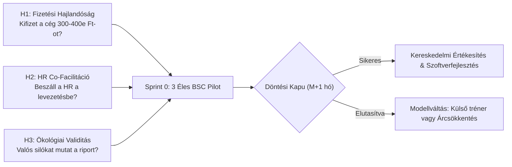
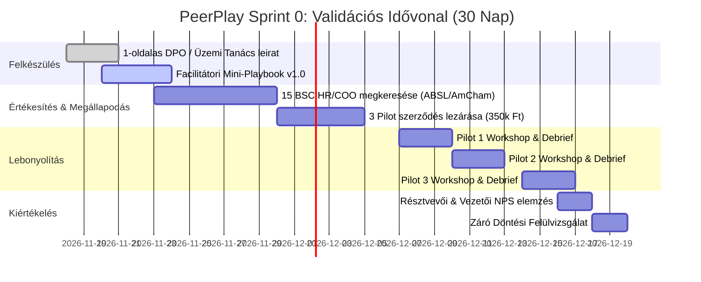

# PeerPlay — Validációs Kísérletterv és Éles Pilot Protokoll (Sprint 0)

> **Cél:** A döntési bizottság által előírt **VALIDATE / PILOT** mandátum végrehajtása: 30 nap alatt, minimális költséggel, valós vásárlási és viselkedési bizonyítékok gyűjtése 3 magyarországi BSC/SSC vállalatnál.

---

## 1. A 3 Validálandó Kritikus Hipotézis

1. **H1 — Fizetési hajlandóság (Commercial Viability):**  
   *Hipotézis:* A célcsoportba tartozó BSC vezetők hajlandók legalább 300 000 – 400 000 Ft + ÁFA bevezető pilot díjat fizetni a 90 perces workshopért és a vezetői ONA riportért.
2. **H2 — HR Co-facilitáció és Megfigyelési Biztonság (Operational Feasibility):**  
   *Hipotézis:* A belső HR-es partnerként bevonható a játék levezetésébe anélkül, hogy a résztvevőkben kémkedési paranoia ébredne vagy szándékosan torzítanák a játékbeli tranzakciókat.
3. **H3 — Diagnosztikai Akcióképesség (Actionable Value):**  
   *Hipotézis:* A workshop utáni 60 perces vezetői debriefen a menedzsment (COO / üzletágvezetők) elismeri, hogy a hálózati térkép a valós hétfő reggeli folyamati elakadásokat tükrözi, és konkrét intézkedési tervet hajlandó rá építeni.

---

## 2. A Kísérlet Részletes Felépítése (The 3-Pilot Experiment Architecture)

### Célcsoport & Belépési Útvonal:
* **3 független szervezet:** 150–500 fős budapesti vagy debreceni Business Service Center (BSC/GBS).
* **Elérési csatorna:** Direkt kapcsolatfelvétel LinkedInen, ABSL Hungary vagy AmCham HR munkacsoporton keresztül.

### Az Ajánlati Csomag (Pilot Offer):
* **Cím:** *„PeerPlay Szervezeti Röntgen — Hibrid Működés & Siló Diagnosztika”*
* **Időtartam:** 90 perc szimuláció + 60 perc vezetői debrief (másnap vagy 48 órán belül).
* **Létszám:** 25–45 fő (keresztfunkcionális csapatok: pl. Pénzügy, IT, Ügyfélszolgálat, HR).
* **Lebonyolítási modell:** **Hibrid Co-Facilitáció:**
  * Az alapító személyesen vezeti a felvezetőt, a játékszabályokat és az ONA riport elemzését.
  * A megbízó cég HR-ese a „Piacfelügyelő / Banki asszisztens” szerepben működik közre a Playbook alapján, felkészülve a későbbi önálló levezetésre.
* **Ár:** 350 000 Ft + ÁFA (a tervezett 500 000 Ft-os alapár 30%-os bevezető kedvezménnyel).

---

## 3. Lépésről Lépésre Forgatókönyv (30 Napos Idővonal)

---

## 4. Konkrét Mérési Metrikák és Adatgyűjtés

A kísérlet során nem anekdotákat, hanem strukturált adatokat rögzítünk:

| Mérési Terület | Mérési Eszköz / Módszer | Célérték (Siker) | Kockázati Küszöb (Kudarc) |
| :--- | :--- | :--- | :--- |
| **Értékesítési Konverzió** | 15 megkeresett BSC döntéshozó tárgyalási rátája | Legalább 3 fizetős pilot aláírva (20%) | <1 fizetős megrendelés |
| **Résztvevői Élmény (UX)** | A játék utáni azonnali 3 kérdéses mobil mikro-kérdőív | **NPS > +50;** >80% szerint élvezetes és tanulságos volt | >25% szerint „kellemetlen vagy megfigyelés jellegű” volt |
| **HR Facilitációs Hajlandóság** | Poszt-pilot strukturált interjú a belső HR-essel | A HR-es **vállalja a következő kör önálló levezetését** | A HR-es kijelenti: *„Ezt egyedül soha nem merném megcsinálni”* |
| **Vezetői Értékpercepció** | A debrief ülés végén a COO/igazgató nyilatkozata | **Megrendeli a 3 hónapos visszamérést** vagy ajánlja másik BSC-nek | *„Szép grafika, de ebből nem tudunk semmit megváltoztatni”* |

---

## 5. Kockázatkezelési és B-Terv (Contingency Plan)

* **Ha a HR nem meri levezetni a játékot:**  
  $\rightarrow$ Átállás a **Boutique Partner Modellre**: a PeerPlay külső független trénereket képez ki, akik 100 000 Ft-os fix napidíjért kimennek levezetni, a cég pedig 600 000 Ft-ot fizet.
* **Ha az Üzemi Tanács / DPO akadékoskodik:**  
  $\rightarrow$ Azonnal átadjuk a kidolgozott **„Zero-PII Compliance Egyoldalast”**, amely igazolja, hogy a WebApp kizárólag véletlenszerű sorszámokat (pl. „Játékos #12”) és összesített csoportos tranzakciókat rögzít, munkavállalói nevet nem tárol.
