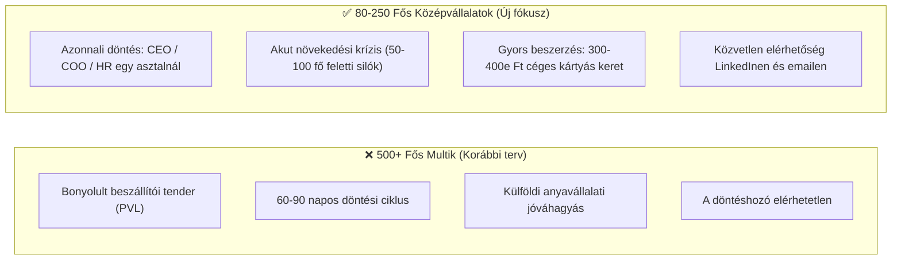
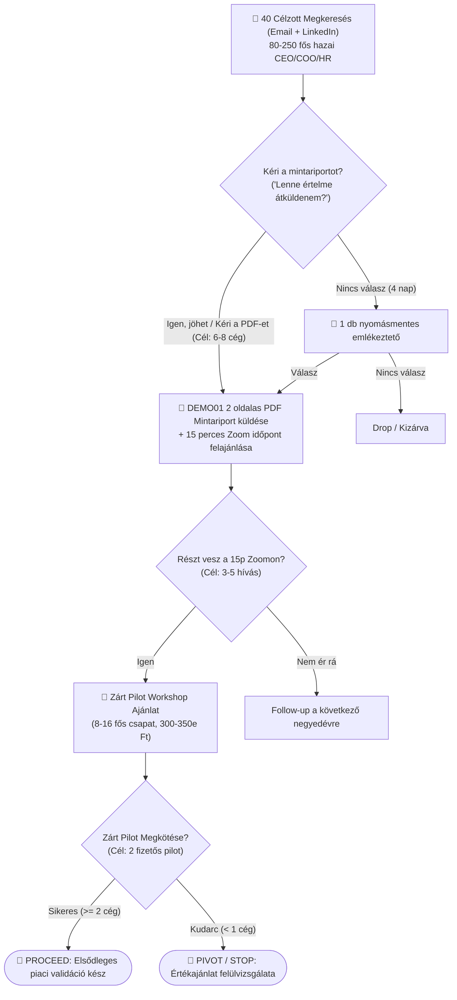

# PeerPlay — Frissített Validációs Kísérletterv (Sprint 0: Mid-Market Outreach)

> **Cél:** A bürokratikus multik (500+ fő) elkerülésével a **80–250 fős hazai növekvő vállalatoknál (Tech, Digitális szolgáltatás, Kereskedelem)** tesztelni a valós piaci reakciót, az elérést és a fizetési hajlandóságot – a már kész **DEMO01 szimulált mintariportra** épülő, alacsony ellenállású hideg megkeresési tölcsérrel.

---

## 1. Miért Váltottunk Fókuszt? (Stratégiai Finomítás)

* **A hitelesség kulcsa kész termék nélkül:** Nem jövőbeli ígéretekkel megyünk a piacra, hanem a `peerplay` projektben már legenerált, vektoros [PeerPlay_Vezetoi_Mintariport_DEMO01.pdf](file:///E:/Data/other_projects/peerplay/public/PeerPlay_Vezetoi_Mintariport_DEMO01.pdf) anyagot mutatjuk meg mint létező esettanulmányt és diagnosztikai végterméket.

---

## 2. A 3 Validálandó Hipotézis (Primary & Economic Focus)

1. **H1 — Vezetői Megnyitási és Reakcióarány (Lead Reach & Resonance):**  
   *Hipotézis:* A 80–250 fős cégek COO-i és HR vezetői legalább **12–15%-os arányban pozitívan reagálnak** az alacsony ellenállású megkeresésre, és kérik a 2 oldalas szimulált mintariportot.
2. **H2 — Mintariport Konverzió & Megbeszélés (Perceived Value):**  
   *Hipotézis:* A mintariportot megtekintő vezetők legalább **30–40%-a (összesen 4–6 cég)** hajlandó egy 15 perces strukturált Zoom hívásra a konkrét pilot megbeszélésére.
3. **H3 — Pilot Fizetési Hajlandóság (Willingness to Pay / Skin-in-the-game):**  
   *Hipotézis:* A hívást követően legalább **2 vállalat aláírja a zárt pilotot** bevezető áron (**300 000 – 350 000 Ft + ÁFA**, vagy garanciális/önköltségi modellben).

---

## 3. Az Értékesítési Tölcsér és Megkeresési Architektúra

Nem „eladni” akarunk az első érintkezéskor, és **nem küldünk naptárlinket (Calendly)**, hanem egyetlen 3 másodperces mikrodöntést kérünk:

---

## 4. Konkrét Megkeresési Sablonok (A PeerPlay Playbook alapján)

### Első Levél (A Micro-Commitment Levél)
> **Tárgy:** Alternatíva a hagyományos csapatépítőkre / [Cégnév]  
> 
> Kedves [Keresztnév]!  
> 
> Látva a [Cégnév] növekedését, a legtöbb 80–200 fős vállalatnál az egyik legnagyobb kihívás, hogy az osztályok (pl. Értékesítés, Fejlesztés, Operáció) közötti kommunikációs silók miatt a feladatátadások lelassulnak, miközben a hagyományos csapatépítők hétfőre semmilyen mérhető változást nem hoznak.  
> 
> Kidolgoztunk egy 90 perces hibrid szimulációs műhelyt („The Trading Game”), amely nem pusztán leköti a csapatot, hanem egy azonnali, objektív szervezeti hálózati térképet (ONA diagnosztikát) ad a menedzsmentnek a rejtett szűk keresztmetszetekről.  
> 
> Nem eladni szeretnék: a következő negyedévre 2 hazai növekvő partnercéget választunk ki zárt pilot programunkba.  
> 
> **Lenne értelme átküldenem egy 2 oldalas, szimulált adatokból készült vezetői mintariportot, hogy lásd, hogyan néz ki egy ilyen diagnózis a valóságban?**  
> 
> Üdvözlettel,  
> [Neved]  
> PeerPlay Vállalati Rendszerek

---

### Második Levél (Amikor kéri a riportot)
> **Tárgy:** Re: Alternatíva a hagyományos csapatépítőkre / Mintariport  
> 
> Kedves [Keresztnév]!  
> 
> Köszönöm a gyors visszajelzést! Csatoltan küldöm a szimulált adatokból generált 2 oldalas vezetői mintariportot ([PeerPlay_Vezetoi_Mintariport_DEMO01.pdf]).  
> 
> Kifejezetten érdemes megnézni a **hálózati térképet a 2. oldalon**:  
> - Tisztán kirajzolódik a két részleg közötti funkcionális siló, és látszik az a 2 kulcsember, aki a hátán viszi a közvetítést.  
> - A pszichometriai panel számszerűsíti a csapat energiamozgását (+1.75 pont a 90 perc alatt).  
> 
> Mivel most véglegesítjük a 2 pilot partnerünket:  
> **Ráérsz a héten csütörtökön 10:00-kor vagy pénteken 14:00-kor egy 15 perces online egyeztetésre?** Megmutatom, hogyan nézne ki ez a gyakorlatban a [Cégnév] egyik 8–16 fős csapatánál.  
> 
> Üdvözlettel,  
> [Neved]

---

## 5. 14 Napos Végrehajtási Menetrend (Sprint 0)

| Nap | Tevékenység | Felelős / Eszköz | Kimenet / Bizonyíték |
| :---: | :--- | :--- | :--- |
| **1–2. nap** | 40 db 80–250 fős hazai cég és döntéshozó (COO/HR/CEO) kigyűjtése | LinkedIn Sales Nav / `peerplay/scripts/b2b_lead_engine.py` | 40 minősített lead a pipeline-ban |
| **3–5. nap** | A 40 megkeresés kiküldése (napi 15–20 db, szigorúan kézbesítési szabályok szerint) | Közvetlen email / LinkedIn | 40 elküldött outreach üzenet |
| **6–9. nap** | Válaszok kezelése, DEMO01 PDF mintariport küldése, 1 db emlékeztető kiküldése a csendeseknek | Email sablon B | Legalább 6–8 kiküldött mintariport |
| **10–13. nap**| 15 perces strukturált Zoom hívások lefolytatása (pilot pitch bemutatása) | Zoom / Google Meet | 3–5 megtartott hívás |
| **14. nap** | **Döntési Kapu (Decision Gate):** Eredmények összesítése a VIS trackerben | Idea Graph Tracker | **PROCEED / PIVOT / STOP döntés** |

---

## 6. Siker- és Hamisítási Kritériumok (Kill Metrics)

| Metrika | ZÖLD LÁMPA (`PROCEED`) | SÁRGA LÁMPA (`TEST FURTHER / PIVOT`) | PIROS LÁMPA (`STOP`) |
| :--- | :--- | :--- | :--- |
| **Mintariport Kérési Arány** | **$\ge$ 15% (legalább 6 cég kéri)** | 8–14% (3–5 cég kéri) | **< 5% (kevesebb mint 2 cég válaszol)** |
| **Hívás Konverzió** | **$\ge$ 3 vezető leül a 15 perces hívásra** | 1–2 vezető ül le | 0 megbeszélés |
| **Zárt Pilot Zárás** | **Legalább 2 cég megrendeli a pilotot** (min. 300e Ft vagy esettanulmányos feltételekkel) | 1 cég komoly szándékot jelez, de átütemezné | **0 cég hajlandó kipróbálni** |

> **A legfontosabb:**  
> Ha a piros lámpa villan fel (nem kérik a mintariportot, vagy a híváson elutasítják az egészet), **az Idea Graph megvéd minket**: azonnal tudjuk, hogy a jelenlegi értékajánlat vagy csomagolás nem működik, anélkül, hogy 1 forint hirdetési pénzt vagy 200 óra kódolást elpazaroltunk volna.
