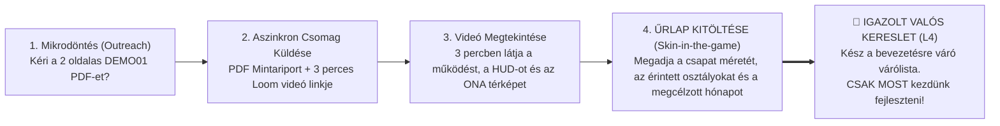
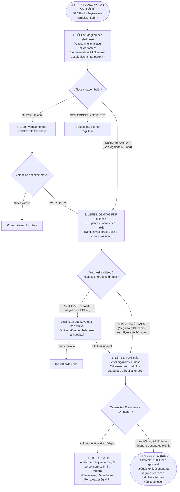

# 🎯 PeerPlay: Master One-Pager, 100% Aszinkron Validáció és Döntési Fa

> **A Rendszer Alapelve:**  
> **1. Alapítói függetlenség & Zéró élőmunka:** Nincs helyszíni workshop-tartás, és **nincs Zoom / Teams / telefonos hívás sem**! A folyamat 100%-ban aszinkron és skálázható.  
> **2. Kockázatmentes Validáció (Pénz és Termék nélkül):** Nem tartunk éles pilotokat, és nem szedünk be előre pénzt. A valódi keresletet azzal mérjük, hogy a vezető a **3 perces Loom videó megnézése után kitölti-e a 3 kérdéses belső csapatadat- és időpont-foglalási űrlapot**.

---

## 1. RÉSZ: HOGYAN MŰKÖDIK A 100% ASZINKRON VALIDÁCIÓ?

A döntéshozók utálják a 15–30 perces értékesítési videóhívásokat. Ehelyett egy tiszteletteljes, önkiszolgáló tölcsért kapnak, ami a vezetőnek kényelmes, neked pedig nulla percedbe kerül:



---

## 2. RÉSZ: STRATÉGIAI MASTER ONE-PAGER

```text
┌─────────────────────────────────────────────────────────────────────────────────────────────────┐
│                                    PEERPLAY STRATÉGIAI ALAPOK                                    │
├────────────────────────────────┬────────────────────────────────┬───────────────────────────────┤
│ 🎯 A PIACI RÉS                 │ 💡 A MEGOLDÁS & POZICIONÁLÁS   │ 🚀 MŰKÖDÉSI MODELL (OPERATIONS│
│ A cégek milliókat költenek     │ 90–120 perces hibrid szimulá-  │ • ZERO ON-SITE & ZERO CALLS:  │
│ csapatépítőkre, de hétfőn a    │ ció ("The Trading Game") +     │   Nincs helyszíni jelenlét,   │
│ silók (Sales vs. Dev vs. Ops)  │ PWA mobil kísérő + azonnali    │   és nincs Zoom/Meet hívás!   │
│ változatlanok. Az enterprise   │ ONA hálózati térkép a rejtett  │ • 100% aszinkron digitális    │
│ szoftverek túl drágák/lassúak. │ szűk keresztmetszetekről.      │   tölcsér (Loom + űrlap).     │
├────────────────────────────────┼────────────────────────────────┼───────────────────────────────┤
│ 🏢 CÉLKÖZÖNSÉG (SWEET SPOT)    │ 🛡️ KOMOLYANVEHETŐSÉG           │ 💰 JÖVŐBELI ÁRKERET (CÉL)     │
│ 80–250 fős hazai növekvő cégek │ NEM ígéreteket adunk el: a     │ • Listaár: 500 000 Ft         │
│ és Scale-upok (Tech, Digitális │ meglévő 2 oldalas, vektoros    │ • Éves előfizetés (2-4 mérés):│
│ szolgáltatás, Kereskedelem).   │ DEMO01 mintariportot mutatjuk  │   1,2M – 2,0M Ft / év         │
│ Döntéshozók: CEO, COO, HR.     │ be + 3 perces videó-walkthrough│ • Bruttó árrés: >90%          │
└────────────────────────────────┴────────────────────────────────┴───────────────────────────────┘
```

---

## 3. RÉSZ: RÉSZLETES ASZINKRON DÖNTÉSI FA (No-Call Decision Tree)



---

## 4. RÉSZ: 14 NAPOS ASZINKRON CHECKLIST

### 🛠️ 0. FÁZIS: Előkészület (1–2. nap) — *Egyszer kell felvenni a videót!*
- [ ] **3 perces Loom / Tella videó felvétele:**
  - *1. perc:* A probléma: miért nem működnek a hagyományos csapatépítők hétfőn (silók).
  - *2. perc:* Képernyőmegosztás: a [DEMO01 PDF](file:///E:/Data/other_projects/peerplay/public/PeerPlay_Vezetoi_Mintariport_DEMO01.pdf) hálózati térképének és a mobil HUD mockupnak a bemutatása.
  - *3. perc:* Call to action: *„Ha szeretnéd, hogy a te csapatodnál is díjmentesen lefuttassuk ezt a zárt pilotban, töltsd ki a videó alatti 3 mezőt.”*
- [ ] **3 kérdéses mini-űrlap létrehozása (Tally / Typeform / Google Forms):**
  1. *Hány fős csapatnál lenne releváns a silók felmérése?* (pl. 10–16 fő)
  2. *Mely részlegek közötti együttműködés a legfontosabb?* (pl. Fejlesztés + Értékesítés)
  3. *Melyik hónapban lenne aktuális a program?* (Választható: Jövő hónap / Következő negyedév)
- [ ] **40 cég kigyűjtése:** 80–250 fős hazai cégek döntéshozói (COO, CEO, HR).

---

### 📤 1. FÁZIS: Megkeresések Kiküldése (3–5. nap)
- [ ] **3. nap:** 15 megkeresés az **1. Számú Sablonnal**.
- [ ] **4. nap:** 15 megkeresés.
- [ ] **5. nap:** 10 megkeresés (összesen 40 db).

**📨 1. Számú Sablon (Közvetlen mikrodöntés):**
> **Tárgy:** Pénzkidobás a csapatépítő? / [Cégnév]  
> *(További alternatívák: „Haszon a csapatépítőből / [Cégnév]”, „Csapatépítés helyett diagnosztika / [Cégnév]”)*  
> 
> Kedves [Keresztnév]!  
> 
> Látva a [Cégnév] növekedését, a legtöbb 80–250 fős vállalatnál az egyik leggyakoribb kihívás, hogy a részlegek (pl. Értékesítés, Fejlesztés, Operáció) közötti információs silók miatt a feladatátadások lelassulnak, miközben a hagyományos csapatépítők hétfőre semmilyen mérhető változást nem hoznak.  
> 
> Kidolgoztunk egy 90 perces hibrid szimulációs műhelyt („The Trading Game”), amely nem pusztán leköti a csapatot, hanem egy azonnali, objektív szervezeti hálózati térképet (ONA diagnosztikát) ad a vezetésnek a rejtett szűk keresztmetszetekről.  
> 
> Nem eladni szeretnék: a következő negyedévre 2 hazai növekvő partnercéget választunk ki zárt pilot programunkba.  
> 
> **Átküldöm a 2 oldalas, szimulált adatokból készült vezetői mintariportot, hogy lásd a gyakorlatban. Mehet?**  
> 
> Üdvözlettel,  
> [Neved]  
> PeerPlay Vállalati Rendszerek

---

### 📑 2. FÁZIS: Aszinkron Csomag Kiküldése (6–9. nap)
*Amikor a vezető visszaír (pl. „Jöhet”, „Küldd át”), azonnal ezt küldjük:*

**📨 2. Számú Sablon (PDF + 3 perces videó linkje):**
> **Tárgy:** Re: Alternatíva a hagyományos csapatépítőkre / Mintariport & 3 perces bemutató  
> 
> Kedves [Keresztnév]!  
> 
> Csatoltan küldöm a szimulált adatokból generált 2 oldalas vezetői mintariportot.  
> 
> Hogy ne raboljam az idődet egy újabb online megbeszéléssel, **készítettem egy 3 perces képernyővideót**, ahol végigvezetem a hálózati térképen és megmutatom, hogyan áll elő ez az objektív diagnózis 90 perc alatt:  
> 🔗 **[3 perces videó megnézése: link a videóhoz és az űrlaphoz]**  
> 
> A videó alatti oldalon közvetlenül be tudod jelölni a csapatodat, ha a következő időszakban nálatok is releváns lehet a zárt pilot teszt.  
> 
> Üdvözlettel,  
> [Neved]

**📨 3. Számú Sablon (Follow-up 4 nap után a csendeseknek):**
> Kedves [Keresztnév]!  
> 
> Tudom, hogy rendkívül sűrűek a napjaid, ezért csak egyetlen mondatban jelentkezem.  
> A héten véglegesítjük a zárt pilot programunk partnerségi körét. Ha releváns lehet a [Cégnév]-nél a belső silók objektív felmérése és egy mérhető csapatprogram, szívesen átküldöm a 2 oldalas mintariportot és a 3 perces összefoglalót.  
> Ha most nem időszerű, természetesen megértem és köszönöm az idődet!  
> 
> Üdvözlettel, [Neved]

---

### ⚖️ 3. FÁZIS: Döntési Kapu & Értékelés (14. nap)
Nem ülsz órákat a gép előtt hívásokra várva. A 14. napon egyszerűen megnyitod az űrlap adatait és az Idea Graph-ot:

- [ ] **Mért számok rögzítése:**
  * Kiküldött megkeresések: `40 db`
  * Mintariportot kérők száma: `___` (Cél: $\ge 6$ cég)
  * Videót megnézők száma (Loom analitika): `___` (Cél: $\ge 4$ cég)
  * **3 kérdéses űrlapot kitöltők száma: `___` (Cél: $\ge 2$ cég)**

- [ ] **A Döntés Meghozatala:**
  * 🟢 **HA $\ge 2$ CÉG KITÖLTÖTTE AZ ŰRLAPOT (Megadva a létszámot és osztályokat):** $\rightarrow$ **`PROCEED TO BUILD`** (A kereslet vitathatatlan. Van 2 valós céged, aki várja a bevezetést. Most már érdemes befejezni az MVP kódolását!).
  * 🔴 **HA SENKI NEM TÖLTÖTTE KI AZ ŰRLAPOT:** $\rightarrow$ **`STOP`** (Az ötlet még díjmentesen sem érdekli a piacot annyira, hogy 3 mezőt kitöltsenek. Nem pazaroltál el egyetlen percet sem felesleges hívásokra vagy kódolásra).
