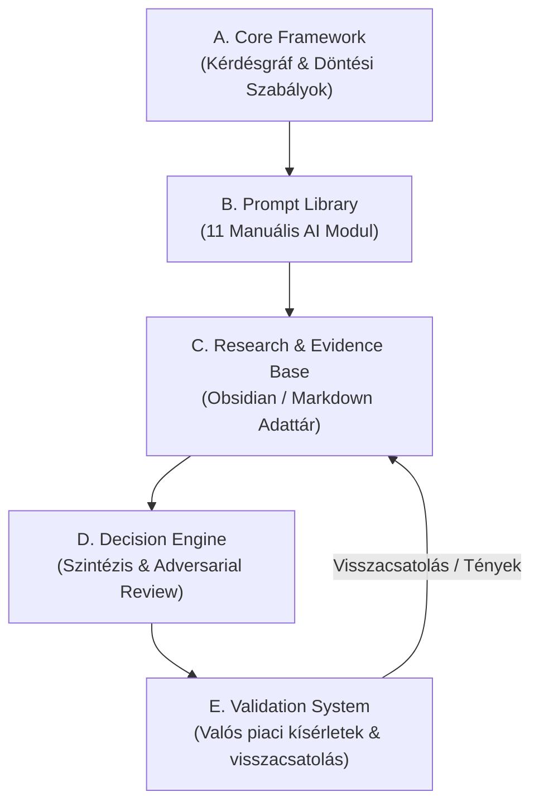
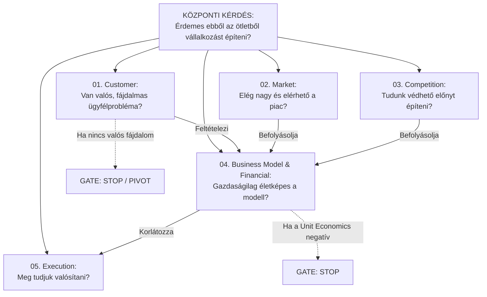
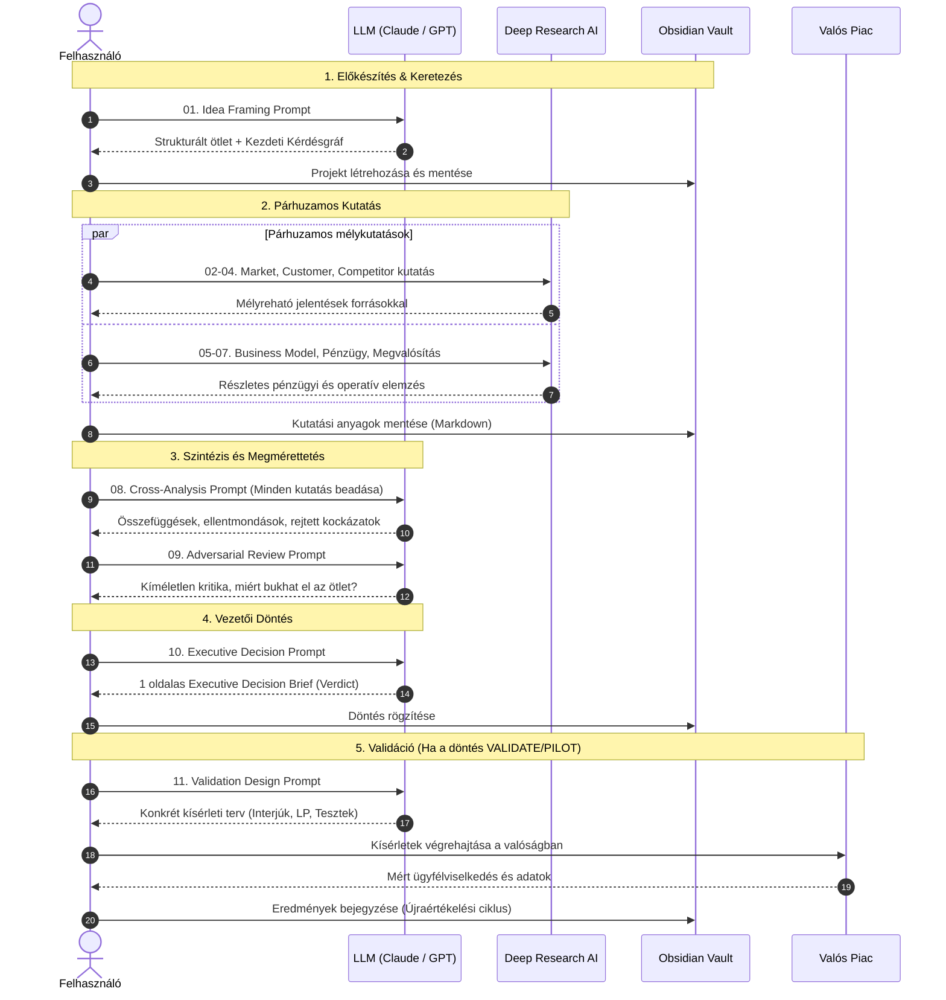
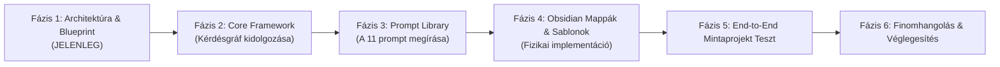

# Venture Intelligence System — System Architecture & Blueprint

> **Verzió:** 1.0 (Tervezet)  
> **Dátum:** 2026-11-17  
> **Státusz:** Fázis 1 — Architektúra & Rendszerterv  
> **Célközönség:** Kezdő és haladó vállalkozásépítők, döntéshozók

---

## 1. Vezetői összefoglaló és a megoldandó probléma

### 1.1. A probléma
A hagyományos üzleti keretrendszerek (pl. Business Model Canvas, Lean Canvas, több tucat oldalas üzleti tervek) két véglet között mozognak:
1. **Túlságosan statikusak és felületesek:** Pár post-it felragasztása nem mutatja meg a tényezők közötti rejtett összefüggéseket vagy a piac mély dinamikáját.
2. **Túlbonyolítottak és lineárisak:** Hosszú, merev számozott kérdéssorok, amelyek rengeteg felesleges kört generálnak, elfedik az ellentmondásokat, és nem konvergálnak egyértelmű döntéssé.

Gyakori hiba továbbá, hogy a feltételezéseket összekeverik a tényekkel, és az alapítók beleszeretnek a saját ötletükbe (hiányzik az ellenséges/kritikai nézőpont).

### 1.2. A cél és a megoldás: Venture Intelligence System (VIS)
A rendszer célja: **Bármilyen üzleti ötletből** strukturált, bizonyítékokon alapuló és azonnal cselekvésre fordítható vezetői döntést előállítani.

A működés alapelve:
$$\text{Comprehensive Research} + \text{Intelligent Synthesis} + \text{Decision Compression}$$

* **Alapos háttérkutatás:** Nem általános jóslatok, hanem célzott források és piaci tények.
* **Intelligens szintézis:** Kérdésgráf-alapú összefüggés- és ellentmondás-vizsgálat.
* **Döntéstömörítés:** 1 oldalas vezetői döntési összefoglaló (Executive Decision Brief).

---

## 2. A rendszer 5 fő komponense

A rendszer moduláris, de szorosan összekapcsolódó elemekből áll:



1. **Core Framework (A rendszer agya):** Tartalmazza a kérdésgráfot, a vizsgálati dimenziókat, a függőségeket és a döntési kapukat.
2. **Prompt Library (Eszköztár):** 11 dedikált, külön futtatható prompt sablon. Nem autonóm ágensek, hanem a felhasználó által célzottan indított AI-beszélgetések.
3. **Research & Evidence Base (Tudásbázis):** Obsidian mappastruktúrára és tiszta Markdown fájlokra épülő adattár, ahol minden állítás bizonyítottsági szinttel van ellátva.
4. **Decision Engine (Döntési motor):** LLM-alapú keresztelemzés és kritikai (adversarial) felülvizsgálat, amely egyetlen tömör vezetői döntési kivonatot (Executive Decision Brief) formál.
5. **Validation System (Validációs motor):** Nem elméleti vizsgálat; valós ügyfélkísérletek (interjúk, landing page, előrendelések, fizetős pilotok) tervezése és kiértékelése.

---

## 3. A 6 fő vizsgálati dimenzió

Minden üzleti ötletet hat egymással összefüggő területen keresztül vizsgálunk. Mindegyik élén egy kardinális főkérdés áll:

| Dimenzió | Központi kérdés | Fő módszertanok / Eszközök |
| :--- | :--- | :--- |
| **01. Market Intelligence** | *Van-e elég nagy, növekvő és elérhető piac ehhez az ötlethez?* | TAM / SAM / SOM, PESTEL, Piaci szegmentáció, Iparági dinamika |
| **02. Customer Intelligence** | *Létezik-e valós, fájdalmas, sürgető és monetizálható ügyfélprobléma?* | Jobs-to-be-Done (JTBD), Customer Discovery, Value Proposition Canvas |
| **03. Competitive Intelligence**| *Rendelkezünk-e fenntartható, másolásbiztos versenyelőnnyel vagy valódi differenciációval?* | Porter 5 erő, Blue Ocean, Pozicionálási térkép, Helyettesítő termékek |
| **04. Business Model** | *Hogyan hoz létre, juttat el és realizál értéket a vállalkozás fenntarthatóan?* | Business Model Canvas, Lean Canvas, Értékesítési csatornák |
| **05. Financial Intelligence** | *Működhet-e gazdaságilag nyereségesen és fenntarthatóan a modell?* | Unit Economics (CAC, LTV, Churn), Fedezeti pont (Break-even), Megtérülés |
| **06. Execution Intelligence** | *Képesek vagyunk-e megvalósítani és skálázni az ötletet a valós korlátok között?* | Megvalósíthatóság (Feasibility), Csapat/Erőforrás-képességek, Jogi/Szabályozási kockázatok |

---

## 4. A kérdésgráf architektúrája

A rendszer nem lineáris kérdéssor, hanem egy hálózatos gráf.

### 4.1. Kapcsolattípusok a gráfban
* **Függőség (Dependency):** Az A kérdés megválaszolása előfeltétele a B kérdés vizsgálatának (pl. ha nincs probléma, felesleges árazást kutatni).
* **Befolyásolás (Influence):** Az egyik tényező közvetlenül módosítja a másikat (pl. ha alacsony a hajlandóság a fizetésre, a CAC megtérülési ideje megnő).
* **Ellentmondás (Contradiction):** Két kutatási eredmény üti egymást (pl. a piac mérete hatalmasnak tűnik, de a vevők szerint a jelenlegi ingyenes alternatívák tökéletesen elégségesek).
* **Visszacsatolási hurok (Feedback Loop):** Egy későbbi kísérlet (pl. landing page konverzió) felülírja a korábbi elméleti feltételezést.
* **Döntési kapu (Decision Gate):** Olyan ellenőrző pont, ahol STOP vagy PIVOT döntés születhet.

### 4.2. A központi kérdésgráf vázlata (Mermaid)



---

## 5. Az Evidencia Protokoll (Evidence Protocol)

A rendszer egyik legfontosabb védelmi vonala a hallucinációk és a túlzott optimizmus ellen. Minden rögzített megállapításnak kötelezően rendelkeznie kell egy státusszal:

1. **Ellenőrzött tény (Verified Fact):** Hivatalos cégadatok, közvetlen mérések, hiteles statisztikák, ellenőrzött forráshivatkozással.
2. **Alátámasztott állítás (Supported Claim):** Iparági jelentésekből, másodlagos forrásokból származó megállapítások, ahol a forrás ismert, de közvetlenül nem auditáltuk.
3. **Becslés (Estimate):** Számításokon, analógiákon vagy logikai levezetéseken alapuló adat (pl. bottom-up TAM kalkuláció).
4. **Feltételezés (Assumption):** Logikusnak tűnő, de bizonyíték nélküli állítás (minden validáció ezek tesztelésére irányul).
5. **Ismeretlen (Unknown):** Információhiány, amit kutatással vagy kísérlettel kell feloldani.

> [!IMPORTANT]
> **Szabály:** Döntést hozni feltételezésekre alapozva tilos. A kritikus feltételezéseket kötelező validációs kísérlet alá vonni.

---

## 6. A manuális AI-Workflow (A folyamat lépésről lépésre)

A rendszer szándékosan **nem használ autonóm multi-agent rendszereket**. A vezérlés a felhasználó kezében van, aki önálló generatív AI felületeket (ChatGPT Deep Research, Claude, Gemini Pro) használ.



---

## 7. A döntési motor kimenetei

A rendszer végén az AI nem pontszámot ad, hanem egy egyértelmű **Döntési Állapotot**:

* **STOP:** Végzetes hiba, nem létező igény vagy tarthatatlan gazdasági modell miatt a projektet le kell állítani.
* **RESEARCH:** Túl sok a kritikus ismeretlen adat; további asztali vagy piaci adatgyűjtés szükséges.
* **VALIDATE:** A koncepció ígéretes, de a kritikus feltételezéseket valós ügyfélviselkedéssel (interjú, landing page) tesztelni kell.
* **PILOT:** Az alapok igazoltak; korlátozott, valós fizetős tesztkör indítása indokolt.
* **BUILD:** A pilot sikeres volt; a termék/szolgáltatás formális fejlesztése megkezdhető.
* **SCALE:** Az üzleti modell bizonyított; a növekedési csatornák skálázhatók.

A végső dokumentum a maximum 1 oldalas **Executive Decision Brief**, melynek kötelező elemei:
1. Vezetői ítélet (3 mondatos összefoglaló).
2. Lehetőség vonzereje vs. Bizonyítottság szintje.
3. Top 3 Erősség és Top 3 Kockázat.
4. Kritikus Ismeretlen (Critical Unknown).
5. Döntési állapot és indoklás.
6. A következő legfontosabb kísérlet (Next-best experiment) és sikerkritériumai.

---

## 8. Technológiai megvalósítás: Obsidian & Markdown

A rendszerhez nem fejlesztünk egyedi szoftvert, mert a cél a transzparencia, a tartósság és a helyi adathozzáférés:
* **Tiszta Markdown (.md):** Jövőbiztos, szabványos, platformfüggetlen formátum.
* **YAML Frontmatter:** Géppel és emberrel is olvasható strukturált metaadatok (státusz, bizonyossági szint, dátumok).
* **Obsidian Wikilinkek (`[[...]]`):** A kérdésgráf természetes leképezése fájlok közötti linkekkel.
* **Mermaid diagramok:** Kódként szerkeszthető vizuális folyamatábrák és kapcsolati hálók közvetlen renderelése.

### Javasolt Obsidian struktúra:
```text
idea_graph/
├── 00-System/                  # A keretrendszer törzselemei
│   ├── Master-Framework.md
│   ├── Question-Graph.md
│   ├── Decision-Rules.md
│   └── Evidence-Protocol.md
├── 01-Prompt-Library/          # A 11 szabványosított prompt
│   ├── 01-Idea-Framing.md
│   ├── 02-Market-Research.md
│   ├── ...
│   └── 11-Validation-Design.md
└── 02-Ventures/                # Az értékelt üzleti projektek
    └── [Projekt-Neve]/
        ├── 00-Opportunity.md
        ├── 01-Question-Graph.md
        ├── Research/
        ├── 03-Cross-Analysis.md
        ├── 04-Adversarial-Review.md
        ├── 05-Executive-Decision.md
        └── 06-Validation-Plan.md
```

---

## 9. Teljes megvalósítási ütemterv (Roadmap)



---

## 10. Nyitott tervezési kérdések (Megbeszélésre a Fázis 2 előtt)

Mielőtt továbblépnénk a **Core Framework (Kérdésgráf)** részletes kidolgozására, érdemes tisztázni:
1. **Mintaprojekt kiválasztása:** Van-e konkrét üzleti ötleted a fejedben, amit tesztként végigvihetnénk a folyamaton (pl. egy SaaS, egy helyi szolgáltatás, vagy egy e-commerce ötlet), vagy egy fiktív példán (pl. "B2B AI építőipari dokumentáció-kezelő") demonstráljuk a rendszert?
2. **Kérdésgráf granularitása:** Mennyire legyen részletes a törzs kérdésgráf? (Kezdésként 15–20 kulcskérdés elegendő-e, vagy menjünk le azonnal 40–50 mikrokérdés szintjére?)

---

## 11. Konkrét következő lépés

Amennyiben ezt az Architektúra Blueprintet jóváhagyod, a következő lépés a **Fázis 2: Core Framework** elkészítése lesz:
* Létrehozzuk a `00-System/` mappát.
* Kidolgozzuk a részletes, univerzális kérdésgráfot alkérdésekkel, függőségekkel és döntési kapukkal (`00-System/Question-Graph.md`).
